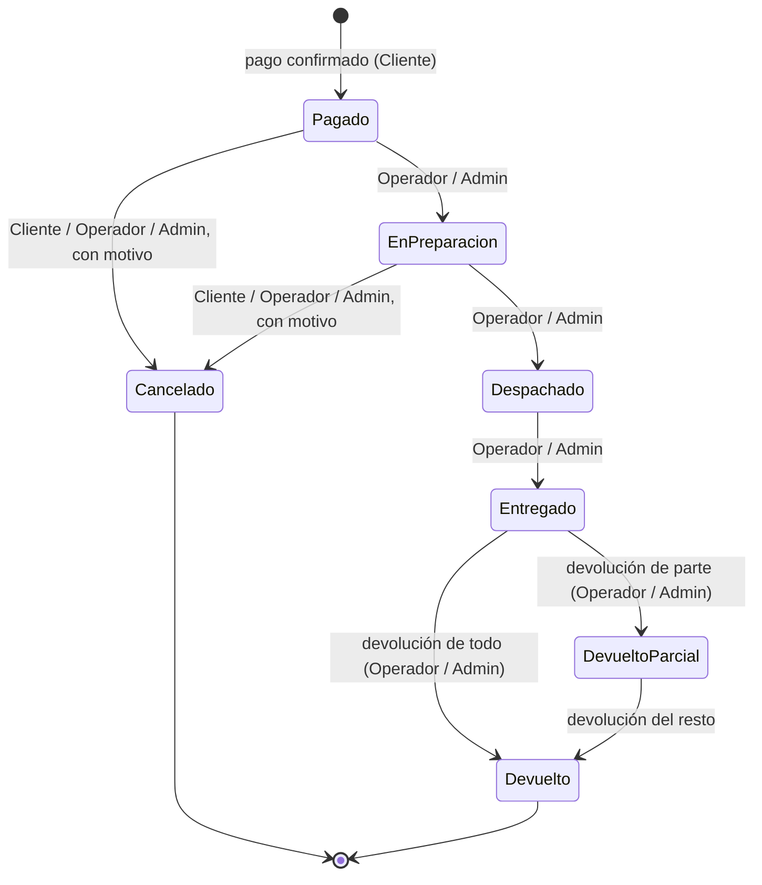
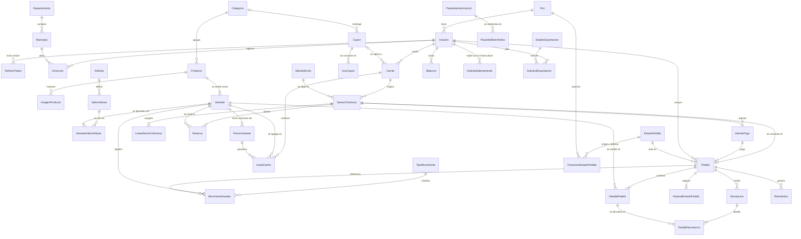

# ShopCart

Tienda en línea de una cadena guatemalteca de ropa, calzado y accesorios: catálogo con variantes, carrito de invitado y de cliente, cupones, checkout con pasarela de pago simulada, pedidos con ciclo de vida, inventario con kardex, devoluciones, bitácora y dashboard.

**Fase 1 (esta entrega):** backend completo (Express 5 + TypeScript + SQL Server 2022) con dos réplicas detrás de nginx. El frontend es la Fase 2.

| Documento                                                        | Contenido                                                                            |
| ---------------------------------------------------------------- | ------------------------------------------------------------------------------------ |
| [docs/enunciado-shopcart.md](docs/enunciado-shopcart.md)         | El enunciado oficial del reto                                                        |
| [docs/00-vision-y-contexto.md](docs/00-vision-y-contexto.md)     | Decisiones de negocio (`N-xx`), no funcionales (`RNF-xx`) y generales (`D-xx`)       |
| [docs/01-arquitectura.md](docs/01-arquitectura.md)               | Arquitectura (`A-xx`), flujos críticos, errores y API                                |
| [docs/02-modelo-datos.md](docs/02-modelo-datos.md)               | Tablas, constraints, índices, SPs, vistas, funciones y códigos de error (`M-xx`)     |
| [docs/03-backlog.md](docs/03-backlog.md)                         | Historias, criterios de aceptación y tablero                                         |
| [docs/04-verificacion-fase-1.md](docs/04-verificacion-fase-1.md) | Checklist de penalizaciones y la prueba que demuestra cada criterio de RF-01 a RF-09 |

---

## 1. Instalación desde cero

### Requisitos

- **Docker Desktop** (en Windows, con el backend de WSL2) con **Compose v2** (el comando `docker compose`, no el antiguo `docker-compose`), y **Git**. Probado con Docker Engine 27.0 y Compose 2.28.
- Para correr las pruebas desde el host: **Node.js 24 LTS** y **pnpm 10** (`corepack enable` lo activa).
- **Memoria:** mínimo **4 GB asignados a Docker** (SQL Server exige 2 GB y no arranca con menos). Uso medido con el entorno en reposo: ~1.9 GB (SQL Server 1.7 GB, cada réplica de la API ~90 MB, Redis y nginx ~10 MB cada uno). Para construir las imágenes y correr las pruebas a la vez hace falta más margen (en Windows, la recomendación para WSL2 de abajo).
- **Disco:** unos 3 GB para las imágenes (SQL Server ocupa 1.7 GB) más la base.
- **Mac con Apple Silicon (M1 o posterior):** la imagen de SQL Server solo existe para `amd64`. En Docker Desktop, activa **Settings → General → "Use Rosetta for x86_64/amd64 emulation on Apple Silicon"** antes del primer `docker compose up`. Sin Rosetta, SQL Server se cae al arrancar. Con la emulación, el primer arranque y las consultas son más lentos que en una máquina x86.

**Memoria para WSL2 (Windows).** SQL Server queda limitado a 2 GB, pero el entorno completo (SQL Server, Redis, dos réplicas de la API y nginx) necesita margen. Se recomienda asignar **10 GB** a WSL2 en `%UserProfile%\.wslconfig`, y después ejecutar `wsl --shutdown` y volver a abrir Docker Desktop:

```ini
[wsl2]
memory=10GB
```

### Levantar el entorno

Bash (Linux, macOS, Git Bash):

```bash
git clone <url-del-repositorio> shopcart && cd shopcart
cp .env.example .env              # los valores de ejemplo funcionan en local; cámbialos fuera de tu máquina
docker compose up -d              # SQL Server, Redis, migrador, api-1, api-2 y nginx
docker compose ps                 # todo "healthy"; db-migrator "Exited (0)"
```

PowerShell (Windows):

```powershell
git clone <url-del-repositorio> shopcart; cd shopcart
Copy-Item .env.example .env       # los valores de ejemplo funcionan en local; cámbialos fuera de tu máquina
docker compose up -d              # SQL Server, Redis, migrador, api-1, api-2 y nginx
docker compose ps                 # todo "healthy"; db-migrator "Exited (0)"
```

El primer arranque descarga las imágenes y construye la API y la web. El migrador crea la base y los logins, y aplica todos los scripts de `database/`, incluidos los datos demo. Cuando termina, las réplicas quedan `healthy`.

- **Con las imágenes base ya descargadas:** unos **2 minutos** desde un clon nuevo, construcción incluida (medido en dos ensayos: 92 s y 118 s).
- **La primera vez en una máquina:** se suman unos 2 GB de descarga (SQL Server, Node, nginx y Redis); con 50 Mbps son unos 5 minutos más.

| URL                                           | Qué es                                                |
| --------------------------------------------- | ----------------------------------------------------- |
| <http://localhost:8080/api/docs>              | Swagger (OpenAPI 3.1 generado desde los esquemas Zod) |
| <http://localhost:8080/api/v1/health>         | Estado de la réplica, de SQL Server y de Redis        |
| <http://localhost:8080/api/docs/openapi.json> | El documento OpenAPI                                  |

> En Windows, `localhost` se resuelve primero a IPv6 (`::1`) y nginx escucha en `127.0.0.1`: cada petición de un script paga unos 200 ms de reintento. Para medir tiempos, usa `http://127.0.0.1:8080` (la API responde en menos de 20 ms).

Para empezar de cero (borra la base): `docker compose down -v && docker compose up -d`.

Redis corre con el usuario `redis`, no como root. Un entorno levantado antes de ese cambio puede tener en `/data` un `dump.rdb` de root que impide arrancar a Redis. Se recrea sin perder nada importante, porque Redis solo guarda lo que se puede perder: `docker compose rm -sfv redis && docker compose up -d redis`.

### Variables de entorno

Cada valor tiene una sola fuente en `.env`: Compose, el migrador y la API leen las mismas variables (`.env.example` documenta cada una). `.env` está en `.gitignore`: el repositorio no tiene credenciales reales.

### Observabilidad (opcional): trazas, métricas y logs

Un solo comando levanta Grafana LGTM (Tempo, Loki, Prometheus y Grafana) junto al resto:

```bash
docker compose --profile observabilidad up -d
```

Grafana queda en <http://localhost:3001> (`GRAFANA_PUERTO`), solo en `127.0.0.1`, con el dashboard **ShopCart** ya aprovisionado. No hace falta reiniciar la API: las réplicas siempre exportan al colector y, mientras no está, lo registran una sola vez y funcionan igual. Para apagarlo: `docker compose --profile observabilidad stop otel-lgtm`. La imagen ocupa ~1 GB y unos 700 MB de RAM.

**Puertos del host.** Si alguno está ocupado, cámbialo en `.env` y vuelve a levantar con `docker compose up -d`:

| Puerto | Servicio                                      | Variable en `.env` | Publicado en                     |
| ------ | --------------------------------------------- | ------------------ | -------------------------------- |
| 8080   | nginx: la tienda, la API y Swagger            | `WEB_PUERTO`       | `WEB_IP` (por defecto 127.0.0.1) |
| 1433   | SQL Server (SSMS y las pruebas)               | `DB_PORT`          | 127.0.0.1                        |
| 6379   | Redis (las pruebas)                           | `REDIS_PORT`       | 127.0.0.1                        |
| 3000   | La API (solo dentro de la red Docker)         | `PUERTO`           | no se publica                    |
| 3001   | Grafana (solo con el perfil `observabilidad`) | `GRAFANA_PUERTO`   | 127.0.0.1                        |

Con otro `WEB_PUERTO`, las URLs pasan a `http://localhost:<WEB_PUERTO>`, y las pruebas de entorno y de concurrencia la leen de `SHOPCART_URL`. `DB_PORT` y `REDIS_PORT` cambian el puerto dentro y fuera del contenedor a la vez, y la API y el migrador leen las mismas variables.

SQL Server y Redis solo se publican en `127.0.0.1` (accesibles desde tu máquina para SSMS o las pruebas, no desde la red). nginx se publica en `WEB_IP` (por defecto `127.0.0.1`). Los contenedores viven en una subred fija (`RED_PREFIJO`, por defecto `172.28.10`) con una IP por servicio; si choca con otra red de tu máquina, cámbiala y vuelve a levantar.

> **Licencia de SQL Server:** el entorno usa la edición **Developer** (`MSSQL_PID=Developer`), gratuita para desarrollo y pruebas pero **no licenciada para producción**.

**Actualizar las imágenes (a propósito).** Todas las imágenes que vienen de un registro están fijadas a una versión exacta y al digest del contenido que pasó todas las suites, así un `docker compose pull` o un build no cambian nada por su cuenta. `penalizaciones.test.ts` falla si una pierde la versión exacta o el digest.

| Imagen       | Dónde                                                                | Fijada a                                    |
| ------------ | -------------------------------------------------------------------- | ------------------------------------------- |
| SQL Server   | `docker-compose.yml` (`sqlserver`)                                   | `2022-CU27-GDR1-ubuntu-22.04` (16.0.4305.5) |
| Redis        | `docker-compose.yml` (`redis`)                                       | `7.4.12-alpine3.21`                         |
| Grafana LGTM | `docker-compose.yml` (`otel-lgtm`)                                   | `0.36.0`                                    |
| Node         | `apps/api/Dockerfile` y `database/migrator/Dockerfile` (cada `FROM`) | `24.22.2-alpine3.24`                        |
| nginx        | `apps/web/Dockerfile`                                                | `1.28.3-alpine3.23`                         |

Para pasar a otra versión:

1. Elige la etiqueta exacta (por ejemplo `node:24.23.0-alpine3.24`; para SQL Server, en <https://mcr.microsoft.com/v2/mssql/server/tags/list>) y obtén su digest: `docker buildx imagetools inspect <imagen>:<etiqueta>` (línea `Digest:`).
2. Reemplaza la etiqueta y el `@sha256:…` en todos los lugares de la tabla donde aparece (Node está en cuatro `FROM`).
3. Corre `docker compose up -d --build` (la base sigue en su volumen), `pnpm test:integracion`, `pnpm test:concurrencia` y `pnpm test:entorno`, y haz el commit solo con todo en verde.

---

## 2. Credenciales de prueba

| Correo                                                      | Contraseña          | Rol                                                             |
| ----------------------------------------------------------- | ------------------- | --------------------------------------------------------------- |
| `admin@shopcart.gt`                                         | `Admin2026!`        | Administrador                                                   |
| `operador@shopcart.gt`                                      | `Operador2026!`     | Operador                                                        |
| `cliente@shopcart.gt`                                       | `Cliente2026!`      | Cliente                                                         |
| `cliente2@shopcart.gt`                                      | `Cliente2026!`      | Cliente (para demostrar que un cliente no ve los datos de otro) |
| `demo001@shopcart.gt` … `demo200@shopcart.gt`               | `Demo2026!`         | Clientes de los datos demo, con pedidos                         |
| `concurrencia01@shopcart.gt` … `concurrencia20@shopcart.gt` | `Concurrencia2026!` | Clientes de `pnpm test:concurrencia`                            |

**Tarjetas de la pasarela simulada** (cualquier CVV de 3 dígitos y una fecha de vencimiento futura):

| Número                | Resultado                                                                                                                                                          |
| --------------------- | ------------------------------------------------------------------------------------------------------------------------------------------------------------------ |
| `4242424242424242`    | Aprobada                                                                                                                                                           |
| `4000000000000002`    | Rechazada: `402 PAGO_RECHAZADO` (fondos insuficientes), con los intentos restantes                                                                                 |
| `4000000000000119`    | La pasarela autoriza, pero la respuesta "se pierde": `504 PAGO_SIN_CONFIRMAR`. Reintentar con la **misma** `Idempotency-Key` confirma el pago sin cobrar dos veces |
| Una fecha vencida     | `400 VALIDACION_FALLIDA`                                                                                                                                           |
| Cualquier otro número | Rechazada: `402 PAGO_RECHAZADO` (la tarjeta no es válida)                                                                                                          |

**Cupones demo**, uno por cada mensaje de rechazo de RF-05: `DEMO10` (vigente, 10 %), `DEMOVENCIDO`, `DEMOFUTURO`, `DEMOINACTIVO`, `DEMOAGOTADO`, `DEMOUNAVEZ` (ya usado por `cliente@shopcart.gt`), `DEMOMINIMO` y `DEMOCATEGORIA`.

**Datos demo.** Las semillas cargan los catálogos fijos, los 22 departamentos y 340 municipios de Guatemala, un catálogo de 61 productos y 244 variantes (imágenes en `apps/web/public/static/productos/`) y, con `S006`, unos 200 clientes con 1,500 pedidos en los últimos 90 días (cancelaciones y devoluciones incluidas) y carritos abandonados: el dashboard tiene datos desde el primer arranque. La variante `DEMO-CONCURRENCIA` es la única con una sola unidad, para la demo de compra simultánea.

---

## 3. Flujo de compra en Swagger, paso a paso

Abre <http://localhost:8080/api/docs>. En cada paso: **Try it out** → completa → **Execute**.

1. **Crear la cuenta.** `POST /api/v1/auth/registro`:
   ```json
   { "correo": "ana@ejemplo.gt", "contrasena": "Ensayo2026!", "nombre": "Ana Pérez" }
   ```
   Responde `201` con `datos.accessToken`. Cópialo, pulsa **Authorize** (arriba a la derecha), pégalo en `bearer` y pulsa **Authorize**. (Con una cuenta existente, `POST /api/v1/auth/login` con `correo` y `contrasena`).
2. **Elegir un producto.** `GET /api/v1/productos` → toma un `idProducto`. `GET /api/v1/productos/{id}` → toma el `idVariante` de una variante con `estadoExistencia` distinto de `Agotado`.
3. **Agregarlo al carrito.** `POST /api/v1/carrito/lineas` con `{ "idVariante": 14, "cantidad": 1 }`. Opcional: `PUT /api/v1/carrito/cupon` con `{ "codigo": "DEMO10" }`, o con `DEMOVENCIDO` para ver un rechazo.
4. **Método de envío.** `GET /api/v1/envios/metodos` → `datos.metodos[].idMetodoEnvio` (1 Estándar, 2 Express) y cuánto falta para el envío gratis.
5. **Dirección.** `GET /api/v1/departamentos` → `GET /api/v1/departamentos/{id}/municipios` → `POST /api/v1/direcciones`:
   ```json
   {
     "nombreRecibe": "Ana Pérez",
     "telefonoRecibe": "55551234",
     "idMunicipio": 1,
     "direccionLinea": "5a avenida 10-20, zona 1"
   }
   ```
   Responde `201` con `datos.idDireccion`.
6. **Iniciar el pago.** `POST /api/v1/checkout/sesion` con `{ "idDireccion": 1, "idMetodoEnvio": 1 }`. Responde `201` con el total congelado, y las unidades quedan reservadas hasta `expiraEn` (15 minutos).
7. **Pagar con la respuesta perdida (4000…0119).** `POST /api/v1/checkout/sesion/pagos`. En `idempotency-key` pon un UUID nuevo (en PowerShell, `[guid]::NewGuid()`; en Bash, `uuidgen`) y **anótalo**:
   ```json
   {
     "numeroTarjeta": "4000000000000119",
     "mesVencimiento": 12,
     "anioVencimiento": 2030,
     "cvv": "123"
   }
   ```
   Responde `504 PAGO_SIN_CONFIRMAR`: la pasarela autorizó, pero la API no recibió la respuesta.
8. **Reintentar con la misma llave.** Pulsa **Execute** otra vez, sin cambiar la `idempotency-key` ni el cuerpo. Responde `201` con el pedido (`SC-…`, estado `Pagado`): la pasarela devolvió la misma autorización, se creó el pedido y se capturó un solo cobro. Un tercer envío con la misma llave responde `200` con el mismo pedido. (Con `4242424242424242` y una llave nueva, el paso 7 responde `201` directamente).
9. **Ver el pedido.** `GET /api/v1/pedidos` y `GET /api/v1/pedidos/{id}`, con el desglose de IVA, la dirección, la tarjeta (solo la marca y los últimos 4 dígitos) y el historial de estados.
10. **Opcional:** `POST /api/v1/pedidos/{id}/cancelar` con `{ "motivo": "Ya no lo necesito" }` → `Cancelado`, la existencia vuelve al kardex y el reembolso queda `Completado`. Inicia sesión como `admin@shopcart.gt` para recorrer `GET /api/v1/dashboard/resumen`, `GET /api/v1/bitacora` o `GET /api/v1/admin/pedidos`.

**Para ver el aislamiento entre clientes (RF-01):** con el token de `cliente2@shopcart.gt`, `GET /api/v1/pedidos/{id}` de un pedido de otro cliente responde `404`, igual que uno inexistente.

### La compra en Grafana (con el perfil `observabilidad`)

1. Levanta el perfil (`docker compose --profile observabilidad up -d`) y haz los pasos 6 a 8. Copia el encabezado `x-request-id` de la respuesta del pago.
2. Abre <http://localhost:3001> → **Explore** → fuente **Tempo** → **TraceQL** y busca `{ span.shopcart.request_id = "<el x-request-id>" }`, o `{ name = "pasarela.autorizar" }` para la más reciente.
3. La traza muestra la petición `POST /api/v1/checkout/sesion/pagos` en la réplica que la atendió (`service.instance.id`: `api-1` o `api-2`), los SPs en orden (`EXECUTE SP_Checkout_RegistrarIntentoPago`, `SP_Pasarela_Autorizar`, `SP_Pedidos_CrearPedido`, `SP_Pasarela_CambiarEstado`…), las operaciones de la pasarela (`pasarela.autorizar`, `pasarela.capturar`) y los comandos de Redis. En el reintento del paso 8, la autorización la devuelve la pasarela sin cobrar dos veces.
4. En cualquier span, **Logs for this span** abre en Loki las líneas de esa petición (las del pino de la réplica, con el mismo `trace_id`).
5. **Dashboards → ShopCart:** latencia y errores por endpoint, peticiones por réplica, pedidos creados, pagos por resultado (`PedidoCreado`, `Repetido`, `PAGO_SIN_CONFIRMAR`…), tareas por resultado (`Omitida` = la otra réplica tenía el bloqueo) y exportaciones pendientes.

### El dashboard en tiempo real (SSE)

Solo el Admin. El token va en el encabezado `Authorization`, nunca en la URL ([A-25](docs/01-arquitectura.md)):

```bash
TOKEN=$(curl -s -X POST http://localhost:8080/api/v1/auth/login -H 'Content-Type: application/json' \
  -d '{"correo":"admin@shopcart.gt","contrasena":"Admin2026!"}' | sed -E 's/.*"accessToken":"([^"]+)".*/\1/')
curl -N -H "Authorization: Bearer $TOKEN" http://localhost:8080/api/v1/admin/reportes/eventos
```

```text
id: ventas3.carritos152
event: versiones
data: {"versiones":{"ventas":3,"carritos":152},"recargar":false}
```

Deja esa terminal abierta y, en otra, agrega algo al carrito o haz una compra (pasos 3 a 8 de §3): llega un evento `cambio` con el dominio y su versión nueva (`{"dominio":"carritos","version":153}`), aunque la petición la atienda la otra réplica. Cada 15 s llega un latido (`: latido`). Con `docker compose stop redis` el stream sigue abierto con sus latidos; con `docker compose start redis` llega otra vez `versiones`, ahora con `"recargar":true`. Con `docker compose stop` de la réplica que atiende el stream (encabezado `X-Instancia` con `curl -i`), el stream se cierra de inmediato (curl termina) y un cliente que reconecta, como el dashboard, cae en la otra réplica. Sin token responde `401`; con el token del Operador, `403`; un cuarto stream del mismo Admin en la misma réplica, `429 CONEXIONES_MAXIMAS`.

---

## 4. Decisiones técnicas

| Decisión                                                                                                                                                                                                                                    | Por qué                                                                                                                     | Detalle                                                                                                 |
| ------------------------------------------------------------------------------------------------------------------------------------------------------------------------------------------------------------------------------------------- | --------------------------------------------------------------------------------------------------------------------------- | ------------------------------------------------------------------------------------------------------- |
| **Monolito modular** (Express 5 + TypeScript strict): `routes → controller → service → repository` por módulo, fronteras verificadas con ESLint                                                                                             | RF-06 exige una transacción que cruza pedidos, inventario y cupones; los microservicios la complicarían sin beneficio       | [A-01](docs/01-arquitectura.md), [A-20](docs/01-arquitectura.md)                                        |
| **Sin SQL en el backend:** el repositorio solo llama a `ejecutarSP` con tipos SQL explícitos; el login de la API solo tiene `EXECUTE`                                                                                                       | Penalización directa del enunciado y defensa contra inyección: ni siquiera un bug puede leer una tabla                      | [A-02](docs/01-arquitectura.md), [A-18](docs/01-arquitectura.md), [02 §5](docs/02-modelo-datos.md)      |
| **La base protege las invariantes:** stock, reservas, límites de cupón, transiciones, devoluciones e idempotencia viven en SPs con `UPDLOCK`, `CHECK` y `UNIQUE`; el servicio orquesta y da mensajes claros                                 | Una regla en el servicio no resiste dos peticiones simultáneas en dos réplicas                                              | [A-02](docs/01-arquitectura.md), [A-05](docs/01-arquitectura.md), [A-13](docs/01-arquitectura.md)       |
| **Dos réplicas stateless detrás de nginx**; los jobs corren en las réplicas con `sp_getapplock`                                                                                                                                             | Escala horizontal y tolerancia a la caída de una réplica; Redis solo guarda lo que se puede perder                          | [RNF-2](docs/00-vision-y-contexto.md), [A-03](docs/01-arquitectura.md), [A-04](docs/01-arquitectura.md) |
| **Pago idempotente con arrendamiento y token de fencing:** `Idempotency-Key` + intento registrado antes de llamar a la pasarela; la pasarela nunca se llama dentro de una transacción                                                       | Doble clic, timeouts y una réplica que muere a mitad del pago terminan en un solo pedido y un solo cobro                    | [N-03](docs/00-vision-y-contexto.md), [01 §6.2](docs/01-arquitectura.md)                                |
| **Pasarela simulada como adaptador** del puerto `PasarelaPago`, con estado propio en SQL Server                                                                                                                                             | Una pasarela real sería otro adaptador sin tocar el checkout; idempotente aunque el reintento caiga en la otra réplica      | [N-03](docs/00-vision-y-contexto.md)                                                                    |
| **Tablas ledger append-only** (`Bitacora`, `MovimientoKardex`, `HistorialEstadoPedido`)                                                                                                                                                     | El motor rechaza `UPDATE` y `DELETE` incluso a un administrador                                                             | [M-01](docs/02-modelo-datos.md)                                                                         |
| **Migrador propio** `V###` + `R__` + `S###` con checksum                                                                                                                                                                                    | Sin Java en la imagen; un script aplicado no se puede editar en silencio                                                    | [A-09](docs/01-arquitectura.md)                                                                         |
| **Zod para validar y generar OpenAPI**; dinero con `decimal.js` y como texto en JSON (`"149.90"`)                                                                                                                                           | Un solo esquema para validar y documentar; nunca `number` para dinero                                                       | [A-08](docs/01-arquitectura.md), [A-21](docs/01-arquitectura.md)                                        |
| **JWT de 15 min + refresh opaco en cookie httpOnly** con rotación por familia y detección de reúso                                                                                                                                          | Un refresh robado se detecta al reusarse y revoca la familia                                                                | [A-07](docs/01-arquitectura.md)                                                                         |
| **Fechas en UTC + `FechaPagoLocal`** (Guatemala, UTC−6)                                                                                                                                                                                     | Los reportes agrupan por el día local sin `AT TIME ZONE` en cada consulta                                                   | [A-12](docs/01-arquitectura.md)                                                                         |
| **Caché de reportes con invalidación por versión** (Redis, en el servicio): dos versiones, ventas y carritos; cada escritura incrementa, después de su commit, solo la de los dominios que cambia, y cada reporte depende solo de los suyos | Sin borrar claves ni coordinar réplicas; con Redis caído se lee la base                                                     | [A-11 y 01 §9](docs/01-arquitectura.md)                                                                 |
| **Exportación asíncrona a Excel y PDF** con la cola en SQL Server, consumida por las dos réplicas en competencia, y archivos en un volumen compartido                                                                                       | Un reporte grande no bloquea la réplica; la cola no se pierde (RNF-2) y el archivo de una réplica se descarga desde la otra | [A-24](docs/01-arquitectura.md)                                                                         |
| **Dashboard en tiempo real con SSE** y avisos entre réplicas por Redis pub/sub; el token en `Authorization`, nunca en la URL                                                                                                                | El dashboard se entera de un pedido en cualquier réplica sin polling; los eventos solo avisan y el reporte sale de la caché | [A-25](docs/01-arquitectura.md)                                                                         |

### Decisiones abiertas del enunciado

Cada ambigüedad que encontramos en el enunciado, la postura que se tomó y dónde está escrita con su porqué y sus alternativas.

| Ambigüedad                                                 | Postura                                                                                                                          | Detalle                              |
| ---------------------------------------------------------- | -------------------------------------------------------------------------------------------------------------------------------- | ------------------------------------ |
| ¿Cuándo nace el pedido?                                    | Solo cuando el pago se confirma; antes hay carrito y sesión de pago                                                              | [N-01](docs/00-vision-y-contexto.md) |
| ¿Qué precio se cobra si cambia mientras el cliente decide? | El carrito garantiza el precio 3 días; la sesión de pago congela precio y descuento                                              | [N-02](docs/00-vision-y-contexto.md) |
| ¿Cómo se paga?                                             | Pasarela simulada como adaptador de un puerto, idempotente por `Idempotency-Key`; captura inmediata                              | [N-03](docs/00-vision-y-contexto.md) |
| ¿Cuánto cuesta el envío?                                   | Estándar y Express con tarifa fija configurable y envío gratis desde un monto, evaluado después del cupón                        | [N-04](docs/00-vision-y-contexto.md) |
| ¿Puede comprar un invitado?                                | Arma su carrito con un token en cookie httpOnly; para pagar inicia sesión y los carritos se fusionan                             | [N-05](docs/00-vision-y-contexto.md) |
| ¿El carrito aparta existencia?                             | Valida pero no reserva; la sesión de pago reserva 15 minutos, todo o nada                                                        | [N-06](docs/00-vision-y-contexto.md) |
| ¿Cuándo sale el stock?                                     | Al confirmar el pago (es la venta); despachar solo cambia el estado                                                              | [N-07](docs/00-vision-y-contexto.md) |
| ¿Qué estados tiene un pedido?                              | `Pagado → EnPreparacion → Despachado → Entregado`, más `Cancelado`, `DevueltoParcial` y `Devuelto` derivados de lo devuelto (§5) | [N-08](docs/00-vision-y-contexto.md) |
| ¿Quién cancela y hasta cuándo?                             | Cliente u Operador desde `Pagado` o `EnPreparacion`, con motivo; reintegra stock y reembolsa                                     | [N-09](docs/00-vision-y-contexto.md) |
| ¿Cómo son las devoluciones?                                | Las registra el Operador hasta 30 días después de la entrega, por línea; el envío no se reembolsa                                | [N-10](docs/00-vision-y-contexto.md) |
| ¿Qué cuenta como venta?                                    | Pedido no cancelado en su día de pago local, neto de descuento, con IVA y sin envío; las devoluciones restan en su propio día    | [N-11](docs/00-vision-y-contexto.md) |
| ¿Cómo se aplican y limitan los cupones?                    | Vista previa en el carrito, compromiso en la sesión de pago; límites total y por cliente con contadores bajo bloqueo             | [N-12](docs/00-vision-y-contexto.md) |
| ¿Qué es un carrito abandonado?                             | Activo con productos y 24 horas sin cambios (configurable)                                                                       | [N-13](docs/00-vision-y-contexto.md) |
| ¿Se puede borrar un producto vendido?                      | Solo se borra sin historial; con historial, se desactiva                                                                         | [N-14](docs/00-vision-y-contexto.md) |
| ¿Quién crea usuarios y con qué rol?                        | El registro público crea Clientes; el Admin crea Operadores y Admins; un rol por usuario                                         | [N-15](docs/00-vision-y-contexto.md) |
| ¿Hay proveedores o compras?                                | No: el Operador registra entradas con cantidad, motivo y referencia                                                              | [N-16](docs/00-vision-y-contexto.md) |
| ¿Cómo son las direcciones?                                 | Catálogo de departamentos y municipios de Guatemala; varias por cliente, una predeterminada; el pedido las copia                 | [N-17](docs/00-vision-y-contexto.md) |
| ¿Los precios incluyen IVA?                                 | Sí; el desglose se calcula sobre el total del pedido (base = total / 1.12)                                                       | [N-18](docs/00-vision-y-contexto.md) |
| ¿Dónde viven las imágenes?                                 | URLs por producto, varias con orden; las de la semilla se sirven localmente                                                      | [N-19](docs/00-vision-y-contexto.md) |
| ¿Cómo se busca sin distinguir tildes?                      | `LIKE` sobre una columna calculada con `Latin1_General_CI_AI`                                                                    | [A-10](docs/01-arquitectura.md)      |
| ¿En qué zona horaria se agrupan los reportes?              | Fechas en UTC y una columna con el día de Guatemala (UTC−6)                                                                      | [A-12](docs/01-arquitectura.md)      |
| ¿Qué es configurable por el Admin?                         | Una tabla tipada de una sola fila (`ParametroSistema`): garantía de precio, minutos de reserva, envío gratis, horas de abandono  | [A-14](docs/01-arquitectura.md)      |
| ¿Cómo se exporta un reporte grande?                        | Asíncrono, con la cola en SQL Server y el archivo en un volumen compartido por las réplicas                                      | [A-24](docs/01-arquitectura.md)      |

**Fuera de alcance y mejoras.** Lo que se excluyó a propósito, con su porqué:

| Tema                                                           | Postura                                                                                      | Detalle                                                               |
| -------------------------------------------------------------- | -------------------------------------------------------------------------------------------- | --------------------------------------------------------------------- |
| Factura electrónica (FEL de la SAT)                            | Fuera de alcance: el pedido guarda la base y el IVA que la factura necesitaría               | [N-18](docs/00-vision-y-contexto.md)                                  |
| Tarifa de envío por zona                                       | Mejora: hoy la tarifa es fija por método                                                     | [N-04](docs/00-vision-y-contexto.md)                                  |
| Capturar el cobro al despachar                                 | Mejora: hoy autoriza y captura al pagar, y una cancelación reembolsa                         | [N-03](docs/00-vision-y-contexto.md)                                  |
| Pasarela real                                                  | Mejora: otro adaptador del puerto `PasarelaPago`, sin tocar el checkout                      | [N-03](docs/00-vision-y-contexto.md)                                  |
| Límite de compra por cliente                                   | Fuera de alcance: el límite es la existencia disponible                                      | [N-06](docs/00-vision-y-contexto.md)                                  |
| Solicitud de devolución por el cliente, con aprobación         | Mejora: hoy la registra el Operador                                                          | [N-10](docs/00-vision-y-contexto.md)                                  |
| Agregar una dimensión de atributos a un producto con historial | Fuera de alcance: un producto con variantes con historial no cambia su conjunto de atributos | [N-14](docs/00-vision-y-contexto.md)                                  |
| Costo del inventario (costo promedio, valoración)              | Mejora: las entradas no llevan costo                                                         | [N-16](docs/00-vision-y-contexto.md)                                  |
| Recuperación de contraseña por correo                          | Fuera de la Fase 1: requiere SMTP; con sesión iniciada, el usuario cambia la suya            | [N-15](docs/00-vision-y-contexto.md)                                  |
| Correo (aviso de exportación terminada)                        | Fuera de la Fase 1: un puerto `Notificador` con Mailpit; requiere SMTP                       | [N-15](docs/00-vision-y-contexto.md), [A-24](docs/01-arquitectura.md) |
| Kubernetes                                                     | Diferido: el diseño stateless ya lo permite                                                  | [D-04](docs/00-vision-y-contexto.md)                                  |
| Producción                                                     | SQL Server Standard o Enterprise, HTTPS en nginx y secretos en un vault en lugar de `.env`   | §8                                                                    |

**Definiciones de los reportes** (`/api/v1/dashboard/*`, solo Admin). Todos agregan sobre una única definición de venta (`VW_Dashboard_HechosVenta`):

- **Venta:** un pedido no cancelado, contado en su día de pago de Guatemala (`FechaPagoLocal`, UTC−6).
- **Monto de ventas:** productos neto de descuento, con IVA incluido y **sin envío**; el envío se reporta aparte.
- **Devoluciones:** se restan en el día en que ocurren, no en el de la venta, así un periodo ya reportado no cambia; las ventas netas de un día pueden ser negativas.
- **Ticket promedio:** monto neto de ventas / número de pedidos del periodo.
- **Carrito abandonado:** se cuenta en el día de su última actividad, con el monto potencial perdido a precio vigente.
- Sin rango (`desde`, `hasta`), los reportes muestran los últimos 30 días.
- Los reportes salen de una caché de 60 s. Los de ventas se invalidan con cada pedido, cancelación o devolución; los de carritos abandonados, con cada cambio de carrito o de precio, y el resumen con ambos (la lista completa en [01 §9](docs/01-arquitectura.md)).

**Exportar un reporte (Admin).** `POST /api/v1/admin/reportes/{reporte}/exportaciones` con `{ "formato": "xlsx", "filtros": { "desde": "2026-10-01", "hasta": "2026-10-31" } }` (o `"pdf"`) responde `202` con `Location`. `GET /api/v1/admin/exportaciones/{id}` muestra el estado (con `Retry-After` mientras no termina) y, cuando está `Completada`, `GET /api/v1/admin/exportaciones/{id}/archivo` descarga el archivo. Una solicitud igual vigente devuelve la misma; cada Admin puede tener 3 en curso; los archivos vencen a las 24 h.

### Librerías del backend

Cada una con su porqué ([A-16](docs/01-arquitectura.md)); ninguna fuera de esta lista sin aprobación del PO.

| Librería                                     | Para qué                                                                      |
| -------------------------------------------- | ----------------------------------------------------------------------------- |
| `express` 5                                  | HTTP; propaga los errores de los handlers `async` al middleware central       |
| `mssql`                                      | Ejecuta stored procedures con parámetros tipados (nunca texto SQL)            |
| `zod`                                        | Valida toda entrada y es la única fuente de los tipos de entrada              |
| `@asteasolutions/zod-to-openapi`             | Genera el OpenAPI 3.1 desde los mismos esquemas Zod                           |
| `swagger-ui-express`                         | Sirve Swagger en `/api/docs`                                                  |
| `decimal.js`                                 | Dinero sin errores de punto flotante; nunca `number`                          |
| `pino`                                       | Logs JSON con `requestId` e instancia, y redacción de datos sensibles         |
| `helmet`                                     | Encabezados de seguridad HTTP                                                 |
| `cors`                                       | CORS con la lista de orígenes de `.env`, con credenciales                     |
| `argon2`                                     | Hash de contraseñas con argon2id (parámetros de OWASP)                        |
| `jose`                                       | Firma y verificación del JWT con el algoritmo fijado (HS256)                  |
| `ioredis`                                    | Cliente de Redis para la caché, la versión de sesión y el rate limiting       |
| `rate-limiter-flexible`                      | Rate limiting compartido por las réplicas en Redis, con respaldo en memoria   |
| `exceljs`                                    | Excel en modo streaming: escribe fila por fila sin cargar el libro en memoria |
| `pdfmake`                                    | PDF declarativo con las fuentes estándar: sin archivos de fuente en la imagen |
| `vitest`, `supertest`, `@vitest/coverage-v8` | Pruebas unitarias, de integración y de API, y cobertura (solo desarrollo)     |

**OpenTelemetry (E9-H01, RNF-4):** solo paquetes de la familia `@opentelemetry`, en el último conjunto con más de dos semanas al instalarlos:

| Paquete                                                                            | Versión | Para qué                                                                                                                                                                                                |
| ---------------------------------------------------------------------------------- | ------- | ------------------------------------------------------------------------------------------------------------------------------------------------------------------------------------------------------- |
| `@opentelemetry/api`                                                               | 1.9.1   | Spans y métricas propios (no hacen nada sin SDK)                                                                                                                                                        |
| `@opentelemetry/sdk-trace-node`, `sdk-metrics`, `resources`, `core`                | 2.12.0  | SDK de trazas (con el contexto de la petición) y de métricas                                                                                                                                            |
| `@opentelemetry/sdk-logs`, `api-logs`                                              | 0.223.0 | Logs de pino hacia Loki                                                                                                                                                                                 |
| `@opentelemetry/exporter-trace-otlp-http`, `-metrics-otlp-http`, `-logs-otlp-http` | 0.223.0 | Exportan por OTLP/HTTP al colector                                                                                                                                                                      |
| `@opentelemetry/instrumentation`, `instrumentation-http`                           | 0.223.0 | Registro de instrumentaciones; spans y métrica de duración HTTP                                                                                                                                         |
| `@opentelemetry/instrumentation-express`                                           | 0.71.1  | `http.route` en cada petición                                                                                                                                                                           |
| `@opentelemetry/instrumentation-tedious`                                           | 0.42.0  | Un span por SP, con su nombre y sin parámetros                                                                                                                                                          |
| `@opentelemetry/instrumentation-ioredis`                                           | 0.71.0  | Un span por comando de Redis, sin argumentos                                                                                                                                                            |
| `@opentelemetry/instrumentation-pino`                                              | 0.69.0  | `trace_id`/`span_id` en cada línea y envío de logs por OTLP                                                                                                                                             |
| `@opentelemetry/semantic-conventions`                                              | 1.43.0  | Nombres estándar de atributos                                                                                                                                                                           |
| `import-in-the-middle`                                                             | 3.5.3   | Hook de ESM con los hooks síncronos de Node 24, para instrumentar lo que el código ESM importa (fuera de la familia, aprobado por el PO; ya venía como dependencia de `@opentelemetry/instrumentation`) |

No se usa `@opentelemetry/sdk-node`: trae los exportadores gRPC, Zipkin, Jaeger y Prometheus, que no hacen falta.

`pnpm audit` (2026-11-02, también después de agregar OpenTelemetry): ninguna alta ni crítica; 3 moderadas en producción, todas transitivas de `exceljs`: `uuid` (solo con el parámetro `buf`, que exceljs no usa) y `minimatch` vía `archiver` (los patrones no vienen del usuario). Ninguna recibe entrada del usuario.

---

## 5. Diagrama de estados del pedido



Las transiciones viven en la tabla `TransicionEstadoPedido` (por rol) y en el mapa `pedidos.transiciones.ts`. Una prueba compara las dos, y el trigger `TR_Pedidos_ValidarTransicion` rechaza cualquier cambio fuera de la tabla, aunque se escriba directo en la base. Cada cambio queda en `HistorialEstadoPedido` (append-only) con quién, cuándo y el motivo. `DevueltoParcial` y `Devuelto` los deriva solo el SP de devoluciones a partir de lo devuelto.

---

## 6. Diagrama entidad-relación

Vista general de las entidades y sus relaciones. Las columnas, los tipos, las constraints y los índices de cada tabla están en [docs/02-modelo-datos.md](docs/02-modelo-datos.md) (§2 por áreas y §3 tabla por tabla). Los diagramas en imagen, generados desde [docs/diagramas/fuentes/](docs/diagramas/fuentes/):

- [Arquitectura y despliegue](docs/diagramas/arquitectura.svg): réplicas, nginx, SQL Server, Redis, el volumen de exportaciones, las tareas periódicas y los puertos con sus adaptadores.
- Modelo por áreas: [A · usuarios, catálogo e inventario](docs/diagramas/modelo-datos-area-a.svg), [B · carrito, cupones, checkout y pasarela simulada](docs/diagramas/modelo-datos-area-b.svg), [C · pedidos, devoluciones, bitácora, exportaciones y sistema](docs/diagramas/modelo-datos-area-c.svg).



Además: `ParametroSistema` (configuración tipada de una sola fila) y `HistorialMigracion` (los scripts aplicados por el migrador, con su checksum). `PasarelaAutorizacion` y `PasarelaReembolso` son las tablas propias de la pasarela simulada: simulan la base de un sistema externo y no tienen FK hacia el checkout.

**Nomenclatura del enunciado:** `SP_Modulo_Proceso`, `VW_Modulo_Proceso`, `FU_Modulo_Proceso`, PK `IDTabla`; extensión propia `TR_`, `PK_`, `FK_`, `UQ_`, `CK_`, `DF_`, `IX_`, `UX_`. Montos `DECIMAL(12,2)`, porcentajes `DECIMAL(5,2)`, fechas `DATETIME2(3)` en UTC; nunca `FLOAT`, `REAL` ni `MONEY`.

---

## 7. Pruebas

Desde el host, con el entorno levantado (`docker compose up -d`):

```bash
pnpm install             # una vez
pnpm lint && pnpm typecheck
pnpm test                # unitarias: servicios y middlewares con puertos falsos, sin infraestructura
pnpm test:integracion    # contra SQL Server real: recrea la base shopcart_test en cada corrida
pnpm test:concurrencia   # RNF-3: 20 clientes a la vez contra http://localhost:8080 (las dos réplicas)
pnpm test:entorno        # seguridad HTTP, contenedores sin root, RNF-2, apagado ordenado y el dashboard en tiempo real (detiene api-1, una réplica con un stream y Redis, y pausa SQL Server; los levanta al terminar)
pnpm test:cobertura      # unitarias e integración en una sola corrida, un solo reporte (apps/api/coverage/combinada)
```

- **Integración:** `pnpm test:integracion` recrea `shopcart_test` desde cero (las tablas ledger no admiten `DELETE`), aplica todos los scripts y, solo en esa base, los SPs de `database/test/`. Las pruebas no escriben SQL: preparan sus datos con esos `SP_Pruebas_*` y cada una crea datos únicos. Nunca tocan la base `ShopCart` del entorno.
- **Concurrencia:** escenario 1, la última unidad de una variante: 1 pedido y 19 × `409 STOCK_INSUFICIENTE`. Escenario 2, el último uso de un cupón: 1 pedido y 19 × `422 CUPON_AGOTADO`. Verifica además la existencia final, la conciliación de inventario vacía, el contador del cupón y que respondieron las dos réplicas. Crea sus propios datos con la API, así que se puede repetir sin reiniciar nada; como cada corrida inicia sesión una vez por cliente y el login admite 5 intentos por minuto por IP y correo (A-07), no conviene repetirla más de unas 4 veces por minuto. Otra URL con `SHOPCART_URL`.

**Balanceo y tolerancia a fallas (demo):**

```bash
for i in 1 2 3 4; do curl -s -o /dev/null -D - http://127.0.0.1:8080/api/v1/health | grep -i x-instancia; done
# X-Instancia alterna: api-1, api-2, api-1, api-2
docker compose stop api-1         # la tienda sigue respondiendo, todo desde api-2
docker compose start api-1        # nginx la reincorpora sola
```

**Verificar el ledger (M-01).** Con el entorno levantado, `pnpm ledger:verificar` genera el digest del ledger de la base (`sys.sp_generate_database_ledger_digest`), lo agrega a `.ledger/<base>-<fecha de creación>.jsonl` (fuera de la base; git lo ignora) y verifica la bitácora, el kardex y el historial de pedidos con `sys.sp_verify_database_ledger` contra todos los digests guardados. Termina con `Ledger verificado` o con código 1 si algo cambió. Otro directorio: `LEDGER_DIGESTS_DIR`. En producción los digests irían a un almacenamiento inmutable.

**Migraciones.** `db-migrator` aplica `migrations/V###` → `programmability/R__*` → `seeds/S###` y termina. Tras agregar scripts: `docker compose up -d --build db-migrator`. Un `V###` o `S###` aplicado **no se edita**: si cambia, el migrador falla; se crea el siguiente número.

**La API fuera de Docker** (con SQL Server y Redis levantados y la base migrada): `pnpm --filter @shopcart/api build && pnpm --filter @shopcart/api start` → <http://localhost:3000/api/docs>. La API usa timeouts explícitos hacia SQL Server (`DB_TIMEOUT_CONEXION_MS`, por defecto 2000; `DB_TIMEOUT_CONSULTA_MS`, por defecto 15000): con la base caída, el health responde `503` en unos 2 s.

---

## 8. Mejoras documentadas

Lo que queda fuera de la Fase 1, a propósito y con su lugar en el plan ([docs/03-backlog.md](docs/03-backlog.md) §4). Las exclusiones del alcance y las mejoras de producto están en §4, «Fuera de alcance y mejoras».

- **Fase 2 · Frontend:** SPA con Vite + React + TypeScript (tienda, backoffice y dashboard con gráficas), renovación transparente del token y estados de carga, vacío y error.
- **Revisión manual de pagos:** un intento con pedido cuya autorización ya no existe en la pasarela queda `EnRevision` y un reembolso que agota sus 5 intentos queda `Fallido` en la lista del Admin (`GET /api/v1/admin/reembolsos`, con reintento). La Fase 2 les dará pantalla.
- **Carga pesada (F5):** el script `database/load/L001` con el generador de datos demo a 50,000 pedidos. Ya se midió en una base desechable: ningún listado ni reporte pasa de 1 s ([docs/revision/estado-backend.md](docs/revision/estado-backend.md) §7).
- **Producción:** SQL Server Standard o Enterprise en lugar de Developer, HTTPS en nginx y secretos fuera de `.env`.
