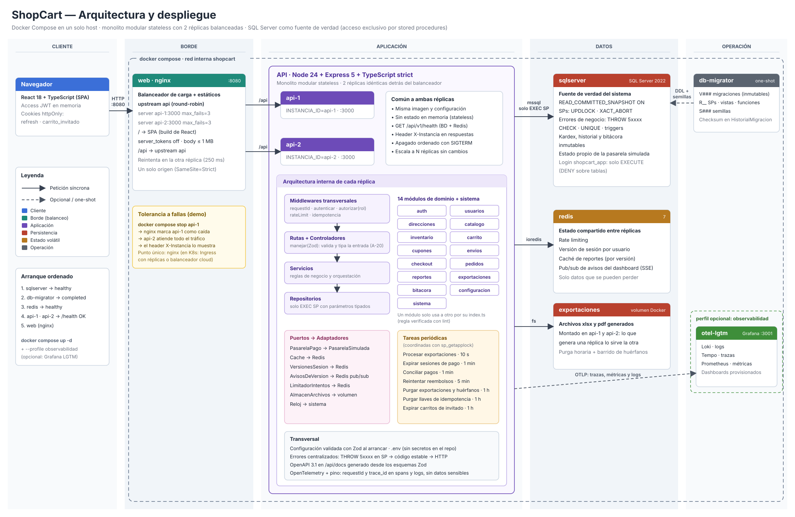

# ShopCart — Arquitectura del sistema

> Etapa 2 del proceso. Se basa en las decisiones confirmadas de [`00-vision-y-contexto.md`](./00-vision-y-contexto.md) (D-xx, RNF-xx, N-xx).
> Las decisiones de arquitectura (`A-xx`) fueron **confirmadas por el PO el 29 oct** (sección 13). A-02, A-04 y A-13 se analizaron en detalle.
> El modelo de datos detallado está en [`02-modelo-datos.md`](./02-modelo-datos.md).

---

## 1. Resumen

ShopCart es un **monolito modular** en Node.js/Express que se despliega como **dos réplicas stateless** detrás de nginx. **SQL Server** es la fuente de verdad, con todo el acceso mediante stored procedures, y **Redis** guarda solo estado que se puede perder. Las reglas críticas (stock, reservas, límites de cupón, transiciones de estado, idempotencia) están protegidas **en la base de datos**. La API orquesta los casos de uso, valida las entradas, habla con la pasarela de pago simulada y emite telemetría con OpenTelemetry.

**Principios que guían todas las decisiones:**

1. **La base de datos protege los invariantes y el servicio orquesta los casos de uso** (A-02).
2. **Si Redis o la observabilidad fallan, el sistema se degrada pero nunca queda inconsistente** (RNF-2, RNF-4).
3. **Nada que el cliente envíe decide a qué datos accede**: la identidad sale del token y cada SP la verifica (RF-01).
4. **Toda operación que mueve dinero o stock es atómica e idempotente** (RF-06, N-03).

---

## 2. Requerimientos (resumen)

| Tipo | Fuente | Puntos clave para el diseño |
|---|---|---|
| Funcionales | RF-01 a RF-09 y N-01 a N-19 | Checkout con reservas de 15 min, precio garantizado 3 días, pedido atómico, ciclo de vida con devoluciones, kardex inmutable, bitácora inmutable |
| Rendimiento | RNF-1 | < 1 s en listados y reportes con la semilla; el diseño asume volumen alto (script de 50k pedidos) |
| Escalabilidad | RNF-2 | API stateless, 2 réplicas, Redis para estado volátil |
| Concurrencia | RNF-3 | 20 checkouts simultáneos sobre la última unidad → exactamente 1 éxito; lo mismo para un cupón con 1 uso |
| Observabilidad | RNF-4 | OpenTelemetry (trazas, métricas y logs) hacia Grafana LGTM en el perfil opcional `observabilidad`; logs JSON con `requestId` y `trace_id`; `/health` (§11) |
| Restricciones | Enunciado | SQL Server 2019+, solo SPs, Express + TS strict, React + TS, 15 días, una persona, Docker Compose en Windows (16 GB) |

---

## 3. Vista de componentes y despliegue



Versión en texto:

```
                          ┌──────────────────────────────────────────────────────────┐
                          │                 Docker Compose (shopcart)                │
                          │                                                          │
  Navegador ──HTTP:8080──►│  ┌──────────────┐   /api/*    ┌─────────┐                │
  (React SPA)             │  │    web       │──round-────►│  api-1  │──┐             │
                          │  │   (nginx)    │   robin     └─────────┘  │  mssql      │
                          │  │ - SPA build  │             ┌─────────┐  ├──────────►┌───────────┐
                          │  │ - /static    │────────────►│  api-2  │──┤  (tedious) │ sqlserver │
                          │  │ - proxy /api │             └─────────┘  │            │   2022    │
                          │  └──────────────┘                  │       │            └─────▲─────┘
                          │                                    │ ioredis              │ one-shot
                          │                              ┌─────▼─────┐   ┌──────────────┴──┐
                          │                              │   redis   │   │   db-migrator   │
                          │                              └───────────┘   │ (scripts .sql)  │
                          │                                              └─────────────────┘
                          │  ── perfil "observabilidad" (opcional) ───────────────────────
                          │   api-1 / api-2 ──OTLP──► ┌─────────────────────────────┐
                          │                           │ otel-lgtm (Grafana :3001,   │
                          │                           │ Loki, Tempo, Prometheus)    │
                          │                           └─────────────────────────────┘
                          └──────────────────────────────────────────────────────────┘
```

| Servicio | Imagen | Rol | Healthcheck | Depende de |
|---|---|---|---|---|
| `sqlserver` | `mcr.microsoft.com/mssql/server:2022-CU27-GDR1-ubuntu-22.04` fijada con su digest | Fuente de verdad | `sqlcmd -Q "SELECT 1"` | — |
| `db-migrator` | Propia (Node + scripts) | Ejecuta los scripts numerados y termina | — (one-shot) | `sqlserver` saludable |
| `redis` | `redis:7.4.12-alpine3.21` fijada con su digest | Rate limiting, versión de sesión por usuario, caché de reportes y el canal pub/sub de avisos del dashboard en tiempo real (A-25) | `redis-cli ping` | — |
| `api-1`, `api-2` | Propia (`apps/api`) | API REST; misma imagen y misma configuración salvo `INSTANCIA_ID` | `GET /api/v1/health` | Migrador completado, `redis` saludable |
| `web` | Propia (nginx + build de `apps/web`) | **Balanceador de carga** (`upstream` round-robin hacia `api-1` y `api-2`, con `max_fails=3 fail_timeout=10s`) y servidor de la SPA y `/static` | `GET /` | `api-1`, `api-2` |
| `otel-lgtm` | `grafana/otel-lgtm:0.36.0` fijada con su digest | Colector OTLP, Tempo, Loki, Prometheus y Grafana (`127.0.0.1:${GRAFANA_PUERTO}`, 3001) | Propio de la imagen | Perfil `observabilidad` (E9-H01) |

**Notas de despliegue:**

- **Un solo origen** (`http://localhost:8080`): la SPA y la API se sirven desde el mismo host, así que las cookies funcionan sin trucos de CORS: `refresh` con `SameSite=Strict` y `carrito_invitado` con `SameSite=Lax` (httpOnly, `Secure` y `Path=/api/v1`). CORS se configura igualmente con una lista explícita de orígenes (requisito del enunciado) para el servidor de desarrollo de Vite.
- **nginx es el balanceador de carga.** Si una réplica deja de responder, nginx la marca como caída y envía todo el tráfico a la otra. **Escenario de demo:** `docker compose stop api-1` → la tienda sigue funcionando y el header `X-Instancia` muestra que todo lo atiende `api-2`. **Punto único de falla reconocido:** con un solo nginx, si nginx cae, cae todo. En producción se resuelve con un Ingress Controller con réplicas (Kubernetes) o un balanceador administrado (por ejemplo, ALB de AWS).
- **Health (`GET /api/v1/health`):** responde `200` cuando la réplica puede atender, con `redis: "degradado"` si solo falta Redis (RNF-2: se sigue vendiendo), y `503` cuando la base no responde: el healthcheck de Docker marca la réplica `unhealthy`. nginx no consulta el health: saca una réplica de la rotación solo por errores de conexión (detección pasiva, `max_fails`), y un `503` de una réplica viva no se reintenta en la otra. Es pública: solo devuelve estados; la versión y la hora de SQL Server van al log.
- **Redis está detrás de la API, no delante.** Toda petición llega a la API, que valida el token y el rol. Redis evita ir a SQL Server, no evita pasar por el backend. No se usa la caché HTTP de nginx (`proxy_cache`): saltaría la autenticación y no permite la invalidación por eventos que exige el extra (sección 9).
- **Réplicas explícitas** (`api-1`, `api-2`) en lugar de `deploy.replicas`: nginx resuelve los nombres al arrancar, y así cada respuesta lleva el header `X-Instancia`, que permite demostrar el balanceo en la defensa.
- **Arranque con un solo comando:** `docker compose up -d`. El orden lo garantizan `depends_on` con `condition: service_healthy` y `service_completed_successfully`.
- **RAM estimada:** SQL Server 2 GB (limitado con `MSSQL_MEMORY_LIMIT_MB`), cada API ~150 MB, Redis ~30 MB, nginx ~10 MB (medido en reposo: ~1.9 GB en total). Con el perfil `observabilidad`, unos 700 MB más.
- **Camino a Kubernetes (D-04):** cada servicio se traduce a un `Deployment` (las APIs con `replicas: 2` y un HPA), el migrador a un `Job` y SQL Server/Redis a `StatefulSet`. No requiere cambios en el código.

---

## 4. Arquitectura del backend

### 4.1 Monolito modular (A-01)

Un solo proceso desplegable, dividido internamente en **módulos por dominio** con fronteras explícitas.

**Por qué no microservicios:** el checkout debe crear pedido, detalle, kardex y uso de cupón **en una sola transacción** (RF-06). Con microservicios, eso exigiría sagas y compensaciones distribuidas en un reto de 15 días hecho por una persona. El monolito modular obtiene la separación de responsabilidades sin el costo distribuido, y deja un camino de extracción: el candidato natural sería **Reportes**, que solo lee.

### 4.2 Módulos

| Módulo | Responsabilidad | Prefijo de SP | RF |
|---|---|---|---|
| `auth` | Registro, login, refresh con rotación, logout, revocación | `SP_Auth_*` | RF-01 |
| `usuarios` | Gestión de usuarios internos, perfil, cambio de contraseña | `SP_Usuarios_*` | RF-01 |
| `direcciones` | Direcciones del cliente y catálogo de departamentos/municipios | `SP_Direcciones_*` | RF-06 |
| `catalogo` | Categorías, productos, variantes, atributos, precios versionados, búsqueda | `SP_Catalogo_*` | RF-02 |
| `inventario` | Entradas, ajustes, kardex, conciliación, existencia de bodega | `SP_Inventario_*` | RF-03 |
| `carrito` | Carrito de cliente e invitado, garantía de precio, fusión, estado de líneas | `SP_Carrito_*` | RF-04 |
| `cupones` | CRUD de cupones, validación y cálculo del descuento | `SP_Cupones_*` | RF-05 |
| `envios` | Métodos de envío y su costo (el umbral del envío gratis es un parámetro de `configuracion`) | `SP_Envios_*` | N-04 |
| `checkout` | Sesión de checkout, reservas, intentos de pago, pasarela | `SP_Checkout_*` | RF-06 |
| `pedidos` | Ciclo de vida, cancelación, devoluciones, reembolsos | `SP_Pedidos_*` | RF-07 |
| `reportes` | Dashboard y listados | `SP_Dashboard_*` | RF-08 |
| `bitacora` | Consulta de la bitácora | `SP_Bitacora_*` | RF-09 |
| `configuracion` | Parámetros del sistema (plazos y umbrales) | `SP_Configuracion_*` | N-02, N-04, N-06, N-13 |
| `exportaciones` | Exportación asíncrona de reportes a Excel y PDF: cola en SQL Server, procesador en las réplicas, almacén compartido y purga | `SP_Exportaciones_*` | RF-08, A-24 |
| `sistema` | Salud de la réplica (`GET /api/v1/health`) y contexto del actor para los triggers (`SP_Sistema_EstablecerContexto`) | `SP_Sistema_*` | RNF-2, A-18 |

### 4.3 Estructura interna de cada módulo

```
src/modules/<modulo>/
  <modulo>.routes.ts        # rutas Express: método, path, middlewares (auth, rol, validación)
  <modulo>.controller.ts    # traduce HTTP ↔ caso de uso; sin lógica de negocio
  <modulo>.service.ts       # casos de uso: orquesta, aplica reglas, llama repositorios y puertos
  <modulo>.repository.ts    # SOLO invoca SPs mediante ejecutarSP(); mapea resultados a tipos
  <modulo>.schemas.ts       # esquemas Zod de entrada y salida (también generan OpenAPI)
  <modulo>.types.ts         # tipos del dominio del módulo
  <modulo>.errors.ts        # solo si el módulo tiene errores propios fuera del catálogo central
  index.ts                  # API pública del módulo (lo único que otros módulos importan)
```

**Reglas de dependencia:**

- `routes → controller → service → repository`. Nunca al revés.
- Un módulo **solo** usa a otro a través de su `index.ts` (su servicio público), nunca su repositorio. Un lint (`eslint-plugin-boundaries` o `no-restricted-imports`) lo hace cumplir.
- Los servicios dependen de **puertos** (interfaces) para todo lo externo: `PasarelaPago`, `Cache`, `VersionesSesion` y `Reloj`. Los adaptadores se inyectan en `app.ts`. Esto permite probar los servicios sin infraestructura.

### 4.4 Infraestructura compartida (`src/shared`)

| Pieza | Qué hace |
|---|---|
| `config/` | Lee las variables de entorno y **las valida con Zod al arrancar**; si falta una, el proceso no inicia |
| `db/` | Pool de `mssql` y helper `ejecutarSP<T>(nombre, parametros)` con **parámetros tipados obligatorios**: agrega los parámetros estándar del actor (A-18), traduce los errores de SQL (A-06, A-19) y reintenta ante deadlocks |
| `errors/` | `AppError` (código, mensaje, status, detalles), mapeo de errores de negocio de SQL (50000–59999) a HTTP y middleware central de errores |
| `http/` | Middlewares: `requestId`, `autenticar`, `autorizar(roles)`, `rateLimit`, `idempotencia`; envoltorio tipado `manejar(esquemas, handler)` que valida la entrada con Zod en el controlador (A-20); formato estándar de respuesta y paginación |
| `observability/` | SDK de OpenTelemetry (http, express, tedious, ioredis), logger pino con `traceId`/`spanId` y **redacción** de datos sensibles |
| `jobs/` | Planificador interno de tareas periódicas (sección 8) |
| `adapters/` | `PasarelaSimulada`, `CacheRedis`, `VersionesSesionRedis` |

### 4.5 Dónde vive la lógica de negocio (A-02)

Es una pregunta segura en la defensa, porque el enunciado pide que los **servicios** tengan la lógica de negocio y, a la vez, que **las reglas críticas se protejan en la base de datos**. La regla de reparto:

| Capa | Responsabilidad | Ejemplos |
|---|---|---|
| **Servicio** | Orquestar el caso de uso, validar precondiciones con mensajes claros, coordinar sistemas externos y decidir el flujo | Decidir si reutilizar la sesión de checkout; llamar a autorizar → crear pedido → capturar, y anular si falla; invalidar la caché; resolver el carrito desde la cookie o el token |
| **Stored procedure** | Garantizar invariantes de datos de forma **atómica y concurrente**: lo que no puede quedar mal aunque dos peticiones lleguen al mismo tiempo | Reservar stock con bloqueo; respetar el límite del cupón; validar la transición de estado; crear el pedido en una transacción; escribir el kardex |
| **Constraint o trigger** | Última línea de defensa ante cualquier escritura, incluso manual | `CHECK (ExistenciaFisica >= 0)`, `CHECK (CantidadDevuelta <= Cantidad)`, trigger de transiciones, bitácora inmutable |

**Ejemplo con el cupón:** el servicio valida y devuelve "te faltan Q80 para el mínimo" (mensaje claro, sin bloquear nada). El SP de reserva vuelve a validar bajo bloqueo, porque entre ambos pasos otro cliente pudo usar el último uso. El `CHECK` del contador garantiza que, aunque hubiera un error en el SP, la base rechace exceder el límite.

### 4.6 Errores (A-06)

- Los SPs señalan errores de negocio con `THROW <número>, <mensaje>, 1`. Hay un rango por módulo (detalle en `02-modelo-datos.md`, sección 8).
- `ejecutarSP` reconoce el rango y lo convierte en `AppError` con su código estable, por ejemplo `50301 → 409 STOCK_INSUFICIENTE`. Cualquier otro error de SQL se registra completo y se responde `500` sin detalles internos.
- **Formato único de error:**

```json
{
  "error": {
    "codigo": "CUPON_MINIMO_NO_ALCANZADO",
    "mensaje": "El cupón requiere una compra mínima de Q300.00. Te faltan Q80.00.",
    "detalles": { "minimo": "300.00", "faltante": "80.00" },
    "requestId": "8f1c2e9a-…"
  }
}
```

| Situación | HTTP |
|---|---|
| Validación de esquema (Zod) | 400 |
| Sin token o token expirado o inválido | 401 |
| Rol sin permiso | 403 |
| Recurso inexistente **o de otro cliente** | 404 |
| Conflicto de estado (transición inválida, pago en proceso, concurrencia optimista) | 409 |
| Regla de negocio incumplida (stock, cupón, plazo de devolución) | 409 o 422 (definido por código en el catálogo) |
| Llave de idempotencia reutilizada con otro contenido | 422 |
| Pago rechazado por la pasarela | 402 |
| Rate limit | 429 |
| Error inesperado | 500 |

---

## 5. Diseño de la API

### 5.1 Convenciones

- Base `/api/v1`, JSON, nombres en español y `camelCase` en los cuerpos.
- **Paginación del lado del servidor:** `?pagina=1&tamano=20&orden=fecha&direccion=desc`, con `tamano` máximo de 100 y `orden` validado contra una lista blanca por endpoint. Respuesta:

```json
{ "datos": [ … ], "paginacion": { "pagina": 1, "tamano": 20, "total": 1532, "totalPaginas": 77 } }
```

- **Montos como texto decimal** (`"149.90"`) en JSON para no perder precisión con `number`. Internamente se usa `decimal.js` en el backend.
- **Documentación OpenAPI 3.1** generada desde los esquemas Zod (`@asteasolutions/zod-to-openapi`), servida en `/api/docs`. Hay una sola fuente de verdad para la validación y la documentación (A-08).
- Header `X-Request-Id` en todas las respuestas, y `X-Instancia` para mostrar qué réplica atendió.

### 5.2 Recursos principales

| Módulo | Endpoints (resumen) | Roles |
|---|---|---|
| auth | `POST /auth/registro`, `POST /auth/login`, `POST /auth/refresh`, `POST /auth/logout` | Público / autenticado |
| usuarios | `GET/PATCH /usuarios/me`, `POST /usuarios/me/contrasena`; `GET/POST /usuarios`, `PATCH /usuarios/:id`, `POST /usuarios/:id/desactivar` y `/activar` | Cliente, Operador y Admin (`/me`) / Admin |
| direcciones | `GET/POST /direcciones`, `GET/PATCH/DELETE /direcciones/:id`; `GET /departamentos`, `GET /departamentos/:id/municipios` | Cliente / público |
| catalogo | `GET /productos` (búsqueda y filtros), `GET /productos/:id`, `GET /categorias`; administración: `GET/POST /admin/productos`, `GET/PATCH/DELETE /admin/productos/:id`, `POST /admin/productos/:id/activar` y `/desactivar`, `PUT /admin/productos/:id/imagenes`, `POST /admin/productos/:id/variantes`; `PATCH/DELETE /admin/variantes/:id`, `POST /admin/variantes/:id/activar` y `/desactivar`, `GET /admin/variantes/:id/precios`, `PUT /admin/variantes/:id/precio`; `POST /admin/categorias`, `PATCH/DELETE /admin/categorias/:id`, `POST /admin/categorias/:id/activar` y `/desactivar`; `GET/POST /admin/atributos`, `POST /admin/atributos/:id/valores` | Público / Admin |
| inventario | `POST /inventario/entradas`, `POST /inventario/ajustes`, `GET /inventario/kardex?variante=`, `GET /inventario/existencias`, `GET /inventario/conciliacion`, `GET /inventario/bodega` | Operador, Admin |
| carrito | `GET /carrito`, `POST /carrito/lineas`, `PATCH /carrito/lineas/:idLinea`, `DELETE /carrito/lineas/:idLinea`, `POST /carrito/avisos/vistos`, `PUT /carrito/cupon`, `DELETE /carrito/cupon` | Invitado, Cliente |
| envios | `GET /envios/metodos`; `PUT /admin/envios/metodos/:id` | Público / Admin |
| cupones | `GET/POST /admin/cupones`, `GET/PATCH /admin/cupones/:id`, `POST /admin/cupones/:id/activar`, `POST /admin/cupones/:id/desactivar` | Admin |
| checkout | `POST /checkout/sesion` (iniciar pago), `GET /checkout/sesion`, `DELETE /checkout/sesion`, `POST /checkout/sesion/pagos` (**`Idempotency-Key`**) | Cliente |
| pedidos | `GET /pedidos`, `GET /pedidos/:id` (propios), `POST /pedidos/:id/cancelar`; gestión: `GET /admin/pedidos`, `POST /admin/pedidos/:id/estado`, `POST /admin/pedidos/:id/cancelar`, `POST /admin/pedidos/:id/devoluciones`, `GET /admin/reembolsos?estado=Fallido`, `POST /admin/reembolsos/:id/reintentar`, `POST /admin/reembolsos/:id/resolver`, `GET /admin/pagos/en-revision`, `POST /admin/pagos/:id/resolver` (revisión manual, E9-H04: solo Admin) | Cliente / Operador, Admin |
| reportes | `GET /dashboard/ventas?agrupacion=dia\|semana\|mes&desde&hasta`, `/dashboard/ventas-por-categoria`, `/dashboard/top-productos`, `/dashboard/carritos-abandonados`, `/dashboard/resumen`; `GET /admin/reportes/eventos` (SSE, A-25) | Admin |
| bitacora | `GET /bitacora?modulo=&entidad=&desde&hasta` | Admin |
| configuracion | `GET /admin/configuracion`, `PATCH /admin/configuracion` | Admin |
| exportaciones | `POST /admin/reportes/:reporte/exportaciones` (202), `GET /admin/exportaciones`, `GET /admin/exportaciones/:id`, `GET /admin/exportaciones/:id/archivo` | Admin |
| sistema | `GET /health` (verifica la BD mediante un SP y Redis); fuera de `/api/v1`: `GET /api/docs` (Swagger) y `GET /api/docs/openapi.json` | Público |

**Aislamiento entre clientes (RF-01):** los endpoints del cliente **nunca reciben el `IDUsuario`**, porque sale del token. Los SPs del cliente reciben `@IDUsuario` y filtran con él (`WHERE IDPedido = @IDPedido AND IDUsuario = @IDUsuario`). Un recurso ajeno responde `404`, igual que uno inexistente. El carrito no expone su ID (N-05).

### 5.3 Autenticación (A-07)

```
Login ──► access JWT (15 min, en memoria del frontend; header Authorization: Bearer)
      └─► refresh token (opaco, 7 días, cookie httpOnly + Secure + SameSite=Strict, Path=/api/v1/auth)
            guardado como hash SHA-256 en RefreshToken, agrupado por IDFamilia

POST /auth/refresh:
  token válido y no usado  ──► se marca como usado, se emite uno nuevo de la misma familia (rotación)
  token ya usado (reúso)   ──► se REVOCA TODA LA FAMILIA → 401 (posible robo del token)
  usuario inactivo         ──► 401

Cada petición autenticada:
  versión del token < versión vigente en Redis ──► 401 (desactivado, otro rol u otra contraseña)
```

- El access token se firma con `HS256` y un secreto del `.env`, y lleva `sub` (IDUsuario), `rol`, `jti` y `versionSesion`.
- **Versión de sesión (N-15):** `Usuario.VersionSesion` sube en la misma transacción que desactiva al usuario, le cambia el rol o le cambia la contraseña; el SP la devuelve. El login y el refresh la leen de la base y la ponen en el token. Después del commit, el servicio publica en Redis la versión vigente con un TTL de 15 min + 1 min de margen (solo puede subir), y `autenticar` rechaza con `401` todo token con una versión menor. Sin clave en Redis rige la ventana del access token: o no hubo cambios recientes, o Redis no responde (N-15). Reactivar no baja la versión.
- **Cambio de contraseña:** la sesión que lo pide recibe un access token y un refresh nuevos con la versión nueva; las demás pierden sus refresh tokens (revocados en el SP) y sus access tokens (versión anterior).
- **Rate limiting** (`rate-limiter-flexible` sobre Redis, compartido entre réplicas): login con 5 intentos por minuto por IP + correo, registro con 3 por minuto por IP, cambio de contraseña con 5 por minuto por usuario y creación de carritos de invitado con 20 por minuto por IP. Si Redis no está disponible, se cae a un limitador en memoria por réplica y la API no se bloquea.

---

## 6. Flujos críticos

### 6.1 Iniciar pago — `POST /checkout/sesion`

```
Cliente        API (CheckoutService)                       SQL Server
  │ POST /checkout/sesion {idDireccion, idMetodoEnvio}         │
  │──────────────►│ valida esquema y rol Cliente               │
  │               │ EXEC SP_Checkout_IniciarSesion ───────────►│ BEGIN TRAN
  │               │                                            │  ¿Sesión activa con el mismo HashContenido? → la devuelve (idempotente)
  │               │                                            │  ¿Sesión activa distinta? → la cancela y libera sus reservas
  │               │                                            │  Valida líneas (todas Disponible; si no → THROW con detalle)
  │               │                                            │  Bloquea variantes en orden de IDVariante (UPDLOCK, ROWLOCK)
  │               │                                            │  Disponible = Física − Reservas vigentes ≥ Cantidad, para TODAS
  │               │                                            │  INSERT Reserva × línea (vence en 15 min)
  │               │                                            │  Si hay cupón: UPDLOCK sobre Cupon, valida reglas,
  │               │                                            │    UsosComprometidos += 1 (CHECK ≤ límite), INSERT UsoCupon (Reservado)
  │               │                                            │  Calcula descuento repartido por línea (FU_Cupones_CalculoDescuento)
  │               │                                            │  Calcula envío (gratis si aplica) e INSERT SesionCheckout + líneas congeladas
  │               │                                            │ COMMIT
  │◄──────────────│ 201 {sesión: líneas, descuento, envío, total, expira}
```

**Si falla una línea:** `THROW 50301` con la lista de variantes y su disponible → `409` y *"Solo quedan 2 unidades de Camiseta azul M"*. No queda ninguna reserva.

### 6.2 Confirmar pago — `POST /checkout/sesion/pagos` con `Idempotency-Key`

```
Cliente          API (CheckoutService)                 Pasarela (puerto)       SQL Server
  │ POST pagos {token tarjeta} + Idempotency-Key: K        │                       │
  │─────────────►│ EXEC SP_Checkout_RegistrarIntentoPago(K, hash) ────────────────►│ UNIQUE(K):
  │              │◄──── ya existe con mismo hash → devuelve resultado guardado ───│  - existe y mismo hash → resultado previo
  │              │◄──── existe con otro hash → 422 ───────────────────────────────│  - existe y otro hash → 422
  │              │◄──── otro intento en curso → 409 ──────────────────────────────│  - otro Pendiente en la sesión → 409
  │              │                                         │                       │  - nuevo → INSERT IntentoPago (Pendiente)
  │              │ autorizar(monto, K) ───────────────────►│                       │
  │              │◄── rechazada → EXEC SP_Checkout_ActualizarIntentoPago(Rechazado) ►│ (5.º rechazo → cancela sesión y libera)
  │              │◄── autorizada (IDTransaccion) ──────────│                       │
  │              │ EXEC SP_Pedidos_CrearPedido(sesión, intento, IDTransaccion) ───►│ BEGIN TRAN
  │              │                                         │                       │  Sesión Activa y no vencida (si venció: re-reserva o THROW)
  │              │                                         │                       │  INSERT Pedido (UNIQUE IDSesionCheckout) + DetallePedido (copia congelada)
  │              │                                         │                       │  Variante.ExistenciaFisica −= Cantidad (CHECK ≥ 0)
  │              │                                         │                       │  INSERT MovimientoKardex SalidaVenta × línea
  │              │                                         │                       │  Reservas → Consumida; UsoCupon → Confirmado
  │              │                                         │                       │  Sesión → Pagada; Carrito → Convertido; Historial (∅ → Pagado)
  │              │                                         │                       │ COMMIT
  │              │  ✗ si CrearPedido falla → anular(IDTransaccion) ──►│            │  → Intento Anulado, sin cobro
  │              │ capturar(IDTransaccion) ───────────────►│                       │
  │              │ EXEC SP_Checkout_ActualizarIntentoPago(Capturado) ─────────────►│
  │◄─────────────│ 201 {pedido}                            │                       │
```

**Arrendamiento del intento (N-03).** `IntentoPago.ArrendadoHasta` dice hasta cuándo una petición tiene tomado el intento: `TIMEOUT_PASARELA_MS` + `MARGEN_ARRENDAMIENTO_MS` (constantes con nombre en el servicio). `SP_Checkout_RegistrarIntentoPago` decide qué hacer con la llave:

| La llave encuentra | Respuesta |
|---|---|
| Nada (llave nueva) | `INSERT` del intento `Pendiente` con el arrendamiento tomado → autorizar |
| Otro cliente, otra sesión u otro hash (incluida la llave de una sesión anterior cuando el cliente ya tiene otra `Activa`) | `422 LLAVE_REUTILIZADA` |
| `Pendiente` o `Autorizado` con el arrendamiento vivo | `409 PAGO_EN_CURSO` con `Retry-After` |
| `Pendiente` o `Autorizado` con el arrendamiento vencido y la sesión vencida o cancelada | Se retoma, pero **nunca se autoriza**: `consultar(llave)`, se anula la autorización si la hay y el intento se cierra sin cobro (`Anulado` o `Fallido`) → `409 SESION_VENCIDA` |
| `Pendiente` con el arrendamiento vencido | Compare-and-set bajo `UPDLOCK` (solo una petición lo gana) → autorizar otra vez con la misma llave |
| `Autorizado` sin pedido, arrendamiento vencido | Se retoma (compare-and-set) → `CrearPedido` |
| `Autorizado` con pedido, arrendamiento vencido | Se retoma → capturar → pedido |
| `Capturado` | `200` con el pedido |
| `Rechazado`, `Anulado` o `Fallido` | El mismo error que se respondió entonces; si lo cerró la conciliación, `409 PAGO_NO_COMPLETADO` (sin cobro) |
| Sesión ya pagada (con cualquier llave) | `200` con el pedido existente, sin crear intento ni llamar a la pasarela |

**Token de fencing.** Cada toma del arrendamiento (la petición que registra o retoma el intento, o la conciliación) genera un `TokenArrendamiento` nuevo. `SP_Pedidos_CrearPedido`, `SP_Checkout_ActualizarIntentoPago` y `SP_Checkout_LiberarArrendamiento` reciben el token y verifican bajo `UPDLOCK` que sigue siendo el vigente; si no, no escriben nada: `CrearPedido` y `ActualizarIntentoPago` responden `50602`, y `LiberarArrendamiento` no hace nada (liberar un arrendamiento que ya es de otro no debe tocarlo). Así una petición "zombi", cuyo arrendamiento ya retomó la conciliación, no puede crear el pedido de una autorización que se está anulando, y el servicio no toca el cobro al perder el arrendamiento. Como el fencing de la base no protege una llamada a la pasarela, antes de anular tras una falla de `CrearPedido` la petición renueva su arrendamiento con `SP_Checkout_RenovarArrendamiento` (compare-and-set del token): si ya no es suyo, no anula; si lo renueva, nadie más puede retomar el intento ni crear su pedido mientras anula. Lo renueva antes de cada intento de anulación, porque cada uno puede tardar el timeout de la pasarela. **Al perder el arrendamiento** (cierre de E6 y E7), la petición responde `409 PAGO_EN_CURSO` con `Retry-After` igual a la duración del arrendamiento y deja la causa original en el log; al reintentar con la misma llave, el cliente recibe el resultado de quien tiene el intento. Renovar con otro rol o sobre un intento ajeno es `50005`, no un arrendamiento perdido.

**Pedido sin cobro posible (`EnRevision`, V019).** La conciliación consulta la pasarela antes de capturar un intento con pedido. Si la autorización ya no existe (anulada o desconocida), el intento pasa a `EnRevision`, un estado terminal que no se vuelve a tomar: el error se registra una sola vez y queda para revisión manual, en lugar de reintentar la captura en cada ejecución. Un reintento con la misma llave responde el pedido, y un cobro capturado sin pedido también queda `EnRevision`: su reintento responde `409 PAGO_EN_REVISION`. **Decisión del PO (cierre de la Fase 1):** un pedido con el pago `EnRevision` no avanza de estado (`SP_Pedidos_CambiarEstado` responde 50706 `PAGO_EN_REVISION`). El cliente lo ve con `estadoPago: "EnVerificacion"` (en el detalle y en los listados), y si se cancela no se crea reembolso, porque la autorización ya no existe.

**Vigencia.** El pago empieza dentro de la vigencia de la sesión: una llave nueva con la sesión vencida responde `409 SESION_VENCIDA`, aunque el job todavía no la haya marcado. Una sesión que vence durante un pago en curso (con el arrendamiento vivo) sí termina: `CrearPedido` re-reserva bajo bloqueo.

El puerto impone `TIMEOUT_PASARELA_MS` (10 s) a cada operación: sin respuesta en ese plazo lanza `PasarelaSinRespuesta`, y los arrendamientos se calculan con ese límite. Ante un timeout de la pasarela el arrendamiento se libera de inmediato (`ArrendadoHasta = ahora`) y se responde `504 PAGO_SIN_CONFIRMAR`: el reintento con la misma llave lo retoma sin esperar.

**La pasarela simulada tiene estado propio.** Guarda sus autorizaciones por llave en `PasarelaAutorizacion` (y los reembolsos en `PasarelaReembolso`), solo por `SP_Pasarela_*` y nunca dentro de una transacción del checkout. Un reintento que cae en la otra réplica recibe la misma autorización.

**Modos de falla documentados:**

| Falla | Resultado |
|---|---|
| Doble clic (misma `K`) | La segunda petición recibe `409 PAGO_EN_CURSO` mientras la primera tiene el arrendamiento y después el mismo resultado; un solo pedido y un solo cobro |
| Timeout de la pasarela (`4000…0119`) | `504 PAGO_SIN_CONFIRMAR`, arrendamiento liberado; el reintento con la misma `K` (en cualquier réplica) recibe la misma autorización |
| La red se cae después de autorizar | El cliente reintenta con la misma `K`; vencido el arrendamiento, la petición retoma el intento `Autorizado` y sigue en `CrearPedido`, que es idempotente gracias a `UNIQUE(IDSesionCheckout)` |
| La reserva venció en el segundo 14:59 | `CrearPedido` intenta reservar de nuevo dentro de la transacción; si no hay stock → THROW → se anula la autorización → `409` |
| Falla `CrearPedido` | Se pregunta a la base si el pedido del intento existe (`SP_Pedidos_ObtenerDeIntento`): el SP pudo confirmar y la petición fallar después, por ejemplo con un timeout al devolver el detalle. Sin pedido, se anula la autorización y el intento queda `Anulado` con el código del error. Con pedido, se captura y se responde el pedido. Si ni eso se puede leer, no se toca el cobro: queda `Autorizado` para la conciliación. `SP_Checkout_ActualizarIntentoPago` rechaza `Anulado` en un intento con pedido |
| Falla la anulación | El intento queda `Autorizado` sin pedido; la conciliación lo anula |
| La API muere entre la autorización y la captura (o entre `CrearPedido` y la actualización del intento) | El intento queda `Autorizado`; la conciliación (cada minuto, E5-H04) lo captura si existe el pedido de la sesión o lo anula si no |
| Falla la captura | El pedido existe y se responde `201`; la conciliación captura después |
| `Pendiente` abandonado | La conciliación consulta la pasarela por la llave: `NoExiste` → `Fallido` sin cobro; `Autorizada` → captura o anula |

### 6.3 Liberación de reservas (N-06, RF-07)

- **Liberación lógica inmediata:** el disponible solo cuenta las reservas `Activa` con `FechaExpiracion > SYSUTCDATETIME()`. Una reserva vencida deja de restar en ese mismo instante, sin esperar a ningún job.
- **Limpieza física:** `SP_Checkout_ExpirarSesiones` corre cada minuto y marca las sesiones vencidas como `Expirada`, sus reservas como `Liberada` y los usos de cupón como `Liberado` (y `UsosComprometidos −= 1`). Lo protege `sp_getapplock`, así que aunque las dos réplicas lo ejecuten al mismo tiempo, solo una avanza.

### 6.4 Cancelación con reembolso (N-09)

```
Operador/Cliente ─► SP_Pedidos_Cancelar (1 transacción):
                      estado + historial, ReingresoCancelacion × línea,
                      UsoCupon → Revertido (UsosComprometidos −= 1),
                      intento Autorizado (captura pendiente) → Anulado con token nuevo,
                      INSERT Reembolso (Pendiente, total + envío, llave determinista),
                      MontoReembolsado += total (CHECK ≤ Total)        ── COMMIT
                 ─► servicio: SP_Pedidos_TomarReembolso (compare-and-set) →
                      cancelación: consultar(llave del intento): Autorizada → anular · Capturada → reembolsar
                      devolución: reembolsar(IDTransaccion, monto, llave)
                      ✓ → SP_Pedidos_ActualizarReembolso(Completado)
                      ✗ → queda Pendiente → job cada 5 min (máx. 5 intentos) → Fallido → lista del Admin
```

Si el cobro todavía no se capturó (captura pendiente de la conciliación), la cancelación cerca el intento (`Anulado` con un token nuevo) y el dinero se devuelve **anulando** la autorización: la conciliación nunca captura el cobro de un pedido cancelado. Si la conciliación o el pago capturaron justo antes, la consulta a la pasarela lo detecta y se reembolsa. Plan: `docs/planes/E6-H03-cancelacion-con-reembolso.md`.

Es un **outbox simplificado**: la intención de reembolsar se guarda en la misma transacción que la cancelación, y la llamada externa ocurre después. Si la API muere entre ambos pasos, el job encuentra el reembolso `Pendiente` y lo completa.

### 6.5 Garantía de precio en el carrito (N-02)

Cuando se consulta el carrito, `SP_Carrito_Obtener` calcula para cada línea:

```
precioVigente  = FU_Catalogo_PrecioVigente(IDVariante)
garantiaActiva = FechaGarantiaHasta > ahora
precioEfectivo = garantiaActiva ? MIN(precioGarantizado, precioVigente) : precioVigente
aviso          = garantiaActiva y precioVigente > precioGarantizado → "Precio garantizado hasta …"
                 precioVigente < precioGarantizado                  → "¡Bajó de precio!"
                 garantía vencida y el precio registrado difiere del vigente (suba o baje) → alerta "cambió de Q… a Q…" (se guarda hasta que el cliente la vea)
```

Al vencer la garantía, la línea se re-ancla a la versión de precio vigente.

### 6.6 Orden global de bloqueo en el catálogo y el carrito (N-14, N-05)

Todo SP de catálogo bloquea en este orden: **categoría → producto → variantes en orden de `IDVariante`**. Desactivar una categoría y activar uno de sus productos se serializan en la fila de la categoría (un producto activo siempre tiene su categoría activa), y el alta de una variante bloquea la fila del producto antes de leer su conjunto de atributos, así dos altas simultáneas nunca fijan dos conjuntos.

En el carrito: **carrito → variantes en orden de `IDVariante`**. Todo SP de carrito bloquea primero la fila del carrito (así el límite de 50 líneas y la existencia se validan sin que otra petición se cuele); la fusión (E4-H03) bloquea los dos carritos en orden de `IDCarrito` y después las variantes. Orden completo cuando un SP toca más: **carrito → variantes (por `IDVariante`) → sesión de checkout → cupón**. La fusión cancela la sesión activa del cliente (`SP_Checkout_CancelarSesionActiva`) en ese orden, y E5 debe respetarlo.

---

## 7. Concurrencia y consistencia

| Mecanismo | Dónde | Por qué |
|---|---|---|
| **`READ_COMMITTED_SNAPSHOT ON`** en la base (A-05) | Global | Las lecturas (catálogo, dashboard) no se bloquean por las escrituras ni las bloquean. Clave para "< 1 s" con concurrencia |
| **Bloqueo pesimista** `WITH (UPDLOCK, ROWLOCK)` | Variantes al reservar o vender, cupón al reservar uso, líneas del pedido al devolver | Serializa solo las filas en disputa: dos compras de productos distintos no se esperan |
| **Orden fijo de bloqueo** (por `IDVariante`) | Reserva de varias variantes | Evita deadlocks entre carritos que comparten variantes |
| **Contadores con `CHECK`** (A-13) | `Cupon.UsosComprometidos ≤ LimiteUsosTotal`, `DetallePedido.CantidadDevuelta ≤ Cantidad`, `Pedido.MontoReembolsado ≤ Total`, `Variante.ExistenciaFisica ≥ 0` | La base rechaza el exceso aunque exista un bug en la lógica |
| **`UNIQUE` como candado de idempotencia** | `IntentoPago.LlaveIdempotencia`, `Pedido.IDSesionCheckout`, `Reembolso.LlaveIdempotencia` | El segundo `INSERT` falla y se devuelve el resultado existente |
| **Concurrencia optimista** | Cambios de estado del pedido (`WHERE IDEstadoPedido = @Esperado`) | Dos operadores sobre el mismo pedido → uno gana y el otro recibe `409` |
| **`sp_getapplock`** | Jobs periódicos | Una sola ejecución a la vez entre réplicas, sin depender de Redis |
| **`SET XACT_ABORT ON`** + `TRY/CATCH` | Todos los SPs que escriben | Cualquier error revierte toda la transacción: nunca quedan datos a medias |
| **Reintento ante deadlock** | `ejecutarSP` (error 1205, hasta 3 veces con backoff) | Si a pesar del orden fijo ocurre un deadlock, se reintenta de forma transparente |

**Test de concurrencia (RNF-3):** `apps/api/test/concurrencia/` lanza 20 clientes sembrados contra la API real (a través de nginx, para repartirse entre las dos réplicas) y verifica: exactamente 1 `201`, 19 rechazos: `409 STOCK_INSUFICIENTE` en el escenario de stock y `422 CUPON_AGOTADO` en el de cupón, `ExistenciaFisica = 0` y `VW_Inventario_Conciliacion` vacía.

---

## 8. Tareas periódicas (A-04)

Se ejecutan **dentro de cada réplica de la API** con un planificador interno (`shared/jobs`, lo arranca solo `server.ts`). Cada SP toma un `sp_getapplock` exclusivo: si la otra réplica ya lo tiene, retorna sin hacer nada y el log de esa réplica dice `Tarea omitida` en debug. La que la ejecuta registra `Tarea ejecutada` con sus conteos en info **solo si hubo trabajo** (algún conteo distinto de cero); una ejecución vacía queda en debug, así una cola revisada cada 10 s no llena el log. Dentro de una réplica una tarea no se superpone consigo misma, y el apagado ordenado espera la ejecución en curso antes de cerrar el pool.

- **Expiración:** bloquea primero todas las sesiones vencidas (por `IDSesionCheckout`) y después libera reservas y cupones, en el mismo orden sesión → cupón que el resto de los SPs.
- **Conciliación:** `SP_Checkout_TomarIntentosPorConciliar` toma **un** intento por llamada (`UPDLOCK, READPAST`) y lo arrienda 60 s (sus dos llamadas a la pasarela, de 10 s como máximo cada una, más holgura para las escrituras); el servicio llama a la pasarela fuera de toda transacción y `SP_Checkout_ResolverIntentoConciliado` registra el resultado con compare-and-set (si un reintento del cliente ya lo resolvió, no cambia nada y se cuenta como `SinCambio`). Captura solo lo que tiene pedido y anula solo lo que no lo tiene. Como máximo 50 intentos por ejecución.

| Tarea | Frecuencia | SP |
|---|---|---|
| Expirar sesiones de checkout y liberar reservas y cupones (no las que tienen un pago con el arrendamiento vivo) | 1 min | `SP_Checkout_ExpirarSesiones` |
| Conciliar intentos de pago con el arrendamiento vencido hace más de 2 min (`Pendiente` o `Autorizado`) | 1 min | `SP_Checkout_TomarIntentosPorConciliar` + servicio + `SP_Checkout_ResolverIntentoConciliado` |
| Reintentar reembolsos pendientes | 5 min | `SP_Pedidos_ObtenerReembolsosPendientes` + servicio |
| Expirar carritos de invitado (30 días) | 1 h | `SP_Carrito_ExpirarInvitados` |
| Purgar llaves de idempotencia de más de 24 h (`SolicitudIdempotente`) | 1 h | `SP_Sistema_PurgarSolicitudesIdempotentes` |
| Procesar la cola de exportaciones: las **dos** réplicas en competencia, sin `sp_getapplock` (A-24) | 10 s, y de inmediato tras un POST | `SP_Exportaciones_Tomar` + servicio + `SP_Exportaciones_Completar` / `SP_Exportaciones_RegistrarFallo` |
| Purgar las exportaciones vencidas (24 h): `Expirada` y borrado del archivo. Después, un barrido de los archivos sin referencia de más de 24 h | 1 h | `SP_Exportaciones_Expirar` + almacén + `SP_Exportaciones_QuitarArchivo`; `SP_Exportaciones_ReferenciasExistentes` |

**Alternativa considerada:** un contenedor `worker` dedicado. Separa mejor la carga, pero agrega un servicio y su configuración. Con `sp_getapplock`, ejecutar los jobs en las réplicas es seguro y además demuestra coordinación entre instancias. Si la carga de jobs creciera, la extracción a un worker sería directa: el mismo código con otro punto de entrada.

---

## 9. Caché de reportes (A-11, E7-H04)

- **Patrón:** *cache-aside* en la capa de servicio de reportes, detrás del puerto `Cache` (adaptador `crearCacheRedis`). Llave `reportes:{dominio}{versión}…:{reporte}:{hash}` (por ejemplo `reportes:ventas3.carritos7:resumen:…`), donde el hash es el SHA-256 de los filtros normalizados (sin los ausentes y con las claves ordenadas). TTL corto: `SEGUNDOS_CACHE_REPORTES = 60`.
- **Una versión por dominio en Redis** (decisión del PO al cierre de la Fase 1): `reportes:ventas:version` y `reportes:carritos:version`. Cada reporte declara de qué dominios depende (`DEPENDENCIAS`): ventas, ventas por categoría y top de productos solo de `ventas`; carritos abandonados solo de `carritos`; el resumen de los dos, porque también cuenta los carritos abandonados y su monto potencial. Así un cambio en un carrito ya no invalida los reportes de ventas. El servicio lee las versiones de sus dominios **antes** de consultar la base; sin alguna (Redis no responde) consulta la base directo. Si una escritura incrementa una mientras tanto, el resultado (quizá ya viejo) queda guardado bajo la versión anterior, que nadie vuelve a leer. Quien escribe ve su cambio en la siguiente consulta: la versión sube antes de responderle. Los demás lectores lo ven apenas sube la versión y, si el `INCR` falló, como mucho al vencer el TTL. Entre el commit y el `INCR` (milisegundos) otra réplica todavía puede servir la versión anterior. La leyenda "Datos al" de una exportación es la hora en que se generó el archivo, y sus datos pueden venir de la caché con hasta 60 s de antigüedad.
- **Invalidación:** cada escritura que cambia lo que leen las vistas del dashboard llama a `InvalidadorReportes.tras(escritura, dominios…)`. Este espera el commit y después hace `INCR` de la versión de cada dominio. Una escritura que falla no invalida.
- **Por qué llaves con versión:** no hay que borrar claves (un borrado por patrón es costoso y deja una ventana entre el borrado y la siguiente lectura), ni coordinar a las réplicas. Las dos leen la misma versión de Redis, y las llaves viejas quedan huérfanas hasta que vence su TTL.
- **El TTL corto** acota dos casos que la versión no cubre: los reportes que dependen de la hora (el rango por defecto de los últimos 30 días y los carritos que se vuelven abandonados con el paso del tiempo) y un `INCR` que falló.
- **Avisos a los dashboards abiertos (A-25, E9-H02):** cada `INCR` de una versión que sí respondió publica `{ dominio, version }` en el canal `reportes:avisos`. Cada réplica lo reenvía a sus streams SSE (`GET /admin/reportes/eventos`) y el dashboard vuelve a pedir el reporte. Si la publicación falla, el aviso se pierde: el dashboard se entera en el siguiente cambio o al reconectar.
- **Redis caído o con error:** el adaptador nunca lanza. Sin versión, el servicio consulta la base directo; el dashboard es más lento, pero correcto. El fallo se registra solo cuando cambia el estado (una advertencia al caer y un aviso al volver). Un valor guardado que no se puede leer cuenta como ausente.

**Escrituras que invalidan.** La lista sale de lo que leen `VW_Dashboard_HechosVenta`, `VW_Dashboard_VentasPorCategoria`, `VW_Carrito_Abandonados` y `SP_Dashboard_*`:

| Dato que leen los reportes | Escritura | Dominios | Servicio |
|---|---|---|---|
| `Pedido`, `DetallePedido` (ventas, envío) y el carrito que pasa a `Convertido` | Crear el pedido al pagar | ventas, carritos | `checkout.pago` |
| `Pedido.IDEstadoPedido = Cancelado` | Cancelar un pedido (cliente o gestión) | ventas | `pedidos.reembolsos` |
| `Devolucion`, `DetalleDevolucion` | Registrar una devolución | ventas | `pedidos.reembolsos` |
| `Carrito.FechaUltimaActividad`, `LineaCarrito` | Agregar, cambiar o quitar una línea; aplicar o quitar el cupón | carritos | `carrito.service` |
| `Carrito.IDUsuario` y sus líneas | Pasar el carrito de invitado al cliente al registrarse o al iniciar sesión | carritos | `auth.service` |
| `Carrito.Estado = Expirado` | Expirar los carritos de invitado (job, solo si expiró alguno) | carritos | `carrito.tareas` |
| El precio vigente (`FU_Catalogo_PrecioVigente`, solo el monto potencial de los carritos) | Cambiar el precio de una variante | carritos | `catalogo.service` |
| `Categoria.Nombre`, `Producto.Nombre` | Renombrar una categoría o un producto | ventas | `catalogo.service` |
| `LineaCarrito` borradas con la variante | Borrar un producto o una variante sin historial | carritos | `catalogo.service` |
| `ParametroSistema.HorasCarritoAbandonado` | Cambiar la configuración | carritos | `configuracion.service` |
| `Usuario.Nombre` (cliente del carrito abandonado) | Cambiar el nombre (perfil o administración) | carritos | `usuarios.service` |

**No invalidan, a propósito:**
- Los cambios de estado de gestión (`Pagado` → `Entregado`), porque los reportes solo excluyen `Cancelado`.
- El reembolso y la conciliación, que no cambian ventas ni carritos.
- El generador de datos demo, que corre en el migrador antes de que la API arranque.

**Costo que queda:** cualquier cambio en un carrito invalida carritos abandonados y el resumen, aunque el carrito no estuviera abandonado (ver §14).

## 10. Seguridad

| Aspecto | Medida |
|---|---|
| Mínimo privilegio en la base | La API se conecta con el login `shopcart_app`, que solo tiene `GRANT EXECUTE ON SCHEMA::dbo` y `DENY SELECT, INSERT, UPDATE, DELETE`. Aunque hubiera una inyección, no se podría leer una tabla directamente. El único SQL dinámico (la búsqueda) corre como `shopcart_busqueda`, un usuario sin login que solo puede leer `VW_Catalogo_ProductosTienda` (A-23). El migrador usa otro login con permisos DDL |
| SQL injection | Solo SPs con parámetros tipados (`ejecutarSP` no acepta texto SQL). El SQL dinámico del catálogo usa `sp_executesql` con parámetros, y el ordenamiento sale de una lista blanca que se resuelve con `CASE`, nunca concatenando |
| Contraseñas | argon2id (memoria de 19 MiB, 2 iteraciones, según la recomendación de OWASP) |
| Tokens | Ver 5.3. Los refresh tokens y los tokens de invitado se guardan solo como hash |
| Cabeceras | `helmet` (CSP, HSTS cuando hay HTTPS, `X-Content-Type-Options`, `frame-ancestors 'none'`) y nginx con `server_tokens off` |
| CORS | Lista explícita desde `CORS_ORIGINS` y `credentials: true` |
| Secretos | Solo en `.env` (ignorado por git). `.env.example` con valores de ejemplo. Al arrancar, la validación de configuración de la API y la del migrador rechazan los valores de ejemplo (`EJEMPLO`) en `NODE_ENV=production` |
| Datos de pago | Nunca se guardan; solo la marca y los últimos 4 dígitos. pino redacta `numeroTarjeta`, `cvv`, `contrasena`, `authorization` y `cookie` |
| Exportaciones (A-24) | Solo el Admin, y solo las propias (una ajena responde 404). Un texto que empieza con `=`, `+`, `-`, `@`, tabulador o retorno de carro se escribe en Excel con un apóstrofo delante (inyección de fórmulas, OWASP). Los nombres de los archivos los genera el servidor (`{id}-{uuid}.{ext}`, validados contra `^[\w-]+\.(xlsx\|pdf)$`) y ninguna respuesta incluye una ruta del sistema: solo el enlace del endpoint de descarga |
| Bitácora | Inmutable: tabla ledger append-only (`LEDGER = ON (APPEND_ONLY = ON)`), que el motor no deja actualizar ni borrar (M-01) |

---

## 11. Observabilidad (RNF-4)

E9-H01 (plan en `docs/planes/E9-H01-opentelemetry-y-grafana.md`).

- **Arranque:** `node --import ./dist/telemetria.js dist/server.js`. Antes que la API se registran el hook de ESM (`import-in-the-middle`, con los hooks síncronos de Node 24) y las instrumentaciones: una librería importada antes no quedaría instrumentada (`apps/api/src/telemetria.ts`, `shared/observability/telemetria.ts`).
- **Trazas:** instrumentación de `http`, `express` (solo el handler de cada ruta, que fija `http.route`), `tedious` (un span por SP: `EXECUTE SP_…`, con `db.stored_procedure.name` y sin parámetros) e `ioredis` (solo el nombre del comando, nunca sus argumentos ni el `AUTH`). Spans propios de la pasarela (`pasarela.autorizar`, `capturar`, `anular`, `consultar`, `reembolsar`, con su resultado y nunca la tarjeta), de cada tarea del planificador (con `shopcart.replica` y `shopcart.tarea.bloqueo_tomado`) y de cada exportación (`exportacion.procesar`). Cada span lleva `shopcart.request_id`. El healthcheck no se traza.
- **Métricas:** `http.server.request.duration` por ruta, método y estado; `shopcart.pedidos.creados`; `shopcart.pagos` por resultado (`PedidoCreado`, `Repetido` o el código del error); `shopcart.tareas.ejecuciones` por tarea y resultado (`ConTrabajo`, `SinTrabajo`, `Omitida`, `Fallida`); `shopcart.exportaciones.pendientes` (`SP_Exportaciones_ContarPendientes`). Se exportan cada 15 s.
- **Logs:** pino en JSON hacia stdout y por OTLP a Loki, ya redactados. Cada línea escrita dentro de un span lleva `trace_id` y `span_id`: en Grafana se pasa de la traza a sus logs.
- **Sin el perfil:** las réplicas siempre exportan a `http://otel-lgtm:4318`, un nombre que `extra_hosts` resuelve a una IP fija de la subred. Sin el colector, cada señal registra **una sola** advertencia al dejar de responder y una línea al volver (`conRegistroDeEstado`), y la API funciona igual. Se activa con un solo comando: `docker compose --profile observabilidad up -d`, sin reiniciar la API.
- **Correlación con la base:** `ejecutarSP` envía el `@RequestId` y cada SP que escribe lo fija en `SESSION_CONTEXT` (A-18): la bitácora y los errores de SQL guardan el mismo `RequestId` que el span.
- **Tiempo real (E9-H02):** cada aviso que una réplica reenvía a sus streams es un span `sse.difundir` con el dominio, la versión y el número de clientes de esa réplica.
- **Dashboard:** `infra/grafana/dashboards/shopcart.json`, aprovisionado: latencia p95, peticiones y errores 4xx/5xx por endpoint, peticiones por réplica, pedidos, pagos por resultado, tareas por resultado, exportaciones pendientes y los logs.
- **Seguridad:** `test/telemetria/seguridad-trazas.test.ts` compila la API, la arranca igual que la imagen y revisa todo lo que exporta (en un receptor en memoria): ninguna contraseña, token, refresh, contraseña de Redis, tarjeta, CVV, `Authorization` ni `Cookie`, y ningún valor de parámetro de SQL.

---

## 12. Estructura del repositorio

```
shopcart/
├─ apps/
│  ├─ api/
│  │  ├─ src/
│  │  │  ├─ modules/            # un directorio por módulo (4.3)
│  │  │  ├─ shared/             # config, db, errors, http, observability, jobs, adapters
│  │  │  ├─ app.ts              # composición: middlewares, rutas, inyección de adaptadores
│  │  │  └─ server.ts           # arranque, telemetría, jobs, apagado ordenado
│  │  ├─ test/                  # unit/, integracion/, concurrencia/
│  │  └─ Dockerfile
│  └─ web/                      # React + Vite (Fase 2) y Dockerfile con nginx
├─ database/
│  ├─ migrations/               # V001__crear_base.sql, V002__seguridad.sql, … (se ejecutan una sola vez, en orden)
│  ├─ programmability/          # R__SP_*.sql, R__VW_*.sql, R__FU_*.sql, R__TR_*.sql (CREATE OR ALTER, se reaplican si cambian)
│  ├─ seeds/                    # S001__catalogos.sql, S002__geografia_gt.sql, S003__demo.sql
│  ├─ load/                     # carga pesada opcional (50k pedidos) para la defensa
│  └─ migrator/                 # runner Node: tabla HistorialMigracion con versión y checksum, idempotente
├─ packages/
│  └─ shared/                   # esquemas Zod y tipos compartidos entre la API y la web
├─ infra/
│  ├─ nginx/                    # nginx.conf (SPA + balanceo de /api)
│  └─ grafana/                  # dashboards provisionados
├─ docs/                        # 00-vision…, 01-arquitectura, 02-modelo-datos, 03-backlog, diagramas
├─ docker-compose.yml
├─ .env.example
├─ CLAUDE.md
└─ README.md
```

**Cómo se publica `@shopcart/shared` dentro del monorepo:** es un paquete de workspace que la API declara como `"@shopcart/shared": "workspace:*"`. Compila con `tsc` a `dist/` (ESM con sus `.d.ts`), y su `package.json` declara `"files": ["dist"]` y `exports` con `types` y `default` apuntando a `dist/`, más la condición propia **`@shopcart/fuente`** apuntando a `src/`.
- **En desarrollo** (`pnpm typecheck`, `pnpm test`, ESLint), el `tsconfig.json` de la API (`customConditions`) y Vitest (`resolve.conditions`) activan `@shopcart/fuente`, así que se usa el código fuente sin compilar antes.
- **Al compilar la API** (`tsconfig.build.json`, sin la condición), los tipos salen de `dist/`, por eso `pnpm build` compila `shared` primero (`pnpm -r` respeta el orden de dependencias).
- **En la imagen**, el Dockerfile compila `shared` y luego la API, y `pnpm deploy --prod` copia la API con sus dependencias de producción y `shared` como paquete (solo `dist/`): la imagen final no lleva `src/`, TypeScript ni pnpm.
- **Fase 2 (Vite):** la SPA consume el mismo paquete. En desarrollo, `vite.config.ts` agrega `@shopcart/fuente` a `resolve.conditions`; el build de la web se hace después de compilar `shared`.

**Migraciones (A-09):** los scripts `V###` son inmutables una vez aplicados: el migrador guarda su checksum y falla si alguien edita uno ya aplicado. Los scripts `R__` (programabilidad) usan `CREATE OR ALTER` y se reaplican cuando cambia su checksum. Es el mismo modelo que Flyway, sin agregar Java a la imagen, y se explica en dos minutos.

---

## 13. Decisiones de arquitectura propuestas

Estado: 🟡 Propuesta · 🔍 En análisis · ✅ Confirmada · ✏️ Modificada

| ID | Decisión | Alternativa descartada y por qué | Estado |
|---|---|---|---|
| A-01 | Monolito modular con fronteras por módulo, verificadas con lint (`eslint-plugin-boundaries`): un módulo solo importa el `index.ts` de otro y, dentro de cada módulo, el orden de capas (el controlador no importa el repositorio; el servicio no importa Express, las rutas ni el controlador; el repositorio no importa el servicio) | Microservicios: RF-06 exige una transacción que cruza pedidos, inventario y cupones | ✅ |
| A-02 | La BD protege invariantes (SP + constraints); el servicio orquesta y da mensajes claros | Todo en servicios: no resiste concurrencia entre réplicas. Todo en SPs: contradice "servicios con la lógica de negocio" | ✅ |
| A-03 | Un nginx actúa como balanceador de carga (round-robin con detección pasiva de fallas) y sirve la SPA; mismo origen. **Red de Compose con subred fija** (`RED_PREFIJO`, por defecto `172.28.10`): cada servicio tiene IP fija y resuelve los nombres de los servicios que usa desde su `/etc/hosts` (`extra_hosts`), nunca por DNS. Porqué: con un contenedor detenido, el DNS de Docker reenvía su nombre al DNS del host, que puede devolver una IP pública (comprobado en la validación de E0-E1); nginx le mandaría peticiones y la API, el login de SQL Server o el `AUTH` de Redis. Los contenedores sin IP fija toman una de `.128/25`, así nadie ocupa la IP de una réplica detenida. nginx: `proxy_connect_timeout 250ms` (conexión sana ≤ 1 ms medido) y `proxy_next_upstream error timeout`, sin `non_idempotent` | Gateway separado: un contenedor más sin beneficio. Orígenes distintos: complica las cookies | ✅ |
| A-04 | Jobs dentro de las réplicas con `sp_getapplock` | Worker dedicado: más servicios. Lock en Redis: depende de algo que se puede perder | ✅ |
| A-05 | `READ_COMMITTED_SNAPSHOT ON` + `UPDLOCK` explícito en escrituras críticas | `SERIALIZABLE` global: bloqueos y deadlocks innecesarios | ✅ |
| A-06 | Errores de negocio con `THROW 5xxxx` por rango de módulo, mapeados a HTTP con un catálogo | Códigos de retorno o `RAISERROR`: menos claros y fáciles de ignorar | ✅ |
| A-07 | Access JWT de 15 min en memoria + refresh opaco en cookie, rotación por familia y detección de reúso; versión de sesión por usuario publicada en Redis | Refresh JWT: no se puede revocar. Token en localStorage: expuesto a XSS | ✅ |
| A-08 | Zod para validar entradas y generar OpenAPI; esquemas compartidos con el frontend | class-validator: duplica tipos. OpenAPI escrito a mano: se desalinea | ✅ |
| A-09 | Migrador propio con versionado `V###` + `R__`, checksum y tabla de historial | Flyway: agrega Java a la imagen. Scripts sin control: no reproducible | ✅ |
| A-10 | Búsqueda con `LIKE` sobre una columna calculada que no distingue mayúsculas ni tildes (`COLLATE Latin1_General_CI_AI`): "camion" encuentra "Camión". El `LIKE '%texto%'` recorre solo la tabla `Producto` (cientos de filas, no los pedidos), y el filtro de categoría usa `IX_Producto_Categoria_Activo`; el precio mínimo y la disponibilidad son agregados de la vista por producto y se filtran después de agruparlos | Full-Text Search: no viene en la imagen oficial de Docker. Queda como mejora documentada | ✅ |
| A-11 | Caché de reportes en Redis (cache-aside en el servicio, puerto `Cache`) con **invalidación por versión de dominio** (§9): dos versiones, `reportes:ventas:version` y `reportes:carritos:version`, y un mapa reporte → dominios de los que depende (solo el resumen y los carritos abandonados leen `carritos`). La llave lleva las versiones de sus dominios (`reportes:ventas3.carritos7:resumen:{hash}`); cada escritura de la lista de §9 hace `INCR` solo de los dominios que cambia, después de su commit; las versiones se leen antes de consultar la base y el TTL es corto (60 s). Un cambio en un carrito ya no invalida los reportes de ventas. No se borra nada ni se coordinan réplicas: una llave vieja queda huérfana | Borrado por patrón: costoso, con una ventana entre el borrado y la siguiente lectura en otra réplica. Invalidar por evento entre réplicas: necesita un canal de avisos. Sin caché: cada vista del dashboard recalcula todo | ✅ |
| A-12 | Fechas en UTC (`DATETIME2(3)`) + columna `FechaPagoLocal DATE` (Guatemala) para agrupar reportes | `AT TIME ZONE` en cada consulta: no aprovecha índices | ✅ |
| A-13 | Contadores con `CHECK` para límites (cupón, devoluciones, reembolsos, existencia) | Solo `COUNT`/`SUM` en el SP: correcto con bloqueo, pero sin defensa ante un bug | ✅ |
| A-14 | Parámetros del sistema en una tabla tipada de una sola fila (`ParametroSistema`) | Tabla clave-valor: sin tipos ni `CHECK` | ✅ |
| A-15 | Estados con comportamiento en tablas de catálogo (`EstadoPedido`, `TipoMovimiento`, `Rol`); estados simples con `CHECK` | Todo con `CHECK`: las transiciones no pueden tener FK. Todo en tablas: exceso de joins | ✅ |
| A-16 | Librerías del backend: Express 5, `mssql`, Zod, `@asteasolutions/zod-to-openapi` (OpenAPI generado desde los esquemas Zod, A-08), `swagger-ui-express` (`/api/docs`), `decimal.js`, pino, helmet, cors, argon2, jose, ioredis, rate-limiter-flexible, **exceljs** (Excel en modo streaming: escribe fila por fila sin cargar el libro en memoria) y **pdfmake** (PDF declarativo sobre pdfkit, con las fuentes estándar: sin archivos de fuente en la imagen), las dos para la exportación asíncrona (A-24, E7-H05), OpenTelemetry (E9-H01: `@opentelemetry/api` 1.9.1, `api-logs` 0.223.0, `sdk-trace-node` 2.12.0, `sdk-metrics` 2.12.0, `sdk-logs` 0.223.0, `resources` 2.12.0, `core` 2.12.0, `semantic-conventions` 1.43.0, `exporter-trace-otlp-http`, `exporter-metrics-otlp-http` y `exporter-logs-otlp-http` 0.223.0, `instrumentation` e `instrumentation-http` 0.223.0, `instrumentation-express` 0.71.1, `instrumentation-tedious` 0.42.0, `instrumentation-ioredis` 0.71.0 e `instrumentation-pino` 0.69.0, más `import-in-the-middle` 3.5.3 (aprobado por el PO: el hook de ESM síncrono de Node 24 para instrumentar lo que el código ESM importa)), Vitest + Supertest, `@vitest/coverage-v8` (reporte de cobertura, solo desarrollo) | Cada una se justifica en el README | ✅ |
| A-17 | Estrategia de pruebas: unitarias de servicios con puertos simulados, integración contra SQL Server real en Docker (base `shopcart_test`), test de concurrencia (RNF-3) y test de coincidencia de transiciones (N-08) | Mocks de la BD: no prueban los SPs, que es donde están las reglas críticas | ✅ |
| A-18 | **Contexto del actor por parámetros estándar.** `ejecutarSP` agrega a cada SP `@IDUsuarioActor`, `@RolActor` y `@RequestId` (tomados de un `AsyncLocalStorage` por petición). Los SPs de recursos propios filtran con `@IDUsuarioActor`, y todo SP que escribe llama primero a `SP_Sistema_EstablecerContexto`, que fija `SESSION_CONTEXT` para los triggers. **Fuera de una petición (jobs), `ejecutarSP` envía `@RolActor = 'Sistema'` e `@IDUsuarioActor = NULL`.** Los triggers de bitácora fallan con `50004 CONTEXTO_NO_ESTABLECIDO` si `SESSION_CONTEXT(N'Rol')` es `NULL`: toda escritura auditada declara quién la hace, también una escritura manual en la base (que debe llamar antes a `SP_Sistema_EstablecerContexto`) y el migrador (que fija `Rol = 'Sistema'` antes de cada script). `Sistema` no es un rol de usuario: el token solo admite `Cliente`, `Operador` y `Administrador` | Fijar `SESSION_CONTEXT` desde Node antes de cada llamada: con el pool de conexiones, el `sp_set_session_context` y el SP pueden ejecutarse en conexiones distintas, y amarrar la conexión exige transacciones del lado del cliente que chocan con las de los SPs | ✅ |
| A-19 | **Errores con detalles estructurados.** Si un `THROW` necesita datos (por ejemplo, qué líneas no tienen existencia), su mensaje es un JSON `{ mensaje, detalles }` y `ejecutarSP` lo separa | Devolver un conjunto de resultados con el error: obliga a cada SP a usar un formato de salida doble y complica el `TRY/CATCH` | ✅ |
| A-20 | **Envoltorio tipado `manejar` para la entrada HTTP.** Cada handler del controlador se declara con `manejar(esquemas, handler)`: valida `params`, `body`, `query`, `cookies` y `encabezados` con Zod, responde `400 VALIDACION_FALLIDA` con los detalles si falla y llama al handler con los valores transformados, tipados con `z.infer` de los mismos esquemas. No modifica `req` | Middleware que reemplaza `req.body`/`req.query` y genéricos de `Request` escritos a mano: `req.query` es de solo lectura en Express 5, y los genéricos no garantizan coincidir con el esquema validado | ✅ |
| A-21 | **Montos DECIMAL entre la base y la API.** Los SPs devuelven `DECIMAL`; no se convierte a texto en la base. Un único punto de conversión en `shared/dinero`: `aMonto(number) → Decimal` con `toDecimalPlaces(2)`. Es exacto porque un double conserva 15 dígitos significativos y `DECIMAL(12,2)` tiene 12; el `number` nunca se usa para operar. Salvaguarda: si `|valor| >= 1e13`, error interno. Todo agregado de montos en un SP (`SUM`, `AVG`) se convierte a `DECIMAL(15,2)`: si se desborda, SQL Server falla en vez de perder precisión. Los parámetros de entrada viajan como `Decimal` y se convierten a `number` solo en el borde de `ejecutarSP` (`montoParaSql`), con la misma salvaguarda | Convertir a texto en cada SP: más código en la base y fácil de olvidar. Leer el `number` y operar con él: pierde centavos | ✅ |
| A-22 | **Listas hacia un SP como JSON.** Cuando un SP recibe una lista (valores de atributo de una variante, imágenes de un producto), la recibe en un parámetro `NVARCHAR(MAX)` con JSON: el SP verifica `ISJSON`, la lee con `OPENJSON ... WITH` tipado y valida él mismo los duplicados y la pertenencia; Zod limita antes el tamaño del arreglo | TVP (`CREATE TYPE`): agrega un tipo de objeto fuera de la nomenclatura del enunciado. Texto separado por comas: sin tipos y frágil | ✅ |

| A-23 | **SQL dinámico con un usuario sin login.** `SP_Catalogo_BuscarProductos` usa `sp_executesql`, que corre con los permisos de quien llama y choca con el `DENY SELECT` de `shopcart_app`. El SP se declara `WITH EXECUTE AS 'shopcart_busqueda'`: un usuario `WITHOUT LOGIN` (V011) cuyo único permiso es `SELECT` sobre `VW_Catalogo_ProductosTienda` (otorgado en el `R__` de la vista). El SQL dinámico solo lee esa vista; lo que necesite una función se calcula antes y entra como parámetro. `shopcart_app` conserva su `DENY SELECT` y solo tiene `EXECUTE` | `EXECUTE AS OWNER`: el SQL dinámico tendría el alcance de dbo. Firma con certificado: clave maestra y volver a firmar tras cada `ALTER`. SQL estático con `OPTION (RECOMPILE)`: compila en cada llamada del endpoint más usado | ✅ |
| A-24 | **Exportación asíncrona de reportes con la cola en SQL Server (E7-H05).** `POST /admin/reportes/{reporte}/exportaciones` responde `202` con `Location` y la réplica que la recibió intenta procesarla de inmediato. Las dos réplicas consumen `SolicitudExportacion` en competencia: la toma usa `UPDLOCK, READPAST` y un arrendamiento con token de fencing (como `IntentoPago`), sin `sp_getapplock`. Una réplica que muere a mitad de un reporte la retoma otra cuando vence el arrendamiento, y la muerta ya no puede completarla: si lo intenta, `Completar` no aplica y borra su archivo, así queda uno solo. Hasta `MAX_INTENTOS_EXPORTACION = 3` intentos, y después `Fallida` con su causa. Cada réplica procesa como mucho `CONCURRENCIA_MAXIMA_POR_REPLICA = 2`. La generación reutiliza el servicio de reportes y su caché (A-11): exceljs y pdfmake por streaming, con un límite de filas por formato y un mapa formato → generador. Los archivos van al puerto `AlmacenArchivos`, un volumen de Docker compartido por `api-1` y `api-2`; en producción, S3 o Azure Blob sin tocar el servicio. Una purga horaria los expira a las 24 h, y una descarga ya vencida responde 410 aunque la purga todavía no la marque. Si la base falla al registrar un archivo ya guardado, no se borra en ese momento, porque el COMMIT pudo ocurrir aunque se perdiera la respuesta. Lo recoge la purga horaria: un barrido borra los archivos que ninguna solicitud referencia y tienen más de 24 h (`HORAS_ANTIGUEDAD_HUERFANO`), y nunca uno referenciado (decisión del PO al cierre de la Fase 1). Con el mismo plazo borra los temporales (`.tmp`) que dejó una réplica que murió mientras escribía (decisión del PO en E9) | Generar dentro de la petición: un reporte grande bloquea la réplica y la petición puede vencer. Cola en Redis: se puede perder (RNF-2: Redis solo guarda lo que se puede perder). Archivos en el disco de una réplica: la otra no los encuentra y rompe la API stateless | ✅ |
| A-25 | **Dashboard en tiempo real con SSE y avisos entre réplicas por Redis pub/sub (E9-H02).** `GET /admin/reportes/eventos` (solo Admin) responde `text/event-stream`. El token va en `Authorization`, nunca en la URL: una URL queda en el log de nginx, en el historial y en los `Referer`; por eso el cliente usa `fetch` con streaming y no `EventSource`, que no envía encabezados. Cada incremento de versión de la caché (A-11) publica `{ dominio, version }` en el canal `reportes:avisos` después del commit (el `INCR` ya ocurre después); cada réplica tiene su propia conexión de suscripción (`duplicate()`: una conexión suscrita no ejecuta otros comandos) y reenvía el aviso a sus streams. Los eventos solo avisan; el cliente vuelve a pedir el reporte, que sale de la caché. Un evento inicial `versiones` con las versiones actuales; cada evento lleva como `id` las dos versiones (`ventas3.carritos7`), y si el `Last-Event-ID` de una reconexión no coincide, el evento inicial dice `recargar: true`. Como mucho un evento por dominio cada `VENTANA_AGRUPACION_MS = 2000` por réplica (el primero sale de inmediato y una ráfaga se resume en la última versión). Un latido (comentario `: latido`) cada `INTERVALO_LATIDO_MS = 15000`, que además revisa cada stream: lo cierra si venció el access token o si cambió la versión de sesión del usuario (A-07), así que el cierre llega como mucho un latido después. Como mucho `MAX_CONEXIONES_POR_USUARIO = 3` streams por usuario y réplica (`429 CONEXIONES_MAXIMAS`). Al recibir SIGTERM la réplica cierra sus streams antes de cerrar el servidor, y el cliente reconecta a la otra. nginx tiene una `location` exacta sin buffering y con `proxy_read_timeout 1h`. Con Redis caído el stream sigue abierto con sus latidos; la suscripción registra un solo aviso al caer y otro al volver, y al volver se envían las versiones actuales con `recargar: true`, porque lo publicado durante la caída se perdió. Cada difusión es un span `sse.difundir` (E9-H01) | Polling del dashboard cada pocos segundos: carga constante aunque nada cambie. WebSocket: bidireccional sin necesidad, otro protocolo en nginx y sin reconexión ni `Last-Event-ID` nativos. Token en la URL (`?token=`) para usar `EventSource`: se filtra en logs e historial. Enviar el reporte en el evento: cada réplica consultaría la base por cada aviso y por cada cliente. Outbox en SQL Server: durable, pero un aviso perdido solo atrasa el dashboard hasta el siguiente cambio o el TTL (RNF-2: Redis guarda lo que se puede perder) | ✅ |

---

## 14. Qué revisaría si el sistema crece

| Señal | Evolución |
|---|---|
| El dashboard pasa de 1 s con millones de pedidos | Vistas indexadas (materializadas) por día y categoría, o una tabla de agregados mantenida en la misma transacción del pedido |
| Los carritos abandonados y el resumen se invalidan demasiado con tráfico de compras | Invalidar el dominio `carritos` solo si el carrito tocado ya estaba abandonado (que el SP lo devuelva). Las versiones de ventas y carritos ya están separadas (cierre de la Fase 1) |
| El kardex y la bitácora crecen sin límite | Particionar por mes y archivar los periodos cerrados |
| Más réplicas de la API o jobs pesados | Extraer los jobs a un worker y pasar los reembolsos a una cola (outbox → broker) |
| Picos de lectura en el catálogo | Caché del catálogo en Redis o en una CDN, y réplica de lectura de SQL Server para reportes |
| Pasarela real | Nuevo adaptador de `PasarelaPago`, webhooks firmados para confirmar capturas y captura al despachar (N-03) |
| Búsqueda más rica | Full-Text Search o un motor dedicado (OpenSearch) alimentado por eventos del catálogo |
| Operación en producción | Kubernetes con HPA en la API, SQL Server administrado, secretos en un vault y alertas sobre las métricas del dashboard de Grafana |
