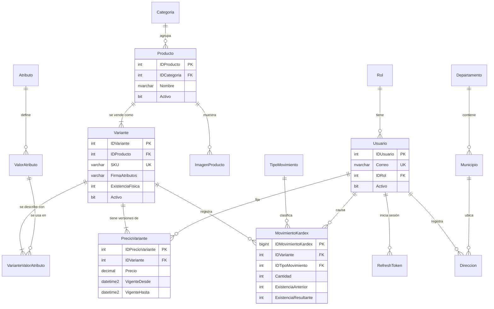
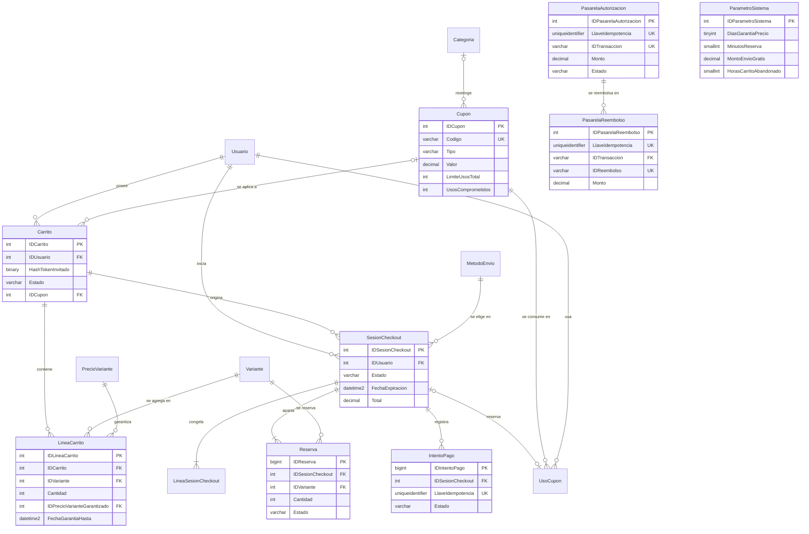
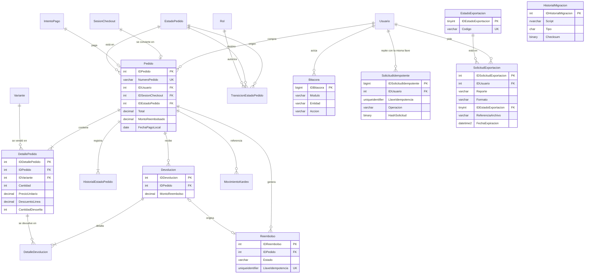

# ShopCart — Modelo de datos

> Etapa 2 del proceso. Implementa las decisiones de [`00-vision-y-contexto.md`](./00-vision-y-contexto.md) y la arquitectura de [`01-arquitectura.md`](./01-arquitectura.md).
> Las decisiones propias del modelo (`M-xx`, sección 10) fueron **confirmadas por el PO el 29 oct**; M-01 se modificó a tablas ledger.
> Motor: **SQL Server 2022** (imagen oficial de Docker). Base: `ShopCart`. Esquema: `dbo`.

---

## 1. Convenciones

### 1.1 Nomenclatura

| Objeto | Formato | Ejemplo | Fuente |
|---|---|---|---|
| Tabla | PascalCase, singular | `Pedido`, `LineaCarrito` | Propuesta |
| PK autoincrementable | `ID` + nombre de la tabla | `IDPedido` | **Enunciado** |
| FK | Mismo nombre que la PK referida | `Pedido.IDUsuario` | Propuesta |
| Stored procedure | `SP_Modulo_Proceso` | `SP_Pedidos_CrearPedido` | **Enunciado** |
| Vista | `VW_Modulo_Proceso` | `VW_Dashboard_VentasPorCategoria` | **Enunciado** |
| Función tipo tabla | `FU_Modulo_Proceso` | `FU_Catalogo_PrecioVigente` | **Enunciado** |
| Trigger | `TR_Modulo_Proceso` | `TR_Pedidos_ValidarTransicion` | Extensión del estándar (M-06) |
| Constraints | `PK_Tabla`, `FK_Tabla_Referida`, `UQ_Tabla_Columnas`, `CK_Tabla_Regla`, `DF_Tabla_Columna` | `CK_Variante_ExistenciaNoNegativa` | Extensión del estándar (M-06) |
| Índices | `IX_Tabla_Columnas` y, si es único filtrado, `UX_Tabla_Regla` | `UX_Carrito_ActivoPorUsuario` | Extensión del estándar (M-06) |

### 1.2 Tipos de datos

| Uso | Tipo | Nota |
|---|---|---|
| Montos en quetzales | `DECIMAL(12,2)` | Hasta Q9,999,999,999.99. **Nunca `FLOAT`/`REAL`** |
| Porcentajes | `DECIMAL(5,2)` | 0.00–100.00 |
| Cantidades | `INT` | Unidades enteras |
| PK de tablas maestras | `INT IDENTITY(1,1)` | |
| PK de tablas de alto volumen | `BIGINT IDENTITY(1,1)` | Kardex, bitácora, historial, intentos de pago, reservas, refresh tokens |
| Fechas y horas | `DATETIME2(3)` en **UTC** (`SYSUTCDATETIME()`) | Precisión de milisegundos |
| Fecha local para reportes | `DATE` | Fecha en Guatemala (UTC−6, sin horario de verano), calculada al insertar (M-03) |
| Texto visible | `NVARCHAR(n)` | Acentos y ñ |
| Códigos técnicos | `VARCHAR(n)` | SKU, códigos de estado y de cupón |
| Hashes | `BINARY(32)` | SHA-256 |
| JSON | `NVARCHAR(MAX)` con `CHECK (ISJSON(col) = 1)` | Bitácora |
| Llaves de idempotencia | `UNIQUEIDENTIFIER` | UUID generado por el cliente |

### 1.3 Reglas generales

- Todas las tablas tienen `FechaCreacion DATETIME2(3) NOT NULL DEFAULT SYSUTCDATETIME()`. Las tablas editables también tienen `FechaActualizacion`.
- **Nada se borra físicamente** si tiene historial (N-14). Las entidades desactivables tienen `Activo BIT NOT NULL DEFAULT 1`.
- La base usa `READ_COMMITTED_SNAPSHOT ON` (A-05).
- Todo SP que escribe empieza con `SET NOCOUNT ON; SET XACT_ABORT ON;` y usa `BEGIN TRY / BEGIN TRAN … COMMIT / END TRY BEGIN CATCH … ROLLBACK; THROW; END CATCH`.
- **Contexto del actor (A-18):** todo SP invocado por la API declara `@IDUsuarioActor INT = NULL, @RolActor VARCHAR(20) = NULL, @RequestId UNIQUEIDENTIFIER = NULL`, que `ejecutarSP` envía siempre. Los SPs de recursos propios filtran con `@IDUsuarioActor`. Todo SP que escribe llama primero a `SP_Sistema_EstablecerContexto`, que fija `SESSION_CONTEXT` (`IDUsuario`, `Rol`, `RequestId`) para que los triggers lo lean. **Los triggers de bitácora exigen `Rol`:** si `SESSION_CONTEXT(N'Rol')` es `NULL`, fallan con `50004 CONTEXTO_NO_ESTABLECIDO`. Los jobs y el migrador usan `Rol = 'Sistema'` con `IDUsuario = NULL`; una escritura manual en la base también llama antes a `SP_Sistema_EstablecerContexto` (es intencional).

---

## 2. Diagrama entidad-relación

El modelo se divide en **tres áreas temáticas** para que se pueda leer. En cada diagrama, las tablas de otras áreas aparecen en gris, solo con su llave primaria, como referencia.

| Área | Contenido | Imagen |
|---|---|---|
| A | Usuarios, direcciones, catálogo e inventario |  |
| B | Carrito, cupones, checkout y pasarela simulada |  |
| C | Pedidos, devoluciones, bitácora, exportaciones y sistema |  |

Las imágenes se regeneran desde `diagramas/fuentes/`. Las tablas y relaciones se editan en `tablas_y_relaciones.py`; después se ejecuta `python generar_modelo_por_areas.py` y `dot -Tsvg ../modelo-datos-area-a.dot -o ../modelo-datos-area-a.svg`, y lo mismo para b y c. A continuación, una versión simplificada en Mermaid, que GitHub renderiza directamente.

### 2.1 Usuarios, catálogo e inventario

### 2.2 Carrito, cupones, checkout y pasarela simulada

### 2.3 Pedidos, devoluciones, bitácora, exportaciones y sistema

---

## 3. Tablas

Notación: **PK** llave primaria · **FK** llave foránea · **UQ** único · **CK** check · **DF** default · **NN** not null (todas las columnas son NN salvo que diga *NULL*).

### 3.1 Seguridad y usuarios

**`Rol`** — catálogo fijo (semilla).

| Columna | Tipo | Reglas |
|---|---|---|
| IDRol | INT IDENTITY | PK |
| Codigo | VARCHAR(20) | UQ. `Cliente`, `Operador`, `Administrador` |
| Nombre | NVARCHAR(50) | |

**`Usuario`**

| Columna | Tipo | Reglas |
|---|---|---|
| IDUsuario | INT IDENTITY | PK |
| Correo | NVARCHAR(254) | Formato validado en la API |
| CorreoNormalizado | AS `LOWER(Correo)` PERSISTED | **UQ** (correo único sin distinguir mayúsculas, N-15) |
| HashContrasena | VARCHAR(255) | argon2id |
| Nombre | NVARCHAR(100) | |
| NombreBusqueda | AS `Nombre COLLATE Latin1_General_CI_AI` PERSISTED | V026: buscar al cliente sin mayúsculas ni tildes en la gestión de pedidos (A-10, M8-H01) |
| Telefono | VARCHAR(8) *NULL* | CK: 8 dígitos |
| IDRol | INT | FK → Rol |
| Activo | BIT | DF 1 |
| FechaDesactivacion | DATETIME2(3) *NULL* | CK: `Activo = 1` ⇔ `FechaDesactivacion IS NULL` |
| VersionSesion | INT | DF 0; CK `>= 0`. Sube al desactivar, cambiar el rol o cambiar la contraseña (A-07); la bitácora no registra los cambios que solo la tocan |

**`RefreshToken`**

| Columna | Tipo | Reglas |
|---|---|---|
| IDRefreshToken | BIGINT IDENTITY | PK |
| IDUsuario | INT | FK → Usuario |
| IDFamilia | UNIQUEIDENTIFIER | Agrupa la cadena de rotaciones |
| HashToken | BINARY(32) | **UQ** |
| FechaExpiracion | DATETIME2(3) | |
| FechaUso | DATETIME2(3) *NULL* | Se llena al rotar; **un segundo uso = reúso → se revoca la familia** |
| FechaRevocacion | DATETIME2(3) *NULL* | |
| MotivoRevocacion | VARCHAR(30) *NULL* | CK: `Logout`, `Reuso`, `Desactivacion`, `CambioContrasena` |
| IP | VARCHAR(45) *NULL* | |
| UserAgent | NVARCHAR(300) *NULL* | |

Índices: `IX_RefreshToken_IDFamilia`, `IX_RefreshToken_IDUsuario`.

### 3.2 Geografía y direcciones

**`Departamento`** (22 filas de semilla): `IDDepartamento` PK, `Nombre NVARCHAR(50)` UQ.

**`Municipio`** (340 filas de semilla): `IDMunicipio` PK, `IDDepartamento` FK, `Nombre NVARCHAR(80)`. UQ `(IDDepartamento, Nombre)`.

**`Direccion`**

| Columna | Tipo | Reglas |
|---|---|---|
| IDDireccion | INT IDENTITY | PK |
| IDUsuario | INT | FK → Usuario |
| Alias | NVARCHAR(50) *NULL* | "Casa", "Oficina" |
| NombreRecibe | NVARCHAR(100) | |
| TelefonoRecibe | VARCHAR(8) | CK: 8 dígitos |
| IDMunicipio | INT | FK → Municipio |
| DireccionLinea | NVARCHAR(200) | |
| Referencia | NVARCHAR(200) *NULL* | |
| EsPredeterminada | BIT | DF 0 |

Índices: **`UX_Direccion_PredeterminadaPorUsuario`** UNIQUE `(IDUsuario) WHERE EsPredeterminada = 1` (N-17) e `IX_Direccion_IDUsuario`. Se permite el borrado físico porque el pedido y la sesión copian la dirección.

### 3.3 Catálogo

**`Categoria`**: `IDCategoria` PK, `Nombre NVARCHAR(80)` UQ, `Descripcion NVARCHAR(300) NULL`, `Activo`.

**`Producto`**

| Columna | Tipo | Reglas |
|---|---|---|
| IDProducto | INT IDENTITY | PK |
| IDCategoria | INT | FK → Categoria |
| Nombre | NVARCHAR(150) | |
| NombreBusqueda | AS `Nombre COLLATE Latin1_General_CI_AI` PERSISTED | Búsqueda sin mayúsculas ni tildes (A-10) |
| Descripcion | NVARCHAR(2000) *NULL* | |
| Activo | BIT | DF 1 |

Índice: `IX_Producto_Categoria_Activo (IDCategoria, Activo) INCLUDE (Nombre)`.

**`ImagenProducto`**: `IDImagenProducto` PK, `IDProducto` FK, `Url NVARCHAR(500)`, `TextoAlternativo NVARCHAR(150)`, `Orden SMALLINT`, `EsPrincipal BIT`. UQ `(IDProducto, Orden)`; **`UX_ImagenProducto_Principal`** UNIQUE `(IDProducto) WHERE EsPrincipal = 1`.

**`Atributo`**: `IDAtributo` PK, `Nombre NVARCHAR(50)` UQ (Talla, Color…), `Orden SMALLINT`.

**`ValorAtributo`**: `IDValorAtributo` PK, `IDAtributo` FK, `Valor NVARCHAR(50)`, `Orden SMALLINT`. UQ `(IDAtributo, Valor)` y UQ `(IDValorAtributo, IDAtributo)`. Esta última sirve de destino para la FK compuesta de abajo.

**`Variante`**

| Columna | Tipo | Reglas |
|---|---|---|
| IDVariante | INT IDENTITY | PK |
| IDProducto | INT | FK → Producto |
| SKU | VARCHAR(40) | **UQ** global; editable (`DetallePedido` guarda su copia) |
| FirmaAtributos | VARCHAR(200) | IDs de `ValorAtributo` ordenados por `IDAtributo` (p. ej. `3\|17`); la calcula el SP |
| DescripcionAtributos | NVARCHAR(200) | Texto legible ("M / Azul"), calculado junto con la firma |
| ExistenciaFisica | INT | DF 0. **CK ≥ 0**. Solo la modifica `SP_Inventario_RegistrarMovimiento` |
| Activo | BIT | DF 1 |
| VersionFila | ROWVERSION | |

UQ **`(IDProducto, FirmaAtributos)`**: no puede haber dos variantes con la misma combinación (N-14).

**`VarianteValorAtributo`** (tabla puente)

| Columna | Tipo | Reglas |
|---|---|---|
| IDVariante | INT | PK (1/2), FK → Variante |
| IDAtributo | INT | PK (2/2): **un solo valor por atributo** en cada variante |
| IDValorAtributo | INT | FK compuesta `(IDValorAtributo, IDAtributo)` → `ValorAtributo`: el valor tiene que pertenecer a ese atributo |

**`PrecioVariante`** — precios versionados (N-02)

| Columna | Tipo | Reglas |
|---|---|---|
| IDPrecioVariante | INT IDENTITY | PK |
| IDVariante | INT | FK → Variante |
| Precio | DECIMAL(12,2) | CK > 0. IVA incluido |
| VigenteDesde | DATETIME2(3) | |
| VigenteHasta | DATETIME2(3) *NULL* | `NULL` = precio vigente. CK: `VigenteHasta > VigenteDesde` |
| IDUsuario | INT | FK → Usuario (quién fijó el precio) |

Índices: **`UX_PrecioVariante_Vigente`** UNIQUE `(IDVariante) WHERE VigenteHasta IS NULL` (un solo precio vigente por variante) e `IX_PrecioVariante_Historial (IDVariante, VigenteDesde DESC) INCLUDE (Precio, VigenteHasta)`.

Cambiar un precio = cerrar la versión vigente (`VigenteHasta = ahora`) e insertar una nueva, en una transacción (`SP_Catalogo_CambiarPrecio`). La primera versión la inserta `SP_Catalogo_CrearVariante`, en la misma transacción que la variante. Un precio igual al vigente no crea versión ni fila de bitácora (PUT idempotente).

### 3.4 Inventario

**`TipoMovimiento`** (semilla, 6 filas)

| Columna | Tipo | Reglas |
|---|---|---|
| IDTipoMovimiento | INT IDENTITY | PK |
| Codigo | VARCHAR(30) | UQ: `EntradaCompra`, `SalidaVenta`, `AjustePositivo`, `AjusteNegativo`, `ReingresoCancelacion`, `ReingresoDevolucion` |
| Nombre | NVARCHAR(60) | |
| Signo | SMALLINT | CK `IN (1, -1)` |
| EsManual | BIT | 1 para entradas y ajustes (los registra el Operador) |

UQ `(IDTipoMovimiento, Signo)`, destino de la FK compuesta del kardex.

**`MovimientoKardex`** — ledger append-only (M-01)

| Columna | Tipo | Reglas |
|---|---|---|
| IDMovimientoKardex | BIGINT IDENTITY | PK |
| IDVariante | INT | FK → Variante |
| IDTipoMovimiento | INT | FK compuesta `(IDTipoMovimiento, Signo)` → TipoMovimiento: **el signo no puede contradecir el tipo** |
| Signo | SMALLINT | |
| Cantidad | INT | CK > 0 |
| ExistenciaAnterior | INT | CK ≥ 0 |
| ExistenciaResultante | INT | CK ≥ 0 y **CK `ExistenciaResultante = ExistenciaAnterior + Signo * Cantidad`** |
| Motivo | NVARCHAR(250) | NN (en ventas: "Venta pedido SC-000123") |
| Referencia | NVARCHAR(100) *NULL* | Número de factura u otra referencia |
| IDPedido | INT *NULL* | FK → Pedido |
| IDDevolucion | INT *NULL* | FK → Devolucion |
| IDUsuario | INT | FK → Usuario |
| RequestId | UNIQUEIDENTIFIER *NULL* | Correlación con las trazas |
| Fecha | DATETIME2(3) | DF `SYSUTCDATETIME()`. Una fecha propia solo con el rol `Sistema`, nunca futura ni anterior al último movimiento de la variante (N-07) |

Índices: `IX_MovimientoKardex_Variante (IDVariante, IDMovimientoKardex DESC)` e `IX_MovimientoKardex_Fecha (Fecha)`.

**Invariante (N-07):** dentro de una variante, las fechas del kardex nunca retroceden. Ordenarlo por `Fecha` o por `IDMovimientoKardex` da el mismo orden y los mismos saldos. Lo garantiza `SP_Inventario_RegistrarMovimiento` bajo el bloqueo de la variante: la fecha actual nunca queda antes de una pasada, y una fecha propia se compara con la del último movimiento (`50003` si es anterior). Por eso S004 registra las entradas iniciales con fecha anterior al periodo de los datos demo (S006).

**Invariante que verifica `VW_Inventario_Conciliacion`:** para cada variante, `ExistenciaFisica = SUM(Signo * Cantidad)` = `ExistenciaResultante` del último movimiento.

**`Reserva`**

| Columna | Tipo | Reglas |
|---|---|---|
| IDReserva | BIGINT IDENTITY | PK |
| IDSesionCheckout | INT | FK → SesionCheckout |
| IDVariante | INT | FK → Variante |
| Cantidad | INT | CK > 0 |
| Estado | VARCHAR(10) | CK `IN ('Activa','Consumida','Liberada')` |
| FechaExpiracion | DATETIME2(3) | |
| FechaCierre | DATETIME2(3) *NULL* | |

UQ `(IDSesionCheckout, IDVariante)`. Índice **`IX_Reserva_Activas (IDVariante, FechaExpiracion) INCLUDE (Cantidad) WHERE Estado = 'Activa'`**: el cálculo del disponible solo lee las reservas activas.

### 3.5 Carrito

**`Carrito`**

| Columna | Tipo | Reglas |
|---|---|---|
| IDCarrito | INT IDENTITY | PK |
| IDUsuario | INT *NULL* | FK → Usuario |
| HashTokenInvitado | BINARY(32) *NULL* | |
| Estado | VARCHAR(12) | CK `IN ('Activo','Fusionado','Convertido','Expirado')` |
| IDCupon | INT *NULL* | FK → Cupon (cupón aplicado como vista previa, N-12) |
| FechaUltimaActividad | DATETIME2(3) | Se actualiza solo con cambios (N-13) |
| FechaCierre | DATETIME2(3) *NULL* | |

CK: **exactamente uno** de `IDUsuario` o `HashTokenInvitado`. Índices: **`UX_Carrito_ActivoPorUsuario`** UNIQUE `(IDUsuario) WHERE Estado = 'Activo' AND IDUsuario IS NOT NULL`, **`UX_Carrito_TokenInvitado`** UNIQUE `(HashTokenInvitado) WHERE HashTokenInvitado IS NOT NULL` e `IX_Carrito_Abandono (Estado, FechaUltimaActividad)`.

**`LineaCarrito`**

| Columna | Tipo | Reglas |
|---|---|---|
| IDLineaCarrito | INT IDENTITY | PK |
| IDCarrito | INT | FK → Carrito |
| IDVariante | INT | FK → Variante |
| Cantidad | INT | CK > 0 |
| IDPrecioVarianteGarantizado | INT | FK → PrecioVariante |
| FechaGarantiaHasta | DATETIME2(3) | Fecha en que se agregó + `DiasGarantiaPrecio` |
| PrecioAnteriorAviso | DECIMAL(12,2) *NULL* | Precio que se muestra en la alerta "cambió de Q… a Q…" hasta que el cliente la vea |
| FechaAgregado | DATETIME2(3) | |

UQ `(IDCarrito, IDVariante)`. El máximo de 50 líneas lo valida el SP contra `ParametroSistema`.

### 3.6 Cupones

**`Cupon`**

| Columna | Tipo | Reglas |
|---|---|---|
| IDCupon | INT IDENTITY | PK |
| Codigo | VARCHAR(30) | **UQ**; CK `Codigo = UPPER(Codigo)` (se guarda en mayúsculas) |
| Descripcion | NVARCHAR(200) | |
| Tipo | VARCHAR(10) | CK `IN ('Porcentaje','MontoFijo')` |
| Valor | DECIMAL(12,2) | CK > 0; CK: si es `Porcentaje`, ≤ 100 |
| MontoMaximoDescuento | DECIMAL(12,2) *NULL* | CK > 0; CK: solo si es `Porcentaje` |
| MontoMinimoCompra | DECIMAL(12,2) | DF 0, CK ≥ 0 |
| IDCategoria | INT *NULL* | FK → Categoria. `NULL` = aplica a todo el carrito |
| FechaInicio, FechaFin | DATETIME2(3) | CK `FechaFin > FechaInicio` |
| LimiteUsosTotal | INT | CK > 0 |
| LimiteUsosPorCliente | INT | CK > 0 |
| **UsosComprometidos** | INT | DF 0. **CK `UsosComprometidos BETWEEN 0 AND LimiteUsosTotal`** (A-13): reservados + confirmados |
| Activo | BIT | DF 1 |
| VersionFila | ROWVERSION | |

**`UsoCupon`**

| Columna | Tipo | Reglas |
|---|---|---|
| IDUsoCupon | INT IDENTITY | PK |
| IDCupon | INT | FK → Cupon |
| IDUsuario | INT | FK → Usuario |
| IDSesionCheckout | INT | FK → SesionCheckout; **UQ** (un cupón por sesión) |
| IDPedido | INT *NULL* | FK → Pedido |
| Estado | VARCHAR(10) | CK `IN ('Reservado','Confirmado','Liberado','Revertido')` |
| MontoDescuento | DECIMAL(12,2) | CK ≥ 0 |

Índice `IX_UsoCupon_PorCliente (IDCupon, IDUsuario, Estado)`: el límite por cliente cuenta `Reservado` (vigentes) + `Confirmado`.

### 3.7 Envíos y parámetros

**`MetodoEnvio`**: `IDMetodoEnvio` PK, `Codigo VARCHAR(20)` UQ, `Nombre NVARCHAR(50)`, `Costo DECIMAL(12,2)` CK ≥ 0, `DiasMin TINYINT`, `DiasMax TINYINT` CK `DiasMax >= DiasMin`, `Activo`.

**`ParametroSistema`** — una sola fila tipada (A-14)

| Columna | Tipo | Default | CK |
|---|---|---|---|
| IDParametroSistema | INT IDENTITY | — | PK; **CK `= 1`** (una sola fila) |
| DiasGarantiaPrecio | TINYINT | 3 | 1–30 |
| MinutosReserva | SMALLINT | 15 | 5–60 |
| HorasCarritoAbandonado | SMALLINT | 24 | 1–720 |
| DiasExpiracionCarritoInvitado | SMALLINT | 30 | 1–365 |
| UmbralUltimasUnidades | SMALLINT | 5 | 1–100 |
| MontoEnvioGratis | DECIMAL(12,2) *NULL* | 500.00 | > 0 (`NULL` = sin envío gratis) |
| MaxIntentosPagoRechazados | TINYINT | 5 | 1–10 |
| DiasPlazoDevolucion | SMALLINT | 30 | 1–365 |
| MaxLineasCarrito | SMALLINT | 50 | 1–200 |
| IDUsuarioActualizacion | INT *NULL* | — | FK → Usuario |

### 3.8 Checkout

**`SesionCheckout`**

| Columna | Tipo | Reglas |
|---|---|---|
| IDSesionCheckout | INT IDENTITY | PK |
| IDUsuario | INT | FK → Usuario |
| IDCarrito | INT | FK → Carrito |
| Estado | VARCHAR(10) | CK `IN ('Activa','Pagada','Expirada','Cancelada')` |
| HashContenido | BINARY(32) | Hash de líneas, cantidades, cupón, envío y dirección: si coincide, la sesión se reutiliza (N-02) |
| NombreRecibe, TelefonoRecibe, IDMunicipio, Departamento, Municipio, DireccionLinea, Referencia | (como en `Direccion`, más los nombres) | **Copia de la dirección** confirmada |
| IDMetodoEnvio | INT | FK → MetodoEnvio |
| NombreMetodoEnvio | NVARCHAR(50) | Copia |
| DiasMin, DiasMax | TINYINT | Copia para la fecha estimada de entrega |
| IDCupon | INT *NULL* | FK → Cupon |
| CodigoCupon | VARCHAR(30) *NULL* | Copia |
| Subtotal | DECIMAL(12,2) | CK ≥ 0 |
| Descuento | DECIMAL(12,2) | CK `0 ≤ Descuento ≤ Subtotal` |
| CostoEnvio | DECIMAL(12,2) | CK ≥ 0 |
| Total | DECIMAL(12,2) | **CK `Total = Subtotal - Descuento + CostoEnvio`** |
| IntentosRechazados | TINYINT | DF 0 |
| FechaExpiracion | DATETIME2(3) | |
| FechaCierre | DATETIME2(3) *NULL* | |

Índices: **`UX_SesionCheckout_ActivaPorUsuario`** UNIQUE `(IDUsuario) WHERE Estado = 'Activa'` (una sola sesión activa, N-02) e `IX_SesionCheckout_PorExpirar (FechaExpiracion) WHERE Estado = 'Activa'`.

**`LineaSesionCheckout`** — resumen congelado

| Columna | Tipo | Reglas |
|---|---|---|
| IDLineaSesionCheckout | INT IDENTITY | PK |
| IDSesionCheckout | INT | FK → SesionCheckout |
| IDVariante | INT | FK → Variante |
| IDPrecioVariante | INT | FK → PrecioVariante (la versión que se cobró) |
| Cantidad | INT | CK > 0 |
| PrecioUnitario | DECIMAL(12,2) | CK > 0. Precio efectivo (con garantía) |
| DescuentoLinea | DECIMAL(12,2) | CK `0 ≤ DescuentoLinea ≤ Cantidad * PrecioUnitario` |
| TotalLinea | DECIMAL(12,2) | **CK `TotalLinea = Cantidad * PrecioUnitario - DescuentoLinea`** |

UQ `(IDSesionCheckout, IDVariante)`. **Invariante (lo valida el SP):** `SUM(DescuentoLinea) = SesionCheckout.Descuento`, con el centavo sobrante asignado a la línea de mayor monto.

**`IntentoPago`**

| Columna | Tipo | Reglas |
|---|---|---|
| IDIntentoPago | BIGINT IDENTITY | PK |
| IDSesionCheckout | INT | FK → SesionCheckout |
| LlaveIdempotencia | UNIQUEIDENTIFIER | **UQ** |
| HashSolicitud | BINARY(32) | Para detectar "misma llave, otro contenido" → 422 |
| Monto | DECIMAL(12,2) | CK > 0 |
| Estado | VARCHAR(12) | CK `IN ('Pendiente','Autorizado','Capturado','Rechazado','Anulado','Fallido','Error','EnRevision')` (`Fallido`: la conciliación confirmó que la pasarela nunca autorizó, V013; `EnRevision`: pago inconsistente con la pasarela, para revisión manual, V019) |
| IDTransaccionPasarela | VARCHAR(64) *NULL* | |
| CodigoRespuesta | VARCHAR(30) *NULL* | p. ej. `FONDOS_INSUFICIENTES` |
| MensajeRespuesta | NVARCHAR(200) *NULL* | |
| MarcaTarjeta | VARCHAR(20) *NULL* | |
| UltimosDigitos | CHAR(4) *NULL* | CK: 4 dígitos |
| ResolucionManual, MotivoResolucion, IDUsuarioResolucion, FechaResolucion | VARCHAR(16), NVARCHAR(250), INT FK → Usuario, DATETIME2(3), todas *NULL* | V023, E9-H04: cómo resolvió el Admin un pago `EnRevision` (`CobroVerificado`, `SinCobro` o `Reembolsar`); CK: las cuatro juntas o ninguna. Índice filtrado `IX_IntentoPago_EnRevision` para la lista |
| ArrendadoHasta | DATETIME2(3) *NULL* | V013, N-03: hasta cuándo una petición tiene tomado el intento en curso; `NULL` cuando ya no está en curso |
| TokenArrendamiento | UNIQUEIDENTIFIER *NULL* | V014, N-03: token de fencing; cada toma del arrendamiento (petición o conciliación) genera uno nuevo y `CrearPedido`, `ActualizarIntentoPago`, `LiberarArrendamiento` y `ResolverIntentoConciliado` verifican bajo `UPDLOCK` que el suyo sigue vigente (si no, `50602` o `Resuelto = 0`) |

Índices: **`UX_IntentoPago_EnCursoPorSesion`** UNIQUE `(IDSesionCheckout) WHERE Estado IN ('Pendiente','Autorizado')` (**un solo intento en curso por sesión, garantizado por la BD** → 409, N-03), `UX_IntentoPago_Transaccion` UNIQUE `(IDTransaccionPasarela) WHERE IDTransaccionPasarela IS NOT NULL` e `IX_IntentoPago_PorConciliar (ArrendadoHasta) INCLUDE (Estado, IDSesionCheckout) WHERE Estado IN ('Pendiente','Autorizado')` (V013: la conciliación busca los intentos en curso con el arrendamiento vencido).

**`PasarelaAutorizacion`** y **`PasarelaReembolso`** (V012, N-03): el estado propio de la pasarela simulada, como si fuera la base de un sistema externo. Solo las usa su adaptador, por `SP_Pasarela_*`, y nunca dentro de una transacción del checkout.

| Tabla | Columnas | Reglas |
|---|---|---|
| `PasarelaAutorizacion` | `IDPasarelaAutorizacion` INT PK, `LlaveIdempotencia` UNIQUEIDENTIFIER, `IDTransaccion` VARCHAR(64), `Monto` DECIMAL(12,2), `Marca` VARCHAR(20), `UltimosDigitos` CHAR(4), `Estado` VARCHAR(12), `CodigoRespuesta` VARCHAR(30) *NULL*, `MensajeRespuesta` NVARCHAR(200) *NULL*, fechas | **UQ** llave (misma llave → misma respuesta) y **UQ** `IDTransaccion`; CK `Estado IN ('Autorizada','Rechazada','Capturada','Anulada')`, CK monto > 0 |
| `PasarelaReembolso` | `IDPasarelaReembolso` INT PK, `LlaveIdempotencia` UNIQUEIDENTIFIER, `IDTransaccion` VARCHAR(64) FK → `PasarelaAutorizacion`, `IDReembolso` VARCHAR(64), `Monto` DECIMAL(12,2), fecha | **UQ** llave y **UQ** `IDReembolso`; CK monto > 0 |

**`SolicitudIdempotente`** (V013, E5-H03): las llaves de idempotencia de las operaciones que no son pagos (entradas y ajustes de inventario).

| Columna | Tipo | Reglas |
|---|---|---|
| IDSolicitudIdempotente | BIGINT IDENTITY | PK |
| IDUsuario | INT | FK → Usuario |
| LlaveIdempotencia | UNIQUEIDENTIFIER | **UQ `(IDUsuario, LlaveIdempotencia)`** |
| Operacion | VARCHAR(40) | p. ej. `Inventario.Entrada` |
| HashSolicitud | BINARY(32) | Misma llave con otro contenido → 422 |
| Respuesta | NVARCHAR(MAX) | CK `ISJSON = 1`: lo necesario para devolver la misma respuesta |
| FechaCreacion | DATETIME2(3) | `IX_SolicitudIdempotente_Fecha`: el job horario purga las de más de 24 h |

La inserta el SP de la operación (entrada o ajuste) **en la misma transacción que el movimiento**, nunca el middleware por separado.

### 3.9 Pedidos

**`EstadoPedido`** (semilla): `IDEstadoPedido` PK, `Codigo VARCHAR(20)` UQ (`Pagado`, `EnPreparacion`, `Despachado`, `Entregado`, `Cancelado`, `DevueltoParcial`, `Devuelto`), `Nombre NVARCHAR(40)`, `EsFinal BIT` (1 = estado sin transiciones de salida: `Cancelado` y `Devuelto`), `Orden TINYINT`.

**`TransicionEstadoPedido`** (semilla)

| Columna | Tipo | Reglas |
|---|---|---|
| IDTransicionEstadoPedido | INT IDENTITY | PK |
| IDEstadoOrigen | INT | FK → EstadoPedido |
| IDEstadoDestino | INT | FK → EstadoPedido; CK `<> IDEstadoOrigen` |
| IDRol | INT | FK → Rol |

UQ `(IDEstadoOrigen, IDEstadoDestino, IDRol)`.

| Origen → Destino | Roles |
|---|---|
| Pagado → EnPreparacion | Operador, Administrador |
| EnPreparacion → Despachado | Operador, Administrador |
| Despachado → Entregado | Operador, Administrador |
| Pagado → Cancelado | Cliente, Operador, Administrador |
| EnPreparacion → Cancelado | Cliente, Operador, Administrador |
| Entregado → DevueltoParcial | Operador, Administrador |
| Entregado → Devuelto | Operador, Administrador |
| DevueltoParcial → Devuelto | Operador, Administrador |

`DevueltoParcial → DevueltoParcial` (otra devolución parcial) no cambia el estado: el SP no registra una transición en ese caso.

**`Pedido`**

| Columna | Tipo | Reglas |
|---|---|---|
| IDPedido | INT IDENTITY | PK |
| NumeroPedido | AS `'SC-' + RIGHT('000000' + CAST(IDPedido AS VARCHAR(10)), 6)` PERSISTED | UQ. Número visible para el cliente |
| IDUsuario | INT | FK → Usuario |
| IDSesionCheckout | INT | FK; **UQ** (un pedido por sesión: idempotencia en la BD) |
| IDIntentoPago | BIGINT | FK; **UQ** |
| IDEstadoPedido | INT | FK → EstadoPedido |
| Subtotal | DECIMAL(12,2) | CK ≥ 0 |
| Descuento | DECIMAL(12,2) | CK `0 ≤ Descuento ≤ Subtotal` |
| CostoEnvio | DECIMAL(12,2) | CK ≥ 0 |
| Total | DECIMAL(12,2) | **CK `Total = Subtotal - Descuento + CostoEnvio`** |
| BaseImponible | DECIMAL(12,2) | `ROUND(Total / 1.12, 2)` (N-18) |
| IVA | DECIMAL(12,2) | **CK `BaseImponible + IVA = Total`** |
| **MontoReembolsado** | DECIMAL(12,2) | DF 0. **CK `MontoReembolsado BETWEEN 0 AND Total`** (A-13) |
| IDCupon, CodigoCupon | INT *NULL*, VARCHAR(30) *NULL* | FK y copia |
| IDMetodoEnvio, NombreMetodoEnvio | INT, NVARCHAR(50) | FK y copia |
| FechaEstimadaEntrega | DATE | Fecha de pago + `DiasMax` |
| NombreRecibe, TelefonoRecibe, IDMunicipio, Departamento, Municipio, DireccionLinea, Referencia | | **Copia de la dirección** (N-17) |
| IDTransaccionPasarela | VARCHAR(64) | Para reembolsos (N-03) |
| MarcaTarjeta, UltimosDigitos | VARCHAR(20), CHAR(4) | Para mostrar "Visa ****4242" |
| FechaPago | DATETIME2(3) | UTC |
| **FechaPagoLocal** | DATE | Fecha en Guatemala; agrupa los reportes (A-12) |
| VersionFila | ROWVERSION | |

Índices: `IX_Pedido_Cliente (IDUsuario, FechaPago DESC)` (historial del cliente), `IX_Pedido_Reportes (FechaPagoLocal) INCLUDE (IDEstadoPedido, Subtotal, Descuento, CostoEnvio, Total)` (dashboard) e `IX_Pedido_Gestion (IDEstadoPedido, FechaPago DESC) INCLUDE (IDUsuario, Total)` (listado con filtros, RF-08).

Trigger **`TR_Pedidos_ValidarTransicion`** (`AFTER UPDATE`): si cambia `IDEstadoPedido` y el par `(anterior, nuevo)` no existe en `TransicionEstadoPedido` para el rol que viene en `SESSION_CONTEXT`, hace `THROW 50701` y la transacción se revierte. Es la "segunda capa" de N-08. Además, salvo para cancelar, un pedido no sale de `Pagado` si su intento no está `Capturado` (`THROW 50710`, decisión del PO en E9-H04).

**`DetallePedido`**

| Columna | Tipo | Reglas |
|---|---|---|
| IDDetallePedido | INT IDENTITY | PK |
| IDPedido | INT | FK → Pedido |
| IDVariante | INT | FK → Variante |
| IDPrecioVariante | INT | FK → PrecioVariante |
| SKU, NombreProducto, DescripcionVariante | | **Copias** al momento de la venta |
| IDCategoria, NombreCategoria | INT, NVARCHAR(80) | **Copia**: los reportes por categoría usan la categoría que tenía el producto al venderse |
| Cantidad | INT | CK > 0 |
| PrecioUnitario | DECIMAL(12,2) | CK > 0 |
| DescuentoLinea | DECIMAL(12,2) | CK `0 ≤ DescuentoLinea ≤ Cantidad * PrecioUnitario` |
| TotalLinea | DECIMAL(12,2) | **CK `TotalLinea = Cantidad * PrecioUnitario - DescuentoLinea`** |
| **CantidadDevuelta** | INT | DF 0. **CK `CantidadDevuelta BETWEEN 0 AND Cantidad`** (N-10) |

UQ `(IDPedido, IDVariante)`. Índices: `IX_DetallePedido_Variante (IDVariante) INCLUDE (Cantidad, TotalLinea)` e `IX_DetallePedido_Categoria (IDCategoria) INCLUDE (IDPedido, TotalLinea, Cantidad)`.

**`HistorialEstadoPedido`** — ledger append-only (M-01)

| Columna | Tipo | Reglas |
|---|---|---|
| IDHistorialEstadoPedido | BIGINT IDENTITY | PK |
| IDPedido | INT | FK → Pedido |
| IDEstadoAnterior | INT *NULL* | FK → EstadoPedido (`NULL` en la creación) |
| IDEstadoNuevo | INT | FK → EstadoPedido |
| IDUsuario | INT | FK → Usuario |
| Motivo | NVARCHAR(250) *NULL* | Obligatorio al cancelar (lo valida el SP) |
| RequestId | UNIQUEIDENTIFIER *NULL* | |
| Fecha | DATETIME2(3) | |

Índice `IX_HistorialEstadoPedido_Pedido (IDPedido, Fecha)`.

**`Devolucion`**: `IDDevolucion` PK, `IDPedido` FK, `IDUsuario` FK (Operador), `Motivo NVARCHAR(250)`, `MontoReembolso DECIMAL(12,2)` CK > 0, `Fecha DATETIME2(3)`, **`FechaLocal DATE`** (las devoluciones se restan en su propia fecha, N-11). Índice `IX_Devolucion_FechaLocal (FechaLocal) INCLUDE (MontoReembolso)`.

**`DetalleDevolucion`**: `IDDetalleDevolucion` PK, `IDDevolucion` FK, `IDDetallePedido` FK, `Cantidad INT` CK > 0, `MontoReembolso DECIMAL(12,2)` CK ≥ 0. UQ `(IDDevolucion, IDDetallePedido)`.

**`Reembolso`**

| Columna | Tipo | Reglas |
|---|---|---|
| IDReembolso | INT IDENTITY | PK |
| IDPedido | INT *NULL* | FK → Pedido |
| IDIntentoPago | BIGINT *NULL* | V023, E9-H04: FK → IntentoPago, solo en un cobro capturado sin pedido. CK `CK_Reembolso_Destino`: exactamente uno de `IDPedido` e `IDIntentoPago`; `UX_Reembolso_PorIntento`: uno por intento, por su monto (nunca más de lo capturado) |
| IDDevolucion | INT *NULL* | FK → Devolucion |
| Origen | VARCHAR(12) | CK `IN ('Cancelacion','Devolucion','SinPedido')`; `Devolucion` ⇔ `IDDevolucion IS NOT NULL`; `SinPedido` ⇔ el reembolso apunta al intento |
| Monto | DECIMAL(12,2) | CK > 0 |
| Estado | VARCHAR(14) | CK `IN ('Pendiente','Completado','Fallido','ResueltoManual','NoAplica')` (`ResueltoManual`: el Admin lo resolvió a mano, E9-H04; `NoAplica`: al resolverlo, la pasarela mostró que el cobro nunca se capturó o se anuló, V024) |
| MotivoResolucion, ReferenciaResolucion, IDUsuarioResolucion, FechaResolucion | NVARCHAR(250), NVARCHAR(100), INT FK → Usuario, DATETIME2(3), todas *NULL* | V023 y V024 (`CK_Reembolso_ResolucionManual`): las cuatro en `ResueltoManual`; en `NoAplica`, motivo, usuario y fecha, sin referencia (no hubo devolución); ninguna en los demás estados |
| Intentos | TINYINT | DF 0 |
| LlaveIdempotencia | UNIQUEIDENTIFIER | **UQ** (se envía a la pasarela) |
| IDTransaccionReembolso | VARCHAR(64) *NULL* | |
| UltimoError | NVARCHAR(500) *NULL* | |
| FechaProximoIntento | DATETIME2(3) *NULL* | |
| FechaCompletado | DATETIME2(3) *NULL* | |

Índices: **`UX_Reembolso_CancelacionPorPedido`** UNIQUE `(IDPedido) WHERE Origen = 'Cancelacion'`, `UX_Reembolso_PorDevolucion` UNIQUE `(IDDevolucion) WHERE IDDevolucion IS NOT NULL` e `IX_Reembolso_Pendientes (FechaProximoIntento) WHERE Estado = 'Pendiente'`.

`Pedido.MontoReembolsado` aumenta **al crear** el reembolso, en la misma transacción. El `CHECK` garantiza que nunca se compromete más de lo cobrado. Por eso un `ResueltoManual` ya cuenta como reembolsado sin tocar el pedido. Un `NoAplica` no cuenta: `SP_Pedidos_MarcarReembolsoNoAplica` resta su monto en la misma transacción.

### 3.10 Bitácora

**`Bitacora`** — ledger append-only (M-01)

| Columna | Tipo | Reglas |
|---|---|---|
| IDBitacora | BIGINT IDENTITY | PK |
| Modulo | VARCHAR(30) | `Catalogo`, `Inventario`, `Cupones`, `Pedidos`, `Envios`, `Usuarios`, `Configuracion` |
| Entidad | VARCHAR(50) | Nombre de la tabla |
| IDEntidad | VARCHAR(50) | PK del registro afectado |
| Accion | VARCHAR(20) | CK `IN ('Crear','Modificar','Desactivar','Activar','Eliminar','CambioEstado')` |
| ValorAnterior | NVARCHAR(MAX) *NULL* | CK `ISJSON = 1` |
| ValorNuevo | NVARCHAR(MAX) *NULL* | CK `ISJSON = 1` |
| IDUsuario | INT *NULL* | FK → Usuario. `NULL` solo con `Rol = 'Sistema'` (un job o el migrador): sin contexto, el trigger falla con `50004` (A-18) |
| RequestId | UNIQUEIDENTIFIER *NULL* | |
| Fecha | DATETIME2(3) | |

Índices: `IX_Bitacora_Modulo (Modulo, Fecha DESC)` (filtro de RF-09), `IX_Bitacora_Entidad (Entidad, IDEntidad, Fecha DESC)`, `IX_Bitacora_Fecha (Fecha DESC, IDBitacora DESC)` (V017: el listado sin filtro, lo más reciente primero) e `IX_Bitacora_ModuloFecha (Modulo, Fecha DESC, IDBitacora DESC)` (V018: el filtro por módulo ya en el orden del listado).

**Triggers que la alimentan** (`AFTER INSERT, UPDATE, DELETE`, serializando `inserted`/`deleted` con `FOR JSON PATH`). Las columnas de dinero (`Precio`, `Costo`, `Valor`, `MontoMaximoDescuento`, `MontoMinimoCompra`, `MontoEnvioGratis`) se serializan como texto (`"149.90"`), igual que en la API (A-21):

| Tabla | Trigger | Qué se registra | Módulo |
|---|---|---|---|
| `Categoria`, `Producto`, `Variante` | `TR_Catalogo_CategoriaBitacora`, `TR_Catalogo_ProductoBitacora`, `TR_Catalogo_VarianteBitacora` | Creación, cambios, desactivación y existencia física | Catalogo / Inventario |
| `PrecioVariante` | `TR_Catalogo_PrecioVarianteBitacora` | Cada nueva versión de precio, con el precio anterior. `IDEntidad` es el `IDPrecioVariante` de la nueva versión (siempre la PK del registro afectado) y `ValorAnterior`/`ValorNuevo` incluyen `IDVariante` y el precio. El historial de precios de una variante se lee de `PrecioVariante` con `SP_Catalogo_HistorialPrecios`, no de la bitácora | Catalogo |
| `Cupon` | `TR_Cupones_Bitacora` | Creación, cambios y desactivación | Cupones |
| `Pedido` | `TR_Pedidos_Bitacora` | **Solo cuando cambia `IDEstadoPedido`** | Pedidos |
| `MetodoEnvio`, `ParametroSistema` | `TR_Envios_Bitacora`, `TR_Configuracion_Bitacora` | Cambios de tarifas y parámetros (N-04) | Envios / Configuracion |
| `Usuario` | `TR_Usuarios_Bitacora` | Rol y activación, **nunca `HashContrasena`** | Usuarios |
| `IntentoPago` | `TR_Pedidos_PagoBitacora` | **Solo cuando cambia `Estado`**, con la resolución manual del Admin (E9-H04); nunca datos de la tarjeta | Pedidos |
| `Reembolso` | `TR_Pedidos_ReembolsoBitacora` | La creación y cada cambio de `Estado`: el job, el reintento del Admin y su resolución manual (E9-H04) | Pedidos |

El duodécimo trigger es `TR_Pedidos_ValidarTransicion` (§3.9), que valida las transiciones de estado del pedido. Los de `IntentoPago` y `Reembolso` usan el módulo `Pedidos`: el `CHECK` de módulo de la tabla ledger `Bitacora` no cambia (M-01).

### 3.11 Exportaciones (V021, E7-H05, A-24)

**`EstadoExportacion`** (catálogo, A-15) con IDs fijos, porque los `CHECK` de coherencia los usan: 1 `Pendiente`, 2 `Procesando`, 3 `Completada`, 4 `Fallida` (final) y 5 `Expirada` (final).

**`SolicitudExportacion`** — la cola de exportaciones que consumen las dos réplicas.

| Columna | Tipo | Notas |
|---|---|---|
| IDSolicitudExportacion | INT IDENTITY | PK |
| IDUsuario | INT | FK → Usuario (el Administrador que la pidió) |
| Reporte | VARCHAR(30) | CK: los cinco reportes del dashboard |
| Formato | VARCHAR(5) | CK `IN ('xlsx','pdf')` |
| Filtros | NVARCHAR(1000) | CK `ISJSON = 1`: los filtros ya validados y normalizados |
| HashFiltros | BINARY(32) | SHA-256 de los filtros normalizados (agrupación) |
| IDEstadoExportacion | TINYINT | FK → EstadoExportacion, DF 1 |
| Intentos | TINYINT | DF 0, CK 0–10 |
| TokenArrendamiento, ArrendadoHasta | UNIQUEIDENTIFIER, DATETIME2(3) *NULL* | Fencing, como `IntentoPago` |
| UltimoError | NVARCHAR(500) *NULL* | La causa que ve el Admin |
| ReferenciaArchivo | VARCHAR(100) *NULL* | El nombre en el almacén, generado por el servidor |
| TamanoBytes | INT *NULL* | CK ≥ 0 |
| FechaCreacion, FechaFinalizacion, FechaExpiracion, FechaActualizacion | DATETIME2(3) | |

`CHECK` de coherencia por estado:
- `Procesando` ⇒ token y arrendamiento;
- `Completada` ⇒ archivo, tamaño, finalización y expiración;
- `Fallida` ⇒ error y finalización.

Índices:
- `IX_SolicitudExportacion_Cola (IDEstadoExportacion, ArrendadoHasta, IDSolicitudExportacion)`, para la toma;
- `IX_SolicitudExportacion_Agrupacion (IDUsuario, Reporte, Formato, HashFiltros) INCLUDE (IDEstadoExportacion, FechaExpiracion)`;
- `IX_SolicitudExportacion_Usuario (IDUsuario, FechaCreacion DESC, IDSolicitudExportacion DESC)`, para el listado;
- `IX_SolicitudExportacion_Vencimiento (FechaExpiracion) WHERE IDEstadoExportacion = 3`, para la purga.

---

## 4. Vistas y funciones

| Objeto | Tipo | Propósito |
|---|---|---|
| `FU_Catalogo_PrecioVigente(@IDVariante)` | Inline TVF | `IDPrecioVariante` y `Precio` vigentes. Se usa con `CROSS APPLY` (nombre tomado del enunciado) |
| `FU_Catalogo_CombinacionVariante(@Valores)` | Inline TVF | De un arreglo JSON de IDs de valor (A-22): firma canónica, descripción, conjunto de atributos y contadores para validar repetidos, inexistentes y un valor por atributo (N-14) |
| `FU_Catalogo_HistorialVariante(@IDVariante)` | Inline TVF | `TieneHistorial`: ventas, kardex, reservas o checkout. Prevalidación del borrado y de la edición de la combinación (N-14) |
| `FU_Inventario_Disponible(@IDVariante)` | Inline TVF | `ExistenciaFisica`, `Reservado` (reservas `Activa` no vencidas) y `Disponible` |
| `FU_Carrito_Disponible(@IDCarrito, @IDVariante)` | Inline TVF | El disponible para ese carrito: `FU_Inventario_Disponible` más las reservas vigentes de su propia sesión de pago activa. Lo usan las líneas, agregar, cambiar la cantidad y la fusión |
| `FU_Carrito_Lineas(@IDCarrito)` | Inline TVF | Por línea: precio vigente, precio efectivo con garantía, estado (`Disponible`/`CantidadExcedida`/`Agotado`/`NoDisponible`), "Ajustar a X" (solo en `CantidadExcedida`), aviso, etiqueta de existencia (la cifra solo en el umbral o por debajo, N-06), lo comprable y la versión de precio que se cobra. El disponible no descuenta las reservas de la sesión de pago activa del mismo carrito (E5-H01) |
| `FU_Cupones_Validar(@IDCupon, @IDUsuario, @IDCarrito)` | Inline TVF | Código de resultado de la validación (cada causa de N-12) y sus datos (p. ej. cuánto falta para el mínimo). La reserva de la sesión de pago del mismo carrito no cuenta como otro uso (ni para el agotado ni para el límite por cliente), tampoco si venció y la tarea de expiración aún no la libera |
| `FU_Cupones_CalculoDescuento(@IDCupon, @IDCarrito)` | Inline TVF | Descuento por línea, repartido proporcionalmente al centavo hacia abajo; el sobrante va a la línea de mayor monto (desempate: menor `IDLineaCarrito`) y, si no le cabe sin pasar de su total, a la siguiente. La suma es exactamente el descuento total (nombre tomado del enunciado) |
| `FU_Carrito_Activo(@IDCliente, @HashTokenInvitado)` | Inline TVF | El carrito `Activo` de quien pide (cliente o invitado), sin bloqueo |
| `FU_Envios_EnvioGratis(@Monto)` | Inline TVF | N-04: mínimo de envío gratis, cuánto falta y si se alcanzó, para un monto ya con el cupón |
| `FU_Envios_Costos(@Monto)` | Inline TVF | N-04: los métodos activos con su costo para ese monto (0 si alcanza el envío gratis); la usan los envíos y el checkout |
| `FU_Catalogo_PatronBusqueda(@Texto)` | Inline TVF | A-10: el texto del usuario como patrones de `LIKE` literales (escapa `\`, `%`, `_` y `[`): `Contiene` y `EmpiezaCon`, para la relevancia de la búsqueda |
| `FU_Cupones_RestriccionViolada(@MensajeError)` | Inline TVF | RF-05: traduce la violación de un `CHECK` de `Cupon` (error 547) al campo de la API y a un mensaje para el Admin; la usan `SP_Cupones_Crear` y `SP_Cupones_Actualizar` en su `CATCH` |
| `FU_Inventario_Movimientos(@IDVariante)` | Inline TVF | RF-03, N-07: los movimientos del kardex de una variante con su tipo y su usuario, como los muestra la API; la usan `SP_Inventario_ObtenerKardex` y los SPs de entrada y ajuste |
| `FU_Pedidos_PlazoDevolucion(@IDPedido, @Ahora)` | Inline TVF | N-10: `EnPlazo`, contado desde que el pedido pasó a Entregado (dentro de `DiasPlazoDevolucion`); una sola regla para `SP_Pedidos_RegistrarDevolucion`, que la exige bajo bloqueo, y `SP_Pedidos_ObtenerDetalleGestion`, que ofrece la devolución |
| `FU_Pedidos_TransicionesGestion(@IDPedido, @IDEstadoOrigen, @Rol)` | Inline TVF | N-08: los destinos de `TransicionEstadoPedido` para el rol, con `ViaGestion` (Cancelado y las devoluciones tienen su propia vía) y `CobroPendiente` (desde Pagado solo con el cobro Capturado); la única regla para `SP_Pedidos_CambiarEstado`, que la exige, y `SP_Pedidos_ObtenerDetalleGestion`, que ofrece los botones |
| `FU_Pedidos_ReembolsoReintentable(@Estado, @TokenReclamo, @FechaProximoIntento)` | Inline TVF | N-09: `PuedeReintentar` (un Fallido, o un Pendiente sin reclamo vigente); la regla de `SP_Pedidos_ReintentarReembolso` y del listado (M8-H05) |
| `FU_Pedidos_ReembolsoResoluble(@Estado, @FechaActualizacion, @SegundosEsperaMinima)` | Inline TVF | E9-H04: `PlazoCumplido` y `PuedeResolver` (Fallido y pasado el plazo); la regla de `SP_Pedidos_ResolverReembolso`, `SP_Pedidos_MarcarReembolsoNoAplica`, `SP_Pedidos_ObtenerReembolsoParaResolver` y del listado (M8-H05) |
| `FU_Sistema_FechaLocal(@FechaUtc)` | Inline TVF | A-12, M-03: el día de Guatemala (UTC−6, sin horario de verano) de una fecha UTC; una sola fórmula para `FechaPagoLocal` (`SP_Pedidos_CrearPedido`) y `FechaLocal` |
| `VW_Catalogo_ProductosTienda` | Vista | Productos activos con al menos una variante activa con precio vigente: categoría, imagen principal, precio mínimo y si tienen disponible. Lo único que puede leer `shopcart_busqueda` (A-23) |
| `VW_Inventario_Conciliacion` | Vista | Variantes donde la existencia física ≠ la suma del kardex. **Debe estar vacía** |
| `VW_Inventario_ExistenciaBodega` | Vista | Física + unidades de pedidos pagados aún no despachados (N-07) |
| `VW_Pedidos_Historial` | Vista | Historial de estados con nombres y usuario (nombre tomado del enunciado) |
| **`VW_Dashboard_HechosVenta`** | Vista | **La definición única de "venta" (N-11):** filas de venta (pedidos no cancelados, en su `FechaPagoLocal`) `UNION ALL` filas de devolución (en negativo, en su `FechaLocal`), con fecha, categoría, variante, unidades y monto neto. Todos los reportes agregan sobre esta vista |
| `VW_Dashboard_VentasPorCategoria` | Vista | Agregado de la vista de hechos por fecha y categoría (nombre tomado del enunciado) |
| `VW_Cupones_Admin` | Vista | RF-05, N-12: los cupones como los ve el Admin, con su categoría y si ya se usaron (desde el primer uso, su tipo y su valor no cambian) |
| `VW_Exportaciones_Solicitudes` | Vista | A-24: una solicitud de exportación con el código de su estado, sin el token de arrendamiento |
| `VW_Carrito_Abandonados` | Vista | Carritos `Activo` con líneas y sin cambios en `HorasCarritoAbandonado`, con su monto potencial a precio vigente |

---

## 5. Catálogo de stored procedures

Los SPs marcados **(interno)** solo los invocan otros SPs, nunca la API. Así hay un único punto de escritura para cada invariante.

### Auth y usuarios
`SP_Auth_RegistrarCliente` · `SP_Auth_ObtenerCredenciales` · `SP_Auth_RegistrarRefreshToken` · `SP_Auth_RotarRefreshToken` (rotación y detección de reúso) · `SP_Auth_RevocarSesion` · `SP_Usuarios_ObtenerPerfil` · `SP_Usuarios_ActualizarPerfil` · `SP_Usuarios_CambiarContrasena` · `SP_Usuarios_Listar` · `SP_Usuarios_CrearInterno` · `SP_Usuarios_Actualizar` · `SP_Usuarios_CambiarEstado` (protege al último Admin y a uno mismo)

### Direcciones
`SP_Direcciones_Listar` · `SP_Direcciones_Crear` · `SP_Direcciones_Actualizar` · `SP_Direcciones_Eliminar` · `SP_Direcciones_ListarDepartamentos` · `SP_Direcciones_ListarMunicipios`

### Catálogo
`SP_Catalogo_BuscarProductos` (texto, categoría, rango de precio, disponibilidad, orden con lista blanca y paginación; `sp_executesql` con parámetros, como `shopcart_busqueda` (A-23). Orden: `relevancia` por defecto (primero lo que empieza con el texto; sin texto, nombre ascendente), `precio` (menor precio vigente entre las variantes activas), `nombre` o `recientes` (`FechaCreacion` descendente, sin dirección); dirección `asc` por defecto o `desc`; todo orden termina con `IDProducto`) · `SP_Catalogo_ObtenerProducto` · `SP_Catalogo_ObtenerProductoAdmin` · `SP_Catalogo_ListarProductosAdmin` · `SP_Catalogo_ListarCategorias` · `SP_Catalogo_CrearCategoria` · `SP_Catalogo_ActualizarCategoria` · `SP_Catalogo_CambiarEstadoCategoria` · `SP_Catalogo_EliminarCategoria` · `SP_Catalogo_CrearProducto` · `SP_Catalogo_ActualizarProducto` · `SP_Catalogo_CambiarEstadoProducto` · `SP_Catalogo_EliminarProducto` · `SP_Catalogo_GuardarImagenes` · `SP_Catalogo_CrearVariante` · `SP_Catalogo_ResolverCombinacion` **(interno)** · `SP_Catalogo_ActualizarVariante` · `SP_Catalogo_CambiarEstadoVariante` · `SP_Catalogo_EliminarVariante` · `SP_Catalogo_CambiarPrecio` · `SP_Catalogo_HistorialPrecios` · `SP_Catalogo_ListarAtributos` · `SP_Catalogo_CrearAtributo` · `SP_Catalogo_CrearValorAtributo`

### Inventario
`SP_Inventario_RegistrarMovimiento` **(interno: único SP que modifica `ExistenciaFisica` y escribe el kardex)** · `SP_Inventario_RegistrarEntrada` · `SP_Inventario_RegistrarAjuste` (motivo obligatorio y nunca por debajo de lo reservado, N-07) · `SP_Inventario_ReservarExistencia` **(interno, nombre del enunciado: el único que inserta en `Reserva`; recibe las líneas en JSON, bloquea las variantes por `IDVariante` y valida todo o nada con 50301; renueva en su fila la reserva vencida de la misma sesión. Lo llaman `SP_Checkout_IniciarSesion` y `SP_Pedidos_CrearPedido`)** · `SP_Inventario_LiberarReservas` **(interno)** · `SP_Inventario_ObtenerKardex` · `SP_Inventario_ListarExistencias` · `SP_Inventario_Conciliar` · `SP_Inventario_ListarExistenciaBodega` (Could de E3-H06)

### Carrito
`SP_Carrito_Obtener` · `SP_Carrito_AgregarLinea` · `SP_Carrito_ActualizarCantidad` · `SP_Carrito_EliminarLinea` · `SP_Carrito_AplicarCupon` · `SP_Carrito_QuitarCupon` · `SP_Carrito_MarcarAvisosVistos` · `SP_Carrito_Fusionar` (invitado → cliente al iniciar sesión) · `SP_Carrito_AsignarInvitado` (al registrarse) · `SP_Carrito_ExpirarInvitados` (job) · `SP_Checkout_CancelarSesionActiva` **(interno: cancela la sesión Activa del cliente y libera sus reservas y el uso reservado del cupón; lo usan la fusión y E5)** · `SP_Carrito_BloquearActivo` **(interno: bloquea el carrito Activo del cliente o del invitado con `UPDLOCK, HOLDLOCK`; primer bloqueo de todo SP de carrito, 01 §6.6)**. Los SPs que modifican el carrito devuelven el carrito completo (`SP_Carrito_Obtener`); sin carrito Activo, ningún conjunto

### Cupones, envíos y configuración
`SP_Cupones_Listar` · `SP_Cupones_Obtener` · `SP_Cupones_Crear` (igual que el de abajo, cada `CK_Cupon_*` a 50003 con `detalles.errores`) · `SP_Cupones_Actualizar` (un cupón usado, con al menos una fila en `UsoCupon`, solo cambia vigencia, límites y estado; `detalles.campo` dice cuál no se puede cambiar; cada `CK_Cupon_*` se traduce a 50003 con su campo en `detalles.errores`, la forma de todo 400 con campos, M9-H01) · `SP_Cupones_CambiarEstado` · `SP_Cupones_ReservarUso` **(interno)** · `SP_Cupones_LiberarUso` **(interno)** · `SP_Cupones_RevertirUso` **(interno: al cancelar, `Confirmado → Revertido` y `UsosComprometidos − 1`)** · `SP_Envios_ListarMetodos` · `SP_Envios_ActualizarMetodo` · `SP_Configuracion_Obtener` · `SP_Configuracion_Actualizar`

### Checkout
`SP_Checkout_IniciarSesion` · `SP_Checkout_ObtenerSesion` · `SP_Checkout_CancelarSesion` · `SP_Checkout_CancelarSesionActiva` **(interno)** · `SP_Checkout_RegistrarIntentoPago` (llave, hash, arrendamiento y compare-and-set) · `SP_Checkout_ActualizarIntentoPago` (autorizado, rechazado, anulado, capturado; cancela la sesión al llegar al máximo de rechazos) · `SP_Checkout_LiberarArrendamiento` (timeout de la pasarela) · `SP_Checkout_RenovarArrendamiento` (fencing antes de anular en la pasarela) · `SP_Checkout_ExpirarSesiones` (job; no vence sesiones con un pago con el arrendamiento vivo) · `SP_Checkout_TomarIntentosPorConciliar` (job, `sp_getapplock`: toma los intentos con el arrendamiento vencido hace más de 2 min) · `SP_Checkout_ResolverIntentoConciliado` (job) · `SP_Inventario_LiberarReservas` **(interno)** · `SP_Cupones_ReservarUso` **(interno)** · `SP_Cupones_LiberarUso` **(interno)** · `SP_Pasarela_Autorizar` · `SP_Pasarela_CambiarEstado` (captura o anula) · `SP_Pasarela_Reembolsar` · `SP_Pasarela_Consultar` · `SP_Pasarela_ConsultarReembolso` (E9-H04) (solo el adaptador de la pasarela simulada) · `SP_Sistema_PurgarSolicitudesIdempotentes` (job) · `SP_Sistema_BuscarSolicitudIdempotente` **(interno)** · `SP_Sistema_GuardarSolicitudIdempotente` **(interno)**: los usan `SP_Inventario_RegistrarEntrada` y `SP_Inventario_RegistrarAjuste` dentro de su transacción

### Pedidos
`SP_Pedidos_CrearPedido` (la transacción atómica de RF-06) · `SP_Pedidos_ListarPropios` (`IX_Pedido_Cliente`) · `SP_Pedidos_ObtenerDetalle` (con `@IDUsuario` si el rol es Cliente) · `SP_Pedidos_ObtenerDetalleGestion` (M8-H01: el detalle más el cliente, `PuedeDevolver` y las transiciones que el rol puede pedir con `SP_Pedidos_CambiarEstado`) · `SP_Pedidos_ObtenerDeIntento` (el pedido de un intento de pago; lo usa el pago antes de anular tras una falla) · `SP_Pedidos_Listar` (gestión: filtros por estado, cliente (por ID o por texto en su nombre o su correo, M8-H01) y días de Guatemala sobre `FechaPagoLocal`, igual que los reportes; paginado; un índice por filtro: `IX_Pedido_Gestion`, `IX_Pedido_Cliente`, `IX_Pedido_Reportes` y, sin filtros, `IX_Pedido_FechaPago` de V015) · `SP_Pedidos_CambiarEstado` · `SP_Pedidos_Cancelar` (N-09, plan E6-H03) · `SP_Pedidos_TomarReembolso` (compare-and-set antes de llamar a la pasarela, con `Reembolso.TokenReclamo` de V016: un fallo solo cuenta si el reclamo sigue vigente y un éxito de la pasarela siempre deja el reembolso `Completado`) · `SP_Pedidos_ReintentarReembolso` (Admin) · `SP_Pedidos_ListarPagosEnRevision`, `SP_Pedidos_ObtenerPagoEnRevision`, `SP_Pedidos_ObtenerReembolsoParaResolver`, `SP_Pedidos_CompletarReembolsoProcesado` (el reembolso que la pasarela ya procesó queda `Completado`), `SP_Pedidos_MarcarReembolsoNoAplica` (el cobro no se capturó: `NoAplica` y resta su monto; con la versión leída y el plazo, como la resolución manual), `SP_Pedidos_ResolverPagoEnRevision` y `SP_Pedidos_ResolverReembolso` (Admin, E9-H04: bajo `UPDLOCK`, solo desde `EnRevision` o `Fallido`) · `SP_Pedidos_AplicarCancelacion` **(interno: el cuerpo de la cancelación, que usan `SP_Pedidos_Cancelar` y la resolución `SinCobro`)** · `SP_Pedidos_RegistrarDevolucion` (N-10: líneas bloqueadas por `IDDetallePedido`, plazo desde la primera entrada a `Entregado` del historial, reembolso por unidad al centavo con el residuo en la devolución que completa la línea, sin envío, y estado derivado `DevueltoParcial`/`Devuelto`) · `SP_Pedidos_ListarReembolsos` · `SP_Pedidos_ObtenerReembolsosPendientes` (job) · `SP_Pedidos_ActualizarReembolso` · `SP_Pedidos_ListarTransiciones` (para el test de coincidencia de N-08)

### Exportaciones (E7-H05, A-24)
- **Administrador:** `SP_Exportaciones_Solicitar` bloquea la fila del usuario, agrupa una solicitud igual vigente y aplica el máximo de pendientes (50801). `SP_Exportaciones_Obtener` y `SP_Exportaciones_Listar` devuelven solo las propias.
- **Sistema (procesador):** `SP_Exportaciones_Tomar` (`UPDLOCK, READPAST`, arrendamiento con token), `SP_Exportaciones_Completar` y `SP_Exportaciones_RegistrarFallo`, estos dos con compare-and-set del token.
- **Sistema (job con `sp_getapplock`):** `SP_Exportaciones_Expirar` y `SP_Exportaciones_QuitarArchivo`. `SP_Exportaciones_ContarPendientes` (solo lectura, rol Sistema): las solicitudes `Pendiente` o `Procesando`, para la métrica `shopcart.exportaciones.pendientes` (E9-H01). Para el barrido de los huérfanos, `SP_Exportaciones_ReferenciasExistentes`: de una lista JSON de nombres (A-22), los que alguna solicitud todavía referencia (V022: `IX_SolicitudExportacion_Referencia`).
- **Vista:** `VW_Exportaciones_Solicitudes`, la solicitud con el código de su estado y sin el token.

### Dashboard, bitácora y sistema
`SP_Dashboard_Resumen` (ventas, pedidos, ticket promedio, carritos abandonados) · `SP_Dashboard_VentasPorPeriodo` (`@Agrupacion` = día, semana o mes) · `SP_Dashboard_VentasPorCategoria` · `SP_Dashboard_TopProductos` (top 10) · `SP_Dashboard_CarritosAbandonados` · `SP_Bitacora_Listar` (filtro por módulo, entidad y días de Guatemala; paginado; `IX_Bitacora_Modulo`, `IX_Bitacora_Entidad` e `IX_Bitacora_Fecha` de V017 sin filtros) · `SP_Sistema_Health` · `SP_Sistema_EstablecerContexto` **(interno: fija `SESSION_CONTEXT` a partir de los parámetros estándar)**

### Datos semilla y carga
`SP_Semilla_GenerarDatosDemo (@Pedidos, @Dias, @Semilla)` (solo rol `Sistema`, determinista e idempotente) genera clientes, carritos y pedidos **consistentes** (detalle, kardex, historial, devoluciones y su estado en la pasarela simulada) con fechas **relativas a hoy**, para que el dashboard siempre muestre los últimos 90 días. El kardex se registra en orden cronológico con la fecha de cada evento (N-07). Cada acción se atribuye a quien la registraría en la operación real: las altas de clientes sin actor, como el registro público; cupones y entradas al Admin; cada compra y su cancelación a su cliente; las devoluciones al Operador. Termina verificando que `VW_Inventario_Conciliacion` esté vacía para las variantes que vendió. La semilla normal usa `@Pedidos = 1500`. La carga pesada (50,000 pedidos) queda para la Fase 5, sobre una base nueva y con el número de pedidos como parámetro.

---

## 6. Inmutabilidad

**Tablas inmutables:** `Bitacora`, `MovimientoKardex` y `HistorialEstadoPedido` (M-01).

**Defensa en capas:**

1. **Tablas ledger de solo inserción** (`WITH (LEDGER = ON (APPEND_ONLY = ON))`). El motor rechaza cualquier `UPDATE` o `DELETE`, incluso de un administrador. Un `DROP TABLE` tampoco borra los datos: SQL Server conserva la tabla renombrada y oculta.
2. **Verificación criptográfica:** `pnpm ledger:verificar` (el migrador, con su SQL en `database/migrator/sql/`) genera el digest con `sys.sp_generate_database_ledger_digest`, lo guarda fuera de la base (`.ledger/`, un archivo por base y fecha de creación) y verifica con `sys.sp_verify_database_ledger` contra todos los digests guardados: un cambio en una fila o en un bloque posterior a cualquiera de ellos hace fallar la verificación. En producción el archivo iría a un almacenamiento inmutable.
3. **La aplicación no tiene permisos** directos sobre ninguna tabla: solo `EXECUTE` sobre los SPs, y ningún SP actualiza ni borra estas tablas.

**Consecuencias para el desarrollo:** no se puede usar `TRUNCATE` ni corregir filas a mano (en desarrollo se recrea la base completa con Docker); solo se pueden agregar columnas `NULL` y no se puede cambiar el tipo de una columna. Por eso el diseño de estas tres tablas se cierra antes de crearlas.

**Confirmado en E1-H01:** las tablas ledger aceptan FKs simples y compuestas, `CHECK`, `ISJSON`, `DEFAULT`, índices e inserciones desde triggers. `UPDATE` y `DELETE` fallan con el error 37359 y `TRUNCATE` con el 13545. La verificación con `sp_verify_database_ledger` requiere `ALLOW_SNAPSHOT_ISOLATION ON`, que activa el migrador al preparar la base. El respaldo con triggers ya no se usa.

**Consecuencia:** como las filas ledger nunca se borran, tampoco se pueden borrar los usuarios, pedidos ni variantes que referencian. Es coherente con N-14: lo que tiene historia solo se desactiva.

---

## 7. Datos semilla

| Script | Contenido |
|---|---|
| `S001__catalogos.sql` | Roles, estados de pedido, transiciones, tipos de movimiento, métodos de envío y la fila de `ParametroSistema` |
| `S002__geografia_gt.sql` | 22 departamentos y 340 municipios de Guatemala |
| `S003__usuarios_demo.sql` | `admin@shopcart.gt`, `operador@shopcart.gt` y `cliente@shopcart.gt`, con hashes argon2 ya calculados. Las credenciales de prueba se documentan en el README, como pide el enunciado |
| `S004__catalogo_demo.sql` | ~8 categorías, ~60 productos, ~250 variantes con atributos, precios con historial, imágenes locales y entradas de inventario iniciales (con su kardex, fechadas 120 días atrás con el rol `Sistema`, antes del periodo de S006: N-07) |
| `S005__clientes_concurrencia.sql` | Los 20 clientes de la prueba de concurrencia (E5-H05) |
| `S006__datos_demo.sql` | `EXEC SP_Semilla_GenerarDatosDemo @Pedidos = 1500, @Dias = 90, @Semilla = 2026`: ~200 clientes (`demo001@shopcart.gt`…), 1,500 pedidos con cancelaciones y devoluciones, carritos abandonados y cupones de ejemplo, uno por cada mensaje de RF-05: `DEMO10` (vigente), `DEMOVENCIDO`, `DEMOFUTURO`, `DEMOINACTIVO`, `DEMOAGOTADO`, `DEMOUNAVEZ` (ya usado por `cliente@shopcart.gt`), `DEMOMINIMO` y `DEMOCATEGORIA` |
| `database/load/L001__carga_pesada.sql` | **Pendiente (F5):** el generador con `@Pedidos = 50000`. La medición ya se hizo en una base desechable con el mismo generador ([revision/estado-backend.md](revision/estado-backend.md) §7) |

---

## 8. Códigos de error de negocio

Rangos por módulo para `THROW`. El catálogo completo, con su código estable y su HTTP, vive en `apps/api/src/shared/errors/catalogo.ts`. Los más importantes:

| Rango | Módulo | Ejemplos |
|---|---|---|
| 50001–50099 | General | 50001 `NO_ENCONTRADO` (404) · 50002 `CONFLICTO_CONCURRENCIA` (409) · 50003 `PARAMETRO_INVALIDO` (400) · 50004 `CONTEXTO_NO_ESTABLECIDO` (500: error de programación, el cliente ve el mensaje genérico) · 50005 `INVARIANTE_INTERNA` (500: un SP interno llamado sin transacción, actor o rol; error de programación, mensaje genérico y log en error) |
| 50100–50199 | Auth y usuarios | 50101 `CORREO_EN_USO` (409) · 50102 `REFRESH_REUTILIZADO` (401) · 50103 `USUARIO_INACTIVO` (401) · 50104 `ULTIMO_ADMIN` (409) · 50105 `ACCION_SOBRE_SI_MISMO` (409: un Admin no se desactiva ni cambia su propio rol) · 50106 `LIMITE_DIRECCIONES` (422: máximo 10 direcciones por cliente) |
| 50200–50299 | Catálogo | 50201 `SKU_DUPLICADO` (409) · 50202 `COMBINACION_DUPLICADA` (409) · 50203 `PRODUCTO_CON_HISTORIAL` (409) · 50204 `CATEGORIA_CON_PRODUCTOS` (409) · 50205 `NOMBRE_DUPLICADO` (409: nombre de categoría o de atributo, o valor repetido dentro de un atributo) · 50206 `CATEGORIA_INACTIVA` (409: un producto activo en una categoría inactiva) · 50207 `ATRIBUTOS_NO_COINCIDEN` (422: la variante no usa el conjunto de atributos del producto; los esperados van en `detalles`) · 50208 `VARIANTE_CON_HISTORIAL` (409: la combinación de una variante con historial no se cambia) · 50209 `CATEGORIA_EN_USO` (409: la categoría está en cupones o en pedidos y solo se puede desactivar) |
| 50300–50399 | Inventario | 50301 `STOCK_INSUFICIENTE` (409) · 50302 `AJUSTE_DEJA_NEGATIVO` (422) · 50303 `AJUSTE_BAJO_RESERVADO` (422) · 50304 `MOTIVO_REQUERIDO` (400) |
| 50400–50499 | Carrito | 50401 `LIMITE_LINEAS` (422) · 50402 `LINEAS_NO_DISPONIBLES` (409) · 50403 `CARRITO_VACIO` (422) |
| 50500–50599 | Cupones | 50501 `CUPON_NO_EXISTE` · 50502 `CUPON_INACTIVO` · 50503 `CUPON_NO_VIGENTE_AUN` · 50504 `CUPON_VENCIDO` · 50505 `CUPON_AGOTADO` · 50506 `CUPON_LIMITE_CLIENTE` · 50507 `CUPON_MINIMO_NO_ALCANZADO` · 50508 `CUPON_SIN_PRODUCTOS_CATEGORIA` (todos 422) · 50509 `CUPON_USADO_NO_EDITABLE` (409) · 50510 `CUPON_CODIGO_DUPLICADO` (409) · 50511 `CUPON_LIMITE_BAJO_USOS` (422, traduce `CK_Cupon_UsosComprometidos`; `detalles.usosComprometidos`) |
| 50600–50699 | Checkout y pago | 50601 `SESION_VENCIDA` (409) · 50602 `PAGO_EN_CURSO` (409, con `Retry-After` si es la misma llave) · 50603 `LLAVE_REUTILIZADA` (422) · 50604 `PAGO_RECHAZADO` (402) · 50605 `MAX_INTENTOS` (409) · 50606 `PAGO_SIN_CONFIRMAR` (504: la pasarela no respondió; se puede reintentar con la misma llave y no se cobra dos veces) · 50607 `PAGO_NO_COMPLETADO` (409: la conciliación cerró el intento sin cobro, `Fallido` o `Anulado`; lo recibe un reintento con esa llave) |
| 50700–50799 | Pedidos | 50701 `TRANSICION_INVALIDA` (409) · 50702 `NO_CANCELABLE` (409) · 50703 `DEVOLUCION_EXCEDE_VENDIDO` (422) · 50704 `PLAZO_DEVOLUCION_VENCIDO` (422) · 50705 `REEMBOLSO_EXCEDE_TOTAL` (422) · 50706 `PAGO_EN_REVISION` (409: el pago del pedido está en revisión manual, V019; el pedido no se cancela, E9-H04, y el reintento de un cobro sin pedido en revisión también lo recibe) · 50707 `PAGO_NO_EN_REVISION` (409: el pago ya se resolvió) · 50708 `RESOLUCION_NO_APLICA` (422) · 50709 `REEMBOLSO_NO_FALLIDO` (409) · 50710 `PAGO_NO_CAPTURADO` (409: el pedido no sale de `Pagado` sin el cobro `Capturado`, E9-H04) · 50711 `REEMBOLSO_RECIENTE` (409: el reembolso se actualizó hace menos del plazo para resolverlo a mano, E9-H04). Nacen en la API (E9-H04): `COBRO_SIN_CAPTURA` (409), `COBRO_CAPTURADO` (409), `REEMBOLSO_YA_PROCESADO` (409: la pasarela ya devolvió el dinero; el reembolso quedó `Completado`), `REEMBOLSO_SIN_COBRO` (409: el cobro nunca se capturó o se anuló; el reembolso quedó `NoAplica`); los dos llevan `detalles: { estado }` con el estado en que quedó el reembolso y `PASARELA_SIN_RESPUESTA` (504) |
| 50800–50899 | Exportaciones | 50801 `EXPORTACIONES_PENDIENTES_MAXIMAS` (429). Nacen en la API: `EXPORTACION_NO_LISTA` (409) y `EXPORTACION_EXPIRADA` (410) |
| 50900–50999 | Envíos | 50901 `METODO_ENVIO_ULTIMO_ACTIVO` (409: siempre queda al menos un método activo, N-04; el SP bloquea todas las filas de `MetodoEnvio`) |
| — (error del motor) | Ledger | **37359**: SQL Server rechaza `UPDATE`/`DELETE` sobre una tabla ledger append-only. Se produce al **compilar** un SP que lo intente, así que nunca llega a la API y no se mapea a HTTP |
| — (sin número SQL) | API | `VALIDACION_FALLIDA` (400) · `JSON_INVALIDO` (400) · `CUERPO_DEMASIADO_GRANDE` (413) · `CONTENIDO_NO_SOPORTADO` (415) · `CREDENCIALES_INVALIDAS` (401, el mismo mensaje para correo inexistente y contraseña incorrecta) · `NO_AUTENTICADO` (401) · `SIN_PERMISO` (403) · `DEMASIADAS_PETICIONES` (429) · `CONEXIONES_MAXIMAS` (429: más de 3 streams del dashboard en tiempo real por usuario y réplica, A-25) · `NO_ENCONTRADO` (404, también para rutas inexistentes) · `ERROR_INTERNO` (500). Nacen en la API, no en un SP |

---

## 9. Cómo responde el modelo a los criterios del enunciado

| Criterio | Dónde se garantiza |
|---|---|
| Cero sobreventa (RF-06) | `UPDLOCK` en orden de `IDVariante` + `CK_Variante_ExistenciaNoNegativa` + disponible = física − reservas vigentes |
| Pedido atómico (RF-06) | `SP_Pedidos_CrearPedido` con `XACT_ABORT` + `UQ Pedido.IDSesionCheckout` |
| Sin duplicados (RF-06) | `UQ IntentoPago.LlaveIdempotencia` + `UX_IntentoPago_EnCursoPorSesion` + `UQ Pedido.IDSesionCheckout` |
| Precio congelado (RF-02) | `DetallePedido` copia precio, descuento, SKU y categoría; `PrecioVariante` versionado |
| Kardex cuadra (RF-03) | Único SP de escritura + CK de saldo + FK compuesta del signo + `VW_Inventario_Conciliacion` |
| Ajuste sin negativos (RF-03) | `CK ExistenciaResultante ≥ 0` + regla de lo reservado en el SP |
| Límite del cupón con concurrencia (RF-05) | `UPDLOCK` en `Cupon` + `CK UsosComprometidos ≤ LimiteUsosTotal` |
| Total nunca negativo (RF-05) | `CK Descuento ≤ Subtotal` en sesión y pedido, y `CK DescuentoLinea ≤ bruto de la línea` |
| Sin errores de redondeo (RF-04) | `DECIMAL(12,2)` + descuento repartido con `CK TotalLinea = …` |
| Transición inválida rechazada en la BD (RF-07) | `TransicionEstadoPedido` + `TR_Pedidos_ValidarTransicion` |
| No devolver de más (RF-07) | `CK CantidadDevuelta ≤ Cantidad` con bloqueo de las líneas |
| Reserva vencida liberada sola (RF-07) | El disponible ignora las reservas vencidas + job con `sp_getapplock` |
| Bitácora inmutable (RF-09) | Sección 6 |
| Cliente aislado (RF-01) | Los SPs del cliente filtran con `@IDUsuario` del token; el carrito no expone su ID |
| Rendimiento (RNF-1) | Índices de la sección 3 (filtrados y con `INCLUDE`), `FechaPagoLocal`, RCSI y paginación con `OFFSET/FETCH` |

---

## 10. Decisiones del modelo propuestas

| ID | Decisión | Alternativa | Estado |
|---|---|---|---|
| M-01 | **Inmutabilidad con tablas ledger append-only** (`LEDGER = ON (APPEND_ONLY = ON)`, SQL Server 2022) en `Bitacora`, `MovimientoKardex` y `HistorialEstadoPedido`: el motor rechaza `UPDATE` y `DELETE` incluso a un administrador y permite verificar con `sp_verify_database_ledger` que nada se alteró. La app sigue sin permisos sobre las tablas. **Confirmado en E1-H01** (§6): acepta FKs, `CHECK` y triggers de bitácora; el respaldo con triggers no se usa | Solo trigger: un administrador puede deshabilitarlo. Verificado en la documentación de Microsoft: nuestros tipos de datos son compatibles | ✅ |
| M-02 | `DECIMAL(12,2)` para montos y `DECIMAL(5,2)` para porcentajes | `MONEY`: redondea mal en divisiones | ✅ |
| M-03 | UTC en todas las fechas + `FechaPagoLocal` y `FechaLocal` (`DATE`, Guatemala) calculadas al insertar | `DATETIMEOFFSET`: más pesado y no resuelve el agrupado por día local | ✅ |
| M-04 | Copias (snapshot) de dirección, método de envío, cupón, SKU, nombre y categoría en sesión y pedido | Solo FKs: el pedido cambiaría si cambia el catálogo o la dirección | ✅ |
| M-05 | `BIGINT` solo en tablas de alto volumen; `INT` en las demás | `BIGINT` en todo: desperdicio en índices | ✅ |
| M-06 | Extensión de la nomenclatura del enunciado para triggers (`TR_Modulo_Proceso`), constraints e índices | Nombres automáticos de SQL Server: ilegibles e incomparables entre entornos | ✅ |
| M-07 | La vista `VW_Dashboard_HechosVenta` como definición única de "venta" para todos los reportes | Cada SP de reporte con su propio cálculo: riesgo de que dos reportes no coincidan | ✅ |
| M-08 | Generador de datos demo con fechas relativas a hoy y verificación de conciliación al final | Datos fijos: el dashboard se vería vacío un mes después | ✅ |
