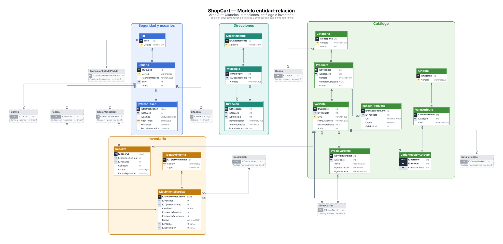
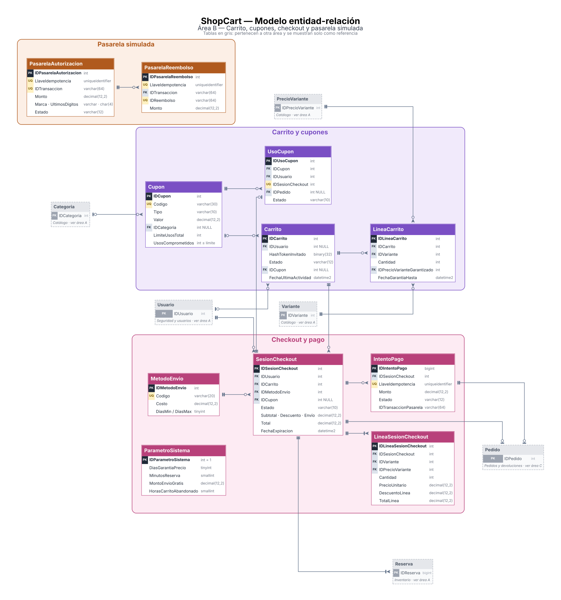
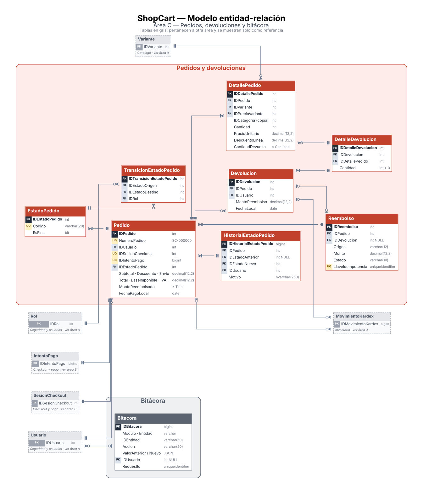
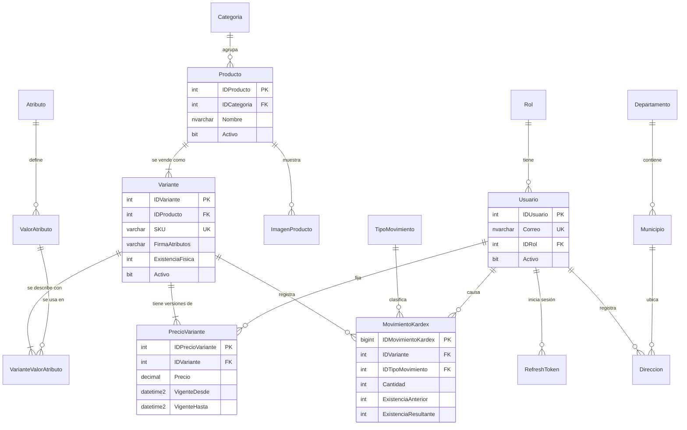
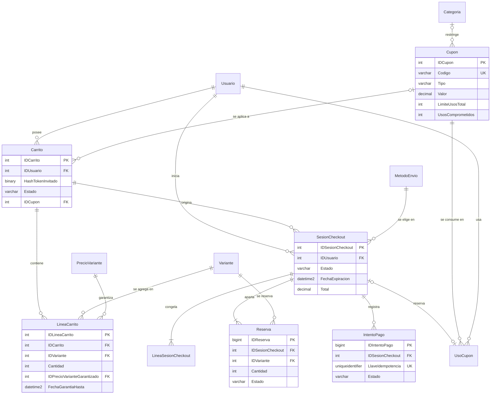
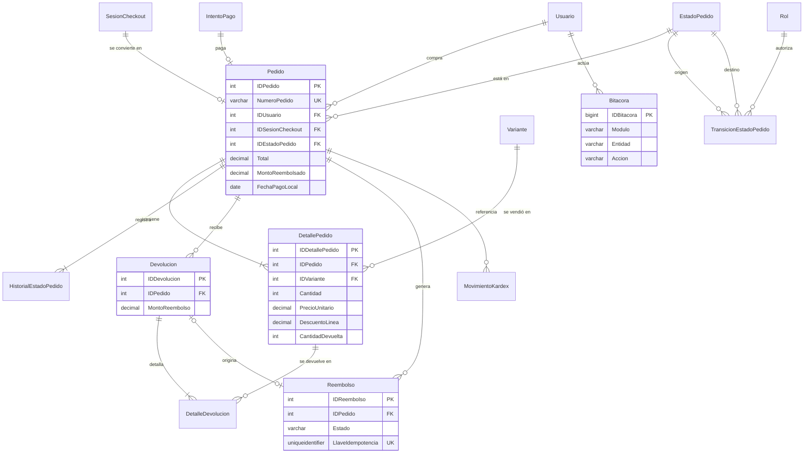

# ShopCart — Modelo de datos

> Etapa 2 del proceso. Implementa las decisiones de [`00-vision-y-contexto.md`](./00-vision-y-contexto.md) y la arquitectura de [`01-arquitectura.md`](./01-arquitectura.md).
> Las decisiones propias del modelo (`M-xx`, sección 10) fueron **confirmadas por el PO el 29 oct**; M-01 se modificó a tablas ledger.
> Motor: **SQL Server 2022** (imagen oficial de Docker). Base: `ShopCart`. Esquema: `dbo`.

---

## 1. Convenciones

### 1.1 Nomenclatura

| Objeto | Formato | Ejemplo | Fuente |
|---|---|---|---|
| Tabla | PascalCase, singular | `Pedido`, `LineaCarrito` | Propuesta |
| PK autoincrementable | `ID` + nombre de la tabla | `IDPedido` | **Enunciado** |
| FK | Mismo nombre que la PK referida | `Pedido.IDUsuario` | Propuesta |
| Stored procedure | `SP_Modulo_Proceso` | `SP_Pedidos_CrearPedido` | **Enunciado** |
| Vista | `VW_Modulo_Proceso` | `VW_Dashboard_VentasPorCategoria` | **Enunciado** |
| Función tipo tabla | `FU_Modulo_Proceso` | `FU_Catalogo_PrecioVigente` | **Enunciado** |
| Trigger | `TR_Modulo_Proceso` | `TR_Bitacora_Inmutable` | Extensión del estándar (M-06) |
| Constraints | `PK_Tabla`, `FK_Tabla_Referida`, `UQ_Tabla_Columnas`, `CK_Tabla_Regla`, `DF_Tabla_Columna` | `CK_Variante_ExistenciaNoNegativa` | Extensión del estándar (M-06) |
| Índices | `IX_Tabla_Columnas` y, si es único filtrado, `UX_Tabla_Regla` | `UX_Carrito_ActivoPorUsuario` | Extensión del estándar (M-06) |

### 1.2 Tipos de datos

| Uso | Tipo | Nota |
|---|---|---|
| Montos en quetzales | `DECIMAL(12,2)` | Hasta Q9,999,999,999.99. **Nunca `FLOAT`/`REAL`** |
| Porcentajes | `DECIMAL(5,2)` | 0.00–100.00 |
| Cantidades | `INT` | Unidades enteras |
| PK de tablas maestras | `INT IDENTITY(1,1)` | |
| PK de tablas de alto volumen | `BIGINT IDENTITY(1,1)` | Kardex, bitácora, historial, intentos de pago, reservas, refresh tokens |
| Fechas y horas | `DATETIME2(3)` en **UTC** (`SYSUTCDATETIME()`) | Precisión de milisegundos |
| Fecha local para reportes | `DATE` | Fecha en Guatemala (UTC−6, sin horario de verano), calculada al insertar (M-03) |
| Texto visible | `NVARCHAR(n)` | Acentos y ñ |
| Códigos técnicos | `VARCHAR(n)` | SKU, códigos de estado y de cupón |
| Hashes | `BINARY(32)` | SHA-256 |
| JSON | `NVARCHAR(MAX)` con `CHECK (ISJSON(col) = 1)` | Bitácora |
| Llaves de idempotencia | `UNIQUEIDENTIFIER` | UUID generado por el cliente |

### 1.3 Reglas generales

- Todas las tablas tienen `FechaCreacion DATETIME2(3) NOT NULL DEFAULT SYSUTCDATETIME()`. Las tablas editables también tienen `FechaActualizacion`.
- **Nada se borra físicamente** si tiene historial (N-14). Las entidades desactivables tienen `Activo BIT NOT NULL DEFAULT 1`.
- La base usa `READ_COMMITTED_SNAPSHOT ON` (A-05).
- Todo SP que escribe empieza con `SET NOCOUNT ON; SET XACT_ABORT ON;` y usa `BEGIN TRY / BEGIN TRAN … COMMIT / END TRY BEGIN CATCH … ROLLBACK; THROW; END CATCH`.
- **Contexto del actor (A-18):** todo SP invocado por la API declara `@IDUsuarioActor INT = NULL, @RolActor VARCHAR(20) = NULL, @RequestId UNIQUEIDENTIFIER = NULL`, que `ejecutarSP` envía siempre. Los SPs de recursos propios filtran con `@IDUsuarioActor`. Todo SP que escribe llama primero a `SP_Sistema_EstablecerContexto`, que fija `SESSION_CONTEXT` (`IDUsuario`, `Rol`, `RequestId`) para que los triggers lo lean.

---

## 2. Diagrama entidad-relación

El modelo se divide en **tres áreas temáticas** para que se pueda leer. En cada diagrama, las tablas de otras áreas aparecen en gris, solo con su llave primaria, como referencia.

| Área | Contenido | Imagen |
|---|---|---|
| A | Usuarios, direcciones, catálogo e inventario |  |
| B | Carrito, cupones y checkout |  |
| C | Pedidos, devoluciones y bitácora |  |

Las imágenes se regeneran desde `diagramas/fuentes/`. Las tablas y relaciones se editan en `tablas_y_relaciones.py`; después se ejecuta `python generar_modelo_por_areas.py` y `dot -Tsvg ../modelo-datos-area-a.dot -o ../modelo-datos-area-a.svg`, y lo mismo para b y c. A continuación, una versión simplificada en Mermaid, que GitHub renderiza directamente.

### 2.1 Usuarios, catálogo e inventario

### 2.2 Carrito, cupones y checkout

### 2.3 Pedidos, devoluciones y bitácora

---

## 3. Tablas

Notación: **PK** llave primaria · **FK** llave foránea · **UQ** único · **CK** check · **DF** default · **NN** not null (todas las columnas son NN salvo que diga *NULL*).

### 3.1 Seguridad y usuarios

**`Rol`** — catálogo fijo (semilla).

| Columna | Tipo | Reglas |
|---|---|---|
| IDRol | INT IDENTITY | PK |
| Codigo | VARCHAR(20) | UQ. `Cliente`, `Operador`, `Administrador` |
| Nombre | NVARCHAR(50) | |

**`Usuario`**

| Columna | Tipo | Reglas |
|---|---|---|
| IDUsuario | INT IDENTITY | PK |
| Correo | NVARCHAR(254) | Formato validado en la API |
| CorreoNormalizado | AS `LOWER(Correo)` PERSISTED | **UQ** (correo único sin distinguir mayúsculas, N-15) |
| HashContrasena | VARCHAR(255) | argon2id |
| Nombre | NVARCHAR(100) | |
| Telefono | VARCHAR(8) *NULL* | CK: 8 dígitos |
| IDRol | INT | FK → Rol |
| Activo | BIT | DF 1 |
| FechaDesactivacion | DATETIME2(3) *NULL* | CK: `Activo = 1` ⇔ `FechaDesactivacion IS NULL` |

**`RefreshToken`**

| Columna | Tipo | Reglas |
|---|---|---|
| IDRefreshToken | BIGINT IDENTITY | PK |
| IDUsuario | INT | FK → Usuario |
| IDFamilia | UNIQUEIDENTIFIER | Agrupa la cadena de rotaciones |
| HashToken | BINARY(32) | **UQ** |
| FechaExpiracion | DATETIME2(3) | |
| FechaUso | DATETIME2(3) *NULL* | Se llena al rotar; **un segundo uso = reúso → se revoca la familia** |
| FechaRevocacion | DATETIME2(3) *NULL* | |
| MotivoRevocacion | VARCHAR(30) *NULL* | CK: `Logout`, `Reuso`, `Desactivacion`, `CambioContrasena` |
| IP | VARCHAR(45) *NULL* | |
| UserAgent | NVARCHAR(300) *NULL* | |

Índices: `IX_RefreshToken_IDFamilia`, `IX_RefreshToken_IDUsuario`.

### 3.2 Geografía y direcciones

**`Departamento`** (22 filas de semilla): `IDDepartamento` PK, `Nombre NVARCHAR(50)` UQ.

**`Municipio`** (340 filas de semilla): `IDMunicipio` PK, `IDDepartamento` FK, `Nombre NVARCHAR(80)`. UQ `(IDDepartamento, Nombre)`.

**`Direccion`**

| Columna | Tipo | Reglas |
|---|---|---|
| IDDireccion | INT IDENTITY | PK |
| IDUsuario | INT | FK → Usuario |
| Alias | NVARCHAR(50) *NULL* | "Casa", "Oficina" |
| NombreRecibe | NVARCHAR(100) | |
| TelefonoRecibe | VARCHAR(8) | CK: 8 dígitos |
| IDMunicipio | INT | FK → Municipio |
| DireccionLinea | NVARCHAR(200) | |
| Referencia | NVARCHAR(200) *NULL* | |
| EsPredeterminada | BIT | DF 0 |

Índices: **`UX_Direccion_PredeterminadaPorUsuario`** UNIQUE `(IDUsuario) WHERE EsPredeterminada = 1` (N-17) e `IX_Direccion_IDUsuario`. Se permite el borrado físico porque el pedido y la sesión copian la dirección.

### 3.3 Catálogo

**`Categoria`**: `IDCategoria` PK, `Nombre NVARCHAR(80)` UQ, `Descripcion NVARCHAR(300) NULL`, `Activo`.

**`Producto`**

| Columna | Tipo | Reglas |
|---|---|---|
| IDProducto | INT IDENTITY | PK |
| IDCategoria | INT | FK → Categoria |
| Nombre | NVARCHAR(150) | |
| NombreBusqueda | AS `Nombre COLLATE Latin1_General_CI_AI` PERSISTED | Búsqueda sin mayúsculas ni tildes (A-10) |
| Descripcion | NVARCHAR(2000) *NULL* | |
| Activo | BIT | DF 1 |

Índice: `IX_Producto_Categoria_Activo (IDCategoria, Activo) INCLUDE (Nombre)`.

**`ImagenProducto`**: `IDImagenProducto` PK, `IDProducto` FK, `Url NVARCHAR(500)`, `TextoAlternativo NVARCHAR(150)`, `Orden SMALLINT`, `EsPrincipal BIT`. UQ `(IDProducto, Orden)`; **`UX_ImagenProducto_Principal`** UNIQUE `(IDProducto) WHERE EsPrincipal = 1`.

**`Atributo`**: `IDAtributo` PK, `Nombre NVARCHAR(50)` UQ (Talla, Color…), `Orden SMALLINT`.

**`ValorAtributo`**: `IDValorAtributo` PK, `IDAtributo` FK, `Valor NVARCHAR(50)`, `Orden SMALLINT`. UQ `(IDAtributo, Valor)` y UQ `(IDValorAtributo, IDAtributo)`. Esta última sirve de destino para la FK compuesta de abajo.

**`Variante`**

| Columna | Tipo | Reglas |
|---|---|---|
| IDVariante | INT IDENTITY | PK |
| IDProducto | INT | FK → Producto |
| SKU | VARCHAR(40) | **UQ** global; no editable con movimientos (lo valida el SP) |
| FirmaAtributos | VARCHAR(200) | IDs de `ValorAtributo` ordenados por `IDAtributo` (p. ej. `3\|17`); la calcula el SP |
| DescripcionAtributos | NVARCHAR(200) | Texto legible ("M / Azul"), calculado junto con la firma |
| ExistenciaFisica | INT | DF 0. **CK ≥ 0**. Solo la modifica `SP_Inventario_RegistrarMovimiento` |
| Activo | BIT | DF 1 |
| VersionFila | ROWVERSION | |

UQ **`(IDProducto, FirmaAtributos)`**: no puede haber dos variantes con la misma combinación (N-14).

**`VarianteValorAtributo`** (tabla puente)

| Columna | Tipo | Reglas |
|---|---|---|
| IDVariante | INT | PK (1/2), FK → Variante |
| IDAtributo | INT | PK (2/2): **un solo valor por atributo** en cada variante |
| IDValorAtributo | INT | FK compuesta `(IDValorAtributo, IDAtributo)` → `ValorAtributo`: el valor tiene que pertenecer a ese atributo |

**`PrecioVariante`** — precios versionados (N-02)

| Columna | Tipo | Reglas |
|---|---|---|
| IDPrecioVariante | INT IDENTITY | PK |
| IDVariante | INT | FK → Variante |
| Precio | DECIMAL(12,2) | CK > 0. IVA incluido |
| VigenteDesde | DATETIME2(3) | |
| VigenteHasta | DATETIME2(3) *NULL* | `NULL` = precio vigente. CK: `VigenteHasta > VigenteDesde` |
| IDUsuario | INT | FK → Usuario (quién fijó el precio) |

Índices: **`UX_PrecioVariante_Vigente`** UNIQUE `(IDVariante) WHERE VigenteHasta IS NULL` (un solo precio vigente por variante) e `IX_PrecioVariante_Historial (IDVariante, VigenteDesde DESC) INCLUDE (Precio, VigenteHasta)`.

Cambiar un precio = cerrar la versión vigente (`VigenteHasta = ahora`) e insertar una nueva, en una transacción (`SP_Catalogo_CambiarPrecio`).

### 3.4 Inventario

**`TipoMovimiento`** (semilla, 6 filas)

| Columna | Tipo | Reglas |
|---|---|---|
| IDTipoMovimiento | INT IDENTITY | PK |
| Codigo | VARCHAR(30) | UQ: `EntradaCompra`, `SalidaVenta`, `AjustePositivo`, `AjusteNegativo`, `ReingresoCancelacion`, `ReingresoDevolucion` |
| Nombre | NVARCHAR(60) | |
| Signo | SMALLINT | CK `IN (1, -1)` |
| EsManual | BIT | 1 para entradas y ajustes (los registra el Operador) |

UQ `(IDTipoMovimiento, Signo)`, destino de la FK compuesta del kardex.

**`MovimientoKardex`** — ledger append-only (M-01)

| Columna | Tipo | Reglas |
|---|---|---|
| IDMovimientoKardex | BIGINT IDENTITY | PK |
| IDVariante | INT | FK → Variante |
| IDTipoMovimiento | INT | FK compuesta `(IDTipoMovimiento, Signo)` → TipoMovimiento: **el signo no puede contradecir el tipo** |
| Signo | SMALLINT | |
| Cantidad | INT | CK > 0 |
| ExistenciaAnterior | INT | CK ≥ 0 |
| ExistenciaResultante | INT | CK ≥ 0 y **CK `ExistenciaResultante = ExistenciaAnterior + Signo * Cantidad`** |
| Motivo | NVARCHAR(250) | NN (en ventas: "Venta pedido SC-000123") |
| Referencia | NVARCHAR(100) *NULL* | Número de factura u otra referencia |
| IDPedido | INT *NULL* | FK → Pedido |
| IDDevolucion | INT *NULL* | FK → Devolucion |
| IDUsuario | INT | FK → Usuario |
| RequestId | UNIQUEIDENTIFIER *NULL* | Correlación con las trazas |
| Fecha | DATETIME2(3) | DF `SYSUTCDATETIME()` |

Índices: `IX_MovimientoKardex_Variante (IDVariante, IDMovimientoKardex DESC)` e `IX_MovimientoKardex_Fecha (Fecha)`.

**Invariante que verifica `VW_Inventario_Conciliacion`:** para cada variante, `ExistenciaFisica = SUM(Signo * Cantidad)` = `ExistenciaResultante` del último movimiento.

**`Reserva`**

| Columna | Tipo | Reglas |
|---|---|---|
| IDReserva | BIGINT IDENTITY | PK |
| IDSesionCheckout | INT | FK → SesionCheckout |
| IDVariante | INT | FK → Variante |
| Cantidad | INT | CK > 0 |
| Estado | VARCHAR(10) | CK `IN ('Activa','Consumida','Liberada')` |
| FechaExpiracion | DATETIME2(3) | |
| FechaCierre | DATETIME2(3) *NULL* | |

UQ `(IDSesionCheckout, IDVariante)`. Índice **`IX_Reserva_Activas (IDVariante, FechaExpiracion) INCLUDE (Cantidad) WHERE Estado = 'Activa'`**: el cálculo del disponible solo lee las reservas activas.

### 3.5 Carrito

**`Carrito`**

| Columna | Tipo | Reglas |
|---|---|---|
| IDCarrito | INT IDENTITY | PK |
| IDUsuario | INT *NULL* | FK → Usuario |
| HashTokenInvitado | BINARY(32) *NULL* | |
| Estado | VARCHAR(12) | CK `IN ('Activo','Fusionado','Convertido','Expirado')` |
| IDCupon | INT *NULL* | FK → Cupon (cupón aplicado como vista previa, N-12) |
| FechaUltimaActividad | DATETIME2(3) | Se actualiza solo con cambios (N-13) |
| FechaCierre | DATETIME2(3) *NULL* | |

CK: **exactamente uno** de `IDUsuario` o `HashTokenInvitado`. Índices: **`UX_Carrito_ActivoPorUsuario`** UNIQUE `(IDUsuario) WHERE Estado = 'Activo' AND IDUsuario IS NOT NULL`, **`UX_Carrito_TokenInvitado`** UNIQUE `(HashTokenInvitado) WHERE HashTokenInvitado IS NOT NULL` e `IX_Carrito_Abandono (Estado, FechaUltimaActividad)`.

**`LineaCarrito`**

| Columna | Tipo | Reglas |
|---|---|---|
| IDLineaCarrito | INT IDENTITY | PK |
| IDCarrito | INT | FK → Carrito |
| IDVariante | INT | FK → Variante |
| Cantidad | INT | CK > 0 |
| IDPrecioVarianteGarantizado | INT | FK → PrecioVariante |
| FechaGarantiaHasta | DATETIME2(3) | Fecha en que se agregó + `DiasGarantiaPrecio` |
| PrecioAnteriorAviso | DECIMAL(12,2) *NULL* | Precio que se muestra en la alerta "cambió de Q… a Q…" hasta que el cliente la vea |
| FechaAgregado | DATETIME2(3) | |

UQ `(IDCarrito, IDVariante)`. El máximo de 50 líneas lo valida el SP contra `ParametroSistema`.

### 3.6 Cupones

**`Cupon`**

| Columna | Tipo | Reglas |
|---|---|---|
| IDCupon | INT IDENTITY | PK |
| Codigo | VARCHAR(30) | **UQ**; CK `Codigo = UPPER(Codigo)` (se guarda en mayúsculas) |
| Descripcion | NVARCHAR(200) | |
| Tipo | VARCHAR(10) | CK `IN ('Porcentaje','MontoFijo')` |
| Valor | DECIMAL(12,2) | CK > 0; CK: si es `Porcentaje`, ≤ 100 |
| MontoMaximoDescuento | DECIMAL(12,2) *NULL* | CK > 0; CK: solo si es `Porcentaje` |
| MontoMinimoCompra | DECIMAL(12,2) | DF 0, CK ≥ 0 |
| IDCategoria | INT *NULL* | FK → Categoria. `NULL` = aplica a todo el carrito |
| FechaInicio, FechaFin | DATETIME2(3) | CK `FechaFin > FechaInicio` |
| LimiteUsosTotal | INT | CK > 0 |
| LimiteUsosPorCliente | INT | CK > 0 |
| **UsosComprometidos** | INT | DF 0. **CK `UsosComprometidos BETWEEN 0 AND LimiteUsosTotal`** (A-13): reservados + confirmados |
| Activo | BIT | DF 1 |
| VersionFila | ROWVERSION | |

**`UsoCupon`**

| Columna | Tipo | Reglas |
|---|---|---|
| IDUsoCupon | INT IDENTITY | PK |
| IDCupon | INT | FK → Cupon |
| IDUsuario | INT | FK → Usuario |
| IDSesionCheckout | INT | FK → SesionCheckout; **UQ** (un cupón por sesión) |
| IDPedido | INT *NULL* | FK → Pedido |
| Estado | VARCHAR(10) | CK `IN ('Reservado','Confirmado','Liberado','Revertido')` |
| MontoDescuento | DECIMAL(12,2) | CK ≥ 0 |

Índice `IX_UsoCupon_PorCliente (IDCupon, IDUsuario, Estado)`: el límite por cliente cuenta `Reservado` (vigentes) + `Confirmado`.

### 3.7 Envíos y parámetros

**`MetodoEnvio`**: `IDMetodoEnvio` PK, `Codigo VARCHAR(20)` UQ, `Nombre NVARCHAR(50)`, `Costo DECIMAL(12,2)` CK ≥ 0, `DiasMin TINYINT`, `DiasMax TINYINT` CK `DiasMax >= DiasMin`, `Activo`.

**`ParametroSistema`** — una sola fila tipada (A-14)

| Columna | Tipo | Default | CK |
|---|---|---|---|
| IDParametroSistema | INT IDENTITY | — | PK; **CK `= 1`** (una sola fila) |
| DiasGarantiaPrecio | TINYINT | 3 | 1–30 |
| MinutosReserva | SMALLINT | 15 | 5–60 |
| HorasCarritoAbandonado | SMALLINT | 24 | 1–720 |
| DiasExpiracionCarritoInvitado | SMALLINT | 30 | 1–365 |
| UmbralUltimasUnidades | SMALLINT | 5 | 1–100 |
| MontoEnvioGratis | DECIMAL(12,2) *NULL* | 500.00 | > 0 (`NULL` = sin envío gratis) |
| MaxIntentosPagoRechazados | TINYINT | 5 | 1–10 |
| DiasPlazoDevolucion | SMALLINT | 30 | 1–365 |
| MaxLineasCarrito | SMALLINT | 50 | 1–200 |
| IDUsuarioActualizacion | INT *NULL* | — | FK → Usuario |

### 3.8 Checkout

**`SesionCheckout`**

| Columna | Tipo | Reglas |
|---|---|---|
| IDSesionCheckout | INT IDENTITY | PK |
| IDUsuario | INT | FK → Usuario |
| IDCarrito | INT | FK → Carrito |
| Estado | VARCHAR(10) | CK `IN ('Activa','Pagada','Expirada','Cancelada')` |
| HashContenido | BINARY(32) | Hash de líneas, cantidades, cupón, envío y dirección: si coincide, la sesión se reutiliza (N-02) |
| NombreRecibe, TelefonoRecibe, IDMunicipio, Departamento, Municipio, DireccionLinea, Referencia | (como en `Direccion`, más los nombres) | **Copia de la dirección** confirmada |
| IDMetodoEnvio | INT | FK → MetodoEnvio |
| NombreMetodoEnvio | NVARCHAR(50) | Copia |
| DiasMin, DiasMax | TINYINT | Copia para la fecha estimada de entrega |
| IDCupon | INT *NULL* | FK → Cupon |
| CodigoCupon | VARCHAR(30) *NULL* | Copia |
| Subtotal | DECIMAL(12,2) | CK ≥ 0 |
| Descuento | DECIMAL(12,2) | CK `0 ≤ Descuento ≤ Subtotal` |
| CostoEnvio | DECIMAL(12,2) | CK ≥ 0 |
| Total | DECIMAL(12,2) | **CK `Total = Subtotal - Descuento + CostoEnvio`** |
| IntentosRechazados | TINYINT | DF 0 |
| FechaExpiracion | DATETIME2(3) | |
| FechaCierre | DATETIME2(3) *NULL* | |

Índices: **`UX_SesionCheckout_ActivaPorUsuario`** UNIQUE `(IDUsuario) WHERE Estado = 'Activa'` (una sola sesión activa, N-02) e `IX_SesionCheckout_PorExpirar (FechaExpiracion) WHERE Estado = 'Activa'`.

**`LineaSesionCheckout`** — resumen congelado

| Columna | Tipo | Reglas |
|---|---|---|
| IDLineaSesionCheckout | INT IDENTITY | PK |
| IDSesionCheckout | INT | FK → SesionCheckout |
| IDVariante | INT | FK → Variante |
| IDPrecioVariante | INT | FK → PrecioVariante (la versión que se cobró) |
| Cantidad | INT | CK > 0 |
| PrecioUnitario | DECIMAL(12,2) | CK > 0. Precio efectivo (con garantía) |
| DescuentoLinea | DECIMAL(12,2) | CK `0 ≤ DescuentoLinea ≤ Cantidad * PrecioUnitario` |
| TotalLinea | DECIMAL(12,2) | **CK `TotalLinea = Cantidad * PrecioUnitario - DescuentoLinea`** |

UQ `(IDSesionCheckout, IDVariante)`. **Invariante (lo valida el SP):** `SUM(DescuentoLinea) = SesionCheckout.Descuento`, con el centavo sobrante asignado a la línea de mayor monto.

**`IntentoPago`**

| Columna | Tipo | Reglas |
|---|---|---|
| IDIntentoPago | BIGINT IDENTITY | PK |
| IDSesionCheckout | INT | FK → SesionCheckout |
| LlaveIdempotencia | UNIQUEIDENTIFIER | **UQ** |
| HashSolicitud | BINARY(32) | Para detectar "misma llave, otro contenido" → 422 |
| Monto | DECIMAL(12,2) | CK > 0 |
| Estado | VARCHAR(12) | CK `IN ('Pendiente','Autorizado','Capturado','Rechazado','Anulado','Error')` |
| IDTransaccionPasarela | VARCHAR(64) *NULL* | |
| CodigoRespuesta | VARCHAR(30) *NULL* | p. ej. `FONDOS_INSUFICIENTES` |
| MensajeRespuesta | NVARCHAR(200) *NULL* | |
| MarcaTarjeta | VARCHAR(20) *NULL* | |
| UltimosDigitos | CHAR(4) *NULL* | CK: 4 dígitos |

Índices: **`UX_IntentoPago_EnCursoPorSesion`** UNIQUE `(IDSesionCheckout) WHERE Estado IN ('Pendiente','Autorizado')` (**un solo intento en curso por sesión, garantizado por la BD** → 409, N-03), `UX_IntentoPago_Transaccion` UNIQUE `(IDTransaccionPasarela) WHERE IDTransaccionPasarela IS NOT NULL` e `IX_IntentoPago_PorConciliar (Estado, FechaActualizacion) WHERE Estado = 'Autorizado'`.

### 3.9 Pedidos

**`EstadoPedido`** (semilla): `IDEstadoPedido` PK, `Codigo VARCHAR(20)` UQ (`Pagado`, `EnPreparacion`, `Despachado`, `Entregado`, `Cancelado`, `DevueltoParcial`, `Devuelto`), `Nombre NVARCHAR(40)`, `EsFinal BIT` (1 = estado sin transiciones de salida: `Cancelado` y `Devuelto`), `Orden TINYINT`.

**`TransicionEstadoPedido`** (semilla)

| Columna | Tipo | Reglas |
|---|---|---|
| IDTransicionEstadoPedido | INT IDENTITY | PK |
| IDEstadoOrigen | INT | FK → EstadoPedido |
| IDEstadoDestino | INT | FK → EstadoPedido; CK `<> IDEstadoOrigen` |
| IDRol | INT | FK → Rol |

UQ `(IDEstadoOrigen, IDEstadoDestino, IDRol)`.

| Origen → Destino | Roles |
|---|---|
| Pagado → EnPreparacion | Operador, Administrador |
| EnPreparacion → Despachado | Operador, Administrador |
| Despachado → Entregado | Operador, Administrador |
| Pagado → Cancelado | Cliente, Operador, Administrador |
| EnPreparacion → Cancelado | Cliente, Operador, Administrador |
| Entregado → DevueltoParcial | Operador, Administrador |
| Entregado → Devuelto | Operador, Administrador |
| DevueltoParcial → Devuelto | Operador, Administrador |

`DevueltoParcial → DevueltoParcial` (otra devolución parcial) no cambia el estado: el SP no registra una transición en ese caso.

**`Pedido`**

| Columna | Tipo | Reglas |
|---|---|---|
| IDPedido | INT IDENTITY | PK |
| NumeroPedido | AS `'SC-' + RIGHT('000000' + CAST(IDPedido AS VARCHAR(10)), 6)` PERSISTED | UQ. Número visible para el cliente |
| IDUsuario | INT | FK → Usuario |
| IDSesionCheckout | INT | FK; **UQ** (un pedido por sesión: idempotencia en la BD) |
| IDIntentoPago | BIGINT | FK; **UQ** |
| IDEstadoPedido | INT | FK → EstadoPedido |
| Subtotal | DECIMAL(12,2) | CK ≥ 0 |
| Descuento | DECIMAL(12,2) | CK `0 ≤ Descuento ≤ Subtotal` |
| CostoEnvio | DECIMAL(12,2) | CK ≥ 0 |
| Total | DECIMAL(12,2) | **CK `Total = Subtotal - Descuento + CostoEnvio`** |
| BaseImponible | DECIMAL(12,2) | `ROUND(Total / 1.12, 2)` (N-18) |
| IVA | DECIMAL(12,2) | **CK `BaseImponible + IVA = Total`** |
| **MontoReembolsado** | DECIMAL(12,2) | DF 0. **CK `MontoReembolsado BETWEEN 0 AND Total`** (A-13) |
| IDCupon, CodigoCupon | INT *NULL*, VARCHAR(30) *NULL* | FK y copia |
| IDMetodoEnvio, NombreMetodoEnvio | INT, NVARCHAR(50) | FK y copia |
| FechaEstimadaEntrega | DATE | Fecha de pago + `DiasMax` |
| NombreRecibe, TelefonoRecibe, IDMunicipio, Departamento, Municipio, DireccionLinea, Referencia | | **Copia de la dirección** (N-17) |
| IDTransaccionPasarela | VARCHAR(64) | Para reembolsos (N-03) |
| MarcaTarjeta, UltimosDigitos | VARCHAR(20), CHAR(4) | Para mostrar "Visa ****4242" |
| FechaPago | DATETIME2(3) | UTC |
| **FechaPagoLocal** | DATE | Fecha en Guatemala; agrupa los reportes (A-12) |
| VersionFila | ROWVERSION | |

Índices: `IX_Pedido_Cliente (IDUsuario, FechaPago DESC)` (historial del cliente), `IX_Pedido_Reportes (FechaPagoLocal) INCLUDE (IDEstadoPedido, Subtotal, Descuento, CostoEnvio, Total)` (dashboard) e `IX_Pedido_Gestion (IDEstadoPedido, FechaPago DESC) INCLUDE (IDUsuario, Total)` (listado con filtros, RF-08).

Trigger **`TR_Pedidos_ValidarTransicion`** (`AFTER UPDATE`): si cambia `IDEstadoPedido` y el par `(anterior, nuevo)` no existe en `TransicionEstadoPedido` para el rol que viene en `SESSION_CONTEXT`, hace `THROW 50701` y la transacción se revierte. Es la "segunda capa" de N-08.

**`DetallePedido`**

| Columna | Tipo | Reglas |
|---|---|---|
| IDDetallePedido | INT IDENTITY | PK |
| IDPedido | INT | FK → Pedido |
| IDVariante | INT | FK → Variante |
| IDPrecioVariante | INT | FK → PrecioVariante |
| SKU, NombreProducto, DescripcionVariante | | **Copias** al momento de la venta |
| IDCategoria, NombreCategoria | INT, NVARCHAR(80) | **Copia**: los reportes por categoría usan la categoría que tenía el producto al venderse |
| Cantidad | INT | CK > 0 |
| PrecioUnitario | DECIMAL(12,2) | CK > 0 |
| DescuentoLinea | DECIMAL(12,2) | CK `0 ≤ DescuentoLinea ≤ Cantidad * PrecioUnitario` |
| TotalLinea | DECIMAL(12,2) | **CK `TotalLinea = Cantidad * PrecioUnitario - DescuentoLinea`** |
| **CantidadDevuelta** | INT | DF 0. **CK `CantidadDevuelta BETWEEN 0 AND Cantidad`** (N-10) |

UQ `(IDPedido, IDVariante)`. Índices: `IX_DetallePedido_Variante (IDVariante) INCLUDE (Cantidad, TotalLinea)` e `IX_DetallePedido_Categoria (IDCategoria) INCLUDE (IDPedido, TotalLinea, Cantidad)`.

**`HistorialEstadoPedido`** — ledger append-only (M-01)

| Columna | Tipo | Reglas |
|---|---|---|
| IDHistorialEstadoPedido | BIGINT IDENTITY | PK |
| IDPedido | INT | FK → Pedido |
| IDEstadoAnterior | INT *NULL* | FK → EstadoPedido (`NULL` en la creación) |
| IDEstadoNuevo | INT | FK → EstadoPedido |
| IDUsuario | INT | FK → Usuario |
| Motivo | NVARCHAR(250) *NULL* | Obligatorio al cancelar (lo valida el SP) |
| RequestId | UNIQUEIDENTIFIER *NULL* | |
| Fecha | DATETIME2(3) | |

Índice `IX_HistorialEstadoPedido_Pedido (IDPedido, Fecha)`.

**`Devolucion`**: `IDDevolucion` PK, `IDPedido` FK, `IDUsuario` FK (Operador), `Motivo NVARCHAR(250)`, `MontoReembolso DECIMAL(12,2)` CK > 0, `Fecha DATETIME2(3)`, **`FechaLocal DATE`** (las devoluciones se restan en su propia fecha, N-11). Índice `IX_Devolucion_FechaLocal (FechaLocal) INCLUDE (MontoReembolso)`.

**`DetalleDevolucion`**: `IDDetalleDevolucion` PK, `IDDevolucion` FK, `IDDetallePedido` FK, `Cantidad INT` CK > 0, `MontoReembolso DECIMAL(12,2)` CK ≥ 0. UQ `(IDDevolucion, IDDetallePedido)`.

**`Reembolso`**

| Columna | Tipo | Reglas |
|---|---|---|
| IDReembolso | INT IDENTITY | PK |
| IDPedido | INT | FK → Pedido |
| IDDevolucion | INT *NULL* | FK → Devolucion |
| Origen | VARCHAR(12) | CK `IN ('Cancelacion','Devolucion')`; CK: `Devolucion` ⇔ `IDDevolucion IS NOT NULL` |
| Monto | DECIMAL(12,2) | CK > 0 |
| Estado | VARCHAR(10) | CK `IN ('Pendiente','Completado','Fallido')` |
| Intentos | TINYINT | DF 0 |
| LlaveIdempotencia | UNIQUEIDENTIFIER | **UQ** (se envía a la pasarela) |
| IDTransaccionReembolso | VARCHAR(64) *NULL* | |
| UltimoError | NVARCHAR(500) *NULL* | |
| FechaProximoIntento | DATETIME2(3) *NULL* | |
| FechaCompletado | DATETIME2(3) *NULL* | |

Índices: **`UX_Reembolso_CancelacionPorPedido`** UNIQUE `(IDPedido) WHERE Origen = 'Cancelacion'`, `UX_Reembolso_PorDevolucion` UNIQUE `(IDDevolucion) WHERE IDDevolucion IS NOT NULL` e `IX_Reembolso_Pendientes (FechaProximoIntento) WHERE Estado = 'Pendiente'`.

`Pedido.MontoReembolsado` aumenta **al crear** el reembolso, en la misma transacción. El `CHECK` garantiza que nunca se compromete más de lo cobrado.

### 3.10 Bitácora

**`Bitacora`** — ledger append-only (M-01)

| Columna | Tipo | Reglas |
|---|---|---|
| IDBitacora | BIGINT IDENTITY | PK |
| Modulo | VARCHAR(30) | `Catalogo`, `Inventario`, `Cupones`, `Pedidos`, `Envios`, `Usuarios`, `Configuracion` |
| Entidad | VARCHAR(50) | Nombre de la tabla |
| IDEntidad | VARCHAR(50) | PK del registro afectado |
| Accion | VARCHAR(20) | CK `IN ('Crear','Modificar','Desactivar','Activar','Eliminar','CambioEstado')` |
| ValorAnterior | NVARCHAR(MAX) *NULL* | CK `ISJSON = 1` |
| ValorNuevo | NVARCHAR(MAX) *NULL* | CK `ISJSON = 1` |
| IDUsuario | INT *NULL* | FK → Usuario (`NULL` = proceso del sistema, por ejemplo un job) |
| RequestId | UNIQUEIDENTIFIER *NULL* | |
| Fecha | DATETIME2(3) | |

Índices: `IX_Bitacora_Modulo (Modulo, Fecha DESC)` (filtro de RF-09) e `IX_Bitacora_Entidad (Entidad, IDEntidad, Fecha DESC)`.

**Triggers que la alimentan** (`AFTER INSERT, UPDATE, DELETE`, serializando `inserted`/`deleted` con `FOR JSON PATH`):

| Tabla | Qué se registra | Módulo |
|---|---|---|
| `Categoria`, `Producto`, `Variante` | Creación, cambios, desactivación y existencia física | Catalogo / Inventario |
| `PrecioVariante` | Cada nueva versión de precio, con el precio anterior | Catalogo |
| `Cupon` | Creación, cambios y desactivación | Cupones |
| `Pedido` | **Solo cuando cambia `IDEstadoPedido`** | Pedidos |
| `MetodoEnvio`, `ParametroSistema` | Cambios de tarifas y parámetros (N-04) | Envios / Configuracion |
| `Usuario` | Rol y activación, **nunca `HashContrasena`** | Usuarios |

---

## 4. Vistas y funciones

| Objeto | Tipo | Propósito |
|---|---|---|
| `FU_Catalogo_PrecioVigente(@IDVariante)` | Inline TVF | `IDPrecioVariante` y `Precio` vigentes. Se usa con `CROSS APPLY` (nombre tomado del enunciado) |
| `FU_Inventario_Disponible(@IDVariante)` | Inline TVF | `ExistenciaFisica`, `Reservado` (reservas `Activa` no vencidas) y `Disponible` |
| `FU_Carrito_Lineas(@IDCarrito)` | Inline TVF | Por línea: precio vigente, precio efectivo con garantía, estado (`Disponible`/`CantidadExcedida`/`Agotado`/`NoDisponible`), aviso y etiqueta de existencia |
| `FU_Cupones_Validar(@IDCupon, @IDUsuario, @IDCarrito)` | Inline TVF | Código de resultado de la validación (cada causa de N-12) y sus datos (p. ej. cuánto falta para el mínimo) |
| `FU_Cupones_CalculoDescuento(@IDCupon, @IDCarrito)` | Inline TVF | Descuento por línea, repartido proporcionalmente con el centavo sobrante en la línea de mayor monto (nombre tomado del enunciado) |
| `VW_Catalogo_ProductosTienda` | Vista | Productos activos con al menos una variante activa, precio mínimo y si tienen disponible |
| `VW_Inventario_Conciliacion` | Vista | Variantes donde la existencia física ≠ la suma del kardex. **Debe estar vacía** |
| `VW_Inventario_ExistenciaBodega` | Vista | Física + unidades de pedidos pagados aún no despachados (N-07) |
| `VW_Pedidos_Historial` | Vista | Historial de estados con nombres y usuario (nombre tomado del enunciado) |
| **`VW_Dashboard_HechosVenta`** | Vista | **La definición única de "venta" (N-11):** filas de venta (pedidos no cancelados, en su `FechaPagoLocal`) `UNION ALL` filas de devolución (en negativo, en su `FechaLocal`), con fecha, categoría, variante, unidades y monto neto. Todos los reportes agregan sobre esta vista |
| `VW_Dashboard_VentasPorCategoria` | Vista | Agregado de la vista de hechos por fecha y categoría (nombre tomado del enunciado) |
| `VW_Carrito_Abandonados` | Vista | Carritos `Activo` con líneas y sin cambios en `HorasCarritoAbandonado`, con su monto potencial a precio vigente |

---

## 5. Catálogo de stored procedures

Los SPs marcados **(interno)** solo los invocan otros SPs, nunca la API. Así hay un único punto de escritura para cada invariante.

### Auth y usuarios
`SP_Auth_RegistrarCliente` · `SP_Auth_ObtenerCredenciales` · `SP_Auth_RegistrarRefreshToken` · `SP_Auth_RotarRefreshToken` (rotación y detección de reúso) · `SP_Auth_RevocarSesion` · `SP_Usuarios_ObtenerPerfil` · `SP_Usuarios_ActualizarPerfil` · `SP_Usuarios_CambiarContrasena` · `SP_Usuarios_Listar` · `SP_Usuarios_CrearInterno` · `SP_Usuarios_Actualizar` · `SP_Usuarios_CambiarEstado` (protege al último Admin y a uno mismo)

### Direcciones
`SP_Direcciones_Listar` · `SP_Direcciones_Crear` · `SP_Direcciones_Actualizar` · `SP_Direcciones_Eliminar` · `SP_Direcciones_ListarDepartamentos` · `SP_Direcciones_ListarMunicipios`

### Catálogo
`SP_Catalogo_BuscarProductos` (texto, categoría, rango de precio, disponibilidad, orden con lista blanca y paginación; `sp_executesql` con parámetros) · `SP_Catalogo_ObtenerProducto` · `SP_Catalogo_ListarProductosAdmin` · `SP_Catalogo_ListarCategorias` · `SP_Catalogo_CrearCategoria` · `SP_Catalogo_ActualizarCategoria` · `SP_Catalogo_CambiarEstadoCategoria` · `SP_Catalogo_EliminarCategoria` · `SP_Catalogo_CrearProducto` · `SP_Catalogo_ActualizarProducto` · `SP_Catalogo_CambiarEstadoProducto` · `SP_Catalogo_EliminarProducto` · `SP_Catalogo_GuardarImagenes` · `SP_Catalogo_CrearVariante` · `SP_Catalogo_ActualizarVariante` · `SP_Catalogo_CambiarEstadoVariante` · `SP_Catalogo_EliminarVariante` · `SP_Catalogo_CambiarPrecio` · `SP_Catalogo_HistorialPrecios` · `SP_Catalogo_ListarAtributos` · `SP_Catalogo_CrearAtributo` · `SP_Catalogo_CrearValorAtributo`

### Inventario
`SP_Inventario_RegistrarMovimiento` **(interno: único SP que modifica `ExistenciaFisica` y escribe el kardex)** · `SP_Inventario_RegistrarEntrada` · `SP_Inventario_RegistrarAjuste` (motivo obligatorio y nunca por debajo de lo reservado, N-07) · `SP_Inventario_ReservarExistencia` **(interno, nombre del enunciado)** · `SP_Inventario_LiberarReservas` **(interno)** · `SP_Inventario_ObtenerKardex` · `SP_Inventario_ListarExistencias` · `SP_Inventario_Conciliar`

### Carrito
`SP_Carrito_Obtener` · `SP_Carrito_AgregarLinea` · `SP_Carrito_ActualizarCantidad` · `SP_Carrito_EliminarLinea` · `SP_Carrito_AplicarCupon` · `SP_Carrito_QuitarCupon` · `SP_Carrito_MarcarAvisosVistos` · `SP_Carrito_Fusionar` (invitado → cliente al iniciar sesión) · `SP_Carrito_AsignarInvitado` (al registrarse) · `SP_Carrito_ExpirarInvitados` (job)

### Cupones, envíos y configuración
`SP_Cupones_Listar` · `SP_Cupones_Obtener` · `SP_Cupones_Crear` · `SP_Cupones_Actualizar` (no cambia tipo ni valor si ya se usó) · `SP_Cupones_CambiarEstado` · `SP_Cupones_ReservarUso` **(interno)** · `SP_Cupones_LiberarUso` **(interno)** · `SP_Envios_ListarMetodos` · `SP_Envios_ActualizarMetodo` · `SP_Configuracion_Obtener` · `SP_Configuracion_Actualizar`

### Checkout
`SP_Checkout_IniciarSesion` · `SP_Checkout_ObtenerSesion` · `SP_Checkout_CancelarSesion` · `SP_Checkout_RegistrarIntentoPago` · `SP_Checkout_ActualizarIntentoPago` (autorizado, rechazado, anulado, capturado; cancela la sesión al llegar al máximo de rechazos) · `SP_Checkout_ExpirarSesiones` (job) · `SP_Checkout_ObtenerIntentosPorConciliar` (job)

### Pedidos
`SP_Pedidos_CrearPedido` (la transacción atómica de RF-06) · `SP_Pedidos_ListarPropios` · `SP_Pedidos_ObtenerDetalle` (con `@IDUsuario` si el rol es Cliente) · `SP_Pedidos_Listar` (gestión: filtros por estado, cliente y fechas, paginado) · `SP_Pedidos_CambiarEstado` · `SP_Pedidos_Cancelar` · `SP_Pedidos_RegistrarDevolucion` · `SP_Pedidos_ListarReembolsos` · `SP_Pedidos_ObtenerReembolsosPendientes` (job) · `SP_Pedidos_ActualizarReembolso` · `SP_Pedidos_ListarTransiciones` (para el test de coincidencia de N-08)

### Dashboard, bitácora y sistema
`SP_Dashboard_Resumen` (ventas, pedidos, ticket promedio, carritos abandonados) · `SP_Dashboard_VentasPorPeriodo` (`@Agrupacion` = día, semana o mes) · `SP_Dashboard_VentasPorCategoria` · `SP_Dashboard_TopProductos` (top 10) · `SP_Dashboard_CarritosAbandonados` · `SP_Bitacora_Listar` (filtro por módulo, entidad y fechas; paginado) · `SP_Sistema_Health` · `SP_Sistema_EstablecerContexto` **(interno: fija `SESSION_CONTEXT` a partir de los parámetros estándar)**

### Datos semilla y carga
`SP_Semilla_GenerarDatosDemo (@Pedidos, @Dias, @Semilla)` genera clientes, carritos y pedidos **consistentes** (detalle, kardex, historial y devoluciones) con fechas **relativas a hoy**, para que el dashboard siempre muestre los últimos 90 días. Termina verificando que `VW_Inventario_Conciliacion` esté vacía. La semilla normal usa `@Pedidos = 1500`; la carga pesada de la defensa, `@Pedidos = 50000`.

---

## 6. Inmutabilidad

**Tablas inmutables:** `Bitacora`, `MovimientoKardex` y `HistorialEstadoPedido` (M-01).

**Defensa en capas:**

1. **Tablas ledger de solo inserción** (`WITH (LEDGER = ON (APPEND_ONLY = ON))`). El motor rechaza cualquier `UPDATE` o `DELETE`, incluso de un administrador. Un `DROP TABLE` tampoco borra los datos: SQL Server conserva la tabla renombrada y oculta.
2. **Verificación criptográfica:** `sys.sp_generate_database_ledger_digest` genera el digest y `sys.sp_verify_database_ledger` confirma que ninguna fila fue alterada. Es una demostración para la defensa.
3. **La aplicación no tiene permisos** directos sobre ninguna tabla: solo `EXECUTE` sobre los SPs, y ningún SP actualiza ni borra estas tablas.

**Consecuencias para el desarrollo:** no se puede usar `TRUNCATE` ni corregir filas a mano (en desarrollo se recrea la base completa con Docker); solo se pueden agregar columnas `NULL` y no se puede cambiar el tipo de una columna. Por eso el diseño de estas tres tablas se cierra antes de crearlas.

**Confirmado en E1-H01:** las tablas ledger aceptan FKs simples y compuestas, `CHECK`, `ISJSON`, `DEFAULT`, índices e inserciones desde triggers. `UPDATE` y `DELETE` fallan con el error 37359 y `TRUNCATE` con el 13545. La verificación con `sp_verify_database_ledger` requiere `ALLOW_SNAPSHOT_ISOLATION ON`, que activa el migrador al preparar la base. El respaldo con triggers ya no se usa.

**Consecuencia:** como las filas ledger nunca se borran, tampoco se pueden borrar los usuarios, pedidos ni variantes que referencian. Es coherente con N-14: lo que tiene historia solo se desactiva.

---

## 7. Datos semilla

| Script | Contenido |
|---|---|
| `S001__catalogos.sql` | Roles, estados de pedido, transiciones, tipos de movimiento, métodos de envío y la fila de `ParametroSistema` |
| `S002__geografia_gt.sql` | 22 departamentos y 340 municipios de Guatemala |
| `S003__usuarios_demo.sql` | `admin@shopcart.gt`, `operador@shopcart.gt` y `cliente@shopcart.gt`, con hashes argon2 ya calculados. Las credenciales de prueba se documentan en el README, como pide el enunciado |
| `S004__catalogo_demo.sql` | ~8 categorías, ~60 productos, ~250 variantes con atributos, precios con historial, imágenes locales y entradas de inventario iniciales (con su kardex) |
| `S005__datos_demo.sql` | `EXEC SP_Semilla_GenerarDatosDemo @Pedidos = 1500, @Dias = 90` más cupones de ejemplo: uno vigente, uno vencido, uno agotado, uno por categoría y uno con mínimo (para demostrar cada mensaje de RF-05) |
| `database/load/L001__carga_pesada.sql` | Opcional: `@Pedidos = 50000` |

---

## 8. Códigos de error de negocio

Rangos por módulo para `THROW`. El catálogo completo, con su código estable y su HTTP, vive en `apps/api/src/shared/errors/catalogo.ts`. Los más importantes:

| Rango | Módulo | Ejemplos |
|---|---|---|
| 50001–50099 | General | 50001 `NO_ENCONTRADO` (404) · 50002 `CONFLICTO_CONCURRENCIA` (409) · 50003 `PARAMETRO_INVALIDO` (400) |
| 50100–50199 | Auth y usuarios | 50101 `CORREO_EN_USO` (409) · 50102 `REFRESH_REUTILIZADO` (401) · 50103 `USUARIO_INACTIVO` (401) · 50104 `ULTIMO_ADMIN` (409) |
| 50200–50299 | Catálogo | 50201 `SKU_DUPLICADO` (409) · 50202 `COMBINACION_DUPLICADA` (409) · 50203 `PRODUCTO_CON_HISTORIAL` (409) · 50204 `CATEGORIA_CON_PRODUCTOS` (409) |
| 50300–50399 | Inventario | 50301 `STOCK_INSUFICIENTE` (409) · 50302 `AJUSTE_DEJA_NEGATIVO` (422) · 50303 `AJUSTE_BAJO_RESERVADO` (422) · 50304 `MOTIVO_REQUERIDO` (400) |
| 50400–50499 | Carrito | 50401 `LIMITE_LINEAS` (422) · 50402 `LINEAS_NO_DISPONIBLES` (409) · 50403 `CARRITO_VACIO` (422) |
| 50500–50599 | Cupones | 50501 `CUPON_NO_EXISTE` · 50502 `CUPON_INACTIVO` · 50503 `CUPON_NO_VIGENTE_AUN` · 50504 `CUPON_VENCIDO` · 50505 `CUPON_AGOTADO` · 50506 `CUPON_LIMITE_CLIENTE` · 50507 `CUPON_MINIMO_NO_ALCANZADO` · 50508 `CUPON_SIN_PRODUCTOS_CATEGORIA` (todos 422) · 50509 `CUPON_USADO_NO_EDITABLE` (409) |
| 50600–50699 | Checkout y pago | 50601 `SESION_VENCIDA` (409) · 50602 `PAGO_EN_CURSO` (409) · 50603 `LLAVE_REUTILIZADA` (422) · 50604 `PAGO_RECHAZADO` (402) · 50605 `MAX_INTENTOS` (409) |
| 50700–50799 | Pedidos | 50701 `TRANSICION_INVALIDA` (409) · 50702 `NO_CANCELABLE` (409) · 50703 `DEVOLUCION_EXCEDE_VENDIDO` (422) · 50704 `PLAZO_DEVOLUCION_VENCIDO` (422) · 50705 `REEMBOLSO_EXCEDE_TOTAL` (422) |
| — (error del motor) | Ledger | **37359**: SQL Server rechaza `UPDATE`/`DELETE` sobre una tabla ledger append-only. Se produce al **compilar** un SP que lo intente, así que nunca llega a la API y no se mapea a HTTP |
| — (sin número SQL) | API | `VALIDACION_FALLIDA` (400) · `JSON_INVALIDO` (400) · `CUERPO_DEMASIADO_GRANDE` (413) · `CONTENIDO_NO_SOPORTADO` (415) · `NO_ENCONTRADO` (404, también para rutas inexistentes) · `ERROR_INTERNO` (500). Nacen en la API, no en un SP |

---

## 9. Cómo responde el modelo a los criterios del enunciado

| Criterio | Dónde se garantiza |
|---|---|
| Cero sobreventa (RF-06) | `UPDLOCK` en orden de `IDVariante` + `CK_Variante_ExistenciaNoNegativa` + disponible = física − reservas vigentes |
| Pedido atómico (RF-06) | `SP_Pedidos_CrearPedido` con `XACT_ABORT` + `UQ Pedido.IDSesionCheckout` |
| Sin duplicados (RF-06) | `UQ IntentoPago.LlaveIdempotencia` + `UX_IntentoPago_EnCursoPorSesion` + `UQ Pedido.IDSesionCheckout` |
| Precio congelado (RF-02) | `DetallePedido` copia precio, descuento, SKU y categoría; `PrecioVariante` versionado |
| Kardex cuadra (RF-03) | Único SP de escritura + CK de saldo + FK compuesta del signo + `VW_Inventario_Conciliacion` |
| Ajuste sin negativos (RF-03) | `CK ExistenciaResultante ≥ 0` + regla de lo reservado en el SP |
| Límite del cupón con concurrencia (RF-05) | `UPDLOCK` en `Cupon` + `CK UsosComprometidos ≤ LimiteUsosTotal` |
| Total nunca negativo (RF-05) | `CK Descuento ≤ Subtotal` en sesión y pedido, y `CK DescuentoLinea ≤ bruto de la línea` |
| Sin errores de redondeo (RF-04) | `DECIMAL(12,2)` + descuento repartido con `CK TotalLinea = …` |
| Transición inválida rechazada en la BD (RF-07) | `TransicionEstadoPedido` + `TR_Pedidos_ValidarTransicion` |
| No devolver de más (RF-07) | `CK CantidadDevuelta ≤ Cantidad` con bloqueo de las líneas |
| Reserva vencida liberada sola (RF-07) | El disponible ignora las reservas vencidas + job con `sp_getapplock` |
| Bitácora inmutable (RF-09) | Sección 6 |
| Cliente aislado (RF-01) | Los SPs del cliente filtran con `@IDUsuario` del token; el carrito no expone su ID |
| Rendimiento (RNF-1) | Índices de la sección 3 (filtrados y con `INCLUDE`), `FechaPagoLocal`, RCSI y paginación con `OFFSET/FETCH` |

---

## 10. Decisiones del modelo propuestas

| ID | Decisión | Alternativa | Estado |
|---|---|---|---|
| M-01 | **Inmutabilidad con tablas ledger append-only** (`LEDGER = ON (APPEND_ONLY = ON)`, SQL Server 2022) en `Bitacora`, `MovimientoKardex` y `HistorialEstadoPedido`: el motor rechaza `UPDATE` y `DELETE` incluso a un administrador y permite verificar con `sp_verify_database_ledger` que nada se alteró. La app sigue sin permisos sobre las tablas. **Confirmado en E1-H01** (§6): acepta FKs, `CHECK` y triggers de bitácora; el respaldo con triggers no se usa | Solo trigger: un administrador puede deshabilitarlo. Verificado en la documentación de Microsoft: nuestros tipos de datos son compatibles | ✅ |
| M-02 | `DECIMAL(12,2)` para montos y `DECIMAL(5,2)` para porcentajes | `MONEY`: redondea mal en divisiones | ✅ |
| M-03 | UTC en todas las fechas + `FechaPagoLocal` y `FechaLocal` (`DATE`, Guatemala) calculadas al insertar | `DATETIMEOFFSET`: más pesado y no resuelve el agrupado por día local | ✅ |
| M-04 | Copias (snapshot) de dirección, método de envío, cupón, SKU, nombre y categoría en sesión y pedido | Solo FKs: el pedido cambiaría si cambia el catálogo o la dirección | ✅ |
| M-05 | `BIGINT` solo en tablas de alto volumen; `INT` en las demás | `BIGINT` en todo: desperdicio en índices | ✅ |
| M-06 | Extensión de la nomenclatura del enunciado para triggers (`TR_Modulo_Proceso`), constraints e índices | Nombres automáticos de SQL Server: ilegibles e incomparables entre entornos | ✅ |
| M-07 | La vista `VW_Dashboard_HechosVenta` como definición única de "venta" para todos los reportes | Cada SP de reporte con su propio cálculo: riesgo de que dos reportes no coincidan | ✅ |
| M-08 | Generador de datos demo con fechas relativas a hoy y verificación de conciliación al final | Datos fijos: el dashboard se vería vacío un mes después | ✅ |
