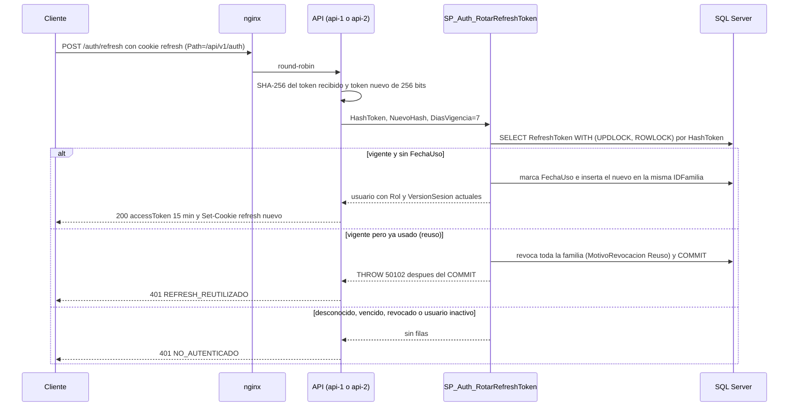

# Módulo auth

## Qué hace

Abre, renueva y cierra sesiones. Endpoints públicos bajo `/api/v1/auth` (sin access token): `POST /registro` (crea solo Clientes), `POST /login`, `POST /refresh` (rota el refresh de la cookie) y `POST /logout` ([auth.routes.ts:77](../../../apps/api/src/modules/auth/auth.routes.ts#L77 "router.post('/registro'"), [auth.routes.ts:80](../../../apps/api/src/modules/auth/auth.routes.ts#L80 "router.post('/refresh', controller.refresh)")).
Entrega un access token JWT HS256 de 15 minutos en el cuerpo y un refresh opaco de 7 días solo en una cookie httpOnly; el refresh se guarda como SHA-256 y rota por familia con detección de reúso. Al iniciar sesión fusiona el carrito de invitado de la cookie con el del cliente.
SPs: `SP_Auth_RegistrarCliente`, `SP_Auth_ObtenerCredenciales`, `SP_Auth_RegistrarRefreshToken`, `SP_Auth_RotarRefreshToken`, `SP_Auth_RevocarSesion`. La verificación del access token en cada petición vive en `shared/http/autenticar.ts` y la versión de sesión en Redis (`shared/adapters/versiones-sesion-redis.ts`).

## Flujo crítico

La rotación del refresh token es el flujo crítico: es lo que permite revocar sesiones (un JWT no se puede revocar) y lo único que detecta un refresh robado, y se puede disparar dos veces a la vez desde dos réplicas.

## Reglas: dónde vive cada una

| Regla | Dónde vive | Archivo:línea | Decisión |
| --- | --- | --- | --- |
| El registro público solo crea Clientes | `SP_Auth_RegistrarCliente` (rol fijo en el INSERT) + Zod `.strict()` rechaza un `rol` en el cuerpo | [R__SP_Auth_RegistrarCliente.sql:30](../../../database/programmability/R__SP_Auth_RegistrarCliente.sql#L30 "r.Codigo = 'Cliente'"), [auth.schemas.ts:25](../../../apps/api/src/modules/auth/auth.schemas.ts#L25 ".strict()") | N-15 |
| Correo único sin distinguir mayúsculas | Columna calculada `CorreoNormalizado` + `UQ_Usuario_CorreoNormalizado` | [V002__seguridad.sql:17](../../../database/migrations/V002__seguridad.sql#L17 "AS LOWER(Correo) PERSISTED"), [V002__seguridad.sql:27](../../../database/migrations/V002__seguridad.sql#L27 "UQ_Usuario_CorreoNormalizado") | N-15 |
| Correo repetido: 409, también si dos registros llegan a la vez | SP bajo `UPDLOCK, HOLDLOCK` + el UNIQUE traducido a 50101 | [R__SP_Auth_RegistrarCliente.sql:24](../../../database/programmability/R__SP_Auth_RegistrarCliente.sql#L24 "WITH (UPDLOCK, HOLDLOCK)"), [R__SP_Auth_RegistrarCliente.sql:38](../../../database/programmability/R__SP_Auth_RegistrarCliente.sql#L38 "IF ERROR_NUMBER() IN (2601, 2627)") | A-02, A-06 |
| Contraseña: 8 a 128 caracteres, con letra y número | Zod | [auth.schemas.ts:10](../../../apps/api/src/modules/auth/auth.schemas.ts#L10 ".min(8, 'Mínimo 8 caracteres.')"), [auth.schemas.ts:11](../../../apps/api/src/modules/auth/auth.schemas.ts#L11 ".max(128, 'Máximo 128 caracteres.')") | N-15 |
| Contraseña con argon2id (19 MiB, 2 iteraciones) | Servicio (`auth.contrasenas.ts`) | [auth.contrasenas.ts:5](../../../apps/api/src/modules/auth/auth.contrasenas.ts#L5 "type: argon2.argon2id"), [auth.contrasenas.ts:6](../../../apps/api/src/modules/auth/auth.contrasenas.ts#L6 "memoryCost: 19 * 1024") | §10 |
| Login con mensaje genérico, mismo tiempo con correo inexistente | Servicio: verifica contra un hash de relleno | [auth.contrasenas.ts:25](../../../apps/api/src/modules/auth/auth.contrasenas.ts#L25 "argon2.verify(hash ?? HASH_DE_RELLENO, contrasena)"), [auth.service.ts:151](../../../apps/api/src/modules/auth/auth.service.ts#L151 "throw new AppError('CREDENCIALES_INVALIDAS')") | N-15 |
| Inactivo solo se revela a quien conoce la contraseña | Servicio | [auth.service.ts:153](../../../apps/api/src/modules/auth/auth.service.ts#L153 "throw new AppError('USUARIO_INACTIVO')") | N-15 |
| Login: 5 intentos por minuto por IP + correo; registro: 3 por IP | Middleware `limitarIntentos` con contador en Redis | [server.ts:39](../../../apps/api/src/server.ts#L39 "LIMITE_LOGIN = { intentos: 5, ventanaSeg: 60 }"), [auth.routes.ts:78](../../../apps/api/src/modules/auth/auth.routes.ts#L78 "limitarIntentos(limitadores.login, porIpYCorreo)") | A-07 |
| Access token de 15 min, HS256, con `versionSesion` | `token-acceso.ts` | [token-acceso.ts:8](../../../apps/api/src/shared/http/token-acceso.ts#L8 "VIGENCIA_ACCESO_SEG = 15 * 60"), [token-acceso.ts:77](../../../apps/api/src/shared/http/token-acceso.ts#L77 "algorithms: [ALGORITMO]") | A-07 |
| Refresh opaco de 256 bits; en la base solo su SHA-256 | `token-opaco.ts` + columna `BINARY(32)` con UNIQUE | [token-opaco.ts:4](../../../apps/api/src/shared/http/token-opaco.ts#L4 "BYTES_TOKEN = 32"), [V002__seguridad.sql:48](../../../database/migrations/V002__seguridad.sql#L48 "UQ_RefreshToken_HashToken") | A-07 |
| Cookie httpOnly, SameSite=Strict, solo en `/api/v1/auth` | Controlador | [auth.controller.ts:34](../../../apps/api/src/modules/auth/auth.controller.ts#L34 "httpOnly: true"), [auth.controller.ts:21](../../../apps/api/src/modules/auth/auth.controller.ts#L21 "RUTA_COOKIE_REFRESH = '/api/v1/auth'") | A-07 |
| Una familia por sesión | Servicio genera `IDFamilia` al abrir sesión | [auth.service.ts:110](../../../apps/api/src/modules/auth/auth.service.ts#L110 "idFamilia: randomUUID()") | A-07 |
| Rotación y reúso revoca la familia | `SP_Auth_RotarRefreshToken` bajo `UPDLOCK` | [R__SP_Auth_RotarRefreshToken.sql:38](../../../database/programmability/R__SP_Auth_RotarRefreshToken.sql#L38 "IF @Vigente = 1 AND @FechaUso IS NOT NULL"), [R__SP_Auth_RotarRefreshToken.sql:42](../../../database/programmability/R__SP_Auth_RotarRefreshToken.sql#L42 "IDFamilia = @IDFamilia") | A-07, A-02 |
| La revocación por reúso sobrevive al error | `THROW 50102` después del `COMMIT` | [R__SP_Auth_RotarRefreshToken.sql:62](../../../database/programmability/R__SP_Auth_RotarRefreshToken.sql#L62 "THROW 50102") | A-07 |
| Refresh de un usuario inactivo no rota | SP (condición `u.Activo = 1`) | [R__SP_Auth_RotarRefreshToken.sql:32](../../../database/programmability/R__SP_Auth_RotarRefreshToken.sql#L32 "u.Activo = 1") | N-15 |
| Logout revoca la familia y es idempotente | `SP_Auth_RevocarSesion` | [R__SP_Auth_RevocarSesion.sql:21](../../../database/programmability/R__SP_Auth_RevocarSesion.sql#L21 "t.IDFamilia = f.IDFamilia"), [auth.service.ts:185](../../../apps/api/src/modules/auth/auth.service.ts#L185 "if (token === undefined) return;") | A-07 |
| Token con versión de sesión anterior: 401 | Middleware `autenticar` + Redis | [autenticar.ts:36](../../../apps/api/src/shared/http/autenticar.ts#L36 "versionSesion < vigente"), [autenticar.ts:47](../../../apps/api/src/shared/http/autenticar.ts#L47 "await sesionRevocada(actor, versiones)") | A-07, N-15 |
| Carrito de invitado pasa al cliente al iniciar sesión (solo rol Cliente) | Servicio orquesta; `SP_Carrito_Fusionar` decide bajo bloqueo | [auth.service.ts:77](../../../apps/api/src/modules/auth/auth.service.ts#L77 "usuario.rol !== 'Cliente'"), [R__SP_Carrito_Fusionar.sql:22](../../../database/programmability/R__SP_Carrito_Fusionar.sql#L22 "CASE WHEN @RolActor = 'Cliente' THEN @IDUsuarioActor END") | N-05, A-18 |

## Concurrencia y réplicas

- **Dos refresh simultáneos con el mismo token** (dos pestañas, o un atacante y la víctima): `SP_Auth_RotarRefreshToken` lee la fila con `WITH (UPDLOCK, ROWLOCK)` ([R__SP_Auth_RotarRefreshToken.sql:34](../../../database/programmability/R__SP_Auth_RotarRefreshToken.sql#L34 "WITH (UPDLOCK, ROWLOCK)")), así que la segunda transacción espera; cuando entra ya ve `FechaUso` y lo trata como reúso: revoca la familia y responde 401. No importa si cada petición cayó en una réplica distinta: el candado está en SQL Server. Lo demuestra [casos-borde.api.test.ts:35](../../../apps/api/test/integracion/auth/casos-borde.api.test.ts#L35 "dos refresh simultáneos con el mismo token"). Es un trade-off aceptado: dos pestañas que refrescan exactamente a la vez cierran la sesión.
- **Dos registros simultáneos con el mismo correo:** el `UPDLOCK, HOLDLOCK` serializa la comprobación y, si aun así ambos llegan al INSERT, el `UNIQUE` dispara 2601/2627 y el CATCH lo traduce a 50101: uno crea y el otro recibe 409, nunca 500 ([registro-login.api.test.ts:76](../../../apps/api/test/integracion/auth/registro-login.api.test.ts#L76 "dos registros simultáneos con el mismo correo")).
- **Límite de intentos entre réplicas:** el contador vive en Redis (`RateLimiterRedis`), así que 5 intentos son 5 en total y no 5 por réplica ([limitador-redis.test.ts:28](../../../apps/api/test/integracion/adaptadores/limitador-redis.test.ts#L28 "dos réplicas comparten los intentos")).
- **Versión de sesión entre réplicas:** la versión vigente se publica en Redis con un script que solo sube ([versiones-sesion-redis.ts:16](../../../apps/api/src/shared/adapters/versiones-sesion-redis.ts#L16 "actual <= tonumber(ARGV[1])")); lo que se cambia en una réplica corta el token en la otra ([usuarios.api.test.ts:437](../../../apps/api/test/integracion/usuarios/usuarios.api.test.ts#L437 "dos réplicas ven la misma versión")).
- **Una réplica muere a mitad:** cada SP es una transacción con `XACT_ABORT`; si la réplica muere antes del COMMIT no queda ni el token marcado ni el nuevo, y el cliente reintenta con su cookie. Si muere después del COMMIT de la rotación, el cliente no recibió el token nuevo y su cookie ya está usada: el siguiente refresh es un reúso y debe iniciar sesión de nuevo (fallo seguro). La fusión del carrito es una transacción propia; si falla, la sesión se abre igual y la cookie de invitado se conserva para el siguiente login ([auth.service.ts:88](../../../apps/api/src/modules/auth/auth.service.ts#L88 "return fusionPendiente();")).

## Modos de falla

- **Credenciales incorrectas o correo inexistente:** 401 `CREDENCIALES_INVALIDAS`, mismo mensaje y mismo trabajo de argon2 ([registro-login.api.test.ts:112](../../../apps/api/test/integracion/auth/registro-login.api.test.ts#L112 "credenciales incorrectas y usuario inexistente responden el mismo 401 genérico")).
- **Usuario desactivado:** 401 `USUARIO_INACTIVO` en el login; en el refresh, sin filas y 401 `NO_AUTENTICADO`.
- **Refresh reutilizado:** 401 `REFRESH_REUTILIZADO` (50102) ([catalogo.ts:53](../../../apps/api/src/shared/errors/catalogo.ts#L53 "REFRESH_REUTILIZADO")).
- **Cookie ausente, basura o de más de 100 caracteres:** cuenta como ausente: refresh 401 `NO_AUTENTICADO`, logout 204 ([auth.schemas.ts:66](../../../apps/api/src/modules/auth/auth.schemas.ts#L66 "valor.length <= LARGO_MAXIMO_REFRESH")).
- **Demasiados intentos:** 429 `DEMASIADAS_PETICIONES` con `Retry-After` ([limitar-intentos.ts:17](../../../apps/api/src/shared/http/limitar-intentos.ts#L17 "new AppError('DEMASIADAS_PETICIONES', { segundosParaReintentar })"), [middleware.ts:44](../../../apps/api/src/shared/errors/middleware.ts#L44 "Retry-After")).
- **Redis caído:** el limitador cae a un contador en memoria por réplica y la API no se bloquea ([limitador-redis.ts:60](../../../apps/api/src/shared/adapters/limitador-redis.ts#L60 "return consumirEn(enMemoria, clave);")); la versión de sesión devuelve `null` y rige la ventana de 15 min del access token ([versiones-sesion-redis.ts:40](../../../apps/api/src/shared/adapters/versiones-sesion-redis.ts#L40 "sin Redis el riesgo queda acotado")).
- **Correo ya registrado:** 409 `CORREO_EN_USO` (50101).
- **Cuerpo con campos extra (por ejemplo `rol`):** 400 `VALIDACION_FALLIDA` por `.strict()` ([registro-login.api.test.ts:86](../../../apps/api/test/integracion/auth/registro-login.api.test.ts#L86 "N-15: no se puede registrar con otro rol")).
- **Base caída:** el SP falla y la petición termina en 500 `ERROR_INTERNO` (no hay sesión que abrir sin la base).

## Alternativas descartadas

- **Refresh como JWT** → no se puede revocar; con un token opaco en tabla, logout, desactivación y reúso lo revocan (A-07).
- **Token en `localStorage`** → expuesto a XSS; el refresh va en cookie httpOnly y el access token en memoria del frontend (A-07).
- **Revocación solo por expiración del access token** → un usuario desactivado seguiría 15 min con permisos; la versión de sesión en Redis lo corta de inmediato (A-07, N-15).
- **Rate limiting en memoria de cada réplica** → con dos réplicas el atacante tendría el doble de intentos; el contador vive en Redis y solo cae a memoria si Redis falla (A-07).
- **Fijar `SESSION_CONTEXT` desde Node** antes de cada SP → con el pool, el contexto y el SP pueden ir en conexiones distintas; por eso el actor viaja como parámetro y la fusión del carrito corre con `ejecutarConContexto` como el cliente (A-18).

## Preguntas probables

### ¿Dónde se guarda la contraseña y con qué algoritmo?

En `Usuario.HashContrasena`, como hash argon2id con 19 MiB y 2 iteraciones; la contraseña en claro nunca llega a la base ni al log.
**Muéstralo en:** [auth.contrasenas.ts:5](../../../apps/api/src/modules/auth/auth.contrasenas.ts#L5 "type: argon2.argon2id")

### ¿Cómo evitas revelar qué correos existen?

Mismo código y mensaje para correo inexistente y contraseña incorrecta, y con un correo inexistente se verifica contra un hash de relleno para que tarde lo mismo.
**Muéstralo en:** [auth.service.ts:150](../../../apps/api/src/modules/auth/auth.service.ts#L150 "verificarContrasena(credenciales?.hashContrasena, contrasena)")

### ¿Qué pasa si roban el refresh token?

Cada refresh rota el token y marca el anterior como usado. Si el ladrón y la víctima lo usan, el segundo uso es un reúso: el SP revoca toda la familia y ambos quedan fuera.
**Muéstralo en:** [R__SP_Auth_RotarRefreshToken.sql:41](../../../database/programmability/R__SP_Auth_RotarRefreshToken.sql#L41 "MotivoRevocacion = 'Reuso'")

### ¿Por qué el THROW del reúso está después del COMMIT?

Porque con `XACT_ABORT` un THROW dentro de la transacción revertiría la revocación de la familia. Primero se confirma la revocación y después se avisa con 50102.
**Muéstralo en:** [R__SP_Auth_RotarRefreshToken.sql:60](../../../database/programmability/R__SP_Auth_RotarRefreshToken.sql#L60 "Después del COMMIT")

### ¿Qué es una familia y por qué el reúso no cierra las demás sesiones del usuario?

Cada login genera un `IDFamilia` nuevo; las rotaciones heredan esa familia. El reúso revoca solo su familia, así que el celular del mismo usuario sigue funcionando.
**Muéstralo en:** [refresh-logout.api.test.ts:55](../../../apps/api/test/integracion/auth/refresh-logout.api.test.ts#L55 "el reúso solo revoca su familia")

### ¿Si desactivo a un usuario, su access token sigue sirviendo 15 minutos?

No. El SP sube `VersionSesion`, la API la publica en Redis y `autenticar` rechaza todo token con una versión menor. Solo si Redis está caído rige la ventana de 15 min (N-15).
**Muéstralo en:** [autenticar.ts:36](../../../apps/api/src/shared/http/autenticar.ts#L36 "versionSesion < vigente")

### ¿Qué pasa si Redis cae? ¿Se puede hacer fuerza bruta?

El limitador cae a un contador en memoria por réplica: sigue limitando, con el límite por réplica en vez de global. La API no se bloquea.
**Muéstralo en:** [limitador-redis.test.ts:50](../../../apps/api/test/integracion/adaptadores/limitador-redis.test.ts#L50 "con Redis caído cae al contador en memoria")

### ¿Variar mayúsculas o espacios del correo da intentos extra?

No. La clave del limitador normaliza el correo con `trim` y `toLowerCase`, y es por IP y correo: agotar uno no bloquea a otro.
**Muéstralo en:** [auth.routes.ts:26](../../../apps/api/src/modules/auth/auth.routes.ts#L26 "cuerpo.correo.trim().toLowerCase()")

### ¿Cómo se valida el JWT? ¿Aceptan `alg: none`?

Con `jose`, solo `HS256` y con `exp`, `iat`, `jti` y `sub` obligatorios; la carga se valida con Zod (rol solo de usuario, `versionSesion` entera). `none` y `HS512` responden 401.
**Muéstralo en:** [autenticar.test.ts:180](../../../apps/api/test/unit/shared/http/autenticar.test.ts#L180 "alg none")

### ¿Por qué la cookie tiene `Path=/api/v1/auth`?

Para que el navegador solo la envíe a los endpoints de sesión y nunca al resto de la API; además es httpOnly (no la lee JavaScript) y SameSite=Strict (no viaja en peticiones de otros sitios).
**Muéstralo en:** [auth.controller.ts:37](../../../apps/api/src/modules/auth/auth.controller.ts#L37 "path: RUTA_COOKIE_REFRESH")

### ¿Puedo registrarme como Administrador mandando `rol` en el cuerpo?

No: el esquema es `.strict()` (400) y además el SP inserta siempre con el rol `Cliente`. El Admin crea internos por `/usuarios`.
**Muéstralo en:** [R__SP_Auth_RegistrarCliente.sql:30](../../../database/programmability/R__SP_Auth_RegistrarCliente.sql#L30 "r.Codigo = 'Cliente'")

### ¿Qué pasa con el carrito de invitado al iniciar sesión, y si la fusión falla?

El servicio llama a la fusión como el cliente (contexto propio solo en esa llamada); el SP fusiona bajo bloqueo. Si falla, la sesión se abre igual, la cookie se conserva y la respuesta trae el aviso `FusionPendiente`.
**Muéstralo en:** [auth.service.test.ts:270](../../../apps/api/test/unit/modules/auth/auth.service.test.ts#L270 "si la fusión falla, la sesión se abre")

### ¿Se registran tokens o contraseñas en los logs?

No: pino redacta los campos sensibles y hay pruebas que recorren el log de registro, login, refresh, logout y cambio de contraseña buscando secretos.
**Muéstralo en:** [registro-login.api.test.ts:194](../../../apps/api/test/integracion/auth/registro-login.api.test.ts#L194 "no dejan secretos en el log")
