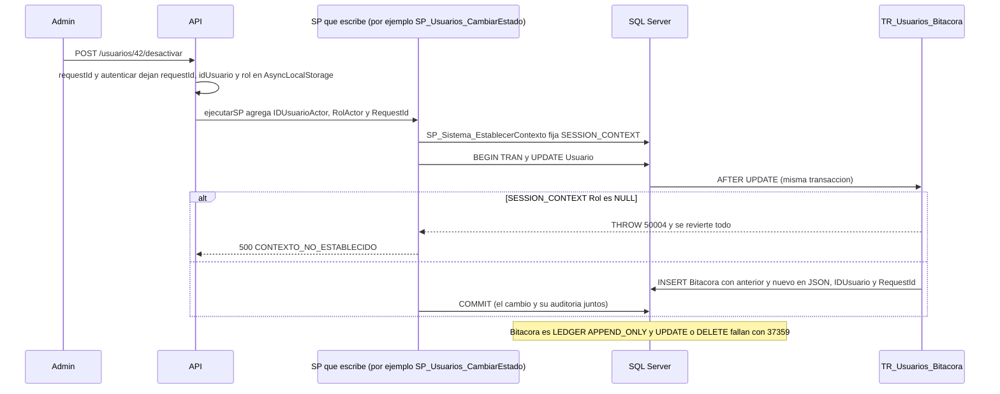

# Módulo bitacora

## Qué hace

Registra y consulta la auditoría de RF-09: quién cambió qué, cuándo, con el valor anterior y el nuevo. La escritura no está en la API: la hacen triggers `TR_*_Bitacora` sobre las tablas auditadas (catálogo, precios, existencias, cupones, estados de pedido, envíos, usuarios y parámetros), que leen el actor de `SESSION_CONTEXT`. La API solo expone la lectura: `GET /api/v1/bitacora`, solo Administrador, paginada en el servidor con filtros por módulo, entidad y rango de días de Guatemala ([bitacora.routes.ts:37](../../../apps/api/src/modules/bitacora/bitacora.routes.ts#L37 "autorizar('Administrador')")).
La tabla `Bitacora` es un ledger append-only de SQL Server 2022: el motor rechaza `UPDATE` y `DELETE`, incluso a un administrador (M-01).
SPs y objetos: `SP_Bitacora_Listar`, `SP_Sistema_EstablecerContexto` y los triggers `TR_Usuarios_Bitacora`, `TR_Configuracion_Bitacora`, `TR_Catalogo_*Bitacora`, `TR_Cupones_Bitacora`, `TR_Pedidos_Bitacora`, `TR_Envios_Bitacora`.

## Flujo crítico

El flujo crítico es cómo una escritura cualquiera deja su fila en la bitácora con el actor correcto: es lo que hace que la auditoría no dependa de que cada servicio se acuerde de registrar, y lo que el evaluador intentará romper (borrar o editar una fila).

## Reglas: dónde vive cada una

| Regla | Dónde vive | Archivo:línea | Decisión |
| --- | --- | --- | --- |
| La bitácora no se modifica ni se elimina | Tabla ledger append-only (motor) | [V009__bitacora.sql:24](../../../database/migrations/V009__bitacora.sql#L24 "WITH (LEDGER = ON (APPEND_ONLY = ON))") | RF-09, M-01 |
| Lo mismo para kardex e historial de pedidos | Tablas ledger | [V005__inventario.sql:47](../../../database/migrations/V005__inventario.sql#L47 "LEDGER = ON (APPEND_ONLY = ON)"), [V008__pedidos.sql:153](../../../database/migrations/V008__pedidos.sql#L153 "LEDGER = ON (APPEND_ONLY = ON)") | M-01 |
| La API no toca tablas, solo ejecuta SPs | Permisos del login `shopcart_app` | [V001__base.sql:5](../../../database/migrations/V001__base.sql#L5 "GRANT EXECUTE ON SCHEMA::dbo TO shopcart_app"), [V001__base.sql:9](../../../database/migrations/V001__base.sql#L9 "DENY SELECT, INSERT, UPDATE, DELETE ON SCHEMA::dbo TO shopcart_app") | §10 |
| Cada escritura se audita sin que el servicio lo pida | Triggers `AFTER INSERT, UPDATE, DELETE` | [R__TR_Usuarios_Bitacora.sql:5](../../../database/programmability/R__TR_Usuarios_Bitacora.sql#L5 "AFTER INSERT, UPDATE, DELETE") | RF-09 |
| El actor viaja como parámetro estándar de todo SP | `ejecutarSP` desde `AsyncLocalStorage` | [ejecutar-sp.ts:110](../../../apps/api/src/shared/db/ejecutar-sp.ts#L110 "contexto === undefined ? ROL_SISTEMA : contexto.rol"), [contexto.ts:13](../../../apps/api/src/shared/http/contexto.ts#L13 "const almacen = new AsyncLocalStorage") | A-18 |
| Todo SP que escribe fija `SESSION_CONTEXT` primero, también con NULL | `SP_Sistema_EstablecerContexto` | [R__SP_Sistema_EstablecerContexto.sql:13](../../../database/programmability/R__SP_Sistema_EstablecerContexto.sql#L13 "@key = N'IDUsuario', @value = @IDUsuarioActor") | A-18 |
| Escritura sin contexto: falla y no queda nada | Trigger lanza 50004 | [R__TR_Usuarios_Bitacora.sql:12](../../../database/programmability/R__TR_Usuarios_Bitacora.sql#L12 "IF SESSION_CONTEXT(N'Rol') IS NULL"), [R__TR_Usuarios_Bitacora.sql:13](../../../database/programmability/R__TR_Usuarios_Bitacora.sql#L13 "THROW 50004") | A-18 |
| Jobs y migrador escriben como `Sistema`, con `IDUsuario` NULL | `ejecutarSP` fuera de una petición; script del migrador | [ejecutar-sp.ts:109](../../../apps/api/src/shared/db/ejecutar-sp.ts#L109 "sin petición es un job, que escribe como Sistema"), [establecer-contexto-sistema.sql:5](../../../database/migrator/sql/establecer-contexto-sistema.sql#L5 "@value = N'Sistema'") | A-18 |
| Usuario, fecha, entidad, acción, anterior y nuevo | Columnas de `Bitacora` | [V009__bitacora.sql:10](../../../database/migrations/V009__bitacora.sql#L10 "ValorAnterior NVARCHAR(MAX)"), [V009__bitacora.sql:15](../../../database/migrations/V009__bitacora.sql#L15 "DF_Bitacora_Fecha DEFAULT SYSUTCDATETIME()") | RF-09 |
| Anterior y nuevo siempre son JSON válido | `CHECK (ISJSON(...) = 1)` | [V009__bitacora.sql:22](../../../database/migrations/V009__bitacora.sql#L22 "ISJSON(ValorAnterior) = 1") | RF-09 |
| Módulos y acciones cerrados | `CHECK` de módulo y acción | [V009__bitacora.sql:18](../../../database/migrations/V009__bitacora.sql#L18 "CK_Bitacora_Modulo"), [V009__bitacora.sql:20](../../../database/migrations/V009__bitacora.sql#L20 "CK_Bitacora_Accion") | RF-09 |
| Nunca se registra `HashContrasena` | Trigger con columnas explícitas | [R__TR_Usuarios_Bitacora.sql:30](../../../database/programmability/R__TR_Usuarios_Bitacora.sql#L30 "SELECT i.Correo, i.Nombre, i.IDRol, i.Activo FOR JSON PATH") | §10 |
| El dinero se audita como texto (`"149.90"`) | Trigger con `CONVERT(VARCHAR)` | [R__TR_Configuracion_Bitacora.sql:27](../../../database/programmability/R__TR_Configuracion_Bitacora.sql#L27 "CONVERT(VARCHAR(20), i.MontoEnvioGratis)") | A-21 |
| Solo el Administrador la consulta | Ruta + el SP vuelve a validar el rol | [R__SP_Bitacora_Listar.sql:20](../../../database/programmability/R__SP_Bitacora_Listar.sql#L20 "IF @RolActor IS NULL OR @RolActor <> 'Administrador'") | RF-09, A-02 |
| Filtro por módulo con lista cerrada | Zod (`MODULOS_BITACORA`) | [bitacora.schemas.ts:8](../../../apps/api/src/modules/bitacora/bitacora.schemas.ts#L8 "modulo: z.enum(MODULOS_BITACORA).optional()") | RF-09 |
| Días de Guatemala (UTC-6) en el filtro de fechas | SP | [R__SP_Bitacora_Listar.sql:28](../../../database/programmability/R__SP_Bitacora_Listar.sql#L28 "@HorasUtcGuatemala INT = 6") | A-12 |
| Paginación en el servidor, lo más reciente primero | SP con `OFFSET/FETCH` e índices por fecha | [R__SP_Bitacora_Listar.sql:40](../../../database/programmability/R__SP_Bitacora_Listar.sql#L40 "ORDER BY b.Fecha DESC, b.IDBitacora DESC"), [V018__indice_bitacora_modulo_ordenado.sql:4](../../../database/migrations/V018__indice_bitacora_modulo_ordenado.sql#L4 "IX_Bitacora_ModuloFecha") | RNF-1 |

## Concurrencia y réplicas

- **Dos peticiones simultáneas que auditan:** cada trigger corre dentro de la transacción del SP que disparó el cambio, así que el cambio y su fila de bitácora se confirman o se revierten juntos; no puede quedar un cambio sin auditar ni una auditoría de un cambio revertido. El `IDBitacora` es `IDENTITY` y la tabla solo recibe INSERT: no hay filas en disputa.
- **El actor correcto con peticiones concurrentes en la misma réplica:** el contexto vive en `AsyncLocalStorage` por petición y `ejecutarSP` lo lee en cada llamada; una prueba lanza peticiones concurrentes y verifica que cada SP recibe su propio actor ([ejecutar-sp.test.ts:225](../../../apps/api/test/unit/shared/db/ejecutar-sp.test.ts#L225 "con peticiones concurrentes, cada SP recibe el actor de su propia petición")).
- **Conexiones del pool reutilizadas:** `SP_Sistema_EstablecerContexto` fija las tres claves en cada llamada, también con NULL, para que una conexión no arrastre el actor de la petición anterior ([R__SP_Sistema_EstablecerContexto.sql:11](../../../database/programmability/R__SP_Sistema_EstablecerContexto.sql#L11 "Se fija en cada llamada, también con NULL"), [contexto-de-sesion.test.ts:38](../../../apps/api/test/integracion/shared/contexto-de-sesion.test.ts#L38 "una llamada sin actor (job) limpia el contexto")).
- **Réplicas:** no hay estado en la API; las dos réplicas escriben en la misma tabla. El `RequestId` de cada fila es el mismo del log y de la traza de la réplica que atendió, así que se puede saber qué réplica hizo el cambio.
- **Una réplica muere a mitad:** la transacción no confirmada se revierte completa, incluida la fila de bitácora; no hay nada que recuperar.

## Modos de falla

- **Intentar `UPDATE` o `DELETE` sobre `Bitacora`:** el motor lo rechaza con el error 37359 al compilar; nunca llega a la API ([ledger.test.ts:19](../../../apps/api/test/integracion/esquema/ledger.test.ts#L19 "rechaza %s")).
- **Escritura auditada sin contexto** (un SP nuevo que olvidó `SP_Sistema_EstablecerContexto`, o un script manual): 500 `CONTEXTO_NO_ESTABLECIDO` (50004) y no queda nada ([catalogo.ts:38](../../../apps/api/src/shared/errors/catalogo.ts#L38 "CONTEXTO_NO_ESTABLECIDO"), [bitacora.test.ts:119](../../../apps/api/test/integracion/esquema/bitacora.test.ts#L119 "una escritura auditada sin contexto falla con CONTEXTO_NO_ESTABLECIDO")).
- **Cliente u Operador en `GET /bitacora`:** 403 `SIN_PERMISO` en la ruta ([bitacora.api.test.ts:87](../../../apps/api/test/integracion/bitacora/bitacora.api.test.ts#L87 "es solo para el Admin (403)")). Si el SP se llamara sin rol Administrador, lanza 50005 `INVARIANTE_INTERNA` (500): es un error de programación, no un caso de usuario ([R__SP_Bitacora_Listar.sql:21](../../../database/programmability/R__SP_Bitacora_Listar.sql#L21 "THROW 50005")).
- **Filtros inválidos** (módulo fuera de la lista, `desde` posterior a `hasta`, página fuera de rango): 400 `VALIDACION_FALLIDA` ([rango-fechas.ts:9](../../../apps/api/src/shared/http/rango-fechas.ts#L9 "desde === undefined || hasta === undefined || desde <= hasta")).
- **Base caída:** 500 `ERROR_INTERNO`; Redis no interviene (la consulta no tiene caché).

## Alternativas descartadas

- **Inmutabilidad solo con un trigger `INSTEAD OF UPDATE, DELETE`** → un administrador puede deshabilitarlo; el ledger lo impone el motor (M-01).
- **Escribir la bitácora desde los servicios** → una ruta nueva o una escritura directa podría olvidarla; el trigger cubre toda escritura a la tabla auditada (RF-09).
- **Fijar `SESSION_CONTEXT` desde Node antes de cada SP** → con el pool, `sp_set_session_context` y el SP pueden ir en conexiones distintas; por eso el actor es un parámetro del SP y el SP fija el contexto (A-18).
- **Permitir escrituras sin actor (IDUsuario NULL silencioso)** → no se sabría si fue un job o un olvido; sin `Rol` el trigger falla y los jobs declaran `Sistema` (A-18).
- **Guardar la fila completa con `SELECT *`** → arrastraría `HashContrasena` y columnas técnicas; los triggers listan columnas explícitas.

## Preguntas probables

### ¿Cómo garantizas que la bitácora no se puede modificar ni borrar?

Es una tabla ledger append-only: SQL Server rechaza `UPDATE` y `DELETE` incluso a `sa` (error 37359). Además la API no tiene permisos sobre tablas, solo `EXECUTE`.
**Muéstralo en:** [V009__bitacora.sql:24](../../../database/migrations/V009__bitacora.sql#L24 "WITH (LEDGER = ON (APPEND_ONLY = ON))")

### ¿Lo probaste?

Sí: una prueba de integración intenta `UPDATE` y `DELETE` sobre las tres tablas ledger desde un SP de pruebas y espera el 37359.
**Muéstralo en:** [ledger.test.ts:19](../../../apps/api/test/integracion/esquema/ledger.test.ts#L19 "rechaza %s")

### ¿Un administrador de la base puede deshabilitar eso como un trigger?

No: append-only es una propiedad de la tabla, no un objeto que se deshabilite; por eso se descartó el trigger `INSTEAD OF` (M-01). Además, `pnpm ledger:verificar` guarda el digest fuera de la base y verifica el ledger contra todos los digests guardados: si alguien cambiara un bloque, la verificación fallaría.
**Muéstralo en:** [verificar-ledger.sql:4](../../../database/migrator/sql/verificar-ledger.sql#L4 "EXEC sys.sp_verify_database_ledger @digests = @Digests;") y [ledger.test.ts:45](../../../database/migrator/test/integracion/ledger.test.ts#L45 "si un digest guardado no corresponde a la base, la verificación falla")

### ¿Cómo sabe el trigger quién hizo el cambio si la API se conecta con un solo login?

`ejecutarSP` envía `@IDUsuarioActor`, `@RolActor` y `@RequestId` a todo SP; el SP llama a `SP_Sistema_EstablecerContexto`, que los deja en `SESSION_CONTEXT`, y el trigger los lee.
**Muéstralo en:** [R__TR_Usuarios_Bitacora.sql:15](../../../database/programmability/R__TR_Usuarios_Bitacora.sql#L15 "TRY_CONVERT(INT, SESSION_CONTEXT(N'IDUsuario'))")

### ¿Y si un desarrollador agrega un SP y olvida fijar el contexto?

El trigger lanza 50004 y la transacción completa se revierte: no hay escrituras auditadas anónimas ([bitacora.test.ts:119](../../../apps/api/test/integracion/esquema/bitacora.test.ts#L119 "una escritura auditada sin contexto falla con CONTEXTO_NO_ESTABLECIDO")). Además una prueba del migrador revisa que todo SP que escribe llame a `SP_Sistema_EstablecerContexto`.
**Muéstralo en:** [convenciones-sql.test.ts:44](../../../database/migrator/test/convenciones-sql.test.ts#L44 "TRY/CATCH con transacción y SP_Sistema_EstablecerContexto")

### ¿Por qué el SP fija el contexto y no Node antes de llamarlo?

Con un pool de conexiones, el `sp_set_session_context` y el SP podrían ejecutarse en conexiones distintas. Como parámetro del SP, el contexto se fija en la misma conexión y la misma llamada (A-18).
**Muéstralo en:** [R__SP_Sistema_EstablecerContexto.sql:1](../../../database/programmability/R__SP_Sistema_EstablecerContexto.sql#L1 "A-18: deja al actor de la petición en SESSION_CONTEXT")

### ¿Qué IDUsuario queda cuando el cambio lo hace un job?

NULL, con `Rol = 'Sistema'`: fuera de una petición `ejecutarSP` envía el rol `Sistema`. Un invitado sí tiene petición y va con rol NULL, nunca `Sistema`.
**Muéstralo en:** [bitacora.test.ts:125](../../../apps/api/test/integracion/esquema/bitacora.test.ts#L125 "un job (fuera de una petición: rol Sistema) deja la fila con IDUsuario NULL")

### ¿Se puede falsificar el actor desde la API, pasando `IDUsuarioActor` a mano?

No: `ejecutarSP` lanza si el llamador intenta pasar un parámetro estándar, también variando mayúsculas.
**Muéstralo en:** [ejecutar-sp.ts:104](../../../apps/api/src/shared/db/ejecutar-sp.ts#L104 "lo agrega ejecutarSP desde el contexto; no se pasa a mano")

### ¿Se registra la contraseña cuando se crea un usuario?

No: el trigger de usuarios serializa solo correo, nombre, rol y activo.
**Muéstralo en:** [bitacora.test.ts:107](../../../apps/api/test/integracion/esquema/bitacora.test.ts#L107 "la creación de un usuario nunca registra su HashContrasena")

### ¿Qué pasa con la bitácora si el SP falla después del cambio?

Se revierte con él: el trigger corre dentro de la misma transacción y el SP usa `XACT_ABORT` con `ROLLBACK` en el `CATCH`.
**Muéstralo en:** [R__TR_Usuarios_Bitacora.sql:18](../../../database/programmability/R__TR_Usuarios_Bitacora.sql#L18 "INSERT INTO dbo.Bitacora")

### ¿El filtro por fecha usa UTC o la hora de Guatemala?

Días de Guatemala: el SP convierte `desde` y `hasta` a UTC sumando 6 horas, sin aplicar funciones sobre la columna `Fecha`, así que el filtro puede usar el índice por fecha.
**Muéstralo en:** [bitacora.api.test.ts:74](../../../apps/api/test/integracion/bitacora/bitacora.api.test.ts#L74 "el rango usa días de Guatemala")

### ¿La consulta pagina en el servidor con muchos registros?

Sí: `OFFSET/FETCH` ordenado por `Fecha DESC, IDBitacora DESC`, con índices que ya entregan ese orden y `OPTION (RECOMPILE)` para que cada combinación de filtros use su plan.
**Muéstralo en:** [bitacora-paginacion.api.test.ts:47](../../../apps/api/test/integracion/secuencial/bitacora-paginacion.api.test.ts#L47 "pagina en el servidor: páginas distintas y el total del filtro")

### ¿Qué se audita exactamente?

Lo que pide RF-09: productos, precios, existencias, cupones y estados de pedido, más envíos, usuarios (rol y activación) y parámetros. Un cambio que solo toca el contador de usos de un cupón no se registra.
**Muéstralo en:** [bitacora.test.ts:95](../../../apps/api/test/integracion/esquema/bitacora.test.ts#L95 "un cambio solo del contador de usos del cupón no se registra")
