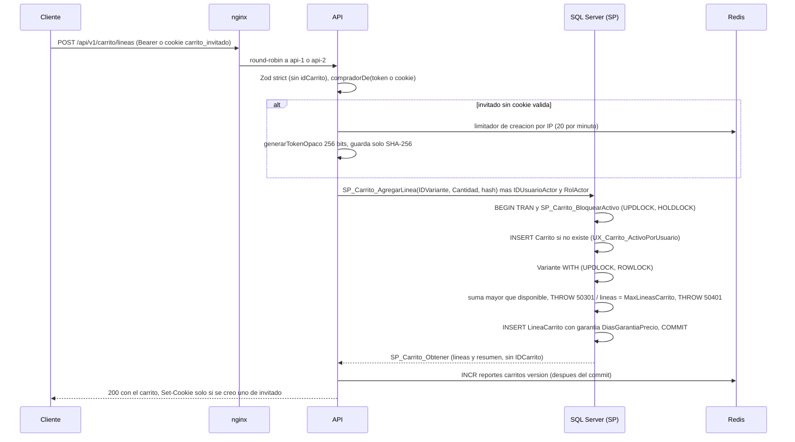

# Módulo carrito

## Qué hace

Guarda el carrito de un **invitado** (resuelto por el hash de un token en una cookie httpOnly) o de un **cliente** (resuelto por `@IDUsuarioActor`, que sale del token). Endpoints bajo `/api/v1/carrito`: `GET /carrito`, `POST /carrito/lineas`, `PATCH` y `DELETE /carrito/lineas/:idLinea`, `POST /carrito/avisos/vistos`, `PUT` y `DELETE /carrito/cupon`. Pueden usarlos un Cliente o un invitado; Operador y Admin reciben 403 ([carrito.routes.ts:107](../../../apps/api/src/modules/carrito/carrito.routes.ts#L107 "autorizarSiHaySesion('Cliente')")). La fusión con el carrito del cliente al iniciar sesión y la asignación al registrarse se exponen a `auth` por el `index.ts` del módulo ([index.ts:37](../../../apps/api/src/modules/carrito/index.ts#L37 "asignarCarritoDeInvitado, fusionarCarritoDeInvitado")).

SPs clave: `SP_Carrito_AgregarLinea`, `SP_Carrito_Obtener`, `SP_Carrito_ActualizarCantidad`, `SP_Carrito_EliminarLinea`, `SP_Carrito_AplicarCupon`, `SP_Carrito_Fusionar`, `SP_Carrito_ExpirarInvitados` (tarea), el bloqueo común `SP_Carrito_BloquearActivo` y la función `FU_Carrito_Lineas` (precio efectivo, estado y aviso de cada línea).

## Flujo crítico

Agregar una línea (`POST /carrito/lineas`) es el flujo crítico: crea el carrito de forma perezosa, decide de quién es, valida existencia y límite de líneas bajo bloqueo y fija la garantía de precio de la línea.

## Reglas: dónde vive cada una

| Regla | Dónde vive | Archivo:línea | Decisión |
|---|---|---|---|
| El carrito se resuelve desde el token o la cookie, nunca desde un ID enviado | Repositorio (sin parámetro de carrito) + Zod `.strict()` | [carrito.repository.ts:171](../../../apps/api/src/modules/carrito/carrito.repository.ts#L171 "nunca recibe ni devuelve el ID del carrito"), [shared/carrito.ts:8](../../../packages/shared/src/carrito.ts#L8 "rechaza un idCarrito colado en el cuerpo") | N-05, RF-01 |
| Con sesión de Cliente manda su carrito; la cookie se ignora | SP (`@RolActor`) | [R__SP_Carrito_AgregarLinea.sql:27](../../../database/programmability/R__SP_Carrito_AgregarLinea.sql#L27 "CASE WHEN @RolActor = 'Cliente' THEN @IDUsuarioActor END") | N-05, A-18 |
| Un carrito es de un cliente o de un invitado, nunca de ambos | Constraint `CK_Carrito_DuenoUnico` | [V006__carrito_cupones_envios.sql:54](../../../database/migrations/V006__carrito_cupones_envios.sql#L54 "CK_Carrito_DuenoUnico") | N-05 |
| Un solo carrito Activo por cliente | Índice único filtrado `UX_Carrito_ActivoPorUsuario` | [V006__carrito_cupones_envios.sql:59](../../../database/migrations/V006__carrito_cupones_envios.sql#L59 "CREATE UNIQUE INDEX UX_Carrito_ActivoPorUsuario") | N-05 |
| Una variante aparece una sola vez por carrito | Constraint `UQ_LineaCarrito_IDCarritoIDVariante` | [V006__carrito_cupones_envios.sql:78](../../../database/migrations/V006__carrito_cupones_envios.sql#L78 "UQ_LineaCarrito_IDCarritoIDVariante") | N-06 |
| Token de 256 bits; en la base solo su SHA-256 | Servicio / `token-opaco.ts` | [token-opaco.ts:4](../../../apps/api/src/shared/http/token-opaco.ts#L4 "BYTES_TOKEN = 32"), [token-opaco.ts:20](../../../apps/api/src/shared/http/token-opaco.ts#L20 "createHash('sha256')") | N-05 |
| Cookie httpOnly, Secure, SameSite=Lax, Path=/api/v1 | Controlador | [carrito.controller.ts:73](../../../apps/api/src/modules/carrito/carrito.controller.ts#L73 "httpOnly: true") | N-05 |
| Creación perezosa con el primer producto y un token nuevo | SP + servicio | [R__SP_Carrito_AgregarLinea.sql:44](../../../database/programmability/R__SP_Carrito_AgregarLinea.sql#L44 "VALUES (@HashTokenNuevo, 'Activo')"), [carrito.service.ts:71](../../../apps/api/src/modules/carrito/carrito.service.ts#L71 "generarTokenOpaco()") | N-05 |
| Creación de carritos de invitado limitada por IP | Servicio (puerto `LimitadorIntentos`) | [carrito.service.ts:68](../../../apps/api/src/modules/carrito/carrito.service.ts#L68 "limitadorCreacion.consumir"), [server.ts:42](../../../apps/api/src/server.ts#L42 "LIMITE_CARRITO_INVITADO = { intentos: 20, ventanaSeg: 60 }") | 01 §5.3 |
| La suma de cantidades no pasa del disponible; nunca se ajusta sola | `SP_Carrito_AgregarLinea` bajo `UPDLOCK` de la variante | [R__SP_Carrito_AgregarLinea.sql:79](../../../database/programmability/R__SP_Carrito_AgregarLinea.sql#L79 "COALESCE(@EnCarrito, 0)) + @Cantidad > @Disponible"), [R__SP_Carrito_AgregarLinea.sql:87](../../../database/programmability/R__SP_Carrito_AgregarLinea.sql#L87 "THROW 50301, @Error, 1;") | N-06, A-02 |
| Máximo de líneas distintas (`MaxLineasCarrito`, 50 por defecto) | SP bajo el bloqueo del carrito | [R__SP_Carrito_AgregarLinea.sql:96](../../../database/programmability/R__SP_Carrito_AgregarLinea.sql#L96 ">= @MaxLineas"), [V006__carrito_cupones_envios.sql:114](../../../database/migrations/V006__carrito_cupones_envios.sql#L114 "MaxLineasCarrito") | N-05, A-14 |
| Garantía de precio: `DiasGarantiaPrecio` desde que se agrega la línea | SP | [R__SP_Carrito_AgregarLinea.sql:109](../../../database/programmability/R__SP_Carrito_AgregarLinea.sql#L109 "DATEADD(DAY, @DiasGarantia, SYSUTCDATETIME())") | N-02 |
| La garantía solo protege contra subidas: precio = menor entre garantizado y vigente | Función `FU_Carrito_Lineas` | [R__FU_Carrito_Lineas.sql:66](../../../database/programmability/R__FU_Carrito_Lineas.sql#L66 "AND pg.Precio < pv.Precio") | N-02 |
| Sumar o cambiar la cantidad no renueva la garantía | SP (el `UPDATE` no toca `FechaGarantiaHasta`) | [R__SP_Carrito_AgregarLinea.sql:112](../../../database/programmability/R__SP_Carrito_AgregarLinea.sql#L112 "no renueva la garantía") | N-02 |
| Garantía vencida: re-ancla al vigente y deja la alerta "cambió de Q… a Q…" | `SP_Carrito_Obtener` (escribe solo si hace falta) | [R__SP_Carrito_Obtener.sql:51](../../../database/programmability/R__SP_Carrito_Obtener.sql#L51 "SET    PrecioAnteriorAviso = CASE WHEN visto.Precio <> pv.Precio THEN visto.Precio END,") | N-02 |
| Estados de línea: NoDisponible, Agotado, CantidadExcedida, Disponible | `FU_Carrito_Lineas` | [R__FU_Carrito_Lineas.sql:69](../../../database/programmability/R__FU_Carrito_Lineas.sql#L69 "'NoDisponible'") | N-06 |
| Una línea NoDisponible solo se elimina | `SP_Carrito_ActualizarCantidad` | [R__SP_Carrito_ActualizarCantidad.sql:43](../../../database/programmability/R__SP_Carrito_ActualizarCantidad.sql#L43 "THROW 50402") | N-06 |
| Una línea ajena responde 404, igual que una inexistente | SP (filtro por el carrito de quien pide) | [R__SP_Carrito_ActualizarCantidad.sql:34](../../../database/programmability/R__SP_Carrito_ActualizarCantidad.sql#L34 "AND l.IDCarrito = @IDCarrito"), [R__SP_Carrito_EliminarLinea.sql:30](../../../database/programmability/R__SP_Carrito_EliminarLinea.sql#L30 "THROW 50001") | RF-01 |
| Solo se puede pagar si todas las líneas están Disponible | `SP_Carrito_Obtener` (`PuedePagar`) | [R__SP_Carrito_Obtener.sql:138](../../../database/programmability/R__SP_Carrito_Obtener.sql#L138 "COUNT(*) > 0 AND COUNT(*) = COUNT(CASE WHEN l.Estado = 'Disponible'") | N-06 |
| La actividad solo cambia cuando el carrito cambia | SP (`FechaUltimaActividad`) | [R__SP_Carrito_AgregarLinea.sql:118](../../../database/programmability/R__SP_Carrito_AgregarLinea.sql#L118 "SET FechaUltimaActividad = SYSUTCDATETIME()") | N-13 |
| Expiración de carritos de invitado sin actividad | Tarea + `SP_Carrito_ExpirarInvitados` con `sp_getapplock` | [R__SP_Carrito_ExpirarInvitados.sql:27](../../../database/programmability/R__SP_Carrito_ExpirarInvitados.sql#L27 "sys.sp_getapplock @Resource = N'Job_Carrito_ExpirarInvitados'") | A-04, N-05 |
| Toda escritura del carrito invalida la caché de reportes de carritos después del commit | Servicio (`reportes.tras`) | [carrito.service.ts:109](../../../apps/api/src/modules/carrito/carrito.service.ts#L109 "reportes.tras(agregarLinea(comprador, linea), 'carritos')") | A-11 |

## Concurrencia y réplicas

- **Dos peticiones simultáneas:** todo SP que escribe en el carrito empieza con `SP_Carrito_BloquearActivo`, que toma la fila del carrito con `WITH (UPDLOCK, HOLDLOCK)` ([R__SP_Carrito_BloquearActivo.sql:22](../../../database/programmability/R__SP_Carrito_BloquearActivo.sql#L22 "WITH (UPDLOCK, HOLDLOCK)")). El `HOLDLOCK` bloquea también el hueco de la llave en el índice filtrado: dos primeras altas del mismo cliente se serializan y la segunda encuentra el carrito que creó la primera. Lo demuestra [carrito.api.test.ts:447](../../../apps/api/test/integracion/carrito/carrito.api.test.ts#L447 "diez primeras altas simultáneas del mismo cliente crean un solo carrito"). Si aun así llega la violación de `UX_Carrito_ActivoPorUsuario`, el SP responde 409 `CONFLICTO_CONCURRENCIA` y no un 500 ([R__SP_Carrito_AgregarLinea.sql:128](../../../database/programmability/R__SP_Carrito_AgregarLinea.sql#L128 "THROW 50002")).
- **Límite de líneas y existencia con concurrencia:** se cuentan las líneas y se lee el disponible después de bloquear el carrito y la variante ([R__SP_Carrito_AgregarLinea.sql:64](../../../database/programmability/R__SP_Carrito_AgregarLinea.sql#L64 "WITH (UPDLOCK, ROWLOCK)")). Con 49 líneas y cinco altas a la vez entra solo una ([carrito.api.test.ts:462](../../../apps/api/test/integracion/carrito/carrito.api.test.ts#L462 "con 49 líneas, de cinco altas simultáneas")); cinco sumas de 2 unidades con 5 disponibles nunca pasan de 5 ([carrito.api.test.ts:483](../../../apps/api/test/integracion/carrito/carrito.api.test.ts#L483 "cinco sumas simultáneas de 2 unidades")).
- **Orden global de bloqueo (01 §6.6):** carrito → variantes por `IDVariante` → sesión de checkout → cupón. Lo declara el checkout ([R__SP_Checkout_IniciarSesion.sql:2](../../../database/programmability/R__SP_Checkout_IniciarSesion.sql#L2 "carrito → variantes por IDVariante → sesión → cupón")) y la fusión lo respeta: los dos carritos en orden de `IDCarrito` ([R__SP_Carrito_Fusionar.sql:50](../../../database/programmability/R__SP_Carrito_Fusionar.sql#L50 "@IDCarritoCliente < @IDCarritoInvitado")), luego las variantes una por una en orden ([R__SP_Carrito_Fusionar.sql:74](../../../database/programmability/R__SP_Carrito_Fusionar.sql#L74 "WITH (UPDLOCK, ROWLOCK) WHERE v.IDVariante = @ID")) y al final la sesión y el cupón ([R__SP_Carrito_Fusionar.sql:148](../../../database/programmability/R__SP_Carrito_Fusionar.sql#L148 "EXEC dbo.SP_Checkout_CancelarSesionActiva @IDCliente;")). Si de todos modos ocurre un deadlock, `ejecutarSP` reintenta el SP completo hasta 3 veces ([ejecutar-sp.ts:67](../../../apps/api/src/shared/db/ejecutar-sp.ts#L67 "numero === DEADLOCK && intento < REINTENTOS_DEADLOCK")).
- **Dos logins simultáneos con la misma cookie** fusionan una sola vez: el segundo, ya con el carrito de invitado `Fusionado`, no encuentra uno Activo ([R__SP_Carrito_Fusionar.sql:62](../../../database/programmability/R__SP_Carrito_Fusionar.sql#L62 "IF @IDCarritoInvitado IS NOT NULL"), [fusion.api.test.ts:253](../../../apps/api/test/integracion/carrito/fusion.api.test.ts#L253 "dos inicios de sesión simultáneos con la misma cookie fusionan una sola vez")).
- **Una réplica muere a mitad:** cada SP corre en una sola transacción con `XACT_ABORT ON`; si la conexión se corta antes del `COMMIT`, SQL Server revierte todo y el carrito queda como estaba. No hay estado del carrito en memoria ni en Redis: la otra réplica atiende el reintento con el mismo token o la misma cookie (RNF-2). Si muere entre el `COMMIT` y el `INCR` de Redis, la caché de reportes queda vieja como mucho el TTL de 60 s ([reportes.cache.ts:62](../../../apps/api/src/modules/reportes/reportes.cache.ts#L62 "const resultado = await escritura;")).
- **La tarea de expiración en dos réplicas:** las dos la programan cada hora; `sp_getapplock` con `@LockTimeout = 0` deja pasar solo a una y la otra devuelve `Ejecutada = 0` ([carrito.repository.ts:247](../../../apps/api/src/modules/carrito/carrito.repository.ts#L247 "fila.Ejecutada ? fila.CarritosExpirados : null")).

## Modos de falla

- **Entrada inválida** (campos extra, cantidad fuera de 1 a 1 000 000, código vacío): 400 `PARAMETRO_INVALIDO` desde Zod ([shared/carrito.ts:5](../../../packages/shared/src/carrito.ts#L5 "CANTIDAD_MAXIMA = 1_000_000")).
- **Cookie mal formada:** cuenta como ausente, no como error ([carrito.schemas.ts:15](../../../apps/api/src/modules/carrito/carrito.schemas.ts#L15 "TOKEN_INVITADO")). Una cookie cuyo carrito ya no está Activo: `GET` la borra ([carrito.controller.ts:98](../../../apps/api/src/modules/carrito/carrito.controller.ts#L98 "if (consulta.cookieObsoleta) borrarCookieCarrito(res);")) y `POST` crea otro carrito con un token nuevo ([carrito.service.ts:94](../../../apps/api/src/modules/carrito/carrito.service.ts#L94 "crearCarritoInvitado(linea, comprador.ip)")).
- **Token de acceso inválido:** 401, nunca cae a invitado ([carrito.api.test.ts:194](../../../apps/api/test/integracion/carrito/carrito.api.test.ts#L194 "un token inválido responde 401 y no cae a invitado")).
- **Operador o Admin:** 403 `SIN_PERMISO` ([autenticar.ts:74](../../../apps/api/src/shared/http/autenticar.ts#L74 "new AppError('SIN_PERMISO')")).
- **Línea ajena o inexistente:** 404 `NO_ENCONTRADO` (50001) ([catalogo.ts:30](../../../apps/api/src/shared/errors/catalogo.ts#L30 "NO_ENCONTRADO: { http: 404, numeroSql: 50001")).
- **Variante inexistente, inactiva o sin precio:** 404 ([R__SP_Carrito_AgregarLinea.sql:67](../../../database/programmability/R__SP_Carrito_AgregarLinea.sql#L67 "THROW 50001")).
- **Sin existencia:** 409 `STOCK_INSUFICIENTE` con `disponible` y `enCarrito` en los detalles ([catalogo.ts:118](../../../apps/api/src/shared/errors/catalogo.ts#L118 "STOCK_INSUFICIENTE: { http: 409, numeroSql: 50301")).
- **Límite de líneas:** 422 `LIMITE_LINEAS` con el máximo en los detalles ([catalogo.ts:132](../../../apps/api/src/shared/errors/catalogo.ts#L132 "LIMITE_LINEAS")); línea NoDisponible: 409 `LINEAS_NO_DISPONIBLES` ([catalogo.ts:137](../../../apps/api/src/shared/errors/catalogo.ts#L137 "LINEAS_NO_DISPONIBLES")); cupón sobre carrito vacío: 422 `CARRITO_VACIO` ([catalogo.ts:142](../../../apps/api/src/shared/errors/catalogo.ts#L142 "CARRITO_VACIO")).
- **Demasiados carritos de invitado desde una IP:** 429 `DEMASIADAS_PETICIONES` con `segundosParaReintentar` ([carrito.service.ts:69](../../../apps/api/src/modules/carrito/carrito.service.ts#L69 "AppError('DEMASIADAS_PETICIONES'")).
- **Redis caído:** el carrito sigue funcionando. El limitador cae a un contador en memoria por réplica ([limitador-redis.ts:60](../../../apps/api/src/shared/adapters/limitador-redis.ts#L60 "return consumirEn(enMemoria, clave);")) y el `INCR` de la versión de reportes devuelve `null` sin lanzar ([cache-redis.ts:34](../../../apps/api/src/shared/adapters/cache-redis.ts#L34 "incrementar: (clave) => tolerante(")).
- **Base caída:** 500 `ERROR_INTERNO` ([middleware.ts:80](../../../apps/api/src/shared/errors/middleware.ts#L80 "new AppError('ERROR_INTERNO', { cause: error })")); el SP no llegó a confirmar nada.
- **La fusión falla en el login:** el login responde igual, con el aviso `FusionPendiente`; el carrito de invitado y la cookie quedan intactos ([auth.service.ts:88](../../../apps/api/src/modules/auth/auth.service.ts#L88 "return fusionPendiente();")).

## Alternativas descartadas

- **Carrito en Redis o en memoria de la réplica** → no: Redis solo guarda lo que se puede perder y la API es stateless (RNF-2, A-11). El carrito y su garantía de precio son datos de negocio y viven en SQL Server.
- **Exponer `idCarrito` y validar el dueño en el servicio** → no: N-05 y RF-01 piden resolverlo desde la sesión o el token; así no existe un ID que adivinar.
- **Guardar el token del invitado en claro** → no: N-05 fija un hash; una fuga de la tabla no da acceso a ningún carrito.
- **Reservar existencia al agregar al carrito** → no: N-06 "el carrito valida pero no reserva"; la reserva nace al iniciar el pago, con vencimiento.
- **Verificar "un carrito activo" solo en el servicio** → no resiste dos réplicas (A-02); la autoridad es el índice único filtrado, y el `HOLDLOCK` evita llegar a la violación.
- **Un job externo o un lock en Redis para expirar carritos** → no: A-04 elige jobs dentro de las réplicas con `sp_getapplock`, sin depender de algo que se puede perder.
- **Borrar las llaves de la caché de reportes por patrón** → no: A-11 usa versión por dominio (`INCR`), sin ventana entre borrado y lectura.

## Preguntas probables

### ¿Dónde se ve que el carrito no expone su ID?
Ningún endpoint lo recibe ni lo devuelve: el repositorio solo manda el hash de la cookie y el SP resuelve el carrito con `@IDUsuarioActor` o ese hash; el SELECT final no incluye `IDCarrito`.
**Muéstralo en:** [R__SP_Carrito_Obtener.sql:4](../../../database/programmability/R__SP_Carrito_Obtener.sql#L4 "Nunca devuelve el ID del carrito.") y la prueba [carrito.api.test.ts:75](../../../apps/api/test/integracion/carrito/carrito.api.test.ts#L75 "nunca expone el ID del carrito")

### ¿Qué pasa si un cliente manda el `idLinea` de otro cliente?
El SP busca la línea filtrando por el carrito de quien pide; si no está, responde 50001 → 404, igual que una línea inexistente. No revela que exista.
**Muéstralo en:** [R__SP_Carrito_ActualizarCantidad.sql:37](../../../database/programmability/R__SP_Carrito_ActualizarCantidad.sql#L37 "THROW 50001, N'La línea no existe en tu carrito.', 1;") y [carrito.api.test.ts:358](../../../apps/api/test/integracion/carrito/carrito.api.test.ts#L358 "la línea de otro cliente responde 404 en PATCH y DELETE")

### ¿Qué impide que un cliente tenga dos carritos activos?
El índice único filtrado `UX_Carrito_ActivoPorUsuario` (`WHERE Estado = 'Activo' AND IDUsuario IS NOT NULL`). Los carritos `Fusionado`, `Convertido` o `Expirado` no cuentan, así que el historial no choca.
**Muéstralo en:** [V006__carrito_cupones_envios.sql:60](../../../database/migrations/V006__carrito_cupones_envios.sql#L60 "WHERE Estado = 'Activo' AND IDUsuario IS NOT NULL")

### ¿Por qué `HOLDLOCK` en el bloqueo del carrito y no solo `UPDLOCK`?
En la primera alta la fila todavía no existe: `UPDLOCK` solo no bloquearía nada. `HOLDLOCK` toma un bloqueo de rango sobre la llave del índice, así la segunda petición espera y encuentra el carrito que creó la primera.
**Muéstralo en:** [R__SP_Carrito_BloquearActivo.sql:22](../../../database/programmability/R__SP_Carrito_BloquearActivo.sql#L22 "WITH (UPDLOCK, HOLDLOCK)") y [carrito.api.test.ts:447](../../../apps/api/test/integracion/carrito/carrito.api.test.ts#L447 "diez primeras altas simultáneas")

### ¿Cómo funciona la garantía de precio y por qué solo protege contra subidas?
Cada línea guarda la versión de precio con la que se agregó y una fecha límite. Mientras está vigente, el precio es el menor entre garantizado y vigente: una subida no afecta y una baja se aplica de inmediato.
**Muéstralo en:** [R__FU_Carrito_Lineas.sql:66](../../../database/programmability/R__FU_Carrito_Lineas.sql#L66 "AND pg.Precio < pv.Precio") y [garantia.api.test.ts:79](../../../apps/api/test/integracion/carrito/garantia.api.test.ts#L79 "una baja de precio se aplica de inmediato")

### ¿Qué pasa cuando vence la garantía?
Al consultar, `SP_Carrito_Obtener` re-ancla la línea a la versión vigente bajo el bloqueo del carrito y, si el precio difiere, deja la alerta "cambió de Q… a Q…" hasta que el cliente la marca como vista. La garantía no se renueva.
**Muéstralo en:** [R__SP_Carrito_Obtener.sql:51](../../../database/programmability/R__SP_Carrito_Obtener.sql#L51 "PrecioAnteriorAviso = CASE WHEN visto.Precio <> pv.Precio") y [garantia.api.test.ts:104](../../../apps/api/test/integracion/carrito/garantia.api.test.ts#L104 "con la garantía vencida, la línea toma el vigente")

### ¿El carrito reserva existencia?
No. Valida contra el disponible al agregar o cambiar, pero la reserva nace al iniciar el pago. Si la suma pasa del disponible, responde 409 sin ajustar nada. Las reservas de su propia sesión de pago activa no le restan: con el pago en curso, el cliente puede bajar la cantidad de lo que él mismo reservó ([R__FU_Carrito_Disponible.sql:9](../../../database/programmability/R__FU_Carrito_Disponible.sql#L9 "inv.Disponible + propias.Cantidad AS Disponible"), [iniciar-sesion.api.test.ts:342](../../../apps/api/test/integracion/checkout/iniciar-sesion.api.test.ts#L342 "con su pago en curso, el cliente puede cambiar la cantidad")).
**Muéstralo en:** [R__SP_Carrito_AgregarLinea.sql:79](../../../database/programmability/R__SP_Carrito_AgregarLinea.sql#L79 "+ @Cantidad > @Disponible") y [carrito.api.test.ts:214](../../../apps/api/test/integracion/carrito/carrito.api.test.ts#L214 "si la suma pasa de lo disponible responde STOCK_INSUFICIENTE")

### ¿Cómo se respeta el límite de 50 líneas con peticiones simultáneas?
El conteo se hace después de bloquear el carrito, dentro de la misma transacción que el `INSERT`: la segunda petición cuenta la línea de la primera.
**Muéstralo en:** [R__SP_Carrito_AgregarLinea.sql:102](../../../database/programmability/R__SP_Carrito_AgregarLinea.sql#L102 "THROW 50401, @Error, 1;") y [carrito.api.test.ts:462](../../../apps/api/test/integracion/carrito/carrito.api.test.ts#L462 "con 49 líneas, de cinco altas simultáneas")

### ¿Por qué el token del invitado no se guarda tal cual?
Es un secreto de 256 bits; en la base solo queda su SHA-256 (`BINARY(32)`). Con la tabla filtrada nadie puede reconstruir la cookie. Tampoco aparece en los logs.
**Muéstralo en:** [token-opaco.ts:20](../../../apps/api/src/shared/http/token-opaco.ts#L20 "createHash('sha256')") y [carrito.api.test.ts:84](../../../apps/api/test/integracion/carrito/carrito.api.test.ts#L84 "en la base solo queda el SHA-256 del token")

### ¿Qué hace la fusión al iniciar sesión y qué pasa si falla?
Suma cantidades con el disponible como tope (sin bajar lo que el cliente tenía), conserva la garantía más favorable, marca el carrito de invitado `Fusionado` y cancela la sesión de pago activa. Si falla, el login responde igual con `FusionPendiente` y la cookie se conserva para reintentar.
**Muéstralo en:** [R__SP_Carrito_Fusionar.sql:85](../../../database/programmability/R__SP_Carrito_Fusionar.sql#L85 "WHEN c.Cantidad + g.Cantidad <= d.Disponible") y [fusion.api.test.ts:339](../../../apps/api/test/integracion/carrito/fusion.api.test.ts#L339 "el login responde 200 con FusionPendiente")

### ¿Cómo evitan un deadlock entre la fusión y el checkout?
Los dos bloquean en el mismo orden global: carrito → variantes por `IDVariante` → sesión → cupón. La fusión ordena los dos carritos por `IDCarrito` y cancela la sesión al final.
**Muéstralo en:** [R__SP_Carrito_Fusionar.sql:50](../../../database/programmability/R__SP_Carrito_Fusionar.sql#L50 "@IDCarritoCliente < @IDCarritoInvitado") y [R__SP_Checkout_IniciarSesion.sql:2](../../../database/programmability/R__SP_Checkout_IniciarSesion.sql#L2 "carrito → variantes por IDVariante → sesión → cupón")

### ¿Quién expira los carritos de invitado y cómo evitan que las dos réplicas lo hagan a la vez?
Una tarea cada hora (y al arrancar) llama a `SP_Carrito_ExpirarInvitados`, que solo corre con `@RolActor = 'Sistema'` y toma `sp_getapplock` sin espera. Pasan a `Expirado`, sin borrado físico.
**Muéstralo en:** [R__SP_Carrito_ExpirarInvitados.sql:39](../../../database/programmability/R__SP_Carrito_ExpirarInvitados.sql#L39 "WHERE  Estado = 'Activo' AND IDUsuario IS NULL") y [tareas-periodicas.test.ts:665](../../../apps/api/test/integracion/secuencial/tareas-periodicas.test.ts#L665 "con 30 días sin actividad pasa a Expirado")

### ¿Cuándo se invalida la caché del dashboard y qué pasa si Redis falla?
`reportes.tras` espera a que el SP confirme y solo entonces hace `INCR` de `reportes:carritos:version`; una escritura que falla no invalida. Si Redis no responde, el `INCR` devuelve `null` sin lanzar y el TTL de 60 s acota lo desactualizado.
**Muéstralo en:** [reportes.cache.ts:63](../../../apps/api/src/modules/reportes/reportes.cache.ts#L63 "await invalidar(dominio, ...otros);") y [carrito.tareas.ts:23](../../../apps/api/src/modules/carrito/carrito.tareas.ts#L23 "await reportes.invalidar('carritos')")

### ¿Puede un atacante crear miles de carritos de invitado?
La creación está limitada a 20 por minuto por IP con un contador compartido en Redis (en memoria por réplica si Redis cae). Agregar a un carrito existente no consume el límite.
**Muéstralo en:** [carrito.service.ts:68](../../../apps/api/src/modules/carrito/carrito.service.ts#L68 "limitadorCreacion.consumir(ip ?? SIN_IP)") y [carrito.api.test.ts:512](../../../apps/api/test/integracion/carrito/carrito.api.test.ts#L512 "limita la creación por IP con 429 y Retry-After")
