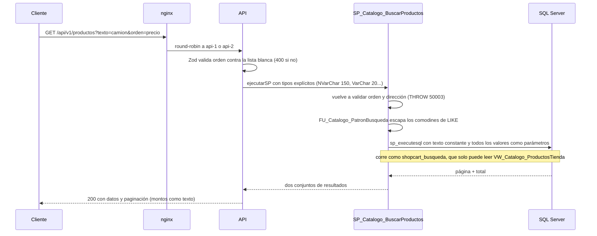

# Módulo catalogo

## Qué hace

Administra categorías, atributos, productos, variantes (una por combinación de valores de atributo), imágenes y precios versionados, y expone la tienda pública. Rutas públicas: `GET /categorias`, `GET /productos` (búsqueda) y `GET /productos/:id` ([catalogo.routes.ts:339](../../../apps/api/src/modules/catalogo/catalogo.routes.ts#L339 "router.get('/productos', controller.buscarProductos)")). Todo `/admin/...` es solo del Administrador ([catalogo.routes.ts:335](../../../apps/api/src/modules/catalogo/catalogo.routes.ts#L335 "const soloAdmin = [autenticar, autorizar('Administrador')]")). SPs clave: `SP_Catalogo_BuscarProductos` (único SQL dinámico del sistema), `SP_Catalogo_CambiarPrecio`, `SP_Catalogo_CrearVariante` con `SP_Catalogo_ResolverCombinacion`, `SP_Catalogo_EliminarProducto` / `SP_Catalogo_EliminarVariante` y la vista `VW_Catalogo_ProductosTienda`.

El servicio no tiene reglas propias: solo orquesta y, tras un cambio que afecta reportes, invalida su caché ([catalogo.service.ts:129](../../../apps/api/src/modules/catalogo/catalogo.service.ts#L129 "reportes.tras(repositorio.cambiarPrecio(idVariante, datos), 'carritos')")).

## Flujo crítico

La búsqueda pública: es el endpoint más usado, el único con SQL dinámico y el primer lugar donde un evaluador busca inyección SQL o concatenación de valores.

Puntos que demuestran que no hay inyección:

- Solo se concatenan fragmentos constantes al filtro, nunca un valor ([R__SP_Catalogo_BuscarProductos.sql:46](../../../database/programmability/R__SP_Catalogo_BuscarProductos.sql#L46 "p.NombreBusqueda LIKE @Contiene ESCAPE")); todo valor viaja como parámetro de `sp_executesql` ([R__SP_Catalogo_BuscarProductos.sql:69](../../../database/programmability/R__SP_Catalogo_BuscarProductos.sql#L69 "EXEC sys.sp_executesql @Sql")).
- El orden sale de una lista blanca resuelta con `CASE` ([R__SP_Catalogo_BuscarProductos.sql:59](../../../database/programmability/R__SP_Catalogo_BuscarProductos.sql#L59 "THEN p.PrecioMinimo END ASC")), validada en Zod ([catalogo.types.ts:111](../../../apps/api/src/modules/catalogo/catalogo.types.ts#L111 "ORDENES_BUSQUEDA = ['relevancia', 'precio', 'nombre', 'recientes']")) y otra vez en el SP ([R__SP_Catalogo_BuscarProductos.sql:30](../../../database/programmability/R__SP_Catalogo_BuscarProductos.sql#L30 "@Orden NOT IN ('relevancia', 'precio', 'nombre', 'recientes')")).
- El SP corre con un usuario sin login ([R__SP_Catalogo_BuscarProductos.sql:24](../../../database/programmability/R__SP_Catalogo_BuscarProductos.sql#L24 "WITH EXECUTE AS 'shopcart_busqueda'")) creado en [V011__usuario_busqueda.sql:4](../../../database/migrations/V011__usuario_busqueda.sql#L4 "CREATE USER shopcart_busqueda WITHOUT LOGIN"), cuyo único permiso es leer la vista ([R__VW_Catalogo_ProductosTienda.sql:30](../../../database/programmability/R__VW_Catalogo_ProductosTienda.sql#L30 "GRANT SELECT ON dbo.VW_Catalogo_ProductosTienda TO shopcart_busqueda")).

## Reglas: dónde vive cada una

| Regla | Dónde vive | Archivo:línea | Decisión |
| --- | --- | --- | --- |
| Búsqueda sin mayúsculas ni tildes ("camion" encuentra "Camión") | Columna calculada persistida con collation `CI_AI` | [V004__catalogo.sql:19](../../../database/migrations/V004__catalogo.sql#L19 "COLLATE Latin1_General_CI_AI") | A-10 |
| Los comodines del usuario (`%`, `_`, `[`, `\`) se buscan literal | `FU_Catalogo_PatronBusqueda` + `ESCAPE` | [R__FU_Catalogo_PatronBusqueda.sql:10](../../../database/programmability/R__FU_Catalogo_PatronBusqueda.sql#L10 "REPLACE(REPLACE(REPLACE(REPLACE(@Texto") | A-10 |
| Orden de lista blanca, paginación estable | SP (`CASE`, desempate por `IDProducto`) | [R__SP_Catalogo_BuscarProductos.sql:65](../../../database/programmability/R__SP_Catalogo_BuscarProductos.sql#L65 "p.IDProducto") | A-23 |
| La tienda solo muestra productos activos con alguna variante activa con precio vigente | Vista | [R__VW_Catalogo_ProductosTienda.sql:20](../../../database/programmability/R__VW_Catalogo_ProductosTienda.sql#L20 "v.Activo = 1") | N-14 |
| La tienda nunca expone la existencia física, solo un estado | `SP_Catalogo_ObtenerProducto` | [R__SP_Catalogo_ObtenerProducto.sql:33](../../../database/programmability/R__SP_Catalogo_ObtenerProducto.sql#L33 "THEN 'Agotado'") | N-06 |
| Precio en `DECIMAL(12,2)` y mayor que cero | Tipo + `CHECK` | [V004__catalogo.sql:115](../../../database/migrations/V004__catalogo.sql#L115 "CK_PrecioVariante_PrecioPositivo") | M-02 |
| Un solo precio vigente por variante | Índice único filtrado | [V004__catalogo.sql:120](../../../database/migrations/V004__catalogo.sql#L120 "UX_PrecioVariante_Vigente") | N-02 |
| Cambiar precio cierra la versión vigente e inserta otra, atómico | `SP_Catalogo_CambiarPrecio` bajo `UPDLOCK` | [R__SP_Catalogo_CambiarPrecio.sql:47](../../../database/programmability/R__SP_Catalogo_CambiarPrecio.sql#L47 "UPDATE dbo.PrecioVariante SET VigenteHasta = @Ahora") | N-02 |
| Versiones sin traslape (`VigenteHasta > VigenteDesde`) | `CHECK` + corrimiento de 1 ms en el SP | [R__SP_Catalogo_CambiarPrecio.sql:45](../../../database/programmability/R__SP_Catalogo_CambiarPrecio.sql#L45 "DATEADD(MILLISECOND, 1, @VigenteDesde)") | N-02 |
| Cada nueva versión de precio queda en la bitácora con el precio anterior | Trigger `AFTER INSERT` | [R__TR_Catalogo_PrecioVarianteBitacora.sql:25](../../../database/programmability/R__TR_Catalogo_PrecioVarianteBitacora.sql#L25 "CONVERT(VARCHAR(20), anterior.Precio)") | RF-09 |
| SKU único global | `UNIQUE` (autoridad) traducido a 50201 | [V004__catalogo.sql:84](../../../database/migrations/V004__catalogo.sql#L84 "UQ_Variante_SKU UNIQUE (SKU)") | N-14 |
| Una variante por combinación de atributos | `UNIQUE (IDProducto, FirmaAtributos)` | [V004__catalogo.sql:86](../../../database/migrations/V004__catalogo.sql#L86 "UQ_Variante_IDProductoFirmaAtributos UNIQUE") | N-14 |
| Un solo valor por atributo y el valor pertenece a su atributo | PK + FK compuesta | [V004__catalogo.sql:99](../../../database/migrations/V004__catalogo.sql#L99 "FK_VarianteValorAtributo_ValorAtributo") | N-14 |
| Todas las variantes de un producto usan el mismo conjunto de atributos | `SP_Catalogo_ResolverCombinacion` | [R__SP_Catalogo_ResolverCombinacion.sql:58](../../../database/programmability/R__SP_Catalogo_ResolverCombinacion.sql#L58 "THROW 50207, @Error, 1;") | N-14 |
| Con historial la combinación no cambia | `SP_Catalogo_ActualizarVariante` | [R__SP_Catalogo_ActualizarVariante.sql:46](../../../database/programmability/R__SP_Catalogo_ActualizarVariante.sql#L46 "THROW 50208") | N-14 |
| Borrado físico solo sin historial | Prevalidación + FKs como autoridad (547 → 50203) | [R__SP_Catalogo_EliminarProducto.sql:61](../../../database/programmability/R__SP_Catalogo_EliminarProducto.sql#L61 "IF ERROR_NUMBER() = 547") | N-14 |
| Producto activo solo en categoría activa | SP bajo bloqueo de la categoría | [R__SP_Catalogo_CambiarEstadoProducto.sql:39](../../../database/programmability/R__SP_Catalogo_CambiarEstadoProducto.sql#L39 "THROW 50206") | N-14 |
| Categoría no se desactiva con productos activos | SP con `UPDLOCK, HOLDLOCK` | [R__SP_Catalogo_CambiarEstadoCategoria.sql:32](../../../database/programmability/R__SP_Catalogo_CambiarEstadoCategoria.sql#L32 "THROW 50204") | N-14 |
| Imágenes: exactamente una principal, órdenes únicos | Zod + SP + índice único filtrado | [V004__catalogo.sql:44](../../../database/migrations/V004__catalogo.sql#L44 "UX_ImagenProducto_Principal") | N-19 |
| SKU ASCII visible de 1 a 40, máximo 4 valores, precio con 2 decimales | Zod | [catalogo.schemas.ts:148](../../../apps/api/src/modules/catalogo/catalogo.schemas.ts#L148 "El SKU tiene de 1 a 40 caracteres ASCII visibles") | A-08 |

## Concurrencia y réplicas

- **Dos cambios de precio simultáneos:** el SP bloquea la fila de la variante antes de leer la versión vigente ([R__SP_Catalogo_CambiarPrecio.sql:26](../../../database/programmability/R__SP_Catalogo_CambiarPrecio.sql#L26 "WITH (UPDLOCK, ROWLOCK) WHERE IDVariante = @IDVariante")), así el segundo espera y cierra la versión que dejó el primero. `UX_PrecioVariante_Vigente` es la última defensa. Lo demuestra [precios.api.test.ts:84](../../../apps/api/test/integracion/catalogo/precios.api.test.ts#L84 "cinco cambios simultáneos dejan exactamente un precio vigente"): seis versiones encadenadas, una sola vigente.
- **Dos altas de variante con el mismo SKU o la misma combinación:** la autoridad es el `UNIQUE`; el `CATCH` traduce la violación a 50201 o 50202 ([R__SP_Catalogo_CrearVariante.sql:54](../../../database/programmability/R__SP_Catalogo_CrearVariante.sql#L54 "LIKE N'%UQ_Variante_SKU%'")), nunca un 500 ([variantes.api.test.ts:103](../../../apps/api/test/integracion/catalogo/variantes.api.test.ts#L103 "dos altas simultáneas de la misma combinación o del mismo SKU")).
- **Dos altas con conjuntos de atributos distintos en un producto sin variantes:** el SP bloquea el producto antes de deducir el conjunto ([R__SP_Catalogo_CrearVariante.sql:31](../../../database/programmability/R__SP_Catalogo_CrearVariante.sql#L31 "FROM dbo.Producto WITH (UPDLOCK, ROWLOCK)")); una entra y la otra recibe 422 ([variantes.api.test.ts:182](../../../apps/api/test/integracion/catalogo/variantes.api.test.ts#L182 "dos altas simultáneas con conjuntos distintos")).
- **Activar un producto mientras se desactiva su categoría:** ambos SPs bloquean primero la categoría ([R__SP_Catalogo_CambiarEstadoProducto.sql:28](../../../database/programmability/R__SP_Catalogo_CambiarEstadoProducto.sql#L28 "dbo.Categoria AS c WITH (UPDLOCK, ROWLOCK)")) y la desactivación toma un rango con `HOLDLOCK` ([R__SP_Catalogo_CambiarEstadoCategoria.sql:30](../../../database/programmability/R__SP_Catalogo_CambiarEstadoCategoria.sql#L30 "WITH (UPDLOCK, HOLDLOCK)")). Prueba: [productos.api.test.ts:111](../../../apps/api/test/integracion/catalogo/productos.api.test.ts#L111 "activar productos mientras se desactiva su categoría").
- **Borrar una variante mientras entra inventario:** el borrado bloquea la variante y revisa el historial bajo ese bloqueo; si la entrada ganó, responde 50203 ([R__SP_Catalogo_EliminarVariante.sql:34](../../../database/programmability/R__SP_Catalogo_EliminarVariante.sql#L34 "THROW 50203")). Prueba: [variantes.api.test.ts:389](../../../apps/api/test/integracion/catalogo/variantes.api.test.ts#L389 "borrar una variante mientras entra inventario").
- **Orden de bloqueo:** producto y luego variantes en orden de `IDVariante` ([R__SP_Catalogo_EliminarProducto.sql:29](../../../database/programmability/R__SP_Catalogo_EliminarProducto.sql#L29 "FROM dbo.Variante AS v WITH (UPDLOCK, ROWLOCK)")), el mismo que el resto del sistema (01 §6.6). Si aun así hay un deadlock, `ejecutarSP` repite el SP completo hasta 3 veces ([ejecutar-sp.ts:67](../../../apps/api/src/shared/db/ejecutar-sp.ts#L67 "if (numero === DEADLOCK && intento < REINTENTOS_DEADLOCK)")).
- **Una réplica muere a mitad:** todo SP que escribe usa `SET XACT_ABORT ON` y una transacción ([R__SP_Catalogo_CambiarPrecio.sql:16](../../../database/programmability/R__SP_Catalogo_CambiarPrecio.sql#L16 "SET XACT_ABORT ON;")); al cortarse la conexión, SQL Server revierte la transacción abierta y no queda una versión cerrada sin su reemplazo. El catálogo no guarda estado en la réplica; el Admin repite la operación (el `PUT` de precio con el mismo valor es idempotente: [R__SP_Catalogo_CambiarPrecio.sql:35](../../../database/programmability/R__SP_Catalogo_CambiarPrecio.sql#L35 "IF @PrecioVigente = @Precio")).

## Modos de falla

- **Entrada inválida** (orden fuera de la lista, precio con 3 decimales, SKU con espacios): `400 VALIDACION_FALLIDA` desde `manejar` ([manejar.ts:67](../../../apps/api/src/shared/http/manejar.ts#L67 "VALIDACION_FALLIDA")). Si alguien llama al SP sin pasar por Zod, el SP responde `400 PARAMETRO_INVALIDO` ([catalogo.ts:36](../../../apps/api/src/shared/errors/catalogo.ts#L36 "PARAMETRO_INVALIDO")); ambos casos en [busqueda.api.test.ts:246](../../../apps/api/test/integracion/catalogo/busqueda.api.test.ts#L246 "un orden malicioso responde 400").
- **Producto inexistente, inactivo o sin variantes activas en la tienda:** `404 NO_ENCONTRADO` ([catalogo.service.ts:38](../../../apps/api/src/modules/catalogo/catalogo.service.ts#L38 "throw new AppError('NO_ENCONTRADO'")), porque el SP no devuelve nada si el producto no está en la vista ([R__SP_Catalogo_ObtenerProducto.sql:16](../../../database/programmability/R__SP_Catalogo_ObtenerProducto.sql#L16 "IF NOT EXISTS (SELECT 1 FROM dbo.VW_Catalogo_ProductosTienda")).
- **Conflictos de negocio:** `409 SKU_DUPLICADO` ([catalogo.ts:74](../../../apps/api/src/shared/errors/catalogo.ts#L74 "SKU_DUPLICADO")), `409 COMBINACION_DUPLICADA`, `409 PRODUCTO_CON_HISTORIAL` ([catalogo.ts:80](../../../apps/api/src/shared/errors/catalogo.ts#L80 "PRODUCTO_CON_HISTORIAL")), `409 CATEGORIA_INACTIVA`, `422 ATRIBUTOS_NO_COINCIDEN` con los atributos esperados en `detalles` ([catalogo.ts:99](../../../apps/api/src/shared/errors/catalogo.ts#L99 "ATRIBUTOS_NO_COINCIDEN")), `409 VARIANTE_CON_HISTORIAL`.
- **Rol incorrecto:** `403 SIN_PERMISO` en `/admin/...`, `401` sin token ([productos.api.test.ts:444](../../../apps/api/test/integracion/catalogo/productos.api.test.ts#L444 "un Cliente o un Operador recibe 403")).
- **Base caída:** el error de conexión no es de negocio y termina como `500 ERROR_INTERNO` ([middleware.ts:80](../../../apps/api/src/shared/errors/middleware.ts#L80 "return new AppError('ERROR_INTERNO', { cause: error });")).
- **Redis caído:** la tienda no usa Redis. En las escrituras del Admin, la invalidación de la caché de reportes nunca lanza ([reportes.cache.ts:61](../../../apps/api/src/modules/reportes/reportes.cache.ts#L61 "async tras(escritura, dominio, ...otros)")): la escritura se confirma y el TTL de la caché ([reportes.cache.ts:36](../../../apps/api/src/modules/reportes/reportes.cache.ts#L36 "SEGUNDOS_CACHE_REPORTES = 60")) acota el reporte desactualizado.

## Alternativas descartadas

- **Full-Text Search** → no viene en la imagen oficial de SQL Server en Docker; se usa `LIKE` sobre la columna `CI_AI` (A-10).
- **`EXECUTE AS OWNER` en la búsqueda** → el SQL dinámico tendría el alcance de `dbo`; con `shopcart_busqueda` solo puede leer una vista (A-23). Firmar con certificado exige volver a firmar tras cada `ALTER` (A-23).
- **SQL estático con `OPTION (RECOMPILE)`** → compila en cada llamada del endpoint más usado (A-23).
- **Precio como columna de `Variante`** → se perdería el historial y un pedido no podría apuntar a la versión que pagó; se versiona en `PrecioVariante` (N-02).
- **Tabla de valores de atributo como texto libre o columnas fijas (talla, color)** → atributos normalizados `Atributo` → `ValorAtributo` → `VarianteValorAtributo` con `FirmaAtributos` única (N-14).
- **Borrar siempre o desactivar siempre** → borrado físico solo sin historial; con historial, desactivación (N-14).
- **TVP para listas** → agrega un tipo fuera de la nomenclatura; las listas viajan como JSON con `OPENJSON` tipado (A-22).

## Preguntas probables

### ¿Dónde está el SQL dinámico y por qué no es inyectable?

Solo en `SP_Catalogo_BuscarProductos`. Se concatenan fragmentos constantes; el texto, la categoría, los precios, el orden y la página viajan como parámetros de `sp_executesql`.
**Muéstralo en:** [R__SP_Catalogo_BuscarProductos.sql:69](../../../database/programmability/R__SP_Catalogo_BuscarProductos.sql#L69 "EXEC sys.sp_executesql @Sql")

### ¿Qué pasa si mando `orden=nombre; DROP TABLE Producto`?

Zod responde 400 porque el valor no está en el `enum`; si se llama al SP directo, su propia lista blanca responde 50003. Hay una prueba exactamente con esa cadena.
**Muéstralo en:** [busqueda.api.test.ts:246](../../../apps/api/test/integracion/catalogo/busqueda.api.test.ts#L246 "un orden malicioso responde 400")

### La API tiene `DENY SELECT`: ¿cómo lee la vista el SQL dinámico?

`sp_executesql` corre con los permisos de quien llama. Por eso el SP se declara `WITH EXECUTE AS 'shopcart_busqueda'`, un usuario sin login cuyo único permiso es `SELECT` sobre la vista. `shopcart_app` conserva su `DENY`.
**Muéstralo en:** [V001__base.sql:9](../../../database/migrations/V001__base.sql#L9 "DENY SELECT, INSERT, UPDATE, DELETE ON SCHEMA::dbo TO shopcart_app")

### ¿Cómo encuentra "camion" a "Camión"?

`NombreBusqueda` es una columna calculada persistida con `COLLATE Latin1_General_CI_AI`, y el `LIKE` se hace sobre ella.
**Muéstralo en:** [busqueda.api.test.ts:75](../../../apps/api/test/integracion/catalogo/busqueda.api.test.ts#L75 "sin tildes ni mayúsculas) y es público")

### Si busco "50%", ¿me trae todo?

No. `FU_Catalogo_PatronBusqueda` escapa `\`, `%`, `_` y `[` y el `LIKE` usa `ESCAPE N'\'`.
**Muéstralo en:** [busqueda.api.test.ts:84](../../../apps/api/test/integracion/catalogo/busqueda.api.test.ts#L84 "los comodines de LIKE del usuario se buscan literal")

### ¿Cómo se guarda el historial de precios y cuál es el vigente?

Cada cambio cierra la versión vigente (`VigenteHasta = ahora`) e inserta otra en la misma transacción. El vigente es la fila sin `VigenteHasta`, y un índice único filtrado impide dos.
**Muéstralo en:** [R__FU_Catalogo_PrecioVigente.sql:9](../../../database/programmability/R__FU_Catalogo_PrecioVigente.sql#L9 "pv.VigenteHasta IS NULL")

### Si cambio un precio, ¿cambian los pedidos ya hechos?

No. El detalle del pedido guarda su `IDPrecioVariante` con FK a la versión que pagó, más su copia de `PrecioUnitario`.
**Muéstralo en:** [V008__pedidos.sql:123](../../../database/migrations/V008__pedidos.sql#L123 "FK_DetallePedido_PrecioVariante")

### ¿Qué pasa si dos administradores cambian el precio a la vez?

Se serializan en la fila de la variante con `UPDLOCK`; ninguna versión se pierde ni se traslapa. La prueba lanza cinco cambios simultáneos.
**Muéstralo en:** [precios.api.test.ts:84](../../../apps/api/test/integracion/catalogo/precios.api.test.ts#L84 "cinco cambios simultáneos dejan exactamente un precio vigente")

### ¿Cómo se garantiza una sola variante por combinación de atributos, sin importar el orden en que lleguen los valores?

El SP calcula `FirmaAtributos` con los IDs de valor ordenados por `IDAtributo`, y `UNIQUE (IDProducto, FirmaAtributos)` es la autoridad.
**Muéstralo en:** [variantes.api.test.ts:78](../../../apps/api/test/integracion/catalogo/variantes.api.test.ts#L78 "la misma combinación en otro orden responde 409 COMBINACION_DUPLICADA")

### ¿Por qué no se puede borrar un producto vendido?

Porque rompería pedidos, kardex y reservas. El SP prevalida con `FU_Catalogo_HistorialVariante` para dar el mensaje, y las FKs son la autoridad: un 547 se traduce a 50203. Con historial solo se desactiva.
**Muéstralo en:** [R__SP_Catalogo_EliminarProducto.sql:37](../../../database/programmability/R__SP_Catalogo_EliminarProducto.sql#L37 "THROW 50203")

### ¿Qué cuenta como historial?

Ventas (`DetallePedido`), movimientos de kardex, reservas y líneas de sesión de checkout.
**Muéstralo en:** [R__FU_Catalogo_HistorialVariante.sql:10](../../../database/programmability/R__FU_Catalogo_HistorialVariante.sql#L10 "FROM dbo.MovimientoKardex")

### ¿Por qué la tienda no muestra la existencia exacta?

N-06: el cliente ve `Disponible`, `UltimasUnidades` (con la cifra solo en el umbral o por debajo) o `Agotado`, calculado sobre el disponible (física menos reservas vigentes), nunca sobre la física. El Admin ve la cifra exacta.
**Muéstralo en:** [productos.api.test.ts:394](../../../apps/api/test/integracion/catalogo/productos.api.test.ts#L394 "con reservas, el estado y las unidades salen del disponible")

### ¿La paginación puede repetir o perder productos cuando hay empates de precio?

No: todo orden termina con `IDProducto` como desempate antes del `OFFSET`.
**Muéstralo en:** [busqueda.api.test.ts:147](../../../apps/api/test/integracion/catalogo/busqueda.api.test.ts#L147 "OFFSET no repite ni pierde productos")

### ¿Cómo se reemplazan las imágenes sin dejar un estado intermedio?

`PUT` reemplaza el conjunto completo en una transacción con el producto bloqueado: borra y vuelve a insertar. Zod y el SP validan una sola principal y órdenes únicos; los índices únicos son la última defensa.
**Muéstralo en:** [R__SP_Catalogo_GuardarImagenes.sql:51](../../../database/programmability/R__SP_Catalogo_GuardarImagenes.sql#L51 "DELETE FROM dbo.ImagenProducto WHERE IDProducto = @IDProducto")
