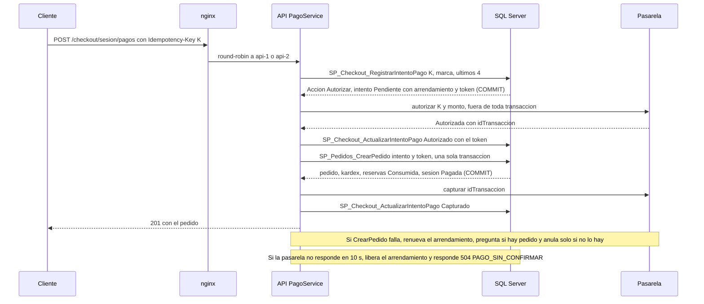

# Módulo checkout

## Qué hace

Convierte el carrito del cliente en una **sesión de pago** con precios, descuento, envío y dirección congelados y las reservas tomadas todo o nada, y después **confirma el pago** con `Idempotency-Key`: autoriza en la pasarela, crea el pedido en una sola transacción y captura. Ningún cobro sin pedido, ningún pedido sin autorización y nunca dos cobros.

- **Endpoints (solo Cliente**, [checkout.routes.ts:78](../../../apps/api/src/modules/checkout/checkout.routes.ts#L78 "autorizar('Cliente')")**):** `POST /api/v1/checkout/sesion` (201 crea, 200 reutiliza), `GET` y `DELETE` de la misma ruta, y `POST /api/v1/checkout/sesion/pagos` con `Idempotency-Key` obligatoria ([checkout.routes.ts:83](../../../apps/api/src/modules/checkout/checkout.routes.ts#L83 "controller.pagar")).
- **SPs clave:** `SP_Checkout_IniciarSesion`, `SP_Checkout_RegistrarIntentoPago` (candado de idempotencia y arrendamiento), `SP_Checkout_ActualizarIntentoPago`, `SP_Pedidos_CrearPedido` (del módulo pedidos, usado por [index.ts:52](../../../apps/api/src/modules/pedidos/index.ts#L52 "crearDeIntento")), `SP_Checkout_RenovarArrendamiento`, `SP_Checkout_LiberarArrendamiento`.
- **Tareas (cada minuto):** `Checkout.ExpirarSesiones` y `Checkout.ConciliarPagos` ([checkout.tareas.ts:23](../../../apps/api/src/modules/checkout/checkout.tareas.ts#L23 "Checkout.ConciliarPagos")), con `SP_Checkout_ExpirarSesiones`, `SP_Checkout_TomarIntentosPorConciliar` y `SP_Checkout_ResolverIntentoConciliado`.

## Flujo crítico

Confirmar el pago es el flujo crítico: ahí se juegan el cobro doble, el cobro sin pedido y el pedido sin cobro, con dos réplicas y una pasarela que puede no responder. Cada paso es un SP con su propio `COMMIT` antes de la siguiente llamada externa ([checkout.pago.ts:52](../../../apps/api/src/modules/checkout/checkout.pago.ts#L52 "la pasarela ocurre dentro de una transacción")).

Antes, `POST /checkout/sesion` bloquea el carrito y las variantes en orden de `IDVariante` ([R__SP_Checkout_IniciarSesion.sql:62](../../../database/programmability/R__SP_Checkout_IniciarSesion.sql#L62 "WITH (UPDLOCK, ROWLOCK)")), congela las líneas ([R__SP_Checkout_IniciarSesion.sql:152](../../../database/programmability/R__SP_Checkout_IniciarSesion.sql#L152 "INSERT INTO dbo.LineaSesionCheckout")) y reserva todo o nada ([R__SP_Checkout_IniciarSesion.sql:161](../../../database/programmability/R__SP_Checkout_IniciarSesion.sql#L161 "SP_Inventario_ReservarExistencia")). La sobreventa se decide ahí, no en el pago.

## Reglas: dónde vive cada una

| Regla | Dónde vive | Archivo:línea | Decisión |
| --- | --- | --- | --- |
| Solo un Cliente compra | Rutas y SP (`50005`) | [checkout.routes.ts:78](../../../apps/api/src/modules/checkout/checkout.routes.ts#L78 "autorizar('Cliente')"), [R__SP_Checkout_RegistrarIntentoPago.sql:35](../../../database/programmability/R__SP_Checkout_RegistrarIntentoPago.sql#L35 "THROW 50005") | N-05, RF-01 |
| El cliente sale del token; el cuerpo no acepta `idUsuario` ni `idCarrito` | Zod `.strict()` | [checkout.schemas.ts:10](../../../apps/api/src/modules/checkout/checkout.schemas.ts#L10 ".strict()") | RF-01 |
| Reserva todo o nada bajo el bloqueo de la variante | `SP_Inventario_ReservarExistencia` | [R__SP_Inventario_ReservarExistencia.sql:52](../../../database/programmability/R__SP_Inventario_ReservarExistencia.sql#L52 "THROW 50301") | N-06, A-02 |
| Lo que se cobra queda congelado en la sesión | SP (`LineaSesionCheckout`) | [R__SP_Checkout_IniciarSesion.sql:151](../../../database/programmability/R__SP_Checkout_IniciarSesion.sql#L151 "N-02: lo que se cobra queda congelado") | N-02, M-04 |
| Mismo contenido (hash) y sesión vigente: se reutiliza (200) | SP | [R__SP_Checkout_IniciarSesion.sql:121](../../../database/programmability/R__SP_Checkout_IniciarSesion.sql#L121 "@HashActiva = @Hash") | N-02 |
| Una sola sesión `Activa` por cliente | Índice único filtrado | [V007__checkout.sql:50](../../../database/migrations/V007__checkout.sql#L50 "UX_SesionCheckout_ActivaPorUsuario") | N-06 |
| Una sesión con un pago en curso no se cancela | SP (`50602`) | [R__SP_Checkout_CancelarSesionActiva.sql:28](../../../database/programmability/R__SP_Checkout_CancelarSesionActiva.sql#L28 "THROW 50602") | N-03 |
| `Idempotency-Key` obligatoria y UUID | Zod | [idempotencia.ts:8](../../../apps/api/src/shared/http/idempotencia.ts#L8 "encabezadoIdempotenciaSchema") | N-03 |
| La misma llave no se procesa dos veces | `UNIQUE` + `UPDLOCK, HOLDLOCK` | [V007__checkout.sql:97](../../../database/migrations/V007__checkout.sql#L97 "UQ_IntentoPago_LlaveIdempotencia"), [R__SP_Checkout_RegistrarIntentoPago.sql:70](../../../database/programmability/R__SP_Checkout_RegistrarIntentoPago.sql#L70 "WITH (UPDLOCK, HOLDLOCK)") | N-03, A-02 |
| Llave de otro cliente o con otra tarjeta: `422` | SP (`50603`) | [R__SP_Checkout_RegistrarIntentoPago.sql:79](../../../database/programmability/R__SP_Checkout_RegistrarIntentoPago.sql#L79 "THROW 50603") | N-03 |
| Un solo intento en curso por sesión | Índice único filtrado + SP | [V007__checkout.sql:107](../../../database/migrations/V007__checkout.sql#L107 "UX_IntentoPago_EnCursoPorSesion"), [R__SP_Checkout_RegistrarIntentoPago.sql:144](../../../database/programmability/R__SP_Checkout_RegistrarIntentoPago.sql#L144 "THROW 50602") | N-03 |
| El pago empieza dentro de la vigencia de la sesión | SP (`50601`) | [R__SP_Checkout_RegistrarIntentoPago.sql:139](../../../database/programmability/R__SP_Checkout_RegistrarIntentoPago.sql#L139 "THROW 50601") | N-03 |
| Máximo de rechazos por sesión; al llegar, se cancela y libera | SP (`50605` y `SP_Checkout_CancelarSesionActiva`) | [R__SP_Checkout_RegistrarIntentoPago.sql:141](../../../database/programmability/R__SP_Checkout_RegistrarIntentoPago.sql#L141 "THROW 50605"), [R__SP_Checkout_ActualizarIntentoPago.sql:92](../../../database/programmability/R__SP_Checkout_ActualizarIntentoPago.sql#L92 "SP_Checkout_CancelarSesionActiva") | N-03, A-14 |
| Retomar un intento vencido: solo una petición gana | SP (compare-and-set) | [R__SP_Checkout_RegistrarIntentoPago.sql:99](../../../database/programmability/R__SP_Checkout_RegistrarIntentoPago.sql#L99 "ArrendadoHasta <= @Ahora") | N-03 |
| Fencing: solo el dueño del token vigente escribe | SP (`50602`) | [R__SP_Pedidos_CrearPedido.sql:73](../../../database/programmability/R__SP_Pedidos_CrearPedido.sql#L73 "@TokenVigente <> @TokenArrendamiento"), [R__SP_Checkout_ActualizarIntentoPago.sql:56](../../../database/programmability/R__SP_Checkout_ActualizarIntentoPago.sql#L56 "@TokenVigente <> @TokenArrendamiento") | N-03 |
| Nunca un pedido sin autorización confirmada | SP (`50005`) | [R__SP_Pedidos_CrearPedido.sql:77](../../../database/programmability/R__SP_Pedidos_CrearPedido.sql#L77 "@EstadoIntento <> 'Autorizado'") | N-01, N-03 |
| Un pedido por sesión y por intento | `UNIQUE` | [V008__pedidos.sql:76](../../../database/migrations/V008__pedidos.sql#L76 "UQ_Pedido_IDSesionCheckout"), [V008__pedidos.sql:77](../../../database/migrations/V008__pedidos.sql#L77 "UQ_Pedido_IDIntentoPago") | RF-06 |
| Un intento con pedido nunca se anula | SP (`50005`) | [R__SP_Checkout_ActualizarIntentoPago.sql:70](../../../database/programmability/R__SP_Checkout_ActualizarIntentoPago.sql#L70 "No se anula un intento de pago con pedido") | RF-06 |
| La pasarela nunca dentro de una transacción | Servicio | [checkout.pago.ts:259](../../../apps/api/src/modules/checkout/checkout.pago.ts#L259 "pasarela.autorizar") | N-03, A-02 |
| De la tarjeta solo se guardan marca y últimos 4 | Servicio + logs redactados | [checkout.pago.ts:327](../../../apps/api/src/modules/checkout/checkout.pago.ts#L327 "marcaDeTarjeta"), [logger.ts:8](../../../apps/api/src/shared/observability/logger.ts#L8 "numeroTarjeta") | N-03 |
| Tarjeta vencida: `400` sin llegar a la pasarela | Zod con el `Reloj` | [checkout.schemas.ts:71](../../../apps/api/src/modules/checkout/checkout.schemas.ts#L71 "tarjetaVencida(datos, reloj.ahora())") | N-03 |
| La expiración no vence una sesión con el arrendamiento vivo | Job (SP) | [R__SP_Checkout_ExpirarSesiones.sql:56](../../../database/programmability/R__SP_Checkout_ExpirarSesiones.sql#L56 "ArrendadoHasta > SYSUTCDATETIME()") | N-03, A-04 |
| La conciliación captura solo con pedido, y nunca el de un cancelado | SP (`50005`) | [R__SP_Checkout_ResolverIntentoConciliado.sql:73](../../../database/programmability/R__SP_Checkout_ResolverIntentoConciliado.sql#L73 "No se captura un intento de pago sin pedido"), [R__SP_Checkout_ResolverIntentoConciliado.sql:79](../../../database/programmability/R__SP_Checkout_ResolverIntentoConciliado.sql#L79 "No se captura el cobro de un pedido cancelado") | RF-06, N-09 |

## Concurrencia y réplicas

- **Dos peticiones simultáneas:**
  - **20 clientes por la última unidad** ([checkout.concurrencia.test.ts:55](../../../apps/api/test/concurrencia/checkout.concurrencia.test.ts#L55 "20 clientes por la última unidad")): los 20 inician su pago a través de nginx. `SP_Inventario_ReservarExistencia` bloquea la variante ([R__SP_Inventario_ReservarExistencia.sql:34](../../../database/programmability/R__SP_Inventario_ReservarExistencia.sql#L34 "WITH (UPDLOCK, ROWLOCK)")) y, ya bloqueada, compara el disponible ([R__SP_Inventario_ReservarExistencia.sql:40](../../../database/programmability/R__SP_Inventario_ReservarExistencia.sql#L40 "d.Disponible < p.Cantidad")). Uno reserva y paga (201). Los otros 19 reciben `409 STOCK_INSUFICIENTE` **al iniciar la sesión**, no al pagar: `comprar` solo paga si la sesión respondió 201 ([apoyo-concurrencia.ts:231](../../../apps/api/test/concurrencia/apoyo-concurrencia.ts#L231 "Idempotency-Key")). La prueba verifica existencia 0, la conciliación de inventario vacía y que respondieron las dos réplicas ([checkout.concurrencia.test.ts:74](../../../apps/api/test/concurrencia/checkout.concurrencia.test.ts#L74 "new Set(['api-1', 'api-2'])")). Última defensa: [V004__catalogo.sql:88](../../../database/migrations/V004__catalogo.sql#L88 "CK_Variante_ExistenciaNoNegativa").
  - **20 clientes por el último uso de un cupón** ([checkout.concurrencia.test.ts:77](../../../apps/api/test/concurrencia/checkout.concurrencia.test.ts#L77 "por el último uso de un cupón")): el contador solo sube si no llegó al límite ([R__SP_Cupones_ReservarUso.sql:42](../../../database/programmability/R__SP_Cupones_ReservarUso.sql#L42 "THROW 50505")), con el `CHECK` como defensa ([V006__carrito_cupones_envios.sql:35](../../../database/migrations/V006__carrito_cupones_envios.sql#L35 "CK_Cupon_UsosComprometidos")): 1 pedido y 19 × `422 CUPON_AGOTADO`.
  - **Doble clic con la misma llave:** el carrito bloqueado serializa al cliente ([R__SP_Carrito_BloquearActivo.sql:22](../../../database/programmability/R__SP_Carrito_BloquearActivo.sql#L22 "WITH (UPDLOCK, HOLDLOCK)")); la segunda petición encuentra el intento con el arrendamiento vivo y recibe `409 PAGO_EN_CURSO` con `Retry-After`. Cinco peticiones simultáneas dan un 201, cuatro 409 y un solo intento ([pagar.api.test.ts:152](../../../apps/api/test/integracion/checkout/pagar.api.test.ts#L152 "doble clic con la misma llave")).
  - **Dos retomas del mismo intento vencido:** el `UPDATE` con la condición del arrendamiento solo afecta una fila; la otra recibe `EnCurso` ([R__SP_Checkout_RegistrarIntentoPago.sql:102](../../../database/programmability/R__SP_Checkout_RegistrarIntentoPago.sql#L102 "@@ROWCOUNT = 0 THEN 'EnCurso'"), prueba [pagar.api.test.ts:294](../../../apps/api/test/integracion/checkout/pagar.api.test.ts#L294 "dos retomas simultáneas")).
  - **Rechazos simultáneos:** el contador nunca pasa de cinco ni cancela dos veces ([pagar.api.test.ts:346](../../../apps/api/test/integracion/checkout/pagar.api.test.ts#L346 "rechazos simultáneos")). Cinco `POST /checkout/sesion` del mismo cliente: una sola sesión ([iniciar-sesion.api.test.ts:357](../../../apps/api/test/integracion/checkout/iniciar-sesion.api.test.ts#L357 "cinco POST simultáneos")). Variantes en orden inverso entre clientes: ningún 500 ([iniciar-sesion.api.test.ts:373](../../../apps/api/test/integracion/checkout/iniciar-sesion.api.test.ts#L373 "en orden inverso")); si aun así hay un deadlock, `ejecutarSP` reintenta el SP completo ([ejecutar-sp.ts:67](../../../apps/api/src/shared/db/ejecutar-sp.ts#L67 "numero === DEADLOCK")).
- **Una réplica muere a mitad:**
  - nginx no repite un `POST` que ya llegó a una réplica ([nginx.conf:71](../../../infra/nginx/nginx.conf#L71 "proxy_next_upstream       error timeout")): el reintento lo hace el cliente con la misma llave.
  - **Antes de autorizar o con la autorización sin pedido:** el intento queda `Pendiente` o `Autorizado` con un arrendamiento de 15 s ([checkout.pago.ts:23](../../../apps/api/src/modules/checkout/checkout.pago.ts#L23 "SEGUNDOS_ARRENDAMIENTO")). El reintento con la misma llave, en cualquier réplica, lo retoma: `Autorizar` (la pasarela devuelve la misma autorización por llave) o `CrearPedido` ([pago-fallas.api.test.ts:214](../../../apps/api/test/integracion/checkout/pago-fallas.api.test.ts#L214 "autorizado sin pedido")).
  - **Con el pedido creado y sin capturar:** el reintento recibe `Capturar` y un 200 con el mismo pedido ([pago-fallas.api.test.ts:194](../../../apps/api/test/integracion/checkout/pago-fallas.api.test.ts#L194 "pedido sin capturar")). Si nadie reintenta, la conciliación toma los intentos con el arrendamiento vencido hace más de 2 minutos ([checkout.conciliacion.ts:14](../../../apps/api/src/modules/checkout/checkout.conciliacion.ts#L14 "SEGUNDOS_GRACIA = 120")) y captura o anula ([tareas-periodicas.test.ts:291](../../../apps/api/test/integracion/secuencial/tareas-periodicas.test.ts#L291 "la API murió entre CrearPedido y la captura")).
  - **Petición zombi:** si la conciliación retomó el intento, el token cambió y la petición vieja ya no puede crear el pedido ([tareas-periodicas.test.ts:432](../../../apps/api/test/integracion/secuencial/tareas-periodicas.test.ts#L432 "no puede crear el pedido")).
  - **Jobs entre réplicas:** `sp_getapplock` en la expiración ([R__SP_Checkout_ExpirarSesiones.sql:29](../../../database/programmability/R__SP_Checkout_ExpirarSesiones.sql#L29 "sp_getapplock")) y en la conciliación, que además toma un intento a la vez con `READPAST` ([R__SP_Checkout_TomarIntentosPorConciliar.sql:48](../../../database/programmability/R__SP_Checkout_TomarIntentosPorConciliar.sql#L48 "READPAST")).

## Modos de falla

- **Entrada inválida:** sin `Idempotency-Key` o no UUID, `400 VALIDACION_FALLIDA` ([pagar.api.test.ts:133](../../../apps/api/test/integracion/checkout/pagar.api.test.ts#L133 "sin Idempotency-Key")); un `idUsuario` en el cuerpo, `400` ([iniciar-sesion.api.test.ts:429](../../../apps/api/test/integracion/checkout/iniciar-sesion.api.test.ts#L429 "un idUsuario en el cuerpo 400")); tarjeta vencida, `400` en el campo ([vigencia-del-pago.api.test.ts:226](../../../apps/api/test/integracion/checkout/vigencia-del-pago.api.test.ts#L226 "una fecha de vencimiento pasada")).
- **Recurso inexistente o ajeno:** sin sesión de pago, `404 NO_ENCONTRADO` ([R__SP_Checkout_RegistrarIntentoPago.sql:133](../../../database/programmability/R__SP_Checkout_RegistrarIntentoPago.sql#L133 "THROW 50001")); una dirección de otro cliente responde igual que una inexistente ([R__SP_Checkout_IniciarSesion.sql:87](../../../database/programmability/R__SP_Checkout_IniciarSesion.sql#L87 "THROW 50001")).
- **Carrito:** vacío, `422 CARRITO_VACIO` ([R__SP_Checkout_IniciarSesion.sql:56](../../../database/programmability/R__SP_Checkout_IniciarSesion.sql#L56 "THROW 50403")); línea desactivada, `409 LINEAS_NO_DISPONIBLES` ([R__SP_Checkout_IniciarSesion.sql:133](../../../database/programmability/R__SP_Checkout_IniciarSesion.sql#L133 "THROW 50402")); sin existencia, `409 STOCK_INSUFICIENTE` con el disponible por línea.
- **Sesión vencida:** `409 SESION_VENCIDA` ([catalogo.ts:183](../../../apps/api/src/shared/errors/catalogo.ts#L183 "SESION_VENCIDA")), también si el job todavía no la marcó ([vigencia-del-pago.api.test.ts:70](../../../apps/api/test/integracion/checkout/vigencia-del-pago.api.test.ts#L70 "sin que el job la marque")).
- **Pago en curso o arrendamiento perdido:** `409 PAGO_EN_CURSO` con `Retry-After` ([middleware.ts:44](../../../apps/api/src/shared/errors/middleware.ts#L44 "Retry-After")).
- **Llave reutilizada:** `422 LLAVE_REUTILIZADA` ([catalogo.ts:185](../../../apps/api/src/shared/errors/catalogo.ts#L185 "LLAVE_REUTILIZADA")).
- **Tarjeta rechazada:** `402 PAGO_RECHAZADO` con `intentosRestantes` en `detalles` ([checkout.pago.ts:377](../../../apps/api/src/modules/checkout/checkout.pago.ts#L377 "detalles: { intentosRestantes, sesionCancelada }")); al quinto, la sesión se cancela y libera, y una sexta llave nueva responde `404` porque ya no hay sesión `Activa` ([pagar.api.test.ts:319](../../../apps/api/test/integracion/checkout/pagar.api.test.ts#L319 "el quinto cancela la sesión y libera")). `409 MAX_INTENTOS` (50605) queda como defensa para una sesión `Activa` que ya tenga el máximo, algo que el flujo normal no produce.
- **Pasarela que no responde (10 s o `4000…0119`):** se libera el arrendamiento y `504 PAGO_SIN_CONFIRMAR` ([checkout.pago.ts:249](../../../apps/api/src/modules/checkout/checkout.pago.ts#L249 "PAGO_SIN_CONFIRMAR")); el límite lo impone el adaptador ([pasarela-simulada.ts:69](../../../apps/api/src/shared/adapters/pasarela-simulada.ts#L69 "new PasarelaSinRespuesta(operacion)")).
- **Falla la captura:** el pedido ya existe, se responde 201 y la conciliación captura después ([checkout.pago.ts:103](../../../apps/api/src/modules/checkout/checkout.pago.ts#L103 "la conciliación (E5-H04) captura después")).
- **Falla la anulación:** tres intentos en la misma petición y, si siguen fallando, el intento queda `Autorizado` para la conciliación ([checkout.pago.ts:150](../../../apps/api/src/modules/checkout/checkout.pago.ts#L150 "intento === INTENTOS_ANULACION")).
- **Cerrado por la conciliación sin cobro:** el reintento recibe `409 PAGO_NO_COMPLETADO` ([R__SP_Checkout_ResolverIntentoConciliado.sql:86](../../../database/programmability/R__SP_Checkout_ResolverIntentoConciliado.sql#L86 "PAGO_NO_COMPLETADO")). **Cobro capturado sin pedido:** `409 PAGO_EN_REVISION` ([checkout.pago.ts:310](../../../apps/api/src/modules/checkout/checkout.pago.ts#L310 "PAGO_EN_REVISION")).
- **Base caída:** `500 ERROR_INTERNO` con el detalle solo en el log ([middleware.ts:80](../../../apps/api/src/shared/errors/middleware.ts#L80 "ERROR_INTERNO")); con `XACT_ABORT` nada queda a medias.
- **Redis caído:** el pago no depende de Redis. Lo único que toca es la invalidación de reportes, que no lanza ([cache-redis.ts:34](../../../apps/api/src/shared/adapters/cache-redis.ts#L34 "tolerante")).
- **Rol equivocado:** invitado `401`, Operador y Admin `403` ([iniciar-sesion.api.test.ts:429](../../../apps/api/test/integracion/checkout/iniciar-sesion.api.test.ts#L429 "Operador y Admin 403")).

## Alternativas descartadas

- **Candado de idempotencia en Redis o en memoria** → se pierde o no se comparte entre réplicas. El candado es un `UNIQUE` en SQL Server (RNF-2, A-04, 01 §7).
- **Pasarela simulada en memoria** → un reintento en la otra réplica autorizaría otra vez. Guarda su estado en sus propias tablas, solo por `SP_Pasarela_*` (N-03, cambio A del plan E5-H03).
- **Llamar a la pasarela dentro de la transacción del pedido** → retiene bloqueos de variantes y cupón hasta 10 s y no se puede revertir un cobro con un `ROLLBACK` (N-03, A-02).
- **Crear el pedido al iniciar el pago** → el pedido es una compra confirmada; la sesión es la que reserva (N-01).
- **Hashear el número de tarjeta o el CVV** → un hash sin clave de un número de tarjeta se revierte por fuerza bruta: solo sesión, monto, marca y últimos 4 (N-03, decisión 2 del plan E5-H03).
- **"En curso" por 30 s desde `FechaActualizacion`** → reemplazado por el arrendamiento con token de fencing, que impide que una petición zombi cree el pedido (N-03, cambio B del plan E5-H03).
- **Que el cliente envíe el total que vio** → agrega un campo al contrato; la sesión ya muestra el total congelado (decisión 1 del plan E5-H01).
- **Un worker dedicado o un lock en Redis para los jobs** → `sp_getapplock` en las réplicas (A-04).
- **`SERIALIZABLE` global** → `READ_COMMITTED_SNAPSHOT` más `UPDLOCK` explícito solo en las filas en disputa (A-05).

## Preguntas probables

### ¿Qué impide cobrar dos veces si el cliente hace doble clic?

El `UNIQUE` de la llave y el arrendamiento: la segunda petición con la misma llave encuentra el intento tomado y recibe `409 PAGO_EN_CURSO`; al reintentar recibe el mismo pedido. La pasarela también es idempotente por llave.
**Muéstralo en:** [pagar.api.test.ts:152](../../../apps/api/test/integracion/checkout/pagar.api.test.ts#L152 "doble clic con la misma llave")

### ¿Qué pasa con la tarjeta 4000 0000 0000 0119?

La pasarela simulada autoriza y "pierde" la respuesta la primera vez; la API libera el arrendamiento y responde `504 PAGO_SIN_CONFIRMAR`. El reintento con la misma llave recibe la misma autorización y termina con un solo cobro.
**Muéstralo en:** [pasarela-simulada.ts:109](../../../apps/api/src/shared/adapters/pasarela-simulada.ts#L109 "fila.Nueva && tarjeta.numero === TIEMPO_AGOTADO")

### ¿Y si el reintento cae en la otra réplica?

Funciona igual: el intento vive en SQL Server y la pasarela simulada guarda sus autorizaciones por llave en sus propias tablas, no en memoria.
**Muéstralo en:** [pagar.api.test.ts:262](../../../apps/api/test/integracion/checkout/pagar.api.test.ts#L262 "en la otra réplica recibe la misma autorización")

### ¿Por qué la pasarela nunca se llama dentro de una transacción?

Porque un cobro no se revierte con `ROLLBACK` y la llamada puede tardar 10 s con las variantes bloqueadas. Cada SP hace `COMMIT` antes; si el pedido falla después de autorizar, la autorización se anula explícitamente.
**Muéstralo en:** [checkout.pago.ts:259](../../../apps/api/src/modules/checkout/checkout.pago.ts#L259 "pasarela.autorizar")

### ¿Qué pasa si la creación del pedido falla después de autorizar?

El servicio renueva su arrendamiento, pregunta a la base si el pedido de ese intento existe (el SP pudo confirmar y la respuesta perderse) y solo anula si no existe. Con pedido, captura y responde el pedido.
**Muéstralo en:** [checkout.pago.ts:177](../../../apps/api/src/modules/checkout/checkout.pago.ts#L177 "obtenerDeIntento(idIntento)")

### ¿Qué es el token de fencing y qué problema resuelve?

Cada toma del arrendamiento genera un `TokenArrendamiento` nuevo. Los SPs que crean el pedido o escriben el intento lo comparan bajo `UPDLOCK`: una petición cuyo arrendamiento retomó otro proceso recibe `50602` y no escribe nada.
**Muéstralo en:** [R__SP_Pedidos_CrearPedido.sql:74](../../../database/programmability/R__SP_Pedidos_CrearPedido.sql#L74 "THROW 50602")

### ¿Qué pasa si la API muere entre crear el pedido y capturar?

El intento queda `Autorizado` con pedido. El reintento con la misma llave recibe la acción `Capturar` y un 200; si nadie reintenta, la conciliación lo captura a los 2 minutos.
**Muéstralo en:** [tareas-periodicas.test.ts:291](../../../apps/api/test/integracion/secuencial/tareas-periodicas.test.ts#L291 "Autorizado con pedido sin capturar")

### ¿Cómo se evita la sobreventa con 20 clientes por la última unidad?

La reserva se toma al iniciar el pago, con la variante bloqueada y el disponible validado bajo ese bloqueo: uno reserva, 19 reciben `409 STOCK_INSUFICIENTE`. La prueba corre contra las dos réplicas a través de nginx.
**Muéstralo en:** [checkout.concurrencia.test.ts:55](../../../apps/api/test/concurrencia/checkout.concurrencia.test.ts#L55 "20 clientes por la última unidad")

### ¿Qué es el hash de la solicitud y qué incluye?

Un SHA-256 calculado en el SP sobre sesión, monto, marca y últimos 4 dígitos; nunca el número ni el CVV. Con una llave ya usada, la sesión y el monto salen del propio intento, así que en la práctica detecta otra tarjeta; otro cliente y otra sesión se detectan con sus propias condiciones.
**Muéstralo en:** [R__SP_Checkout_RegistrarIntentoPago.sql:77](../../../database/programmability/R__SP_Checkout_RegistrarIntentoPago.sql#L77 "@HashGuardado <> HASHBYTES")

### ¿Qué pasa si la reserva vence durante el pago?

`CrearPedido` vuelve a reservar las líneas vencidas con la variante bloqueada; si ya no hay existencia, `50301`, nada se escribe y el servicio anula la autorización.
**Muéstralo en:** [R__SP_Pedidos_CrearPedido.sql:95](../../../database/programmability/R__SP_Pedidos_CrearPedido.sql#L95 "SP_Inventario_ReservarExistencia")

### ¿Cuándo un intento queda EnRevision?

Cuando la pasarela contradice la base: un pedido cuya autorización ya no existe o un cobro capturado sin pedido. Es terminal: la conciliación no lo vuelve a tomar y el error se registra una sola vez.
**Muéstralo en:** [checkout.conciliacion.ts:87](../../../apps/api/src/modules/checkout/checkout.conciliacion.ts#L87 "pedidoSinCobro || cobroSinPedido")

### ¿Cómo se garantiza que la conciliación corre en una sola réplica?

`SP_Checkout_TomarIntentosPorConciliar` toma un `sp_getapplock` exclusivo con `@LockTimeout = 0`: la otra réplica retorna sin hacer nada. Además arrienda el intento con un token nuevo y la resolución es un compare-and-set.
**Muéstralo en:** [R__SP_Checkout_TomarIntentosPorConciliar.sql:34](../../../database/programmability/R__SP_Checkout_TomarIntentosPorConciliar.sql#L34 "sp_getapplock")

### ¿Puede un cliente pagar con la llave de otro o ver la sesión de otro?

No. Ningún endpoint recibe el ID del cliente ni de la sesión: salen del token (`@IDUsuarioActor`). Una llave de otro cliente responde `422` sin revelar de quién es.
**Muéstralo en:** [R__SP_Checkout_RegistrarIntentoPago.sql:76](../../../database/programmability/R__SP_Checkout_RegistrarIntentoPago.sql#L76 "@Dueno <> @IDCliente")

### ¿Se guarda o se registra el número de tarjeta?

No. El intento guarda la marca y los últimos 4; pino redacta `numeroTarjeta` y `cvv`, y una prueba busca el número y el CVV en los logs y en la respuesta.
**Muéstralo en:** [pago-fallas.api.test.ts:276](../../../apps/api/test/integracion/checkout/pago-fallas.api.test.ts#L276 "nunca aparecen en los logs")

### ¿Qué métricas del pago hay?

Un decorador cuenta `shopcart.pagos` por resultado (pedido creado, repetido o el código de error) y `shopcart.pedidos.creados`, sin tocar el flujo del pago.
**Muéstralo en:** [checkout.metricas.ts:15](../../../apps/api/src/modules/checkout/checkout.metricas.ts#L15 "pagoResuelto")
