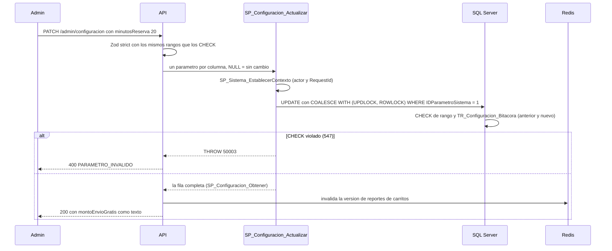

# Módulo configuracion

## Qué hace

Expone al Administrador los parámetros del sistema: plazo de la garantía de precio, minutos de reserva, horas para carrito abandonado, días de expiración del carrito de invitado, umbral de últimas unidades, monto de envío gratis, máximo de pagos rechazados, plazo de devolución y máximo de líneas del carrito. Endpoints, solo Administrador: `GET /api/v1/admin/configuracion` y `PATCH /api/v1/admin/configuracion` ([configuracion.routes.ts:40](../../../apps/api/src/modules/configuracion/configuracion.routes.ts#L40 "autorizar('Administrador')")).
Los valores viven en `ParametroSistema`, una tabla tipada de una sola fila con un `CHECK` por parámetro (A-14). Los SPs de negocio la leen en cada operación, así que un cambio rige de inmediato en las dos réplicas.
SPs: `SP_Configuracion_Obtener` y `SP_Configuracion_Actualizar`; la bitácora la escribe `TR_Configuracion_Bitacora`.

## Flujo crítico

El cambio de un parámetro es el flujo crítico: altera reglas de negocio en caliente (reservas, garantía, devoluciones, envío gratis), debe quedar auditado y no puede salir de rango aunque se escriba directo en la base.

## Reglas: dónde vive cada una

| Regla | Dónde vive | Archivo:línea | Decisión |
| --- | --- | --- | --- |
| Una sola fila | Constraint `CK_ParametroSistema_UnaSolaFila` | [V006__carrito_cupones_envios.sql:120](../../../database/migrations/V006__carrito_cupones_envios.sql#L120 "CHECK (IDParametroSistema = 1)") | A-14 |
| Cada parámetro con su tipo (TINYINT, SMALLINT, DECIMAL) | Columnas tipadas | [V006__carrito_cupones_envios.sql:102](../../../database/migrations/V006__carrito_cupones_envios.sql#L102 "una sola fila tipada"), [V006__carrito_cupones_envios.sql:111](../../../database/migrations/V006__carrito_cupones_envios.sql#L111 "DECIMAL(12,2)") | A-14, M-02 |
| Rangos (por ejemplo garantía 1 a 30 días, reserva 5 a 60 min) | `CHECK` en la tabla (autoridad) + Zod con los mismos rangos | [V006__carrito_cupones_envios.sql:121](../../../database/migrations/V006__carrito_cupones_envios.sql#L121 "DiasGarantiaPrecio BETWEEN 1 AND 30"), [configuracion.ts:8](../../../packages/shared/src/configuracion.ts#L8 "diasGarantiaPrecio: [1, 30]") | A-14, A-02 |
| Envío gratis mayor que cero o NULL (sin envío gratis) | `CHECK` + Zod con `Decimal` | [V006__carrito_cupones_envios.sql:126](../../../database/migrations/V006__carrito_cupones_envios.sql#L126 "CHECK (MontoEnvioGratis > 0)"), [configuracion.ts:35](../../../packages/shared/src/configuracion.ts#L35 "montoMenorOIgual(valor, '0')") | N-04 |
| Valores iniciales = DEFAULT de la tabla | Semilla | [S001__catalogos.sql:81](../../../database/seeds/S001__catalogos.sql#L81 "INSERT INTO dbo.ParametroSistema DEFAULT VALUES;") | A-14 |
| PATCH: lo ausente se conserva; `montoEnvioGratis: null` lo quita | Repositorio (NULL + bandera) y SP (`COALESCE`) | [configuracion.repository.ts:58](../../../apps/api/src/modules/configuracion/configuracion.repository.ts#L58 "QuitarMontoEnvioGratis: { tipo: sql.Bit, valor: cambios.montoEnvioGratis === null }"), [R__SP_Configuracion_Actualizar.sql:33](../../../database/programmability/R__SP_Configuracion_Actualizar.sql#L33 "COALESCE(@DiasGarantiaPrecio, p.DiasGarantiaPrecio)") | A-02 |
| No se puede enviar un monto y quitarlo a la vez | SP | [R__SP_Configuracion_Actualizar.sql:26](../../../database/programmability/R__SP_Configuracion_Actualizar.sql#L26 "IF @QuitarMontoEnvioGratis = 1 AND @MontoEnvioGratis IS NOT NULL") | A-02 |
| Fuera de rango en la base: 400 y no 500 | CATCH traduce el 547 de un `CK_ParametroSistema_` a 50003 | [R__SP_Configuracion_Actualizar.sql:53](../../../database/programmability/R__SP_Configuracion_Actualizar.sql#L53 "ERROR_NUMBER() = 547") | A-06 |
| Quién lo cambió, en la fila y en la bitácora | SP guarda `IDUsuarioActualizacion`; trigger escribe anterior y nuevo | [R__SP_Configuracion_Actualizar.sql:44](../../../database/programmability/R__SP_Configuracion_Actualizar.sql#L44 "IDUsuarioActualizacion"), [R__TR_Configuracion_Bitacora.sql:34](../../../database/programmability/R__TR_Configuracion_Bitacora.sql#L34 "OR   EXISTS (SELECT i.DiasGarantiaPrecio") | RF-09, A-18 |
| El dinero se audita y responde como texto | Trigger (`CONVERT(VARCHAR)`) y controlador (`montoATexto`) | [R__TR_Configuracion_Bitacora.sql:23](../../../database/programmability/R__TR_Configuracion_Bitacora.sql#L23 "CONVERT(VARCHAR(20), d.MontoEnvioGratis)"), [configuracion.controller.ts:11](../../../apps/api/src/modules/configuracion/configuracion.controller.ts#L11 "montoATexto(configuracion.montoEnvioGratis)") | A-21 |
| Monto como `DECIMAL(12,2)` también en el parámetro | Repositorio | [configuracion.repository.ts:57](../../../apps/api/src/modules/configuracion/configuracion.repository.ts#L57 "MontoEnvioGratis: { tipo: sql.Decimal(12, 2)") | M-02, A-21 |
| Solo el Administrador | `autorizar('Administrador')` | [configuracion.routes.ts:40](../../../apps/api/src/modules/configuracion/configuracion.routes.ts#L40 "autorizar('Administrador')") | RF-01 |

Dónde se usan los parámetros (los SPs los leen en cada operación, sin caché):

| Parámetro | Lo lee | Archivo:línea |
| --- | --- | --- |
| `MinutosReserva` | Inicio del checkout | [R__SP_Checkout_IniciarSesion.sql:136](../../../database/programmability/R__SP_Checkout_IniciarSesion.sql#L136 "@MinutosReserva = ps.MinutosReserva") |
| `DiasPlazoDevolucion` | Registro de devoluciones y detalle de gestión (`puedeDevolver`) | [R__FU_Pedidos_PlazoDevolucion.sql:14](../../../database/programmability/R__FU_Pedidos_PlazoDevolucion.sql#L14 "p.DiasPlazoDevolucion") |
| `MontoEnvioGratis` | Función de envío gratis | [R__FU_Envios_EnvioGratis.sql:12](../../../database/programmability/R__FU_Envios_EnvioGratis.sql#L12 "p.MontoEnvioGratis FROM dbo.ParametroSistema") |
| `MaxLineasCarrito` | Fusión del carrito | [R__SP_Carrito_Fusionar.sql:102](../../../database/programmability/R__SP_Carrito_Fusionar.sql#L102 "@MaxLineas = ps.MaxLineasCarrito") |
| `MaxIntentosPagoRechazados` | Registro de intentos de pago | [R__SP_Checkout_ActualizarIntentoPago.sql:43](../../../database/programmability/R__SP_Checkout_ActualizarIntentoPago.sql#L43 "@MaxRechazos = ps.MaxIntentosPagoRechazados") |
| `HorasCarritoAbandonado` | Vista de carritos abandonados | [R__VW_Carrito_Abandonados.sql:19](../../../database/programmability/R__VW_Carrito_Abandonados.sql#L19 "FROM dbo.ParametroSistema AS ps") |

## Concurrencia y réplicas

- **Dos Admins cambian parámetros distintos a la vez:** el UPDATE toma la única fila `WITH (UPDLOCK, ROWLOCK)` ([R__SP_Configuracion_Actualizar.sql:46](../../../database/programmability/R__SP_Configuracion_Actualizar.sql#L46 "WITH (UPDLOCK, ROWLOCK)")) y mezcla con `COALESCE` dentro del mismo UPDATE: el segundo espera y aplica su cambio sobre lo que dejó el primero, sin pisarlo (no hay una lectura previa en el servicio). No hay una prueba de concurrencia específica para este SP; el patrón es el mismo que el del perfil y las direcciones, que sí la tienen.
- **Dos réplicas:** no hay caché de parámetros en la API. Cada SP los lee de la tabla en su propia transacción, así que `api-1` y `api-2` ven el valor nuevo en la siguiente operación. La garantía de precio, por ejemplo, toma el plazo vigente al agregar la línea ([garantia-parametro.api.test.ts:23](../../../apps/api/test/integracion/secuencial/garantia-parametro.api.test.ts#L23 "con DiasGarantiaPrecio = 7")).
- **Una operación en curso mientras cambia un parámetro:** la operación ya leyó el valor dentro de su transacción y lo usa completo; la siguiente usa el nuevo. Con RCSI (A-05), la lectura no espera al UPDATE.
- **Una réplica muere a mitad:** el UPDATE y la fila de bitácora están en la misma transacción; sin COMMIT no queda ninguno de los dos. La invalidación de reportes ocurre después del COMMIT; si se pierde, el reporte de carritos se actualiza al vencer su TTL corto (A-11).

## Modos de falla

- **Valor fuera de rango, campo desconocido o PATCH vacío:** 400 `VALIDACION_FALLIDA` por Zod ([configuracion-envios.api.test.ts:138](../../../apps/api/test/integracion/secuencial/configuracion-envios.api.test.ts#L138 "rechaza %o con 400")).
- **Fuera de rango que llega a la base** (escritura directa o Zod desalineado): el `CHECK` lo rechaza y el SP responde 400 `PARAMETRO_INVALIDO` (50003).
- **Operador o Cliente:** 403 `SIN_PERMISO` ([configuracion-envios.api.test.ts:144](../../../apps/api/test/integracion/secuencial/configuracion-envios.api.test.ts#L144 "el Operador y el Cliente reciben 403")).
- **Una escritura sin contexto de actor:** el trigger de bitácora la rechaza con 50004 `CONTEXTO_NO_ESTABLECIDO` (500) ([R__TR_Configuracion_Bitacora.sql:12](../../../database/programmability/R__TR_Configuracion_Bitacora.sql#L12 "IF SESSION_CONTEXT(N'Rol') IS NULL")).
- **Redis caído:** el cambio se guarda igual; la invalidación de la caché de reportes nunca lanza (puerto `Cache`), y el reporte de carritos se refresca por TTL.
- **Base caída:** 500 `ERROR_INTERNO`.

## Alternativas descartadas

- **Tabla clave-valor** (`Nombre`, `Valor NVARCHAR`) → sin tipos ni `CHECK` por parámetro: un valor inválido solo se detectaría al usarlo (A-14).
- **Parámetros en variables de entorno** → cambiar uno exigiría reiniciar las réplicas y no quedaría en la bitácora (A-14, RF-09).
- **Caché de parámetros en Redis o en memoria** → con dos réplicas habría ventanas con valores distintos; leer una fila por PK dentro del SP es barato y siempre coherente (RNF-2).
- **Validar los rangos solo con Zod** → una escritura directa a la base los saltaría; el `CHECK` es la autoridad y Zod solo da el mensaje claro (A-02).
- **Auditar desde el servicio** → se podría olvidar en otra ruta; el trigger registra cualquier cambio a la fila con el actor de `SESSION_CONTEXT` (A-18).

## Preguntas probables

### ¿Por qué una tabla de una sola fila y no clave-valor?

Cada parámetro tiene su tipo y su `CHECK` en el motor; una tabla clave-valor guardaría todo como texto sin validar. La fila única la garantiza `CHECK (IDParametroSistema = 1)`.
**Muéstralo en:** [V006__carrito_cupones_envios.sql:120](../../../database/migrations/V006__carrito_cupones_envios.sql#L120 "CHECK (IDParametroSistema = 1)")

### ¿Qué impide poner la reserva en 0 minutos escribiendo directo en la base?

El `CHECK` de la columna. La API además tiene `shopcart_app` con `DENY UPDATE` sobre las tablas: solo puede ejecutar SPs.
**Muéstralo en:** [V006__carrito_cupones_envios.sql:122](../../../database/migrations/V006__carrito_cupones_envios.sql#L122 "MinutosReserva BETWEEN 5 AND 60")

### Si la regla está en el CHECK, ¿para qué validar con Zod?

Para dar un 400 con el detalle del campo antes de ir a la base. Zod replica los mismos rangos; la base es la última defensa.
**Muéstralo en:** [configuracion.ts:5](../../../packages/shared/src/configuracion.ts#L5 "los mismos rangos que los CHECK de ParametroSistema")

### ¿Qué pasa si los rangos de Zod y del CHECK se desalinean?

El `CHECK` rechaza con el error 547, el CATCH del SP lo reconoce por el nombre `CK_ParametroSistema_` y lo traduce a 50003: el Admin recibe 400, no 500.
**Muéstralo en:** [R__SP_Configuracion_Actualizar.sql:54](../../../database/programmability/R__SP_Configuracion_Actualizar.sql#L54 "THROW 50003")

### ¿Cómo se quita el envío gratis?

Con `montoEnvioGratis: null` en el PATCH: el repositorio envía `QuitarMontoEnvioGratis = 1` y el SP deja la columna en NULL. Ausente significa sin cambio.
**Muéstralo en:** [configuracion-envios.api.test.ts:119](../../../apps/api/test/integracion/secuencial/configuracion-envios.api.test.ts#L119 "montoEnvioGratis en null deja la tienda sin envío gratis")

### ¿El monto de envío gratis usa FLOAT en algún punto?

No: `DECIMAL(12,2)` en la tabla y en el parámetro del SP, `Decimal` de decimal.js en la API y texto en el JSON.
**Muéstralo en:** [configuracion.repository.ts:29](../../../apps/api/src/modules/configuracion/configuracion.repository.ts#L29 "aMonto(fila.MontoEnvioGratis)")

### ¿Queda registrado quién cambió un parámetro?

Sí: el trigger escribe en la bitácora el valor anterior y el nuevo con el `IDUsuario` y el `RequestId` de `SESSION_CONTEXT`, y la fila guarda `IDUsuarioActualizacion`.
**Muéstralo en:** [configuracion-envios.api.test.ts:87](../../../apps/api/test/integracion/secuencial/configuracion-envios.api.test.ts#L87 "el cambio queda en la bitácora con su usuario y su petición")

### ¿Un PATCH que no cambia nada deja una fila en la bitácora?

No: el trigger solo inserta si algún parámetro cambió (`EXISTS ... EXCEPT`).
**Muéstralo en:** [R__TR_Configuracion_Bitacora.sql:37](../../../database/programmability/R__TR_Configuracion_Bitacora.sql#L37 "EXCEPT")

### ¿Cuándo rige un parámetro nuevo en la otra réplica?

En la siguiente operación: no hay caché, cada SP lee la fila dentro de su transacción.
**Muéstralo en:** [R__SP_Checkout_IniciarSesion.sql:136](../../../database/programmability/R__SP_Checkout_IniciarSesion.sql#L136 "@MinutosReserva = ps.MinutosReserva")

### ¿Qué pasa si dos Admins editan la configuración a la vez?

El UPDATE bloquea la única fila y mezcla con `COALESCE`, así que cada uno aplica solo lo que mandó sobre el valor vigente; el segundo espera al primero.
**Muéstralo en:** [R__SP_Configuracion_Actualizar.sql:46](../../../database/programmability/R__SP_Configuracion_Actualizar.sql#L46 "WITH (UPDLOCK, ROWLOCK)")

### ¿Por qué el servicio invalida los reportes al cambiar la configuración?

Porque `HorasCarritoAbandonado` define qué carritos cuentan como abandonados: sube la versión del dominio `carritos` de la caché de reportes (A-11).
**Muéstralo en:** [configuracion.service.ts:18](../../../apps/api/src/modules/configuracion/configuracion.service.ts#L18 "reportes.tras(repositorio.actualizar(cambios), 'carritos')")

### ¿De dónde salen los valores iniciales?

De los `DEFAULT` de la tabla: la semilla inserta la fila con `DEFAULT VALUES` si no existe.
**Muéstralo en:** [S001__catalogos.sql:80](../../../database/seeds/S001__catalogos.sql#L80 "IF NOT EXISTS (SELECT 1 FROM dbo.ParametroSistema)")
