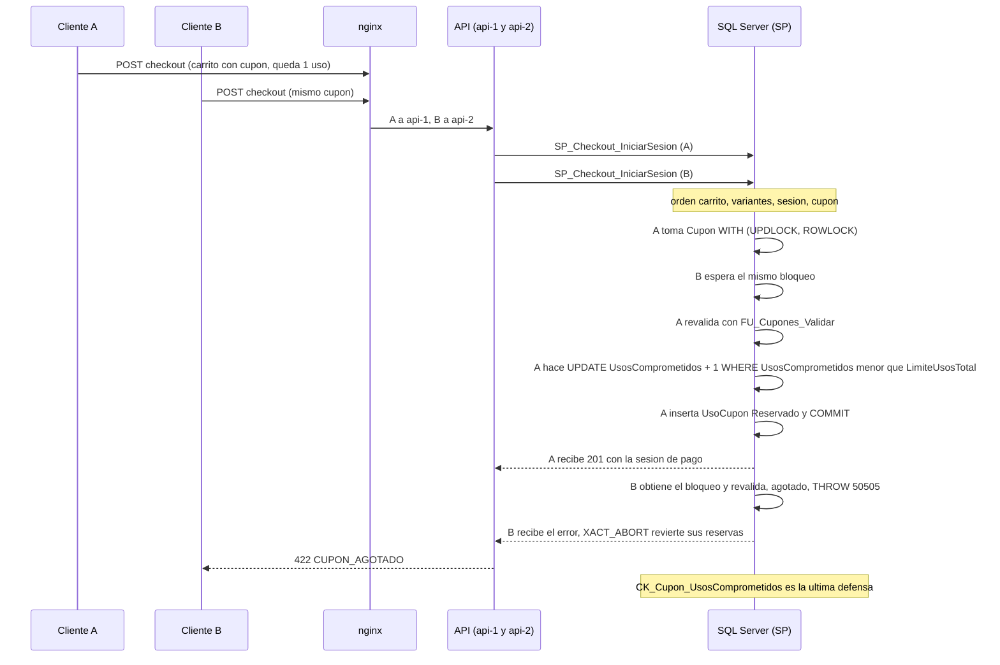

# Módulo cupones

## Qué hace

Administra los cupones de descuento (solo Admin): `GET` y `POST /api/v1/admin/cupones`, `GET` y `PATCH /admin/cupones/:id`, `POST /admin/cupones/:id/activar` y `/desactivar` ([cupones.routes.ts:92](../../../apps/api/src/modules/cupones/cupones.routes.ts#L92 "autorizar('Administrador')")). Un cupón es de `Porcentaje` (con tope opcional) o `MontoFijo`, tiene vigencia, compra mínima, categoría opcional, límite total y límite por cliente.

El **uso** del cupón no pasa por este módulo HTTP: se aplica como vista previa en el carrito (`PUT /carrito/cupon`, `SP_Carrito_AplicarCupon`), se **reserva** al iniciar el pago (`SP_Cupones_ReservarUso`), se **confirma** al crear el pedido, se **libera** si la sesión se cancela o vence (`SP_Cupones_LiberarUso`) y se **revierte** si se cancela el pedido (`SP_Cupones_RevertirUso`). La validación única de todas las causas de rechazo es `FU_Cupones_Validar`, y el reparto del descuento por línea es `FU_Cupones_CalculoDescuento`. SPs de administración: `SP_Cupones_Crear`, `SP_Cupones_Actualizar`, `SP_Cupones_CambiarEstado`, `SP_Cupones_Listar`, `SP_Cupones_Obtener`.

## Flujo crítico

El crítico es la reserva del último uso al iniciar el pago: con varias réplicas, dos clientes no pueden quedarse con el mismo último uso, y el límite total no se puede rebasar ni con un bug.

## Reglas: dónde vive cada una

| Regla | Dónde vive | Archivo:línea | Decisión |
|---|---|---|---|
| Tipos permitidos: `Porcentaje` o `MontoFijo` | Constraint `CK_Cupon_Tipo` + Zod | [V006__carrito_cupones_envios.sql:27](../../../database/migrations/V006__carrito_cupones_envios.sql#L27 "CK_Cupon_Tipo CHECK (Tipo IN ('Porcentaje', 'MontoFijo'))") | RF-05 |
| Valor positivo; un porcentaje no pasa de 100 | Constraint `CK_Cupon_Valor` + Zod | [V006__carrito_cupones_envios.sql:28](../../../database/migrations/V006__carrito_cupones_envios.sql#L28 "CK_Cupon_Valor CHECK (Valor > 0 AND (Tipo <> 'Porcentaje' OR Valor <= 100))"), [cupones.ts:66](../../../packages/shared/src/cupones.ts#L66 "refine(porcentajeValido") | RF-05 |
| El tope de descuento solo aplica a porcentajes | Constraint + Zod | [V006__carrito_cupones_envios.sql:30](../../../database/migrations/V006__carrito_cupones_envios.sql#L30 "Tipo = 'Porcentaje'"), [cupones.ts:67](../../../packages/shared/src/cupones.ts#L67 "cupon.montoMaximoDescuento === undefined") | N-12 |
| Vigencia: `FechaFin > FechaInicio` | Constraint `CK_Cupon_Vigencia` + Zod | [V006__carrito_cupones_envios.sql:32](../../../database/migrations/V006__carrito_cupones_envios.sql#L32 "CK_Cupon_Vigencia CHECK (FechaFin > FechaInicio)") | RF-05 |
| Código en mayúsculas y único sin distinguir mayúsculas | `UQ_Cupon_Codigo` + `CK_Cupon_CodigoMayusculas` + `UPPER` en el SP | [V006__carrito_cupones_envios.sql:23](../../../database/migrations/V006__carrito_cupones_envios.sql#L23 "UQ_Cupon_Codigo UNIQUE (Codigo)"), [R__SP_Cupones_Crear.sql:35](../../../database/programmability/R__SP_Cupones_Crear.sql#L35 "UPPER(LTRIM(RTRIM(@Codigo)))") | N-12 |
| Límite total: `UsosComprometidos` (reservados + confirmados) nunca pasa de `LimiteUsosTotal` | Contador + constraint `CK_Cupon_UsosComprometidos` | [V006__carrito_cupones_envios.sql:35](../../../database/migrations/V006__carrito_cupones_envios.sql#L35 "CK_Cupon_UsosComprometidos CHECK (UsosComprometidos BETWEEN 0 AND LimiteUsosTotal)") | A-13 |
| Reserva del uso con el cupón bloqueado y revalidado | `SP_Cupones_ReservarUso` bajo `UPDLOCK` | [R__SP_Cupones_ReservarUso.sql:21](../../../database/programmability/R__SP_Cupones_ReservarUso.sql#L21 "WITH (UPDLOCK, ROWLOCK)"), [R__SP_Cupones_ReservarUso.sql:39](../../../database/programmability/R__SP_Cupones_ReservarUso.sql#L39 "UsosComprometidos < LimiteUsosTotal") | A-02, A-13, N-12 |
| Límite por cliente: confirmados más reservados vigentes de otros carritos | `FU_Cupones_Validar`, evaluada bajo el `UPDLOCK` del cupón | [R__FU_Cupones_Validar.sql:54](../../../database/programmability/R__FU_Cupones_Validar.sql#L54 "confirmados.Usos + reservados.DelCliente >= c.LimiteUsosPorCliente") | N-12 |
| La reserva de la sesión del mismo carrito no cuenta como otro uso | `FU_Cupones_Validar` | [R__FU_Cupones_Validar.sql:51](../../../database/programmability/R__FU_Cupones_Validar.sql#L51 "c.UsosComprometidos - reservados.DeEsteCarrito >= c.LimiteUsosTotal") | N-12 |
| Vigencia y estado al aplicar y al reservar | `FU_Cupones_Validar` (`SYSUTCDATETIME()`) | [R__FU_Cupones_Validar.sql:50](../../../database/programmability/R__FU_Cupones_Validar.sql#L50 "SYSUTCDATETIME() >= c.FechaFin") | N-12 |
| Mínimo de compra sobre el subtotal comprable de todo el carrito, con lo que falta | `FU_Cupones_Validar` + `THROW` con JSON | [R__FU_Cupones_Validar.sql:27](../../../database/programmability/R__FU_Cupones_Validar.sql#L27 "SUM(l.TotalComprable)) AS Subtotal"), [R__SP_Carrito_AplicarCupon.sql:44](../../../database/programmability/R__SP_Carrito_AplicarCupon.sql#L44 "THROW 50507, @Error, 1;") | N-12, A-19 |
| Cupón por categoría: exige una línea comprable de esa categoría y solo descuenta esas líneas | `FU_Cupones_Validar` + `FU_Cupones_CalculoDescuento` | [R__FU_Cupones_Validar.sql:57](../../../database/programmability/R__FU_Cupones_Validar.sql#L57 "c.IDCategoria IS NOT NULL AND t.LineasCategoria = 0"), [R__FU_Cupones_CalculoDescuento.sql:18](../../../database/programmability/R__FU_Cupones_CalculoDescuento.sql#L18 "c.IDCategoria IS NULL OR p.IDCategoria = c.IDCategoria") | N-12 |
| Porcentaje redondeado al centavo, con tope y nunca más que el subtotal | `FU_Cupones_CalculoDescuento` | [R__FU_Cupones_CalculoDescuento.sql:29](../../../database/programmability/R__FU_Cupones_CalculoDescuento.sql#L29 "ROUND(b.Subtotal * b.Valor / 100, 2)") | N-12 |
| Reparto por línea al centavo hacia abajo; sobrante a la de mayor monto | `FU_Cupones_CalculoDescuento` | [R__FU_Cupones_CalculoDescuento.sql:40](../../../database/programmability/R__FU_Cupones_CalculoDescuento.sql#L40 "CONVERT(BIGINT, t.Descuento * 100)"), [R__FU_Cupones_CalculoDescuento.sql:48](../../../database/programmability/R__FU_Cupones_CalculoDescuento.sql#L48 "ORDER BY p.Monto DESC, p.IDLineaCarrito") | N-12, N-02 |
| El uso se confirma al crear el pedido | `SP_Pedidos_CrearPedido` | [R__SP_Pedidos_CrearPedido.sql:147](../../../database/programmability/R__SP_Pedidos_CrearPedido.sql#L147 "UPDATE dbo.UsoCupon SET Estado = 'Confirmado'") | N-02, N-12 |
| El uso se libera si la sesión se cancela o vence | `SP_Cupones_LiberarUso` (única ruta) | [R__SP_Cupones_LiberarUso.sql:22](../../../database/programmability/R__SP_Cupones_LiberarUso.sql#L22 "SET    Estado = 'Liberado'"), [R__SP_Cupones_LiberarUso.sql:25](../../../database/programmability/R__SP_Cupones_LiberarUso.sql#L25 "UsosComprometidos = UsosComprometidos - 1") | N-12, A-13 |
| Cancelar un pedido devuelve el uso; una devolución no | `SP_Cupones_RevertirUso`, llamado solo desde `SP_Pedidos_Cancelar` | [R__SP_Pedidos_AplicarCancelacion.sql:67](../../../database/programmability/R__SP_Pedidos_AplicarCancelacion.sql#L67 "EXEC dbo.SP_Cupones_RevertirUso @IDPedido;") | N-09, N-12 |
| Un cupón por sesión de pago | Constraint `UQ_UsoCupon_IDSesionCheckout` | [V007__checkout.sql:126](../../../database/migrations/V007__checkout.sql#L126 "UQ_UsoCupon_IDSesionCheckout UNIQUE (IDSesionCheckout)") | N-12 |
| Un cupón usado solo cambia vigencia, límites y estado | `SP_Cupones_Actualizar` bajo `UPDLOCK` del cupón | [R__SP_Cupones_Actualizar.sql:68](../../../database/programmability/R__SP_Cupones_Actualizar.sql#L68 "EXISTS (SELECT 1 FROM dbo.UsoCupon AS u WHERE u.IDCupon = @IDCupon)") | N-12 |
| El límite total no baja de los usos comprometidos | `CK_Cupon_UsosComprometidos`, traducido a 50511 | [R__SP_Cupones_Actualizar.sql:104](../../../database/programmability/R__SP_Cupones_Actualizar.sql#L104 "THROW 50511, @Error, 1;") | A-13, A-19 |
| Crear, editar y desactivar quedan en la bitácora; el contador no | Trigger `TR_Cupones_Bitacora` | [R__TR_Cupones_Bitacora.sql:51](../../../database/programmability/R__TR_Cupones_Bitacora.sql#L51 "EXCEPT") | RF-09 |
| Montos como `DECIMAL(12,2)` en la base y como texto en JSON | Repositorio + controlador | [cupones.repository.ts:55](../../../apps/api/src/modules/cupones/cupones.repository.ts#L55 "sql.Decimal(12, 2)"), [cupones.controller.ts:17](../../../apps/api/src/modules/cupones/cupones.controller.ts#L17 "montoATexto(cupon.valor)") | M-02 |

## Concurrencia y réplicas

- **Dos peticiones simultáneas por el último uso:** `SP_Cupones_ReservarUso` corre dentro de la transacción de `SP_Checkout_IniciarSesion` (exige `@@TRANCOUNT > 0`: [R__SP_Cupones_ReservarUso.sql:16](../../../database/programmability/R__SP_Cupones_ReservarUso.sql#L16 "IF @@TRANCOUNT = 0")) y es lo último que se bloquea ([R__SP_Checkout_IniciarSesion.sql:165](../../../database/programmability/R__SP_Checkout_IniciarSesion.sql#L165 "EXEC dbo.SP_Cupones_ReservarUso")). Bloquea la fila del cupón con `UPDLOCK`, revalida y sube el contador con un `UPDATE` condicionado: si no afectó filas, `THROW 50505` ([R__SP_Cupones_ReservarUso.sql:42](../../../database/programmability/R__SP_Cupones_ReservarUso.sql#L42 "THROW 50505")). Aunque esa lógica tuviera un bug, `CK_Cupon_UsosComprometidos` rechaza el exceso ([checkout.test.ts:44](../../../apps/api/test/integracion/esquema/checkout.test.ts#L44 "rechaza UsosComprometidos mayor que LimiteUsosTotal")).
- **La prueba de concurrencia (RNF-3):** 20 clientes con el mismo cupón de `limiteUsosTotal: 1` pagan a la vez a través de nginx, repartidos entre api-1 y api-2. Resultado esperado: 1 pedido con cupón, 19 × 422 `CUPON_AGOTADO` y `usosComprometidos: 1` ([checkout.concurrencia.test.ts:77](../../../apps/api/test/concurrencia/checkout.concurrencia.test.ts#L77 "escenario 2: 20 clientes por el último uso de un cupón")). Requiere `docker compose up -d` y corre con `pnpm test:concurrencia`.
- **Límite por cliente:** se evalúa en `FU_Cupones_Validar` después de tomar el `UPDLOCK` del cupón, así que la reserva de otra sesión del mismo cliente ya está confirmada cuando se cuenta ([cupon-reservas.api.test.ts:111](../../../apps/api/test/integracion/carrito/cupon-reservas.api.test.ts#L111 "un uso reservado del cliente en otra sesión activa cuenta para su límite")).
- **Editar contra reservar:** `SP_Cupones_Actualizar` toma el mismo `UPDLOCK` antes de decidir si el cupón ya se usó ([R__SP_Cupones_Actualizar.sql:62](../../../database/programmability/R__SP_Cupones_Actualizar.sql#L62 "FROM   dbo.Cupon AS c WITH (UPDLOCK, ROWLOCK)")): un Admin no puede cambiar el valor mientras una reserva lo está usando.
- **Dos altas con el mismo código:** `UQ_Cupon_Codigo` es la autoridad; la segunda recibe 409, nunca 500 ([R__SP_Cupones_Crear.sql:44](../../../database/programmability/R__SP_Cupones_Crear.sql#L44 "LIKE N'%UQ_Cupon_Codigo%'"), [cupones.api.test.ts:128](../../../apps/api/test/integracion/cupones/cupones.api.test.ts#L128 "dos altas simultáneas del mismo código con otras mayúsculas")).
- **Una réplica muere a mitad:** si cae antes del `COMMIT` de la sesión de pago, `XACT_ABORT` revierte la reserva del uso y el contador. Si cae después, el uso queda `Reservado` con su sesión: lo libera la tarea de expiración de sesiones (cada minuto, con `sp_getapplock`) por la misma ruta `SP_Cupones_LiberarUso` ([R__SP_Checkout_ExpirarSesiones.sql:66](../../../database/programmability/R__SP_Checkout_ExpirarSesiones.sql#L66 "EXEC dbo.SP_Cupones_LiberarUso @ID;"), [tareas-periodicas.test.ts:145](../../../apps/api/test/integracion/secuencial/tareas-periodicas.test.ts#L145 "libera sus reservas y el uso del cupón")). El límite por cliente ya no cuenta una reserva de una sesión vencida aunque el job no haya pasado ([cupon-reservas.api.test.ts:140](../../../apps/api/test/integracion/carrito/cupon-reservas.api.test.ts#L140 "una reserva de una sesión vencida no cuenta para el límite por cliente")).

## Modos de falla

- **Entrada inválida** (código fuera de `[A-Za-z0-9_-]{3,30}`, porcentaje mayor que 100, fechas invertidas, PATCH vacío, campos extra): 400 `PARAMETRO_INVALIDO` desde Zod ([cupones.ts:24](../../../packages/shared/src/cupones.ts#L24 "/^[A-Za-z0-9_-]{3,30}$/"), [cupones.ts:89](../../../packages/shared/src/cupones.ts#L89 "Indica al menos un campo.")). Un monto llega como texto con 2 decimales y sin signo ([monto.ts:6](../../../packages/shared/src/monto.ts#L6 "El monto debe tener hasta 10 enteros y 2 decimales.")).
- **Un CHECK violado con los valores ya combinados del PATCH:** 400 `PARAMETRO_INVALIDO` con el campo en los detalles ([R__FU_Cupones_RestriccionViolada.sql:20](../../../database/programmability/R__FU_Cupones_RestriccionViolada.sql#L20 "WHERE @MensajeError LIKE")).
- **Cupón o categoría inexistente:** 404 `NO_ENCONTRADO` ([R__SP_Cupones_Actualizar.sql:66](../../../database/programmability/R__SP_Cupones_Actualizar.sql#L66 "THROW 50001, N'El cupón no existe.', 1;")).
- **Código duplicado:** 409 `CUPON_CODIGO_DUPLICADO` ([catalogo.ts:170](../../../apps/api/src/shared/errors/catalogo.ts#L170 "CUPON_CODIGO_DUPLICADO")); campo inmutable de un cupón usado: 409 `CUPON_USADO_NO_EDITABLE` ([catalogo.ts:165](../../../apps/api/src/shared/errors/catalogo.ts#L165 "CUPON_USADO_NO_EDITABLE")); límite menor que los usos: 422 `CUPON_LIMITE_BAJO_USOS` con `usosComprometidos` ([catalogo.ts:176](../../../apps/api/src/shared/errors/catalogo.ts#L176 "CUPON_LIMITE_BAJO_USOS")).
- **Rechazos al aplicar o reservar** (todos 422, uno por causa): `CUPON_NO_EXISTE`, `CUPON_INACTIVO`, `CUPON_NO_VIGENTE_AUN`, `CUPON_VENCIDO`, `CUPON_AGOTADO` ([catalogo.ts:149](../../../apps/api/src/shared/errors/catalogo.ts#L149 "CUPON_AGOTADO: { http: 422, numeroSql: 50505")), `CUPON_LIMITE_CLIENTE`, `CUPON_MINIMO_NO_ALCANZADO` (con `faltante`) y `CUPON_SIN_PRODUCTOS_CATEGORIA`.
- **Operador o Cliente en `/admin/cupones`:** 403 `SIN_PERMISO` ([cupones.api.test.ts:408](../../../apps/api/test/integracion/cupones/cupones.api.test.ts#L408 "el Operador y el Cliente reciben 403")).
- **Redis caído:** no aplica; ninguna regla de cupones depende de Redis.
- **Base caída:** 500 `ERROR_INTERNO`; nada se confirmó a medias porque cada SP es una transacción.

## Alternativas descartadas

- **Solo `COUNT(*)` de `UsoCupon` bajo bloqueo para el límite total** → A-13: es correcto con bloqueo, pero sin defensa ante un bug; el contador con `CHECK` hace que la base rechace el exceso.
- **Validar el límite en el servicio o con un lock en Redis** → A-02 y A-04: dos réplicas pueden decidir a la vez y Redis se puede perder; la autoridad es el SP bajo `UPDLOCK`.
- **Concurrencia optimista (`ROWVERSION`) para la reserva** → la columna `VersionFila` existe, pero A-05 elige `UPDLOCK` explícito en escrituras críticas: con 20 compradores por un uso, el optimista haría reintentar a casi todos.
- **Reservar el uso al aplicar el cupón en el carrito** → N-12: en el carrito es vista previa; el uso se reserva al iniciar el pago, como el stock, y se libera si la sesión vence.
- **Que una devolución devuelva el uso** → N-12: solo una cancelación lo devuelve.
- **Permitir editar el valor de un cupón ya usado** → N-12: cambiaría lo que vieron o pagaron otros clientes; se crea otro cupón.

## Preguntas probables

### ¿Qué garantiza que el último uso de un cupón no lo usen dos clientes?
La reserva bloquea la fila del cupón con `UPDLOCK`, revalida y sube el contador con un `UPDATE ... WHERE UsosComprometidos < LimiteUsosTotal`. El segundo espera el bloqueo, ve el contador lleno y recibe 50505 → 422 `CUPON_AGOTADO`.
**Muéstralo en:** [R__SP_Cupones_ReservarUso.sql:39](../../../database/programmability/R__SP_Cupones_ReservarUso.sql#L39 "UsosComprometidos < LimiteUsosTotal") y [checkout.concurrencia.test.ts:77](../../../apps/api/test/concurrencia/checkout.concurrencia.test.ts#L77 "20 clientes por el último uso de un cupón")

### ¿Y si alguien escribe directo en la base o hay un bug en el SP?
`CK_Cupon_UsosComprometidos` (`BETWEEN 0 AND LimiteUsosTotal`) rechaza cualquier escritura que deje el contador por encima del límite o negativo, venga de donde venga.
**Muéstralo en:** [V006__carrito_cupones_envios.sql:35](../../../database/migrations/V006__carrito_cupones_envios.sql#L35 "CK_Cupon_UsosComprometidos") y [checkout.test.ts:44](../../../apps/api/test/integracion/esquema/checkout.test.ts#L44 "rechaza UsosComprometidos mayor que LimiteUsosTotal")

### ¿Cómo se respeta el límite por cliente?
Cuenta los usos `Confirmado` del cliente más sus `Reservado` de sesiones activas no vencidas en otros carritos. Se evalúa bajo el bloqueo del cupón; a un invitado no le aplica porque el checkout exige sesión.
**Muéstralo en:** [R__FU_Cupones_Validar.sql:54](../../../database/programmability/R__FU_Cupones_Validar.sql#L54 "confirmados.Usos + reservados.DelCliente") y [cupon.api.test.ts:246](../../../apps/api/test/integracion/carrito/cupon.api.test.ts#L246 "el límite por cliente cuenta los usos confirmados")

### ¿Cuál es el ciclo de vida de un uso?
`Reservado` al iniciar el pago, `Confirmado` al crear el pedido, `Liberado` si la sesión se cancela o vence, `Revertido` si se cancela el pedido. Liberar y revertir bajan el contador con el cupón bloqueado.
**Muéstralo en:** [V007__checkout.sql:131](../../../database/migrations/V007__checkout.sql#L131 "CK_UsoCupon_Estado CHECK (Estado IN ('Reservado', 'Confirmado', 'Liberado', 'Revertido'))") y [R__SP_Cupones_RevertirUso.sql:20](../../../database/programmability/R__SP_Cupones_RevertirUso.sql#L20 "SET    Estado = 'Revertido'")

### ¿Por qué aplicar el cupón en el carrito no consume un uso?
Es una vista previa (N-12): solo guarda `Carrito.IDCupon` tras validar. El uso se reserva al iniciar el pago; así un carrito abandonado no agota un cupón.
**Muéstralo en:** [R__SP_Carrito_AplicarCupon.sql:36](../../../database/programmability/R__SP_Carrito_AplicarCupon.sql#L36 "FU_Cupones_Validar(@IDCupon, @IDCliente, @IDCarrito)")

### ¿Volver al carrito durante el pago hace que el cupón cuente dos veces?
No. La reserva de una sesión activa de ese mismo carrito se descuenta del agotado y no cuenta para el límite por cliente. Para el agotado se descuenta aunque la sesión ya haya vencido, porque sigue en `UsosComprometidos` hasta que la tarea de expiración la libera ([R__FU_Cupones_Validar.sql:32](../../../database/programmability/R__FU_Cupones_Validar.sql#L32 "vigente o no"), [cupon-reservas.api.test.ts:95](../../../apps/api/test/integracion/carrito/cupon-reservas.api.test.ts#L95 "ya venció pero aún no se libera")).
**Muéstralo en:** [R__FU_Cupones_Validar.sql:34](../../../database/programmability/R__FU_Cupones_Validar.sql#L34 "AS DeEsteCarrito") y [cupon-reservas.api.test.ts:81](../../../apps/api/test/integracion/carrito/cupon-reservas.api.test.ts#L81 "la reserva de la sesión de pago de este mismo carrito no cuenta")

### ¿Sobre qué se mide la compra mínima en un cupón por categoría?
Sobre el subtotal comprable de todo el carrito (N-12), no solo de la categoría; el descuento sí se aplica solo a las líneas de la categoría. Si no alcanza, el error trae cuánto falta.
**Muéstralo en:** [R__FU_Cupones_Validar.sql:27](../../../database/programmability/R__FU_Cupones_Validar.sql#L27 "SUM(l.TotalComprable)) AS Subtotal") y [cupon.api.test.ts:147](../../../apps/api/test/integracion/carrito/cupon.api.test.ts#L147 "un cupón de categoría solo descuenta sus líneas")

### ¿Cómo reparten el descuento sin perder ni inventar centavos?
Se calcula en centavos enteros (`BIGINT`) proporcional a cada línea, truncando; el sobrante va a la línea de mayor monto (desempate por menor `IDLineaCarrito`) sin pasar de su total. La suma es exactamente el descuento.
**Muéstralo en:** [R__FU_Cupones_CalculoDescuento.sql:40](../../../database/programmability/R__FU_Cupones_CalculoDescuento.sql#L40 "CONVERT(BIGINT, t.Descuento * 100)") y [cupon.api.test.ts:97](../../../apps/api/test/integracion/carrito/cupon.api.test.ts#L97 "el centavo sobrante va a la línea de mayor monto")

### ¿Un monto fijo puede dejar el total negativo?
No: el descuento es el mínimo entre el valor, el tope y el subtotal de las líneas elegibles.
**Muéstralo en:** [R__FU_Cupones_CalculoDescuento.sql:31](../../../database/programmability/R__FU_Cupones_CalculoDescuento.sql#L31 "COALESCE(b.MontoMaximoDescuento, b.Subtotal)") y [cupon.api.test.ts:137](../../../apps/api/test/integracion/carrito/cupon.api.test.ts#L137 "un monto fijo mayor que el subtotal deja el total en cero")

### ¿Por qué no se puede editar un cupón ya usado y cómo evitan la carrera con una reserva?
Con al menos una fila en `UsoCupon`, tipo, valor, categoría, compra mínima, tope y código responden 409 con el campo en los detalles. Se decide bajo el mismo `UPDLOCK` que toma la reserva.
**Muéstralo en:** [R__SP_Cupones_Actualizar.sql:73](../../../database/programmability/R__SP_Cupones_Actualizar.sql#L73 "THROW 50509, @Error, 1;") y [cupones.api.test.ts:186](../../../apps/api/test/integracion/cupones/cupones.api.test.ts#L186 "con usos no cambia %s")

### ¿Qué pasa si el Admin baja el límite total por debajo de los usos ya comprometidos?
El `UPDATE` viola `CK_Cupon_UsosComprometidos`; el `CATCH` lo traduce a 50511 (422 `CUPON_LIMITE_BAJO_USOS`) con los usos comprometidos en los detalles.
**Muéstralo en:** [R__SP_Cupones_Actualizar.sql:97](../../../database/programmability/R__SP_Cupones_Actualizar.sql#L97 "CK_Cupon_UsosComprometidos") y [cupones.api.test.ts:260](../../../apps/api/test/integracion/cupones/cupones.api.test.ts#L260 "bajar el límite total por debajo de los usos comprometidos")

### ¿Cómo garantizan que el código sea único sin distinguir mayúsculas?
El SP guarda `UPPER(LTRIM(RTRIM(@Codigo)))`, un `CHECK` con collation sensible a mayúsculas impide guardarlo en minúsculas, y `UQ_Cupon_Codigo` es la autoridad ante dos altas simultáneas.
**Muéstralo en:** [V006__carrito_cupones_envios.sql:26](../../../database/migrations/V006__carrito_cupones_envios.sql#L26 "COLLATE Latin1_General_CS_AS") y [cupones.api.test.ts:118](../../../apps/api/test/integracion/cupones/cupones.api.test.ts#L118 "el código es único sin distinguir mayúsculas")

### ¿Qué pasa si un cupón deja de ser válido mientras está en un carrito?
`SP_Carrito_Obtener` lo revalida en cada consulta; si falla, lo quita (solo si sigue siendo el mismo cupón) y el resumen trae el motivo una sola vez.
**Muéstralo en:** [R__SP_Carrito_Obtener.sql:87](../../../database/programmability/R__SP_Carrito_Obtener.sql#L87 "SET IDCupon = NULL WHERE IDCarrito = @IDCarrito AND IDCupon = @IDCupon") y [cupon.api.test.ts:283](../../../apps/api/test/integracion/carrito/cupon.api.test.ts#L283 "si deja de ser válido, al consultar el carrito se quita")

### ¿Cancelar un pedido devuelve el uso del cupón?
Sí: `SP_Pedidos_Cancelar` llama a `SP_Cupones_RevertirUso`, que pasa el uso `Confirmado` a `Revertido` y baja el contador, aunque el cupón ya haya vencido. Una devolución no lo llama.
**Muéstralo en:** [R__SP_Cupones_RevertirUso.sql:23](../../../database/programmability/R__SP_Cupones_RevertirUso.sql#L23 "UsosComprometidos = UsosComprometidos - 1") y [cancelacion.api.test.ts:101](../../../apps/api/test/integracion/pedidos/cancelacion.api.test.ts#L101 "cupón revertido")
