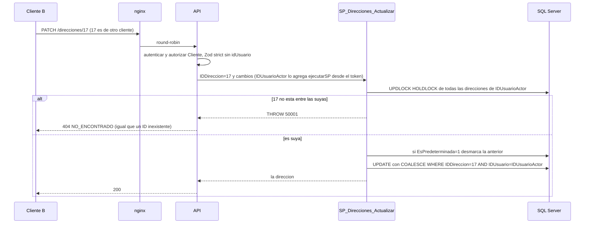

# Módulo direcciones

## Qué hace

Libreta de direcciones del Cliente y catálogo geográfico de Guatemala. Solo Cliente: `GET /api/v1/direcciones`, `POST /direcciones` (máximo 10, una sola predeterminada), `GET`, `PATCH` y `DELETE /direcciones/:id`. Públicos: `GET /departamentos` y `GET /departamentos/:id/municipios` ([direcciones.routes.ts:101](../../../apps/api/src/modules/direcciones/direcciones.routes.ts#L101 "autorizar('Cliente')"), [direcciones.routes.ts:110](../../../apps/api/src/modules/direcciones/direcciones.routes.ts#L110 "router.get('/departamentos'")).
Es el ejemplo más claro del aislamiento entre clientes (RF-01): el dueño sale siempre del token y una dirección ajena responde 404, igual que una inexistente.
SPs: `SP_Direcciones_Listar`, `SP_Direcciones_Crear`, `SP_Direcciones_Actualizar`, `SP_Direcciones_Eliminar`, `SP_Direcciones_ListarDepartamentos`, `SP_Direcciones_ListarMunicipios`.

## Flujo crítico

Editar una dirección por ID es el flujo crítico: es la ruta donde un cliente puede intentar tocar la dirección de otro cambiando el ID en la URL, y donde dos cambios de la predeterminada pueden cruzarse.

## Reglas: dónde vive cada una

| Regla | Dónde vive | Archivo:línea | Decisión |
| --- | --- | --- | --- |
| El dueño sale del token, nunca de la entrada | `ejecutarSP` agrega `@IDUsuarioActor` desde el contexto y rechaza que se pase a mano | [ejecutar-sp.ts:108](../../../apps/api/src/shared/db/ejecutar-sp.ts#L108 "IDUsuarioActor: { tipo: sql.Int, valor: contexto?.idUsuario ?? null }"), [ejecutar-sp.ts:104](../../../apps/api/src/shared/db/ejecutar-sp.ts#L104 "lo agrega ejecutarSP desde el contexto; no se pasa a mano") | RF-01, A-18 |
| El cuerpo no acepta `idUsuario` | Zod `.strict()` | [direcciones.schemas.ts:5](../../../apps/api/src/modules/direcciones/direcciones.schemas.ts#L5 "RF-01: .strict() rechaza un idUsuario colado en el cuerpo") | RF-01 |
| Listar y leer solo las propias | `SP_Direcciones_Listar` filtra por `@IDUsuarioActor` | [R__SP_Direcciones_Listar.sql:17](../../../database/programmability/R__SP_Direcciones_Listar.sql#L17 "d.IDUsuario = @IDUsuarioActor") | RF-01 |
| Una ajena responde 404, igual que una inexistente (lectura) | Servicio | [direcciones.service.ts:15](../../../apps/api/src/modules/direcciones/direcciones.service.ts#L15 "AppError('NO_ENCONTRADO'") | RF-01 |
| Una ajena responde 404 (edición y borrado) | SP, aunque el servicio no filtre | [R__SP_Direcciones_Actualizar.sql:45](../../../database/programmability/R__SP_Direcciones_Actualizar.sql#L45 "THROW 50001"), [R__SP_Direcciones_Eliminar.sql:28](../../../database/programmability/R__SP_Direcciones_Eliminar.sql#L28 "THROW 50001") | RF-01, A-02 |
| Defensa extra: el UPDATE y el DELETE también filtran por dueño | SP | [R__SP_Direcciones_Actualizar.sql:61](../../../database/programmability/R__SP_Direcciones_Actualizar.sql#L61 "AND IDUsuario = @IDUsuarioActor"), [R__SP_Direcciones_Eliminar.sql:30](../../../database/programmability/R__SP_Direcciones_Eliminar.sql#L30 "DELETE FROM dbo.Direccion") | RF-01 |
| Máximo 10 direcciones por cliente | `SP_Direcciones_Crear` cuenta bajo `UPDLOCK, HOLDLOCK` | [R__SP_Direcciones_Crear.sql:22](../../../database/programmability/R__SP_Direcciones_Crear.sql#L22 "@MaximoDirecciones INT = 10"), [R__SP_Direcciones_Crear.sql:33](../../../database/programmability/R__SP_Direcciones_Crear.sql#L33 "THROW 50106") | E2-H05, A-02 |
| Una sola predeterminada por cliente | Índice único filtrado | [V003__direcciones.sql:41](../../../database/migrations/V003__direcciones.sql#L41 "UX_Direccion_PredeterminadaPorUsuario"), [V003__direcciones.sql:42](../../../database/migrations/V003__direcciones.sql#L42 "WHERE EsPredeterminada = 1") | N-17 |
| Marcar una nueva desmarca la anterior en la misma transacción | SP | [R__SP_Direcciones_Crear.sql:38](../../../database/programmability/R__SP_Direcciones_Crear.sql#L38 "AND EsPredeterminada = 1"), [R__SP_Direcciones_Actualizar.sql:50](../../../database/programmability/R__SP_Direcciones_Actualizar.sql#L50 "AND IDDireccion <> @IDDireccion") | N-17 |
| PATCH: lo que no llega se conserva; `alias` y `referencia` en `null` se quitan | Repositorio arma NULL + banderas; el SP mezcla en el UPDATE | [direcciones.repository.ts:53](../../../apps/api/src/modules/direcciones/direcciones.repository.ts#L53 "QuitarAlias: { tipo: sql.Bit, valor: cambios.alias === null }"), [R__SP_Direcciones_Actualizar.sql:59](../../../database/programmability/R__SP_Direcciones_Actualizar.sql#L59 "EsPredeterminada = COALESCE(@EsPredeterminada, EsPredeterminada)") | A-02 |
| Teléfono de 8 dígitos | Zod + constraint | [V003__direcciones.sql:37](../../../database/migrations/V003__direcciones.sql#L37 "CK_Direccion_TelefonoRecibe") | N-17 |
| El municipio existe | SP (mensaje claro) + FK | [R__SP_Direcciones_Crear.sql:25](../../../database/programmability/R__SP_Direcciones_Crear.sql#L25 "THROW 50003"), [V003__direcciones.sql:36](../../../database/migrations/V003__direcciones.sql#L36 "FK_Direccion_Municipio") | N-17 |
| Borrado físico permitido | El pedido copia la dirección (M-04) | [V003__direcciones.sql:21](../../../database/migrations/V003__direcciones.sql#L21 "Se permite el borrado físico") | N-17, M-04 |
| Solo el Cliente tiene direcciones | `autorizar('Cliente')` | [direcciones.api.test.ts:383](../../../apps/api/test/integracion/direcciones/direcciones.api.test.ts#L383 "un Operador no tiene direcciones (403)") | RF-01 |

## Concurrencia y réplicas

- **Cinco altas simultáneas con 8 direcciones:** sin bloqueo, todas contarían 8 y pasarían. El `COUNT(*)` se hace `WITH (UPDLOCK, HOLDLOCK)` sobre las direcciones del cliente ([R__SP_Direcciones_Crear.sql:31](../../../database/programmability/R__SP_Direcciones_Crear.sql#L31 "WITH (UPDLOCK, HOLDLOCK)")): el `HOLDLOCK` bloquea también el rango, así que la segunda alta espera a que la primera confirme y cuenta 9. Quedan exactamente 10 ([direcciones.api.test.ts:342](../../../apps/api/test/integracion/direcciones/direcciones.api.test.ts#L342 "con 8 direcciones, 5 altas simultáneas dejan exactamente 10")).
- **Varias direcciones marcadas como predeterminadas a la vez:** los tres SPs que escriben bloquean primero todas las direcciones del cliente en el orden del índice ([R__SP_Direcciones_Actualizar.sql:41](../../../database/programmability/R__SP_Direcciones_Actualizar.sql#L41 "dbo.Direccion WITH (UPDLOCK, HOLDLOCK)"), [R__SP_Direcciones_Eliminar.sql:24](../../../database/programmability/R__SP_Direcciones_Eliminar.sql#L24 "dbo.Direccion WITH (UPDLOCK, HOLDLOCK)")) y el índice único filtrado es la última defensa. Queda exactamente una y sin deadlocks ([direcciones.api.test.ts:187](../../../apps/api/test/integracion/direcciones/direcciones.api.test.ts#L187 "marcar 5 direcciones como predeterminadas a la vez deja exactamente una"), [direcciones.api.test.ts:213](../../../apps/api/test/integracion/direcciones/direcciones.api.test.ts#L213 "borrar y cambiar la predeterminada a la vez no produce deadlocks")). Si aun así ocurriera un deadlock, `ejecutarSP` reintenta el SP completo hasta 3 veces ([ejecutar-sp.ts:67](../../../apps/api/src/shared/db/ejecutar-sp.ts#L67 "numero === DEADLOCK && intento < REINTENTOS_DEADLOCK")).
- **Dos PATCH que tocan campos distintos:** la mezcla con lo guardado se hace con `COALESCE` en el UPDATE, no leyendo antes en el servicio, así que ninguno pisa al otro ([direcciones.api.test.ts:276](../../../apps/api/test/integracion/direcciones/direcciones.api.test.ts#L276 "PATCH simultáneos que tocan campos distintos")).
- **Réplicas:** todo el estado está en SQL Server; dos peticiones del mismo cliente en `api-1` y `api-2` compiten por los mismos bloqueos. Una réplica que muere a mitad deja la transacción sin confirmar (`XACT_ABORT` la revierte) y el cliente reintenta; no hay nada que recuperar.

## Modos de falla

- **Dirección ajena o inexistente:** 404 `NO_ENCONTRADO` (50001), con el mismo código en los dos casos ([aislamiento.api.test.ts:233](../../../apps/api/test/integracion/seguridad/aislamiento.api.test.ts#L233 "el recurso de otro cliente responde 404, igual que uno inexistente")).
- **Undécima dirección:** 422 `LIMITE_DIRECCIONES` (50106) ([catalogo.ts:69](../../../apps/api/src/shared/errors/catalogo.ts#L69 "numeroSql: 50106")).
- **Municipio inexistente:** 400 `PARAMETRO_INVALIDO` (50003) ([direcciones.api.test.ts:357](../../../apps/api/test/integracion/direcciones/direcciones.api.test.ts#L357 "un municipio inexistente responde 400")).
- **Departamento inexistente:** 404 (50001) ([R__SP_Direcciones_ListarMunicipios.sql:12](../../../database/programmability/R__SP_Direcciones_ListarMunicipios.sql#L12 "THROW 50001")).
- **Cuerpo con `idUsuario`, PATCH vacío o ID fuera de rango de INT:** 400 `VALIDACION_FALLIDA` ([direcciones.api.test.ts:363](../../../apps/api/test/integracion/direcciones/direcciones.api.test.ts#L363 "RF-01: el cuerpo no acepta un idUsuario")).
- **Operador o Admin:** 403 `SIN_PERMISO`; sin token, 401 `NO_AUTENTICADO`.
- **Base caída:** 500 `ERROR_INTERNO`; Redis no interviene en este módulo.

## Alternativas descartadas

- **Responder 403 a un recurso ajeno** → confirmaría que el ID existe; 404 no filtra información (CLAUDE.md, RF-01).
- **Filtrar el dueño solo en el servicio** → una escritura directa o un servicio con un bug lo saltaría; el SP es la autoridad y filtra por `@IDUsuarioActor` (A-02). Hay una prueba que llama al SP sin pasar por el servicio ([direcciones.api.test.ts:124](../../../apps/api/test/integracion/direcciones/direcciones.api.test.ts#L124 "A-02: el SP rechaza editar o borrar una dirección ajena")).
- **Recibir `IDUsuario` del cliente** → abre la puerta a suplantar; el ID sale del token (A-18).
- **Una predeterminada garantizada solo por el SP** → un bug podría dejar dos; el índice único filtrado lo impide en el motor (N-17).
- **Bloquear solo la fila propia al cambiar la predeterminada** → producía deadlocks al desmarcar la anterior; ahora se bloquean todas las del cliente en orden ([R__SP_Direcciones_Actualizar.sql:36](../../../database/programmability/R__SP_Direcciones_Actualizar.sql#L36 "Bloquea todas las direcciones del cliente en el orden del índice")).
- **Borrado lógico** → innecesario: el pedido copia la dirección al crearse (M-04).

## Preguntas probables

### ¿Qué pasa si cambio el ID de la dirección en la URL por el de otro cliente?

404 `NO_ENCONTRADO`, el mismo que con un ID que no existe. Se prueba en leer, editar y borrar, y que nada del dueño cambió.
**Muéstralo en:** [direcciones.api.test.ts:101](../../../apps/api/test/integracion/direcciones/direcciones.api.test.ts#L101 "RF-01: un cliente que usa el ID de una dirección de otro recibe 404")

### ¿Por qué 404 y no 403?

Un 403 confirma que la dirección existe y es de alguien; 404 no distingue entre ajena e inexistente.
**Muéstralo en:** [direcciones.service.ts:13](../../../apps/api/src/modules/direcciones/direcciones.service.ts#L13 "una dirección ajena responde igual que una inexistente (404)")

### ¿De dónde sale el ID del cliente?

Del token: `autenticar` lo deja en el contexto de la petición y `ejecutarSP` lo agrega como `@IDUsuarioActor`. El repositorio ni siquiera lo recibe, y si alguien intenta pasarlo a mano `ejecutarSP` lanza.
**Muéstralo en:** [ejecutar-sp.test.ts:75](../../../apps/api/test/unit/shared/db/ejecutar-sp.test.ts#L75 "RF-01: rechaza que el llamador envíe un parámetro estándar")

### ¿Y si mando `idUsuario` en el cuerpo?

400: los esquemas son `.strict()`. Una prueba recorre todas las rutas de cliente y verifica que ninguna acepte `idUsuario`.
**Muéstralo en:** [aislamiento.api.test.ts:262](../../../apps/api/test/integracion/seguridad/aislamiento.api.test.ts#L262 "ninguna ruta de cliente acepta idUsuario en su entrada")

### Si el servicio tuviera un bug y no filtrara, ¿se podría editar una ajena?

No: el SP vuelve a validar bajo bloqueo que la dirección es de `@IDUsuarioActor` y el UPDATE también filtra por dueño. Hay una prueba que llama al SP directamente.
**Muéstralo en:** [R__SP_Direcciones_Actualizar.sql:61](../../../database/programmability/R__SP_Direcciones_Actualizar.sql#L61 "AND IDUsuario = @IDUsuarioActor")

### ¿Cómo garantizas el máximo de 10 con peticiones simultáneas?

El conteo se hace dentro de la transacción con `UPDLOCK, HOLDLOCK` sobre las direcciones del cliente; las altas se serializan y la undécima recibe 422.
**Muéstralo en:** [R__SP_Direcciones_Crear.sql:31](../../../database/programmability/R__SP_Direcciones_Crear.sql#L31 "WITH (UPDLOCK, HOLDLOCK)")

### ¿Cómo garantizas una sola predeterminada?

El SP desmarca la anterior en la misma transacción, y un índice único filtrado `(IDUsuario) WHERE EsPredeterminada = 1` lo impide en el motor aunque un SP fallara.
**Muéstralo en:** [V003__direcciones.sql:41](../../../database/migrations/V003__direcciones.sql#L41 "UX_Direccion_PredeterminadaPorUsuario")

### ¿Por qué el SP bloquea todas las direcciones del cliente y no solo la que edita?

Al desmarcar la anterior, dos transacciones que bloqueaban solo su fila esperaban cada una la fila de la otra (deadlock). Bloqueando todas en el mismo orden se serializan.
**Muéstralo en:** [direcciones.api.test.ts:243](../../../apps/api/test/integracion/direcciones/direcciones.api.test.ts#L243 "5 altas predeterminadas simultáneas dejan exactamente una")

### ¿Un PATCH que no menciona la predeterminada puede cambiarla?

No: `@EsPredeterminada` en NULL conserva el valor guardado con `COALESCE`, aunque otra petición la tome a la vez.
**Muéstralo en:** [direcciones.api.test.ts:304](../../../apps/api/test/integracion/direcciones/direcciones.api.test.ts#L304 "N-17: un PATCH que no incluye la predeterminada nunca la cambia")

### Si borro una dirección, ¿qué pasa con los pedidos que la usaron?

Nada: el pedido y la sesión de checkout copian la dirección al crearse (M-04), por eso se permite el borrado físico.
**Muéstralo en:** [V003__direcciones.sql:21](../../../database/migrations/V003__direcciones.sql#L21 "Se permite el borrado físico")

### ¿Por qué los departamentos son públicos?

Es un catálogo geográfico sin datos personales y lo usa el formulario de dirección antes de tener sesión.
**Muéstralo en:** [direcciones.routes.ts:109](../../../apps/api/src/modules/direcciones/direcciones.routes.ts#L109 "el catálogo geográfico (N-17) no tiene datos personales")

### ¿Qué responde un ID enorme o no numérico?

Un ID fuera del rango de INT o no numérico es 400 por Zod; el mayor INT que no existe es 404, nunca 500.
**Muéstralo en:** [casos-borde.api.test.ts:176](../../../apps/api/test/integracion/direcciones/casos-borde.api.test.ts#L176 "el ID más grande de INT que no existe responde 404")
