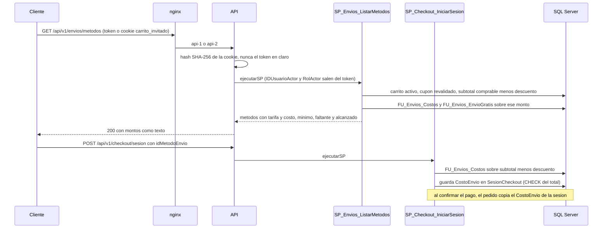

# Módulo envios

## Qué hace

Expone los métodos de envío con su costo para el carrito de quien pregunta y permite al Administrador cambiar cada método. `GET /envios/metodos` es público: un invitado usa su cookie de carrito y un cliente su sesión ([envios.routes.ts:52](../../../apps/api/src/modules/envios/envios.routes.ts#L52 "router.get('/envios/metodos', autenticarOpcional(autenticar)")); `PUT /admin/envios/metodos/:id` es solo del Administrador ([envios.routes.ts:56](../../../apps/api/src/modules/envios/envios.routes.ts#L56 "autorizar('Administrador')")). SPs y funciones clave: `SP_Envios_ListarMetodos`, `SP_Envios_ActualizarMetodo`, `FU_Envios_Costos` (la usa también el checkout) y `FU_Envios_EnvioGratis`. El monto mínimo del envío gratis se configura en otro módulo, `PATCH /admin/configuracion` ([configuracion.routes.ts:43](../../../apps/api/src/modules/configuracion/configuracion.routes.ts#L43 "router.patch('/admin/configuracion'")).

## Flujo crítico

El cálculo del costo de envío y su congelamiento en el checkout: decide cuánto se cobra, y un cambio de tarifa del Admin no puede alterar un pago en curso ni un pedido ya hecho.

## Reglas: dónde vive cada una

| Regla | Dónde vive | Archivo:línea | Decisión |
| --- | --- | --- | --- |
| Tarifa en `DECIMAL(12,2)` y no negativa | Tipo + `CHECK` | [V006__carrito_cupones_envios.sql:98](../../../database/migrations/V006__carrito_cupones_envios.sql#L98 "CK_MetodoEnvio_Costo CHECK (Costo >= 0)") | M-02 |
| Días máximos ≥ días mínimos | Zod + `CHECK` (547 → 50003) | [V006__carrito_cupones_envios.sql:99](../../../database/migrations/V006__carrito_cupones_envios.sql#L99 "CK_MetodoEnvio_Dias CHECK (DiasMax >= DiasMin)") | N-04 |
| El código del método no cambia | El `PUT` no lo recibe; `UNIQUE` | [envios.schemas.ts:10](../../../apps/api/src/modules/envios/envios.schemas.ts#L10 "el código no cambia") | N-04 |
| Solo se ofrecen los métodos activos | `FU_Envios_Costos` | [R__FU_Envios_Costos.sql:15](../../../database/programmability/R__FU_Envios_Costos.sql#L15 "m.Activo = 1") | N-04 |
| Envío gratis para todos los métodos al alcanzar el mínimo | `FU_Envios_Costos` | [R__FU_Envios_Costos.sql:11](../../../database/programmability/R__FU_Envios_Costos.sql#L11 "CASE WHEN g.Alcanzado = 1 THEN 0 ELSE m.Costo END") | N-04 |
| El mínimo es un parámetro del sistema (500.00 por defecto; NULL = sin envío gratis) | `ParametroSistema` | [V006__carrito_cupones_envios.sql:111](../../../database/migrations/V006__carrito_cupones_envios.sql#L111 "DF_ParametroSistema_MontoEnvioGratis DEFAULT 500.00") | A-14 |
| Se evalúa sobre el subtotal comprable después del cupón; el cupón no aplica al envío | `SP_Envios_ListarMetodos` | [R__SP_Envios_ListarMetodos.sql:25](../../../database/programmability/R__SP_Envios_ListarMetodos.sql#L25 "SUM(l.TotalComprable - COALESCE(dc.DescuentoLinea, 0))") | N-04, N-12 |
| Un cupón que ya no es válido no cuenta para el envío gratis | `SP_Envios_ListarMetodos` | [R__SP_Envios_ListarMetodos.sql:23](../../../database/programmability/R__SP_Envios_ListarMetodos.sql#L23 "SET @IDCupon = NULL") | N-12 |
| Cuánto falta para el envío gratis | `FU_Envios_EnvioGratis` | [R__FU_Envios_EnvioGratis.sql:8](../../../database/programmability/R__FU_Envios_EnvioGratis.sql#L8 "ps.MontoEnvioGratis - @Monto") | N-04 |
| El cliente sale del token, nunca de la petición | SP con `@RolActor` | [R__SP_Envios_ListarMetodos.sql:14](../../../database/programmability/R__SP_Envios_ListarMetodos.sql#L14 "CASE WHEN @RolActor = 'Cliente' THEN @IDUsuarioActor END") | RF-01, A-18 |
| El token de invitado nunca viaja a la base, solo su hash | Servicio | [envios.service.ts:15](../../../apps/api/src/modules/envios/envios.service.ts#L15 "hashearTokenOpaco(tokenInvitado)") | N-05 |
| El costo se congela en la sesión de pago | `SP_Checkout_IniciarSesion` | [R__SP_Checkout_IniciarSesion.sql:95](../../../database/programmability/R__SP_Checkout_IniciarSesion.sql#L95 "dbo.FU_Envios_Costos(@Subtotal - @Descuento)") | N-02, M-04 |
| Total de la sesión y del pedido incluye el envío | `CHECK` | [V008__pedidos.sql:88](../../../database/migrations/V008__pedidos.sql#L88 "CK_Pedido_Total CHECK (Total = Subtotal - Descuento + CostoEnvio)") | N-04 |
| El pedido guarda fecha estimada de entrega con los días máximos | `SP_Pedidos_CrearPedido` | [R__SP_Pedidos_CrearPedido.sql:110](../../../database/programmability/R__SP_Pedidos_CrearPedido.sql#L110 "DATEADD(DAY, s.DiasMax, @FechaLocal)") | N-04 |
| Cada cambio de tarifa queda en la bitácora con el valor anterior y el nuevo | Trigger | [R__TR_Envios_Bitacora.sql:28](../../../database/programmability/R__TR_Envios_Bitacora.sql#L28 "CONVERT(VARCHAR(20), d.Costo)") | RF-09, A-21 |

## Concurrencia y réplicas

- **Dos administradores cambian el mismo método a la vez:** `SP_Envios_ActualizarMetodo` bloquea la fila con `UPDLOCK` ([R__SP_Envios_ActualizarMetodo.sql:24](../../../database/programmability/R__SP_Envios_ActualizarMetodo.sql#L24 "WITH (UPDLOCK, ROWLOCK)")); se aplican en serie y el último gana, porque el `PUT` reemplaza la representación completa. Ninguno se pierde de la auditoría: el trigger registra cada cambio real con su usuario y su `RequestId` ([R__TR_Envios_Bitacora.sql:36](../../../database/programmability/R__TR_Envios_Bitacora.sql#L36 "EXCEPT SELECT d.Codigo")).
- **El Admin cambia la tarifa mientras un cliente paga:** la sesión de checkout ya guardó su `CostoEnvio` ([V007__checkout.sql:46](../../../database/migrations/V007__checkout.sql#L46 "CK_SesionCheckout_Total CHECK (Total = Subtotal - Descuento + CostoEnvio)")) y el pedido copia el de la sesión, no el de `MetodoEnvio` ([R__SP_Pedidos_CrearPedido.sql:109](../../../database/programmability/R__SP_Pedidos_CrearPedido.sql#L109 "s.CostoEnvio, s.Total")). El cambio solo afecta sesiones nuevas.
- **El Admin desactiva un método elegido en un checkout nuevo:** `FU_Envios_Costos` ya no lo devuelve y el checkout responde 50001 ([R__SP_Checkout_IniciarSesion.sql:99](../../../database/programmability/R__SP_Checkout_IniciarSesion.sql#L99 "El método de envío no existe o no está disponible.")).
- **Una réplica muere a mitad de un `PUT`:** la actualización es una sola transacción con `XACT_ABORT` ([R__SP_Envios_ActualizarMetodo.sql:17](../../../database/programmability/R__SP_Envios_ActualizarMetodo.sql#L17 "SET XACT_ABORT ON;")); SQL Server la revierte y el Admin repite el `PUT`, que es idempotente. `GET /envios/metodos` no escribe nada, así que no deja estado.

## Modos de falla

- **Entrada inválida** (días al revés, costo con 3 decimales, campo extra): `400 VALIDACION_FALLIDA` desde Zod ([envios.schemas.ts:20](../../../apps/api/src/modules/envios/envios.schemas.ts#L20 "metodo.diasMax >= metodo.diasMin")); si llegara a la base, el `CHECK` se traduce a `400 PARAMETRO_INVALIDO` ([R__SP_Envios_ActualizarMetodo.sql:38](../../../database/programmability/R__SP_Envios_ActualizarMetodo.sql#L38 "THROW 50003")).
- **Método inexistente:** `404 NO_ENCONTRADO` ([R__SP_Envios_ActualizarMetodo.sql:26](../../../database/programmability/R__SP_Envios_ActualizarMetodo.sql#L26 "THROW 50001")), probado en [configuracion-envios.api.test.ts:193](../../../apps/api/test/integracion/secuencial/configuracion-envios.api.test.ts#L193 "un método inexistente responde 404 y días al revés 400").
- **Token inválido en la consulta pública:** `401` (si hay `Authorization`, se verifica) ([envios.api.test.ts:138](../../../apps/api/test/integracion/carrito/envios.api.test.ts#L138 "un token inválido responde 401")).
- **Operador o Cliente en el `PUT`:** `403 SIN_PERMISO` ([configuracion-envios.api.test.ts:137](../../../apps/api/test/integracion/secuencial/configuracion-envios.api.test.ts#L137 "el Operador y el Cliente reciben 403")).
- **Sin carrito:** no es error; el monto es 0, cada método cuesta su tarifa y falta todo el mínimo ([envios.api.test.ts:72](../../../apps/api/test/integracion/carrito/envios.api.test.ts#L72 "sin carrito, cada método cuesta su tarifa")).
- **Base caída:** `500 ERROR_INTERNO` ([middleware.ts:80](../../../apps/api/src/shared/errors/middleware.ts#L80 "return new AppError('ERROR_INTERNO', { cause: error });")).
- **Redis caído:** el módulo no usa Redis; la autenticación sigue aceptando el access token vigente ([autenticar.ts:11](../../../apps/api/src/shared/http/autenticar.ts#L11 "si Redis no responde")).

## Alternativas descartadas

- **Tarifa por zona o por peso** → dos métodos con tarifa fija configurable; la tarifa por zona queda como mejora documentada en el README (N-04).
- **Evaluar el envío gratis sobre el subtotal antes del cupón** → se evalúa después del cupón, y el cupón nunca descuenta el envío (N-04).
- **Leer la tarifa vigente al crear el pedido** → el costo se congela en la sesión y el pedido copia la sesión (N-02, M-04).
- **Parámetros en una tabla clave-valor** → `ParametroSistema` es una sola fila tipada con un `CHECK` por parámetro (A-14).
- **Calcular el costo en el servicio** → la misma función `FU_Envios_Costos` sirve a la consulta y al checkout, así ambos calculan igual.

## Preguntas probables

### ¿Cómo se calcula el costo de envío que ve el cliente?

El SP resuelve el carrito (sesión o cookie), revalida el cupón, suma el subtotal comprable menos el descuento y pasa ese monto a `FU_Envios_Costos`: la tarifa, o 0 si alcanza el mínimo.
**Muéstralo en:** [R__SP_Envios_ListarMetodos.sql:31](../../../database/programmability/R__SP_Envios_ListarMetodos.sql#L31 "FU_Envios_Costos(@Monto)")

### ¿El envío gratis se evalúa antes o después del cupón?

Después: el monto es el subtotal comprable menos el descuento de cada línea. La prueba aplica un cupón que deja el carrito por debajo del mínimo.
**Muéstralo en:** [envios.api.test.ts:88](../../../apps/api/test/integracion/carrito/envios.api.test.ts#L88 "el envío gratis se evalúa sobre el subtotal después del cupón")

### ¿El cupón descuenta el envío?

No. El descuento se resta de las líneas, y el costo del envío sale aparte de `MetodoEnvio`; el total es subtotal − descuento + envío.
**Muéstralo en:** [V007__checkout.sql:46](../../../database/migrations/V007__checkout.sql#L46 "CK_SesionCheckout_Total CHECK (Total = Subtotal - Descuento + CostoEnvio)")

### ¿Qué pasa si un cupón aplicado dejó de ser válido?

No cuenta para el envío gratis: si `FU_Cupones_Validar` devuelve un error, el SP ignora el cupón.
**Muéstralo en:** [envios.api.test.ts:111](../../../apps/api/test/integracion/carrito/envios.api.test.ts#L111 "un cupón que dejó de ser válido no cuenta para el envío gratis")

### Si el Admin sube la tarifa mientras pago, ¿me cobran la nueva?

No. El costo se congela en `SesionCheckout` al iniciar el pago y el pedido copia el de la sesión.
**Muéstralo en:** [R__SP_Pedidos_CrearPedido.sql:109](../../../database/programmability/R__SP_Pedidos_CrearPedido.sql#L109 "s.CostoEnvio, s.Total")

### ¿Puedo ver el costo de envío del carrito de otro cliente?

No. El endpoint no recibe ningún ID: el cliente sale de `@IDUsuarioActor` y `@RolActor`, que `ejecutarSP` toma del token; un invitado solo puede usar el hash de su propia cookie.
**Muéstralo en:** [R__SP_Envios_ListarMetodos.sql:15](../../../database/programmability/R__SP_Envios_ListarMetodos.sql#L15 "CASE WHEN @IDCliente IS NULL THEN @HashTokenInvitado END")

### ¿Por qué se manda el hash de la cookie y no la cookie?

La base solo guarda el hash del token de invitado (N-05); el servicio lo calcula antes de llamar al SP, y una prueba unitaria verifica que el token en claro nunca llega al repositorio.
**Muéstralo en:** [envios.service.test.ts:23](../../../apps/api/test/unit/modules/envios/envios.service.test.ts#L23 "el carrito del invitado viaja como el hash de su cookie")

### ¿Dónde queda registrado quién cambió una tarifa?

En la bitácora, con un trigger `AFTER INSERT, UPDATE, DELETE` que guarda el valor anterior y el nuevo (montos como texto), el usuario y el `RequestId` del contexto. Sin contexto, el trigger falla con 50004.
**Muéstralo en:** [configuracion-envios.api.test.ts:152](../../../apps/api/test/integracion/secuencial/configuracion-envios.api.test.ts#L152 "el Admin cambia una tarifa, los métodos la reflejan")

### ¿Cómo se quita el envío gratis?

Con `montoEnvioGratis: null` en la configuración; `FU_Envios_EnvioGratis` devuelve entonces `Alcanzado = 0` y la API responde `envioGratis: null`.
**Muéstralo en:** [configuracion-envios.api.test.ts:112](../../../apps/api/test/integracion/secuencial/configuracion-envios.api.test.ts#L112 "montoEnvioGratis en null deja la tienda sin envío gratis")

### ¿El envío gratis aplica también a Express?

Sí, a todos los métodos activos: el `CASE` de `FU_Envios_Costos` no distingue método.
**Muéstralo en:** [R__FU_Envios_Costos.sql:11](../../../database/programmability/R__FU_Envios_Costos.sql#L11 "CASE WHEN g.Alcanzado = 1 THEN 0 ELSE m.Costo END")

### ¿Cómo viajan los montos sin perder precisión?

La base devuelve `DECIMAL`, el repositorio lo convierte a `Decimal` y el controlador lo serializa como texto (`"35.00"`). El Admin envía la tarifa como texto validado por `montoSchema`.
**Muéstralo en:** [envios.controller.ts:21](../../../apps/api/src/modules/envios/envios.controller.ts#L21 "tarifa: montoATexto(metodo.tarifa)")

### ¿De dónde sale la fecha estimada de entrega?

De los `DiasMax` del método, copiados en la sesión y sumados a la fecha local de pago al crear el pedido.
**Muéstralo en:** [R__SP_Pedidos_CrearPedido.sql:110](../../../database/programmability/R__SP_Pedidos_CrearPedido.sql#L110 "DATEADD(DAY, s.DiasMax, @FechaLocal)")
