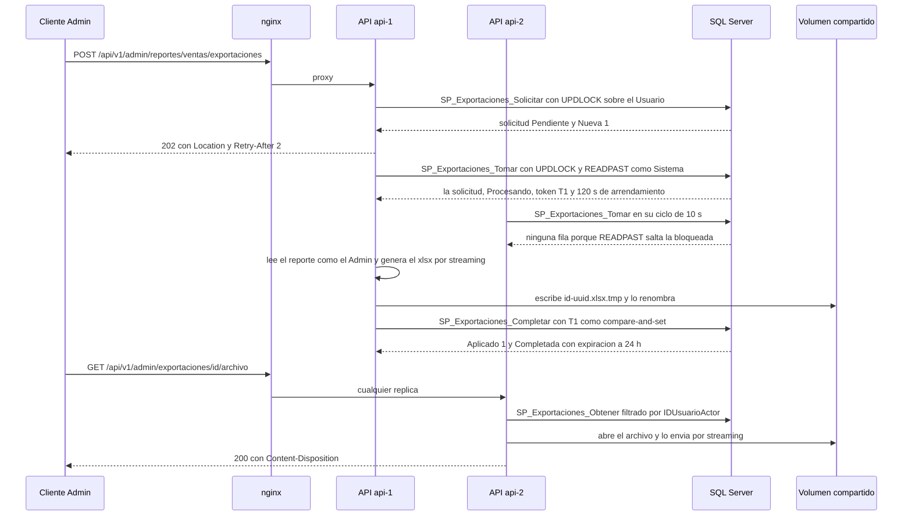

# Módulo exportaciones

## Qué hace
Exporta los cinco reportes del dashboard a Excel o PDF de forma asíncrona (E7-H05, A-24). La cola vive en SQL Server (`SolicitudExportacion`) y la consumen las dos réplicas en competencia. El archivo se guarda en un almacén compartido y vence a las 24 h.

- **Endpoints, todos solo para el Administrador** ([exportaciones.routes.ts:47](../../../apps/api/src/modules/exportaciones/exportaciones.routes.ts#L47 "autorizar('Administrador')")):
  - `POST /api/v1/admin/reportes/{reporte}/exportaciones`, que responde `202` con `Location`.
  - `GET /api/v1/admin/exportaciones` y `GET /api/v1/admin/exportaciones/{id}`.
  - `GET /api/v1/admin/exportaciones/{id}/archivo` (descarga).
- **SPs:**
  - `SP_Exportaciones_Solicitar`, `SP_Exportaciones_Obtener` y `SP_Exportaciones_Listar` (Administrador).
  - `SP_Exportaciones_Tomar`, `SP_Exportaciones_Completar` y `SP_Exportaciones_RegistrarFallo` (Sistema, con arrendamiento y fencing).
  - `SP_Exportaciones_Expirar`, `SP_Exportaciones_QuitarArchivo` y `SP_Exportaciones_ReferenciasExistentes` (purga).
- Los datos salen del servicio de reportes, con su caché ([index.ts:44](../../../apps/api/src/modules/exportaciones/index.ts#L44 "reportes: crearServicioReportes(cache, logger)")).

## Flujo crítico
El flujo crítico es la toma de la cola con arrendamiento y token de fencing. Es lo que garantiza que dos réplicas no generen la misma exportación, que una réplica muerta no deje la solicitud colgada y que al final quede **un solo** archivo.

Si `api-1` muere después de tomar, el arrendamiento vence y `api-2` la retoma con un token nuevo ([R__SP_Exportaciones_Tomar.sql:43](../../../database/programmability/R__SP_Exportaciones_Tomar.sql#L43 "s.ArrendadoHasta < @Ahora")). El `Completar` tardío de `api-1` ya no aplica y su archivo se borra ([exportaciones.procesador.ts:140](../../../apps/api/src/modules/exportaciones/exportaciones.procesador.ts#L140 "await almacen.borrar(archivo.referencia);")). Lo prueba [exportaciones.api.test.ts:297](../../../apps/api/test/integracion/secuencial/exportaciones.api.test.ts#L297 "una réplica que muere a mitad: otra la retoma al vencer el arrendamiento y queda un solo archivo").

## Reglas: dónde vive cada una
| Regla | Dónde vive | Archivo:línea | Decisión |
|---|---|---|---|
| Solo el Administrador; una ajena responde 404 | `autorizar` y `SP_Exportaciones_Obtener` (filtra por `@IDUsuarioActor`) | [R__SP_Exportaciones_Obtener.sql:18](../../../database/programmability/R__SP_Exportaciones_Obtener.sql#L18 "v.IDUsuario = @IDUsuarioActor"), [exportaciones.service.ts:43](../../../apps/api/src/modules/exportaciones/exportaciones.service.ts#L43 "throw new AppError('NO_ENCONTRADO'") | RF-01 |
| Los filtros se validan con el mismo esquema del reporte del dashboard | Servicio (Zod) | [exportaciones.service.ts:53](../../../apps/api/src/modules/exportaciones/exportaciones.service.ts#L53 "TABLAS[reporte].filtros.safeParse(filtros)") | A-24 |
| Reporte, formato y filtros JSON válidos aunque se escriba directo a la base | Constraints `CK_` | [V021__exportaciones.sql:46](../../../database/migrations/V021__exportaciones.sql#L46 "CK_SolicitudExportacion_Reporte"), [V021__exportaciones.sql:49](../../../database/migrations/V021__exportaciones.sql#L49 "CHECK (ISJSON(Filtros) = 1)") | A-02 |
| Coherencia por estado (Procesando con token, Completada con archivo, Fallida con causa) | Constraints `CK_` | [V021__exportaciones.sql:53](../../../database/migrations/V021__exportaciones.sql#L53 "CK_SolicitudExportacion_Procesando"), [V021__exportaciones.sql:55](../../../database/migrations/V021__exportaciones.sql#L55 "CK_SolicitudExportacion_Completada") | A-02 |
| Una solicitud igual vigente devuelve la existente | `SP_Exportaciones_Solicitar`, bajo `UPDLOCK` del usuario | [R__SP_Exportaciones_Solicitar.sql:39](../../../database/programmability/R__SP_Exportaciones_Solicitar.sql#L39 "s.HashFiltros = @HashFiltros") | A-24 |
| Máximo 3 en curso por Administrador (429) | `SP_Exportaciones_Solicitar` (50801) | [R__SP_Exportaciones_Solicitar.sql:49](../../../database/programmability/R__SP_Exportaciones_Solicitar.sql#L49 "THROW 50801"), [exportaciones.service.ts:21](../../../apps/api/src/modules/exportaciones/exportaciones.service.ts#L21 "MAX_EXPORTACIONES_PENDIENTES = 3") | A-24 |
| 10 solicitudes por minuto por usuario | Limitador de Redis en la ruta | [exportaciones.routes.ts:52](../../../apps/api/src/modules/exportaciones/exportaciones.routes.ts#L52 "limitarIntentos(limitador, porUsuario)"), [server.ts:43](../../../apps/api/src/server.ts#L43 "LIMITE_EXPORTACIONES = { intentos: 10, ventanaSeg: 60 }") | A-07 |
| Toma en competencia sin `sp_getapplock` | `SP_Exportaciones_Tomar` (`UPDLOCK, ROWLOCK, READPAST`) | [R__SP_Exportaciones_Tomar.sql:41](../../../database/programmability/R__SP_Exportaciones_Tomar.sql#L41 "WITH (UPDLOCK, ROWLOCK, READPAST)") | A-24, A-04 |
| Arrendamiento con token nuevo en cada toma (fencing) | `SP_Exportaciones_Tomar` | [R__SP_Exportaciones_Tomar.sql:48](../../../database/programmability/R__SP_Exportaciones_Tomar.sql#L48 "TokenArrendamiento = @Token") | A-24 |
| Solo el dueño vigente del token completa o registra el fallo | Compare-and-set en `SP_Exportaciones_Completar` y `SP_Exportaciones_RegistrarFallo` | [R__SP_Exportaciones_Completar.sql:38](../../../database/programmability/R__SP_Exportaciones_Completar.sql#L38 "TokenArrendamiento = @TokenArrendamiento") | A-24 |
| Hasta 3 intentos; después, `Fallida` con su causa | `SP_Exportaciones_RegistrarFallo` y `SP_Exportaciones_Tomar` | [R__SP_Exportaciones_RegistrarFallo.sql:33](../../../database/programmability/R__SP_Exportaciones_RegistrarFallo.sql#L33 "IIF(@Definitivo = 1 OR Intentos >= @MaxIntentos, @Fallida, @Pendiente)"), [R__SP_Exportaciones_Tomar.sql:38](../../../database/programmability/R__SP_Exportaciones_Tomar.sql#L38 "s.Intentos >= @MaxIntentos") | A-24 |
| Un error que reintentar no arregla (límite de filas, filtros que ya no valen) falla definitivo | Procesador (`ExportacionImposible`) | [exportaciones.procesador.ts:94](../../../apps/api/src/modules/exportaciones/exportaciones.procesador.ts#L94 "error instanceof ExportacionImposible") | A-24 |
| Máximo 2 generaciones a la vez por réplica | Procesador (contador local) | [exportaciones.procesador.ts:17](../../../apps/api/src/modules/exportaciones/exportaciones.procesador.ts#L17 "CONCURRENCIA_MAXIMA_POR_REPLICA = 2") | A-24 |
| Límite de filas por formato, sin truncar en silencio | Generadores | [exportaciones.generadores.ts:20](../../../apps/api/src/modules/exportaciones/exportaciones.generadores.ts#L20 "LIMITE_FILAS_EXCEL = 50_000"), [exportaciones.generadores.ts:21](../../../apps/api/src/modules/exportaciones/exportaciones.generadores.ts#L21 "LIMITE_FILAS_PDF = 2_000") | A-24 |
| Inyección de fórmulas: apóstrofo delante de `= + - @`, tabulador o retorno | Generador de Excel | [exportaciones.generadores.ts:26](../../../apps/api/src/modules/exportaciones/exportaciones.generadores.ts#L26 "const INICIO_DE_FORMULA") | §10, OWASP |
| Montos como celda numérica `#,##0.00`; totales sumados con `Decimal` | Generador y tablas | [exportaciones.generadores.ts:40](../../../apps/api/src/modules/exportaciones/exportaciones.generadores.ts#L40 "celda.toDecimalPlaces(2).toNumber()"), [exportaciones.tablas.ts:13](../../../apps/api/src/modules/exportaciones/exportaciones.tablas.ts#L13 "const sumar") | A-21 |
| Nombres de archivo del servidor, nunca rutas del cliente | Procesador y almacén (lista blanca) | [exportaciones.procesador.ts:79](../../../apps/api/src/modules/exportaciones/exportaciones.procesador.ts#L79 "randomUUID()}.${tomada.formato}"), [almacen-disco.ts:23](../../../apps/api/src/shared/adapters/almacen-disco.ts#L23 "if (!NOMBRE_VALIDO.test(nombre))") | §10 |
| Ninguna respuesta incluye una ruta del sistema | Controlador | [exportaciones.controller.ts:41](../../../apps/api/src/modules/exportaciones/exportaciones.controller.ts#L41 "e.estado === 'Completada'") | §10 |
| Vencida a las 24 h: `410` aunque la purga no haya pasado | `SP_Exportaciones_Completar` y servicio | [R__SP_Exportaciones_Completar.sql:35](../../../database/programmability/R__SP_Exportaciones_Completar.sql#L35 "DATEADD(HOUR, @HorasVigencia, @Ahora)"), [exportaciones.service.ts:94](../../../apps/api/src/modules/exportaciones/exportaciones.service.ts#L94 "fechaExpiracion <= reloj.ahora()") | A-24 |
| La purga expira y borra; una sola réplica marca `Expirada` | `SP_Exportaciones_Expirar` (`sp_getapplock`) | [R__SP_Exportaciones_Expirar.sql:28](../../../database/programmability/R__SP_Exportaciones_Expirar.sql#L28 "sys.sp_getapplock @Resource = N'Job_Exportaciones_Purgar'") | A-04 |
| Barrido de huérfanos: borra solo lo no referenciado con más de 24 h | Tarea y `SP_Exportaciones_ReferenciasExistentes` | [exportaciones.tareas.ts:15](../../../apps/api/src/modules/exportaciones/exportaciones.tareas.ts#L15 "HORAS_ANTIGUEDAD_HUERFANO = 24"), [R__SP_Exportaciones_ReferenciasExistentes.sql:19](../../../database/programmability/R__SP_Exportaciones_ReferenciasExistentes.sql#L19 "OPENJSON(@Referencias)") | A-24, A-22 |

## Concurrencia y réplicas
- **Dos peticiones simultáneas:**
  - **Dos clics iguales del mismo Admin:** `SP_Exportaciones_Solicitar` bloquea primero la fila del usuario ([R__SP_Exportaciones_Solicitar.sql:33](../../../database/programmability/R__SP_Exportaciones_Solicitar.sql#L33 "dbo.Usuario AS u WITH (UPDLOCK, ROWLOCK)")). La segunda petición espera, encuentra la primera por el hash de los filtros normalizados y la devuelve (`Nueva = 0`). El mismo bloqueo hace exacto el conteo del máximo de 3 en curso. La agrupación la prueba [exportaciones.api.test.ts:188](../../../apps/api/test/integracion/secuencial/exportaciones.api.test.ts#L188 "una solicitud igual (los mismos filtros en otro orden) devuelve la misma exportación"), en secuencia: no hay una prueba de dos peticiones a la vez.
  - **Las dos réplicas tomando la cola a la vez:** `SP_Exportaciones_Tomar` lee con `UPDLOCK, ROWLOCK, READPAST` dentro de una transacción ([R__SP_Exportaciones_Tomar.sql:41](../../../database/programmability/R__SP_Exportaciones_Tomar.sql#L41 "WITH (UPDLOCK, ROWLOCK, READPAST)")). La segunda salta la fila que la primera tiene bloqueada y toma la siguiente o ninguna, sin esperar. Cada toma estrena un token `NEWID()` ([R__SP_Exportaciones_Tomar.sql:27](../../../database/programmability/R__SP_Exportaciones_Tomar.sql#L27 "@Token UNIQUEIDENTIFIER = NEWID()")). No hay una prueba de concurrencia que lance dos `Tomar` a la vez: la garantía es la semántica de `READPAST` sobre la fila bloqueada.
  - **Dentro de una réplica, el POST y la tarea a la vez:** el lugar se reserva antes de tomar ([exportaciones.procesador.ts:165](../../../apps/api/src/modules/exportaciones/exportaciones.procesador.ts#L165 "enCurso += 1;")), así nunca hay más de 2 ([procesador.test.ts:238](../../../apps/api/test/unit/modules/exportaciones/procesador.test.ts#L238 "nunca procesa más de la concurrencia máxima de la réplica a la vez")).
- **Una réplica muere a mitad:**
  - La solicitud queda `Procesando` con su `ArrendadoHasta`. Al vencer (120 s, [exportaciones.procesador.ts:20](../../../apps/api/src/modules/exportaciones/exportaciones.procesador.ts#L20 "SEGUNDOS_ARRENDAMIENTO_EXPORTACION = 120")), la otra réplica la retoma con un token nuevo e `Intentos + 1` ([R__SP_Exportaciones_Tomar.sql:49](../../../database/programmability/R__SP_Exportaciones_Tomar.sql#L49 "Intentos = Intentos + 1")).
  - Si ya agotó sus 3 intentos, pasa a `Fallida` en lugar de retomarse ([R__SP_Exportaciones_Tomar.sql:38](../../../database/programmability/R__SP_Exportaciones_Tomar.sql#L38 "s.Intentos >= @MaxIntentos")).
  - Si la réplica «muerta» solo era lenta y termina tarde, `Completar` no aplica porque su token ya no es el vigente ([R__SP_Exportaciones_Completar.sql:39](../../../database/programmability/R__SP_Exportaciones_Completar.sql#L39 "SET @Aplicado = IIF(@@ROWCOUNT = 1, 1, 0);")), y borra su archivo: queda uno solo ([procesador.test.ts:124](../../../apps/api/test/unit/modules/exportaciones/procesador.test.ts#L124 "si otra réplica la retomó (el token ya no es el vigente), borra su archivo")).
  - **Si la base falla al completar,** el archivo **no** se borra, porque el COMMIT pudo ocurrir aunque se perdiera la respuesta ([exportaciones.procesador.ts:129](../../../apps/api/src/modules/exportaciones/exportaciones.procesador.ts#L129 "Si completar lanza, el archivo no se borra")). Si el COMMIT no ocurrió, el archivo queda sin referencia y lo recoge el barrido de huérfanos a las 24 h ([exportaciones.tareas.ts:45](../../../apps/api/src/modules/exportaciones/exportaciones.tareas.ts#L45 "const huerfanos = viejos.filter((nombre) => !referenciados.has(nombre));")).
  - **Apagado ordenado (SIGTERM):** deja de tomar y espera lo que está generando antes de cerrar el pool ([exportaciones.procesador.ts:211](../../../apps/api/src/modules/exportaciones/exportaciones.procesador.ts#L211 "detenido = true;"), [server.ts:144](../../../apps/api/src/server.ts#L144 ".then(() => exportaciones.detener())")).

## Modos de falla
- **Entrada inválida:** un reporte desconocido, un formato que no es `xlsx` ni `pdf` o filtros que no cumplen el esquema del reporte responden `400 VALIDACION_FALLIDA` ([exportaciones.service.ts:59](../../../apps/api/src/modules/exportaciones/exportaciones.service.ts#L59 "throw new AppError('VALIDACION_FALLIDA'"), [exportaciones.service.test.ts:55](../../../apps/api/test/unit/modules/exportaciones/exportaciones.service.test.ts#L55 "valida los filtros con el esquema del reporte del dashboard")).
- **Exportación ajena o inexistente:** `404 NO_ENCONTRADO` ([catalogo.ts:30](../../../apps/api/src/shared/errors/catalogo.ts#L30 "NO_ENCONTRADO")). Un Operador o un Cliente reciben `403 SIN_PERMISO`. Lo prueba [exportaciones.api.test.ts:332](../../../apps/api/test/integracion/secuencial/exportaciones.api.test.ts#L332 "la de otro Administrador responde 404; un Operador o un Cliente, 403").
- **Demasiadas en curso:** `429 EXPORTACIONES_PENDIENTES_MAXIMAS` ([catalogo.ts:271](../../../apps/api/src/shared/errors/catalogo.ts#L271 "EXPORTACIONES_PENDIENTES_MAXIMAS"), [exportaciones.api.test.ts:424](../../../apps/api/test/integracion/secuencial/exportaciones.api.test.ts#L424 "pasar el máximo de exportaciones en curso responde 429")). Más de 10 POST por minuto: `429 DEMASIADAS_PETICIONES` ([catalogo.ts:23](../../../apps/api/src/shared/errors/catalogo.ts#L23 "DEMASIADAS_PETICIONES")).
- **Descargar antes de tiempo:** `409 EXPORTACION_NO_LISTA` ([catalogo.ts:276](../../../apps/api/src/shared/errors/catalogo.ts#L276 "EXPORTACION_NO_LISTA")).
- **Descargar una vencida, o una Completada cuyo archivo ya no está:** `410 EXPORTACION_EXPIRADA` ([catalogo.ts:277](../../../apps/api/src/shared/errors/catalogo.ts#L277 "EXPORTACION_EXPIRADA"), [exportaciones.service.ts:115](../../../apps/api/src/modules/exportaciones/exportaciones.service.ts#L115 "if (!(error instanceof ArchivoNoEncontrado)) throw error;"), [exportaciones.service.test.ts:152](../../../apps/api/test/unit/modules/exportaciones/exportaciones.service.test.ts#L152 "una Completada cuyo archivo ya no está responde EXPORTACION_EXPIRADA")).
- **El procesamiento inmediato tras el POST falla:** la solicitud igual responde `202` y la tarea de 10 s la retoma ([exportaciones.service.ts:71](../../../apps/api/src/modules/exportaciones/exportaciones.service.ts#L71 "void procesador.procesarPendientes().catch("), [exportaciones.service.test.ts:142](../../../apps/api/test/unit/modules/exportaciones/exportaciones.service.test.ts#L142 "si el procesamiento inmediato falla, la solicitud igual responde")).
- **Error al generar** (el reporte, el generador o el almacén fallan):
  - Se registra el fallo con un mensaje sin detalles internos y vuelve a `Pendiente` ([exportaciones.procesador.ts:23](../../../apps/api/src/modules/exportaciones/exportaciones.procesador.ts#L23 "const MENSAJE_REINTENTO"), [procesador.test.ts:200](../../../apps/api/test/unit/modules/exportaciones/procesador.test.ts#L200 "un error al leer el reporte se registra para reintentar")).
  - Si una punta del stream falla, se destruye el `PassThrough` y la otra no queda colgada ([exportaciones.procesador.ts:83](../../../apps/api/src/modules/exportaciones/exportaciones.procesador.ts#L83 "destino.destroy(comoError(error));"), [procesador.test.ts:145](../../../apps/api/test/unit/modules/exportaciones/procesador.test.ts#L145 "el generador no queda colgado")).
- **Reporte más grande que el límite del formato:** `Fallida` definitiva, con la causa en `error` ([exportaciones.procesador.ts:72](../../../apps/api/src/modules/exportaciones/exportaciones.procesador.ts#L72 "if (tabla.filas.length > generador.limiteFilas) {"), [procesador.test.ts:215](../../../apps/api/test/unit/modules/exportaciones/procesador.test.ts#L215 "un reporte que pasa el límite de filas del formato falla de forma definitiva")).
- **Base caída al tomar o al completar:**
  - La toma lanza y libera el lugar ([procesador.test.ts:155](../../../apps/api/test/unit/modules/exportaciones/procesador.test.ts#L155 "si tomar de la cola falla, libera el lugar")).
  - Un `Completar` o `RegistrarFallo` que falla deja la solicitud `Procesando`, que se retoma al vencer el arrendamiento ([exportaciones.procesador.ts:188](../../../apps/api/src/modules/exportaciones/exportaciones.procesador.ts#L188 "La base falló al registrar")).
  - Los endpoints responden `500 ERROR_INTERNO` ([catalogo.ts:27](../../../apps/api/src/shared/errors/catalogo.ts#L27 "ERROR_INTERNO")).
- **Redis caído:**
  - La cola no depende de Redis. El limitador de 10 por minuto cae a un contador en memoria por réplica ([limitador-redis.ts:60](../../../apps/api/src/shared/adapters/limitador-redis.ts#L60 "return consumirEn(enMemoria, clave);")).
  - El reporte se lee de la base directo, sin caché.
- **El cliente corta la descarga a mitad:** se ignora `ERR_STREAM_PREMATURE_CLOSE`; no es un error ([exportaciones.controller.ts:86](../../../apps/api/src/modules/exportaciones/exportaciones.controller.ts#L86 "if (!esDescargaCancelada(error)) throw error;")).

## Alternativas descartadas
- **Generar el archivo dentro de la petición:** un reporte grande bloquea la réplica y la petición puede vencer (A-24).
- **Cola en Redis:** se puede perder, y Redis solo guarda lo que se puede perder (A-24, RNF-2). La cola en SQL Server sobrevive a un reinicio de Redis.
- **`sp_getapplock` para la cola, como los demás jobs:** solo una réplica trabajaría a la vez. Con `READPAST`, las dos consumen en paralelo (A-24). La purga, en cambio, sí usa `sp_getapplock` (A-04).
- **Guardar los archivos en el disco de una réplica:** la otra no los encuentra y la API deja de ser stateless. Por eso hay un volumen con nombre compartido ([docker-compose.yml:55](../../../docker-compose.yml#L55 "exportaciones:/var/lib/shopcart/exportaciones")), detrás del puerto `AlmacenArchivos`; en producción sería S3 o Azure Blob (A-24).
- **Borrar el archivo cuando `Completar` lanza:** rompería una exportación cuyo COMMIT sí ocurrió. Se deja al barrido de huérfanos (decisión del PO al cierre de la Fase 1, A-24).
- **Truncar el reporte al límite de filas:** el archivo mentiría. Falla de forma definitiva con su causa (A-24).

## Preguntas probables

### ¿Por qué la cola está en SQL Server y no en Redis?
Porque una solicitud aceptada con `202` no se puede perder, y Redis solo guarda lo que se puede perder (RNF-2). La tabla tiene constraints de coherencia por estado e índices para la toma.
**Muéstralo en:** [V021__exportaciones.sql:22](../../../database/migrations/V021__exportaciones.sql#L22 "CREATE TABLE dbo.SolicitudExportacion (")

### ¿Cómo evitas que las dos réplicas generen la misma exportación?
`SP_Exportaciones_Tomar` hace un `SELECT TOP (1)` con `UPDLOCK, ROWLOCK, READPAST` dentro de una transacción. La otra réplica salta la fila bloqueada en lugar de esperarla o leerla.
**Muéstralo en:** [R__SP_Exportaciones_Tomar.sql:40](../../../database/programmability/R__SP_Exportaciones_Tomar.sql#L40 "SELECT TOP (1) @IDSolicitud = s.IDSolicitudExportacion")

### ¿Qué es el token de fencing y qué problema resuelve?
Cada toma genera un `NEWID()`. `Completar` y `RegistrarFallo` solo actualizan si el token sigue siendo el vigente (compare-and-set con `@@ROWCOUNT`). Una réplica que perdió el arrendamiento ya no puede escribir.
**Muéstralo en:** [R__SP_Exportaciones_Completar.sql:38](../../../database/programmability/R__SP_Exportaciones_Completar.sql#L38 "TokenArrendamiento = @TokenArrendamiento")

### Si apago `api-1` en plena generación, ¿qué pasa?
Con SIGTERM, `detener()` espera lo que está generando. Con un corte brusco, la solicitud queda `Procesando` hasta que vence su arrendamiento de 120 s, y entonces la toma `api-2` con un token nuevo y un intento más.
**Muéstralo en:** [exportaciones.api.test.ts:297](../../../apps/api/test/integracion/secuencial/exportaciones.api.test.ts#L297 "una réplica que muere a mitad")

### ¿Y si `api-1` no murió, solo era lenta, y termina después de que `api-2` la retomó?
Su `Completar` devuelve `Aplicado = 0`, así que borra su propio archivo y lo cuenta como `desplazadas`. Queda un solo archivo, el de `api-2`.
**Muéstralo en:** [exportaciones.procesador.ts:140](../../../apps/api/src/modules/exportaciones/exportaciones.procesador.ts#L140 "await almacen.borrar(archivo.referencia);")

### ¿Cuántas veces se reintenta y qué ve el Admin cuando se rinde?
Hasta 3 intentos. Un error definitivo (pasar el límite de filas, filtros que ya no valen) o el último intento la dejan `Fallida` con su causa en `error`; los demás vuelven a `Pendiente`.
**Muéstralo en:** [R__SP_Exportaciones_RegistrarFallo.sql:33](../../../database/programmability/R__SP_Exportaciones_RegistrarFallo.sql#L33 "IIF(@Definitivo = 1 OR Intentos >= @MaxIntentos, @Fallida, @Pendiente)")

### ¿Qué impide que el Admin dispare 50 exportaciones iguales con doble clic?
El SP bloquea la fila del usuario y busca una igual (reporte, formato y SHA-256 de los filtros normalizados) `Pendiente`, `Procesando` o `Completada` vigente; si la hay, la devuelve. Además hay un máximo de 3 en curso y 10 POST por minuto.
**Muéstralo en:** [R__SP_Exportaciones_Solicitar.sql:33](../../../database/programmability/R__SP_Exportaciones_Solicitar.sql#L33 "dbo.Usuario AS u WITH (UPDLOCK, ROWLOCK)")

### El procesador corre fuera de la petición. ¿Con qué permisos lee los reportes?
La cola corre como `Sistema` (`fueraDeLaPeticion`: sin contexto, `ejecutarSP` envía el rol Sistema). La lectura del reporte corre en nombre del Administrador que lo pidió, porque `SP_Dashboard_*` es solo para el Admin.
**Muéstralo en:** [exportaciones.procesador.ts:69](../../../apps/api/src/modules/exportaciones/exportaciones.procesador.ts#L69 "idUsuario: tomada.idUsuario, rol: 'Administrador'")

### ¿Qué es «streaming» aquí, exactamente?
Excel se escribe con `WorkbookWriter`, que hace commit fila por fila sin armar el libro en memoria. El PDF sale de `pdfmake` como stream. Los dos se conectan al almacén por un `PassThrough`, y la descarga es `pipeline(archivo, res)`. Las filas del reporte sí se leen completas a memoria, acotadas por el límite de filas.
**Muéstralo en:** [exportaciones.generadores.ts:52](../../../apps/api/src/modules/exportaciones/exportaciones.generadores.ts#L52 "new ExcelJS.stream.xlsx.WorkbookWriter")

### Un producto se llama `=HYPERLINK(...)`. ¿Qué pasa al abrir el Excel?
Se ve como texto. Todo texto que empieza con `=`, `+`, `-`, `@`, tabulador o retorno de carro se escribe con un apóstrofo delante (OWASP, inyección de fórmulas).
**Muéstralo en:** [exportaciones.api.test.ts:269](../../../apps/api/test/integracion/secuencial/exportaciones.api.test.ts#L269 "se exporta como texto, nunca como fórmula")

### ¿Los totales del Excel coinciden con el dashboard?
Sí, al centavo. Las tablas suman con `Decimal`, y solo en la celda se convierte a número con dos decimales, porque Excel necesita un número para sumar.
**Muéstralo en:** [exportaciones.api.test.ts:230](../../../apps/api/test/integracion/secuencial/exportaciones.api.test.ts#L230 "los totales del Excel y del PDF coinciden al centavo con el reporte JSON")

### El archivo lo generó `api-1` y la descarga cae en `api-2`. ¿Cómo lo encuentra?
Las dos réplicas montan el mismo volumen con nombre en `ALMACEN_DIR`. Se escribe a un `.tmp` y se renombra, así nunca se lee un archivo a medias. Si una réplica muere mientras escribe, el `.tmp` lo borra la purga horaria cuando tiene más de 24 h ([almacen-disco.ts:62](../../../apps/api/src/shared/adapters/almacen-disco.ts#L62 "async borrarTemporales(limite: Date) {"), [almacen-disco.test.ts:70](../../../apps/api/test/unit/shared/adapters/almacen-disco.test.ts#L70 "borrarTemporales borra los .tmp anteriores al límite")).
**Muéstralo en:** [almacen-disco.ts:35](../../../apps/api/src/shared/adapters/almacen-disco.ts#L35 "await rename(temporal, destino);")

### ¿Puede un Admin pedir un nombre de archivo y leer `../../etc/passwd`?
No. El nombre lo genera el servidor (`{id}-{uuid}.{ext}`), el almacén rechaza todo lo que no cumpla `^[\w-]+\.(xlsx|pdf)$`, y la respuesta solo lleva el enlace del endpoint, nunca una ruta.
**Muéstralo en:** [almacen-disco.ts:9](../../../apps/api/src/shared/adapters/almacen-disco.ts#L9 "const NOMBRE_VALIDO")

### ¿Cómo se limpian los archivos viejos sin borrar uno en uso?
Cada hora, `SP_Exportaciones_Expirar` (con `sp_getapplock`) pasa a `Expirada` las vencidas, y después se borra el archivo y se quita su referencia. Un barrido borra solo los archivos con más de 24 h que ninguna solicitud referencia.
**Muéstralo en:** [purga.test.ts:40](../../../apps/api/test/unit/modules/exportaciones/purga.test.ts#L40 "borra un archivo sin referencia con más de 24 h; nunca uno referenciado ni uno reciente")

### ¿La descarga de una exportación vencida depende de que la purga ya haya corrido?
No. El servicio compara `FechaExpiracion` con el reloj y responde `410` aunque la purga todavía no la haya marcado `Expirada`.
**Muéstralo en:** [exportaciones.service.test.ts:129](../../../apps/api/test/unit/modules/exportaciones/exportaciones.service.test.ts#L129 "una Completada que ya venció (la purga todavía no pasó) responde EXPORTACION_EXPIRADA")
