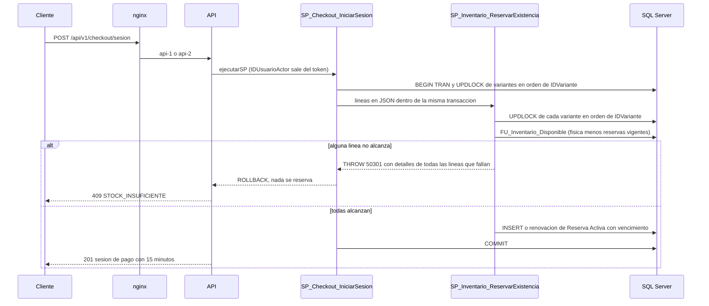

# Módulo inventario

## Qué hace

Lleva la existencia física de cada variante, el kardex (ledger inmutable de movimientos) y las reservas que hace el checkout. Endpoints, todos para Operador y Administrador ([inventario.routes.ts:108](../../../apps/api/src/modules/inventario/inventario.routes.ts#L108 "router.use(autenticar, autorizar('Operador', 'Administrador'))")): `POST /inventario/entradas`, `POST /inventario/ajustes` (ambos con `Idempotency-Key` opcional), `GET /inventario/kardex`, `/existencias`, `/conciliacion` y `/bodega`. SPs clave: `SP_Inventario_RegistrarMovimiento` (el único que toca `ExistenciaFisica` y escribe el kardex), `SP_Inventario_ReservarExistencia` (el único que reserva), `SP_Inventario_LiberarReservas`, la función `FU_Inventario_Disponible` y la vista `VW_Inventario_Conciliacion`.

El servicio no valida saldos: los valida el SP bajo el bloqueo de la variante ([inventario.service.ts:22](../../../apps/api/src/modules/inventario/inventario.service.ts#L22 "solicitudIdempotente(llave, 'Inventario.Entrada', datos)")).

## Flujo crítico

La reserva todo o nada al iniciar el pago: es lo que impide la sobreventa cuando varios clientes compran la última unidad desde réplicas distintas. La invoca el checkout, pero la regla vive en este módulo.

El segundo cliente que pide la misma variante espera en el `UPDLOCK` y, cuando entra, `FU_Inventario_Disponible` ya cuenta la reserva confirmada del primero.

## Reglas: dónde vive cada una

| Regla | Dónde vive | Archivo:línea | Decisión |
| --- | --- | --- | --- |
| Solo un SP modifica `ExistenciaFisica`, y en el mismo paso escribe el kardex | `SP_Inventario_RegistrarMovimiento` | [R__SP_Inventario_RegistrarMovimiento.sql:74](../../../database/programmability/R__SP_Inventario_RegistrarMovimiento.sql#L74 "UPDATE dbo.Variante") | N-07 |
| El movimiento solo corre dentro de la transacción del llamador | SP (50005) | [R__SP_Inventario_RegistrarMovimiento.sql:24](../../../database/programmability/R__SP_Inventario_RegistrarMovimiento.sql#L24 "IF @@TRANCOUNT = 0") | N-07 |
| Todo movimiento tiene un usuario responsable (de `SESSION_CONTEXT`) | SP | [R__SP_Inventario_RegistrarMovimiento.sql:31](../../../database/programmability/R__SP_Inventario_RegistrarMovimiento.sql#L31 "Todo movimiento de inventario necesita un usuario responsable.") | A-18 |
| La existencia nunca queda negativa | SP (50301) + `CHECK` | [V004__catalogo.sql:88](../../../database/migrations/V004__catalogo.sql#L88 "CK_Variante_ExistenciaNoNegativa") | A-13 |
| Cada movimiento cuadra: resultante = anterior + signo × cantidad | `CHECK` de la tabla | [V005__inventario.sql:46](../../../database/migrations/V005__inventario.sql#L46 "ExistenciaResultante = ExistenciaAnterior + Signo * Cantidad") | N-07 |
| El signo no contradice el tipo de movimiento | FK compuesta `(IDTipoMovimiento, Signo)` | [V005__inventario.sql:39](../../../database/migrations/V005__inventario.sql#L39 "FOREIGN KEY (IDTipoMovimiento, Signo)") | A-15 |
| El kardex es inmutable (ni un administrador lo modifica) | Tabla ledger append-only | [V005__inventario.sql:47](../../../database/migrations/V005__inventario.sql#L47 "WITH (LEDGER = ON (APPEND_ONLY = ON))") | M-01 |
| Las fechas del kardex nunca retroceden dentro de una variante | SP bajo el bloqueo | [R__SP_Inventario_RegistrarMovimiento.sql:65](../../../database/programmability/R__SP_Inventario_RegistrarMovimiento.sql#L65 "IF @FechaMovimiento < (SELECT TOP (1) m.Fecha") | N-07 |
| Disponible = física − reservas Activa no vencidas, en un solo lugar | `FU_Inventario_Disponible` | [R__FU_Inventario_Disponible.sql:18](../../../database/programmability/R__FU_Inventario_Disponible.sql#L18 "re.FechaExpiracion > SYSUTCDATETIME()") | N-06 |
| Reserva todo o nada, variantes en orden de `IDVariante` | `SP_Inventario_ReservarExistencia` | [R__SP_Inventario_ReservarExistencia.sql:52](../../../database/programmability/R__SP_Inventario_ReservarExistencia.sql#L52 "THROW 50301, @Error, 1;") | N-06 |
| Una fila de reserva por sesión y variante | `UNIQUE` | [V005__inventario.sql:62](../../../database/migrations/V005__inventario.sql#L62 "UQ_Reserva_IDSesionCheckoutIDVariante") | N-06 |
| Un ajuste no deja la física negativa | `SP_Inventario_RegistrarAjuste` | [R__SP_Inventario_RegistrarAjuste.sql:52](../../../database/programmability/R__SP_Inventario_RegistrarAjuste.sql#L52 "THROW 50302") | N-07 |
| Un ajuste no baja la física de lo reservado (con el máximo ajustable) | `SP_Inventario_RegistrarAjuste` (JSON de A-19) | [R__SP_Inventario_RegistrarAjuste.sql:60](../../../database/programmability/R__SP_Inventario_RegistrarAjuste.sql#L60 "THROW 50303, @Error, 1;") | N-07, A-19 |
| Entradas y ajustes exigen motivo | SP (50304), no Zod | [R__SP_Inventario_RegistrarAjuste.sql:24](../../../database/programmability/R__SP_Inventario_RegistrarAjuste.sql#L24 "THROW 50304") | N-16 |
| Tope de 1 000 000 por movimiento | Zod y SP | [R__SP_Inventario_RegistrarMovimiento.sql:37](../../../database/programmability/R__SP_Inventario_RegistrarMovimiento.sql#L37 "@CantidadMaxima INT = 1000000") | N-07 |
| Misma `Idempotency-Key` → mismo movimiento; otro contenido → 422 | SP + `UNIQUE (IDUsuario, LlaveIdempotencia)` | [V013__arrendamiento_y_solicitud_idempotente.sql:32](../../../database/migrations/V013__arrendamiento_y_solicitud_idempotente.sql#L32 "UQ_SolicitudIdempotente_IDUsuarioLlave") | E5-H03 |
| La física cuadra con la suma del kardex | `VW_Inventario_Conciliacion` (debe estar vacía) | [R__VW_Inventario_Conciliacion.sql:22](../../../database/programmability/R__VW_Inventario_Conciliacion.sql#L22 "v.ExistenciaFisica <> k.SumaKardex") | N-07 |
| Existencia de bodega = física + pagado sin despachar | `VW_Inventario_ExistenciaBodega` | [R__VW_Inventario_ExistenciaBodega.sql:17](../../../database/programmability/R__VW_Inventario_ExistenciaBodega.sql#L17 "e.Codigo IN ('Pagado', 'EnPreparacion')") | N-07 |
| Solo Operador y Administrador | Middleware `autorizar` | [inventario.routes.ts:108](../../../apps/api/src/modules/inventario/inventario.routes.ts#L108 "autorizar('Operador', 'Administrador')") | RF-01 |

## Concurrencia y réplicas

- **Dos movimientos simultáneos sobre la misma variante:** `SP_Inventario_RegistrarMovimiento` lee el saldo con `UPDLOCK` ([R__SP_Inventario_RegistrarMovimiento.sql:56](../../../database/programmability/R__SP_Inventario_RegistrarMovimiento.sql#L56 "dbo.Variante AS v WITH (UPDLOCK, ROWLOCK)")); el segundo espera al `COMMIT` del primero y parte de su saldo. Prueba con ocho ajustes a la vez y la conciliación vacía: [inventario.api.test.ts:163](../../../apps/api/test/integracion/inventario/inventario.api.test.ts#L163 "tras movimientos simultáneos, el saldo cuadra con el kardex").
- **Dos ajustes negativos que juntos bajan de lo reservado o de cero:** el ajuste bloquea la variante antes de leer lo reservado ([R__SP_Inventario_RegistrarAjuste.sql:43](../../../database/programmability/R__SP_Inventario_RegistrarAjuste.sql#L43 "dbo.Variante AS v WITH (UPDLOCK, ROWLOCK)")), el mismo bloqueo que toma quien reserva. Uno pasa y el otro recibe 422 con el máximo restante ([inventario.api.test.ts:191](../../../apps/api/test/integracion/inventario/inventario.api.test.ts#L191 "dos ajustes negativos a la vez que juntos bajan de lo reservado")).
- **Veinte clientes por la última unidad:** la reserva bloquea en orden de `IDVariante` ([R__SP_Inventario_ReservarExistencia.sql:34](../../../database/programmability/R__SP_Inventario_ReservarExistencia.sql#L34 "WITH (UPDLOCK, ROWLOCK) WHERE v.IDVariante = @ID")) y valida con las variantes bloqueadas. Resultado: un pedido y 19 respuestas 409, con la conciliación vacía al final ([checkout.concurrencia.test.ts:55](../../../apps/api/test/concurrencia/checkout.concurrencia.test.ts#L55 "20 clientes por la última unidad")).
- **Orden de bloqueo sin deadlocks:** quien llama también bloquea en orden de `IDVariante` antes de reservar ([R__SP_Checkout_IniciarSesion.sql:62](../../../database/programmability/R__SP_Checkout_IniciarSesion.sql#L62 "WITH (UPDLOCK, ROWLOCK) WHERE v.IDVariante = @ID")), y la venta escribe los movimientos en ese mismo orden ([R__SP_Pedidos_CrearPedido.sql:137](../../../database/programmability/R__SP_Pedidos_CrearPedido.sql#L137 "EXEC dbo.SP_Inventario_RegistrarMovimiento")). Si aun así ocurre un deadlock (1205), `ejecutarSP` repite el SP completo ([ejecutar-sp.ts:67](../../../apps/api/src/shared/db/ejecutar-sp.ts#L67 "if (numero === DEADLOCK && intento < REINTENTOS_DEADLOCK)")).
- **Misma `Idempotency-Key` en dos ajustes simultáneos:** la búsqueda de la llave toma `UPDLOCK, HOLDLOCK` también sobre el hueco de una llave nueva ([R__SP_Sistema_BuscarSolicitudIdempotente.sql:23](../../../database/programmability/R__SP_Sistema_BuscarSolicitudIdempotente.sql#L23 "WITH (UPDLOCK, HOLDLOCK)")); se registra un solo movimiento ([pagar.api.test.ts:405](../../../apps/api/test/integracion/checkout/pagar.api.test.ts#L405 "la misma llave en dos ajustes simultáneos registra uno solo")).
- **Una réplica muere a mitad de un ajuste:** con `SET XACT_ABORT ON` ([R__SP_Inventario_RegistrarAjuste.sql:19](../../../database/programmability/R__SP_Inventario_RegistrarAjuste.sql#L19 "SET XACT_ABORT ON;")) y una sola transacción, SQL Server revierte todo al cortarse la conexión: no queda existencia cambiada sin su movimiento. El Operador reintenta con la misma llave y, si el primero sí se confirmó, recibe el mismo movimiento sin registrarlo dos veces ([pagar.api.test.ts:389](../../../apps/api/test/integracion/checkout/pagar.api.test.ts#L389 "la misma llave devuelve el mismo movimiento")).
- **Una réplica muere con reservas activas:** la reserva vencida deja de contar sola, porque `FU_Inventario_Disponible` filtra por `FechaExpiracion` sin depender del job ([R__FU_Inventario_Disponible.sql:18](../../../database/programmability/R__FU_Inventario_Disponible.sql#L18 "re.FechaExpiracion > SYSUTCDATETIME()")). Después, el job de expiración, protegido con `sp_getapplock` para que corra en una sola réplica ([R__SP_Checkout_ExpirarSesiones.sql:29](../../../database/programmability/R__SP_Checkout_ExpirarSesiones.sql#L29 "sys.sp_getapplock")), las marca `Liberada` con `SP_Inventario_LiberarReservas`.

## Modos de falla

- **Entrada inválida** (cantidad 0, decimal, texto o fuera del tope; campos extra): `400 VALIDACION_FALLIDA` ([casos-borde.api.test.ts:39](../../../apps/api/test/integracion/inventario/casos-borde.api.test.ts#L39 "cantidades decimales, como texto, en 0, negativas en una entrada o por encima del tope responden 400")).
- **Motivo vacío o de solo espacios:** `400 MOTIVO_REQUERIDO` desde el SP ([catalogo.ts:129](../../../apps/api/src/shared/errors/catalogo.ts#L129 "MOTIVO_REQUERIDO")).
- **Ajuste que deja la física negativa:** `422 AJUSTE_DEJA_NEGATIVO` ([catalogo.ts:119](../../../apps/api/src/shared/errors/catalogo.ts#L119 "AJUSTE_DEJA_NEGATIVO")).
- **Ajuste por debajo de lo reservado:** `422 AJUSTE_BAJO_RESERVADO` con `detalles.maximoAjustable` ([inventario.api.test.ts:123](../../../apps/api/test/integracion/inventario/inventario.api.test.ts#L123 "un ajuste que deja la física por debajo de lo reservado")).
- **Reserva sin existencia:** `409 STOCK_INSUFICIENTE` con el detalle de cada línea que falla ([catalogo.ts:118](../../../apps/api/src/shared/errors/catalogo.ts#L118 "STOCK_INSUFICIENTE")).
- **Llave de idempotencia reutilizada con otro contenido:** `422 LLAVE_REUTILIZADA` ([catalogo.ts:185](../../../apps/api/src/shared/errors/catalogo.ts#L185 "LLAVE_REUTILIZADA")).
- **Variante inexistente:** `404 NO_ENCONTRADO` (50001) desde el SP ([R__SP_Inventario_RegistrarMovimiento.sql:60](../../../database/programmability/R__SP_Inventario_RegistrarMovimiento.sql#L60 "THROW 50001")).
- **SP interno llamado sin transacción o sin actor:** `500 INVARIANTE_INTERNA` con mensaje genérico; el detalle queda en el log ([catalogo.ts:45](../../../apps/api/src/shared/errors/catalogo.ts#L45 "INVARIANTE_INTERNA")).
- **Cliente o anónimo:** `403` / `401` en todas las rutas ([inventario.api.test.ts:334](../../../apps/api/test/integracion/inventario/inventario.api.test.ts#L334 "un Cliente recibe 403 en cada ruta de inventario")).
- **Base caída:** `500 ERROR_INTERNO`; como la transacción no llegó al `COMMIT`, nada queda a medias ([middleware.ts:80](../../../apps/api/src/shared/errors/middleware.ts#L80 "return new AppError('ERROR_INTERNO', { cause: error });")).
- **Redis caído:** el módulo no usa Redis. La autenticación sigue aceptando el access token vigente ([autenticar.ts:11](../../../apps/api/src/shared/http/autenticar.ts#L11 "si Redis no responde")).

## Alternativas descartadas

- **Descontar el stock al despachar** → la venta es el pago: la salida del kardex ocurre al confirmar el pago, y la vista de bodega concilia con el conteo físico (N-07).
- **Reservar al agregar al carrito** → el carrito valida pero no reserva; se reserva todo o nada al iniciar el pago, por 15 minutos (N-06).
- **Kardex protegido solo con triggers** → un administrador puede deshabilitarlos; la tabla ledger append-only rechaza `UPDATE` y `DELETE` en el motor (M-01).
- **Validar el saldo solo en el servicio o con `COUNT`/`SUM` sin bloqueo** → no resiste dos réplicas; el SP valida bajo `UPDLOCK` y los `CHECK` son la defensa ante un bug (A-02, A-13).
- **`SERIALIZABLE` global** → bloqueos y deadlocks innecesarios; se usa `READ_COMMITTED_SNAPSHOT` con `UPDLOCK` explícito en las filas en disputa (A-05).
- **Liberar reservas solo con el job** → si el job se atrasa, el disponible sería incorrecto; la función ignora las reservas vencidas aunque sigan `Activa` (N-06).
- **Costo promedio y valoración** → fuera de alcance (N-16).

## Preguntas probables

### ¿Cómo garantizas que nadie cambie la existencia sin dejar rastro en el kardex?

Un solo SP actualiza `ExistenciaFisica` y en el mismo paso inserta el movimiento; ningún otro SP de producción escribe esa columna, y la app no tiene permisos sobre las tablas.
**Muéstralo en:** [R__SP_Inventario_RegistrarMovimiento.sql:78](../../../database/programmability/R__SP_Inventario_RegistrarMovimiento.sql#L78 "INSERT INTO dbo.MovimientoKardex")

### ¿Qué impide la sobreventa con dos réplicas?

La reserva bloquea cada variante con `UPDLOCK` en orden de `IDVariante` y valida el disponible ya bloqueado. El segundo comprador espera y ve la reserva del primero. La prueba de concurrencia lanza 20 clientes por una unidad.
**Muéstralo en:** [checkout.concurrencia.test.ts:55](../../../apps/api/test/concurrencia/checkout.concurrencia.test.ts#L55 "20 clientes por la última unidad")

### ¿Por qué bloquear en orden de `IDVariante`?

Si un carrito bloquea A y luego B y otro B y luego A, se produce un deadlock. Con un orden global, el segundo siempre espera en la primera variante compartida.
**Muéstralo en:** [R__SP_Inventario_ReservarExistencia.sql:31](../../../database/programmability/R__SP_Inventario_ReservarExistencia.sql#L31 "SELECT MIN(p.IDVariante) FROM @Pedidas AS p")

### ¿Qué significa "todo o nada" en la reserva?

Si una sola línea no alcanza, el SP lanza 50301 con el detalle de todas las que fallan y no inserta ninguna reserva; el llamador revierte su transacción.
**Muéstralo en:** [reservar-existencia.test.ts:58](../../../apps/api/test/integracion/inventario/reservar-existencia.test.ts#L58 "todo o nada: si una línea no alcanza")

### ¿Qué pasa con una reserva que venció pero el job todavía no liberó?

No cuenta: `FU_Inventario_Disponible` solo suma reservas `Activa` con `FechaExpiracion` futura. El disponible nunca depende del job.
**Muéstralo en:** [inventario.api.test.ts:219](../../../apps/api/test/integracion/inventario/inventario.api.test.ts#L219 "una reserva vencida no cuenta como reservada para el ajuste")

### ¿Puede un Operador ajustar a la baja unidades que un cliente está pagando?

No. Bajo el bloqueo de la variante, el SP compara la física resultante con lo reservado vigente y responde 422 con el máximo ajustable.
**Muéstralo en:** [R__SP_Inventario_RegistrarAjuste.sql:53](../../../database/programmability/R__SP_Inventario_RegistrarAjuste.sql#L53 "IF @Fisica + @Cantidad < @Reservado")

### ¿Y si alguien intenta corregir un error editando el kardex?

El motor lo rechaza (error 37359) porque la tabla es ledger append-only, incluso para un administrador. Los errores se corrigen con un ajuste compensatorio.
**Muéstralo en:** [ledger.test.ts:15](../../../apps/api/test/integracion/esquema/ledger.test.ts#L15 "['MovimientoKardex', 'Modificar']")

### ¿Qué impide un movimiento con un saldo inventado?

El `CHECK` exige `ExistenciaResultante = ExistenciaAnterior + Signo * Cantidad` y la FK compuesta impide un signo que contradiga el tipo.
**Muéstralo en:** [inventario.test.ts:44](../../../apps/api/test/integracion/esquema/inventario.test.ts#L44 "rechaza un saldo que no cuadra")

### ¿Cómo compruebas que la existencia y el kardex coinciden?

`VW_Inventario_Conciliacion` lista las variantes cuya física difiere de la suma del kardex o del último saldo; debe estar vacía. La prueba de concurrencia la verifica al final.
**Muéstralo en:** [checkout.concurrencia.test.ts:73](../../../apps/api/test/concurrencia/checkout.concurrencia.test.ts#L73 "expect(await conciliacionDeInventario()).toEqual([])")

### ¿Por qué `RegistrarMovimiento` exige la transacción del llamador?

Porque la salida por venta, la cancelación y la devolución deben ser atómicas con el pedido. Una transacción propia anidada revertiría también la del llamador en un `ROLLBACK`.
**Muéstralo en:** [registrar-movimiento.test.ts:100](../../../apps/api/test/integracion/inventario/registrar-movimiento.test.ts#L100 "si el llamador no abrió una transacción")

### Si la respuesta de un ajuste se pierde por la red, ¿se registra dos veces al reintentar?

No, si el cliente manda `Idempotency-Key`: la llave y su respuesta se guardan en la misma transacción que el movimiento, y la misma llave devuelve el mismo movimiento.
**Muéstralo en:** [R__SP_Inventario_RegistrarAjuste.sql:75](../../../database/programmability/R__SP_Inventario_RegistrarAjuste.sql#L75 "SP_Sistema_GuardarSolicitudIdempotente")

### ¿Quién queda como responsable de un movimiento?

El usuario del `SESSION_CONTEXT`, que fija `SP_Sistema_EstablecerContexto` con el actor del token; sin usuario, el movimiento se rechaza. Se guarda también el `RequestId`.
**Muéstralo en:** [registrar-movimiento.test.ts:64](../../../apps/api/test/integracion/inventario/registrar-movimiento.test.ts#L64 "registra el usuario y el RequestId del contexto de la petición")

### ¿Por qué la existencia de bodega no es la existencia física?

La salida ocurre al pagar, pero la mercadería sigue en bodega hasta despacharse. La vista suma lo pagado y en preparación para el conteo físico.
**Muéstralo en:** [inventario.api.test.ts:286](../../../apps/api/test/integracion/inventario/inventario.api.test.ts#L286 "bodega suma a la física las unidades pagadas por despachar")
