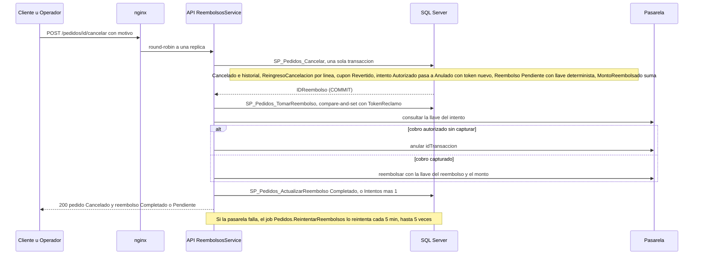

# Módulo pedidos

## Qué hace

El pedido es la compra confirmada: lo crea `SP_Pedidos_CrearPedido` cuando el checkout confirma el pago ([index.ts:51](../../../apps/api/src/modules/pedidos/index.ts#L51 "pedidosParaCheckout")). Este módulo lo consulta, lo mueve por su ciclo de vida con una máquina de estados validada en tres capas, lo cancela con reembolso y registra devoluciones parciales. El dinero se devuelve **después** del `COMMIT`, con una llave determinista y un job que reintenta.

- **Cliente** ([pedidos.routes.ts:226](../../../apps/api/src/modules/pedidos/pedidos.routes.ts#L226 "autorizar('Cliente')")): `GET /api/v1/pedidos`, `GET /api/v1/pedidos/{id}`, `POST /api/v1/pedidos/{id}/cancelar`.
- **Operador y Admin** ([pedidos.routes.ts:227](../../../apps/api/src/modules/pedidos/pedidos.routes.ts#L227 "autorizar('Operador', 'Administrador')")): `GET /api/v1/admin/pedidos`, `POST /api/v1/admin/pedidos/{id}/estado`, `POST /api/v1/admin/pedidos/{id}/cancelar`, `POST /api/v1/admin/pedidos/{id}/devoluciones`.
- **Solo Admin** ([pedidos.routes.ts:228](../../../apps/api/src/modules/pedidos/pedidos.routes.ts#L228 "autorizar('Administrador')")): `GET /api/v1/admin/reembolsos` y `POST /api/v1/admin/reembolsos/{id}/reintentar`.
- **SPs clave:** `SP_Pedidos_CambiarEstado`, `SP_Pedidos_Cancelar`, `SP_Pedidos_RegistrarDevolucion`, `SP_Pedidos_TomarReembolso`, `SP_Pedidos_ActualizarReembolso`, `SP_Pedidos_ObtenerReembolsosPendientes` (job `Pedidos.ReintentarReembolsos` cada 5 min, [pedidos.tareas.ts:11](../../../apps/api/src/modules/pedidos/pedidos.tareas.ts#L11 "Pedidos.ReintentarReembolsos")), el trigger `TR_Pedidos_ValidarTransicion` y la vista `VW_Pedidos_Historial`.

## Flujo crítico

La cancelación con reembolso es el flujo crítico: en una transacción devuelve el producto al inventario, revierte el cupón y deja registrada la deuda con el cliente; después devuelve el dinero en la pasarela sin cobrar ni reembolsar dos veces, aunque falle, se repita o la réplica muera (un outbox simplificado).

## Reglas: dónde vive cada una

| Regla | Dónde vive | Archivo:línea | Decisión |
| --- | --- | --- | --- |
| No se saltan estados (primera capa, mensaje claro) | Servicio con el mapa de transiciones | [pedidos.service.ts:37](../../../apps/api/src/modules/pedidos/pedidos.service.ts#L37 "transicionPermitida"), [pedidos.transiciones.ts:23](../../../apps/api/src/modules/pedidos/pedidos.transiciones.ts#L23 "destino: 'EnPreparacion'") | N-08 |
| La transición existe para el rol (segunda capa) | SP contra `TransicionEstadoPedido` | [R__SP_Pedidos_CambiarEstado.sql:38](../../../database/programmability/R__SP_Pedidos_CambiarEstado.sql#L38 "THROW 50701") | N-08, A-15 |
| Ningún `UPDATE` a `Pedido` escapa (tercera capa) | Trigger con el rol de `SESSION_CONTEXT` | [R__TR_Pedidos_ValidarTransicion.sql:28](../../../database/programmability/R__TR_Pedidos_ValidarTransicion.sql#L28 "THROW 50701") | N-08, A-18 |
| El endpoint de estado nunca alcanza `Cancelado`, `DevueltoParcial` ni `Devuelto` | SP | [R__SP_Pedidos_CambiarEstado.sql:34](../../../database/programmability/R__SP_Pedidos_CambiarEstado.sql#L34 "THROW 50701") | N-08 |
| Solo cambia si sigue en el estado esperado | SP (concurrencia optimista) | [R__SP_Pedidos_CambiarEstado.sql:57](../../../database/programmability/R__SP_Pedidos_CambiarEstado.sql#L57 "IDEstadoPedido = @IDEsperado") | N-08 |
| El historial se escribe en la misma transacción | SP | [R__SP_Pedidos_CambiarEstado.sql:61](../../../database/programmability/R__SP_Pedidos_CambiarEstado.sql#L61 "INSERT INTO dbo.HistorialEstadoPedido") | N-08 |
| El historial no se modifica ni se borra | Tabla ledger append-only | [V008__pedidos.sql:153](../../../database/migrations/V008__pedidos.sql#L153 "APPEND_ONLY = ON") | M-01 |
| La primera fila es (ninguno) → `Pagado`, al confirmar el pago | `SP_Pedidos_CrearPedido` | [R__SP_Pedidos_CrearPedido.sql:158](../../../database/programmability/R__SP_Pedidos_CrearPedido.sql#L158 "Pago confirmado") | N-08 |
| Un pedido solo sale de `Pagado` con el cobro `Capturado` (ni con la captura pendiente ni `EnRevision`) | SP y trigger (`50710`) | [R__SP_Pedidos_CambiarEstado.sql:52](../../../database/programmability/R__SP_Pedidos_CambiarEstado.sql#L52 "THROW 50710") · [R__TR_Pedidos_ValidarTransicion.sql:41](../../../database/programmability/R__TR_Pedidos_ValidarTransicion.sql#L41 "THROW 50710") | N-08, N-03 |
| Un pedido con el pago `EnRevision` no se cancela: solo `SinCobro` lo hace | SP bajo el bloqueo del intento (`50706`) | [R__SP_Pedidos_AplicarCancelacion.sql:84](../../../database/programmability/R__SP_Pedidos_AplicarCancelacion.sql#L84 "THROW 50706") | N-09 |
| Revisión manual (E9-H04): solo desde `EnRevision`, bajo bloqueo; resolver dos veces es 409 | SP (`50707`) | [R__SP_Pedidos_ResolverPagoEnRevision.sql:62](../../../database/programmability/R__SP_Pedidos_ResolverPagoEnRevision.sql#L62 "THROW 50707") | N-09 |
| `CobroVerificado` y `Reembolsar` exigen el cobro `Capturada` en la pasarela; `SinCobro`, que no lo esté | Servicio (la pasarela se consulta fuera de la transacción) | [pedidos.revision.ts:98](../../../apps/api/src/modules/pedidos/pedidos.revision.ts#L98 "COBRO_SIN_CAPTURA") | N-03, N-09 |
| `SinCobro` no deja una autorización retenida: la anula antes de escribir | Servicio | [pedidos.revision.ts:176](../../../apps/api/src/modules/pedidos/pedidos.revision.ts#L176 "pasarela.anular(enPasarela.idTransaccion)") | N-09 |
| `SinCobro` cierra el intento como `Anulado` (sin reembolso) y cancela por el mismo camino que cualquier cancelación | SP interno compartido | [R__SP_Pedidos_ResolverPagoEnRevision.sql:81](../../../database/programmability/R__SP_Pedidos_ResolverPagoEnRevision.sql#L81 "EXEC dbo.SP_Pedidos_AplicarCancelacion") | N-09 |
| Un cobro sin pedido se reembolsa una sola vez y por su monto | `CHECK` e índice único | [V023__revision_manual_de_pagos.sql:60](../../../database/migrations/V023__revision_manual_de_pagos.sql#L60 "UX_Reembolso_PorIntento") | N-09, A-13 |
| Antes de resolver a mano un reembolso, la pasarela se consulta por su llave: si ya lo procesó, queda `Completado` y la resolución se rechaza (nunca se devuelve dos veces) | Servicio (la pasarela se consulta fuera de la transacción) | [pedidos.revision.ts:124](../../../apps/api/src/modules/pedidos/pedidos.revision.ts#L124 "REEMBOLSO_YA_PROCESADO") · prueba [revision-manual.api.test.ts:520](../../../apps/api/test/integracion/pedidos/revision-manual.api.test.ts#L520 "nunca se reembolsa dos veces") | N-09 |
| Un reembolso se resuelve a mano solo pasado el plazo de un reclamo desde su último intento (una llamada en vuelo puede devolver el dinero) | SP bajo bloqueo (`50711`); el servicio prevalida | [R__SP_Pedidos_ResolverReembolso.sql:53](../../../database/programmability/R__SP_Pedidos_ResolverReembolso.sql#L53 "THROW 50711") · [pedidos.reembolsos.ts:35](../../../apps/api/src/modules/pedidos/pedidos.reembolsos.ts#L35 "SEGUNDOS_ANTES_DE_RESOLVER_A_MANO = SEGUNDOS_RECLAMO") | N-09 |
| Si el cobro nunca se capturó o se anuló, el reembolso pasa a `NoAplica` y no cuenta como reembolsado | Servicio (consulta el cobro) y SP (resta el monto bajo bloqueo) | [pedidos.revision.ts:146](../../../apps/api/src/modules/pedidos/pedidos.revision.ts#L146 "REEMBOLSO_SIN_COBRO") · [R__SP_Pedidos_MarcarReembolsoNoAplica.sql:61](../../../database/programmability/R__SP_Pedidos_MarcarReembolsoNoAplica.sql#L61 "MontoReembolsado - @Monto") | N-09, A-13 |
| Un reembolso `Fallido` se resuelve a mano a `ResueltoManual`; solo desde `Fallido` | SP (`50709`) | [R__SP_Pedidos_ResolverReembolso.sql:48](../../../database/programmability/R__SP_Pedidos_ResolverReembolso.sql#L48 "THROW 50709") | N-09 |
| Cada cambio de estado de un pago o de un reembolso queda en la bitácora | Triggers | [R__TR_Pedidos_PagoBitacora.sql:11](../../../database/programmability/R__TR_Pedidos_PagoBitacora.sql#L11 "IF NOT UPDATE(Estado) RETURN;") | RF-09 |
| Se cancela solo desde `Pagado` o `EnPreparacion`, el pedido completo | SP bajo `UPDLOCK` (`50702`) | [R__SP_Pedidos_Cancelar.sql:39](../../../database/programmability/R__SP_Pedidos_Cancelar.sql#L39 "THROW 50702") | N-09 |
| Motivo obligatorio | Zod y SP (`50003`) | [pedidos.schemas.ts:40](../../../apps/api/src/modules/pedidos/pedidos.schemas.ts#L40 "textoNvarchar(250)"), [R__SP_Pedidos_Cancelar.sql:22](../../../database/programmability/R__SP_Pedidos_Cancelar.sql#L22 "THROW 50003") | N-09 |
| El producto vuelve al inventario por el único SP del kardex | `SP_Inventario_RegistrarMovimiento` | [R__SP_Pedidos_AplicarCancelacion.sql:5](../../../database/programmability/R__SP_Pedidos_AplicarCancelacion.sql#L5 "ReingresoCancelacion") | N-07, N-09 |
| El uso del cupón se revierte | `SP_Cupones_RevertirUso` | [R__SP_Pedidos_AplicarCancelacion.sql:6](../../../database/programmability/R__SP_Pedidos_AplicarCancelacion.sql#L6 "SP_Cupones_RevertirUso") | N-09, N-12 |
| Un cobro sin capturar se cerca: la conciliación ya no lo captura | SP (token nuevo) | [R__SP_Pedidos_AplicarCancelacion.sql:78](../../../database/programmability/R__SP_Pedidos_AplicarCancelacion.sql#L78 "TokenArrendamiento = NEWID()") | N-09, N-03 |
| Reembolso `Pendiente` en la misma transacción, con llave determinista | SP | [R__SP_Pedidos_AplicarCancelacion.sql:93](../../../database/programmability/R__SP_Pedidos_AplicarCancelacion.sql#L93 "HASHBYTES('MD5'") | N-09 |
| Un solo reembolso por cancelación | Índice único filtrado | [V008__pedidos.sql:218](../../../database/migrations/V008__pedidos.sql#L218 "UX_Reembolso_CancelacionPorPedido") | N-09 |
| Lo reembolsado nunca supera el total | Contador con `CHECK` | [V008__pedidos.sql:90](../../../database/migrations/V008__pedidos.sql#L90 "CK_Pedido_MontoReembolsado") | A-13 |
| Devoluciones solo de pedidos `Entregado` o `DevueltoParcial` | SP (`50701`) | [R__SP_Pedidos_RegistrarDevolucion.sql:75](../../../database/programmability/R__SP_Pedidos_RegistrarDevolucion.sql#L75 "THROW 50701") | N-10 |
| Plazo de 30 días desde la primera vez que pasó a `Entregado` | SP con el historial y `ParametroSistema` | [R__SP_Pedidos_RegistrarDevolucion.sql:81](../../../database/programmability/R__SP_Pedidos_RegistrarDevolucion.sql#L81 "THROW 50704"), [V006__carrito_cupones_envios.sql:113](../../../database/migrations/V006__carrito_cupones_envios.sql#L113 "DEFAULT 30") | N-10, A-14 |
| No devolver más de lo vendido | SP bajo `UPDLOCK` + `CHECK` | [R__SP_Pedidos_RegistrarDevolucion.sql:109](../../../database/programmability/R__SP_Pedidos_RegistrarDevolucion.sql#L109 "THROW 50703"), [V008__pedidos.sql:130](../../../database/migrations/V008__pedidos.sql#L130 "CK_DetallePedido_CantidadDevuelta") | N-10, A-13 |
| Reembolso por unidad al centavo hacia abajo; la última devolución se lleva el residuo | SP | [R__SP_Pedidos_RegistrarDevolucion.sql:118](../../../database/programmability/R__SP_Pedidos_RegistrarDevolucion.sql#L118 "FLOOR(d.TotalLinea * 100 / d.Cantidad)") | N-10 |
| El estado `DevueltoParcial` o `Devuelto` lo deriva el SP | SP | [R__SP_Pedidos_RegistrarDevolucion.sql:154](../../../database/programmability/R__SP_Pedidos_RegistrarDevolucion.sql#L154 "SET @IDNuevo") | N-08, N-10 |
| Cinco fallos de la pasarela → `Fallido`, a la lista del Admin | SP | [R__SP_Pedidos_ActualizarReembolso.sql:49](../../../database/programmability/R__SP_Pedidos_ActualizarReembolso.sql#L49 "'Fallido', 'Pendiente'") | N-09 |
| Un proceso desplazado no suma intentos | SP (`TokenReclamo`) | [R__SP_Pedidos_ActualizarReembolso.sql:53](../../../database/programmability/R__SP_Pedidos_ActualizarReembolso.sql#L53 "TokenReclamo = @TokenReclamo") | N-09 |
| La pasarela se llama después del `COMMIT` | Servicio | [pedidos.reembolsos.ts:198](../../../apps/api/src/modules/pedidos/pedidos.reembolsos.ts#L198 "repositorio.cancelar(idPedido, motivo)") | N-09, A-02 |
| El cliente solo ve y cancela los suyos; uno ajeno es `404` | SP con `@IDUsuarioActor` | [R__SP_Pedidos_ObtenerDetalle.sql:17](../../../database/programmability/R__SP_Pedidos_ObtenerDetalle.sql#L17 "p.IDUsuario = @IDUsuarioActor"), [R__SP_Pedidos_AplicarCancelacion.sql:41](../../../database/programmability/R__SP_Pedidos_AplicarCancelacion.sql#L41 "@Dueno <> @IDCliente") | RF-01 |

## Concurrencia y réplicas

- **Dos peticiones simultáneas:**
  - **Dos cancelaciones del mismo pedido** (el cliente y un operador): la primera bloquea el pedido ([R__SP_Pedidos_AplicarCancelacion.sql:37](../../../database/programmability/R__SP_Pedidos_AplicarCancelacion.sql#L37 "WITH (UPDLOCK, ROWLOCK)")) y la segunda, al obtener el bloqueo, lo ve `Cancelado` y recibe `409 NO_CANCELABLE`. El índice único es la última defensa y su error también se traduce a `50702` ([R__SP_Pedidos_Cancelar.sql:38](../../../database/programmability/R__SP_Pedidos_Cancelar.sql#L38 "UX_Reembolso_CancelacionPorPedido")). Prueba: un 200, un 409, un reembolso y un reingreso ([cancelacion.api.test.ts:338](../../../apps/api/test/integracion/pedidos/cancelacion.api.test.ts#L338 "dos cancelaciones simultáneas")).
  - **Dos devoluciones de la misma línea:** se bloquean las líneas del pedido en orden de `IDDetallePedido` ([R__SP_Pedidos_RegistrarDevolucion.sql:87](../../../database/programmability/R__SP_Pedidos_RegistrarDevolucion.sql#L87 "WITH (UPDLOCK, ROWLOCK)")) y se valida contra lo ya devuelto con el bloqueo tomado: una pasa (201) y la otra recibe `422` ([devoluciones.api.test.ts:196](../../../apps/api/test/integracion/pedidos/devoluciones.api.test.ts#L196 "dos devoluciones simultáneas")).
  - **Dos operadores sobre el mismo pedido:** `UPDATE … WHERE IDEstadoPedido = @IDEsperado`; uno gana y el otro recibe `409 CONFLICTO_CONCURRENCIA` ([estados.api.test.ts:180](../../../apps/api/test/integracion/pedidos/estados.api.test.ts#L180 "dos operadores a la vez")).
  - **Cancelar mientras la conciliación captura:** la cancelación cambia el token del intento, así la resolución de la conciliación no aplica ([R__SP_Checkout_ResolverIntentoConciliado.sql:66](../../../database/programmability/R__SP_Checkout_ResolverIntentoConciliado.sql#L66 "@TokenVigente = @TokenArrendamiento")) y además rechaza capturar un cancelado ([R__SP_Checkout_ResolverIntentoConciliado.sql:79](../../../database/programmability/R__SP_Checkout_ResolverIntentoConciliado.sql#L79 "No se captura el cobro de un pedido cancelado")). La pasarela no captura una autorización ya anulada ([R__SP_Pasarela_CambiarEstado.sql:33](../../../database/programmability/R__SP_Pasarela_CambiarEstado.sql#L33 "THROW 50002")). Si el cobro se capturó justo antes, el reembolso consulta la pasarela ([pedidos.reembolsos.ts:68](../../../apps/api/src/modules/pedidos/pedidos.reembolsos.ts#L68 "pasarela.consultar(reembolso.llaveIntento)")), ve `Capturada` y reembolsa ([cancelacion.api.test.ts:371](../../../apps/api/test/integracion/pedidos/cancelacion.api.test.ts#L371 "carrera con la conciliación")).
  - **La petición, el Admin y el job sobre el mismo reembolso:** solo uno lo toma (compare-and-set sobre `FechaProximoIntento`, [R__SP_Pedidos_TomarReembolso.sql:36](../../../database/programmability/R__SP_Pedidos_TomarReembolso.sql#L36 "FechaProximoIntento <= SYSUTCDATETIME()")) y todos envían la misma llave, que la pasarela trata como idempotente.
- **Una réplica muere a mitad:**
  - **Dentro de `SP_Pedidos_Cancelar` o `SP_Pedidos_RegistrarDevolucion`:** `SET XACT_ABORT ON` y una sola transacción; nada queda escrito.
  - **Después del `COMMIT` y antes de la pasarela:** el reembolso quedó `Pendiente` en la misma transacción que la cancelación. El job lo encuentra cuando vence su reclamo de 60 s ([pedidos.reembolsos.ts:29](../../../apps/api/src/modules/pedidos/pedidos.reembolsos.ts#L29 "SEGUNDOS_RECLAMO")) y lo procesa.
  - **Después de que la pasarela reembolsó y antes de registrarlo:** el job repite con la misma llave y la pasarela devuelve el mismo reembolso, sin un segundo pago al cliente ([cancelacion.api.test.ts:229](../../../apps/api/test/integracion/pedidos/cancelacion.api.test.ts#L229 "la respuesta se perdió")).
  - **El job en las dos réplicas:** `sp_getapplock` con `@LockTimeout = 0` ([R__SP_Pedidos_ObtenerReembolsosPendientes.sql:29](../../../database/programmability/R__SP_Pedidos_ObtenerReembolsosPendientes.sql#L29 "sp_getapplock")); la otra réplica retorna sin hacer nada ([tareas-periodicas.test.ts:581](../../../apps/api/test/integracion/secuencial/tareas-periodicas.test.ts#L581 "si la otra réplica tiene el bloqueo, el job retorna sin hacer nada")).

## Modos de falla

- **Pedido ajeno o inexistente:** `404 NO_ENCONTRADO`, con el mismo cuerpo en los dos casos ([pedidos.service.ts:28](../../../apps/api/src/modules/pedidos/pedidos.service.ts#L28 "NO_ENCONTRADO"), prueba [consulta.api.test.ts:95](../../../apps/api/test/integracion/pedidos/consulta.api.test.ts#L95 "igual que uno inexistente")).
- **Transición inválida:** `409 TRANSICION_INVALIDA` ([catalogo.ts:211](../../../apps/api/src/shared/errors/catalogo.ts#L211 "TRANSICION_INVALIDA")). **Estado que ya cambió:** `409 CONFLICTO_CONCURRENCIA` ([R__SP_Pedidos_CambiarEstado.sql:59](../../../database/programmability/R__SP_Pedidos_CambiarEstado.sql#L59 "THROW 50002")).
- **No cancelable** (despachado, entregado o ya cancelado): `409 NO_CANCELABLE` ([catalogo.ts:216](../../../apps/api/src/shared/errors/catalogo.ts#L216 "NO_CANCELABLE")).
- **Cobro sin capturar:** con la captura pendiente o el pago en revisión, el pedido no avanza, `409 PAGO_NO_CAPTURADO` ([estados.api.test.ts:283](../../../apps/api/test/integracion/pedidos/estados.api.test.ts#L283 "el Operador no puede preparar")), y un `UPDATE` directo tampoco ([estados.api.test.ts:323](../../../apps/api/test/integracion/pedidos/estados.api.test.ts#L323 "un UPDATE directo también se rechaza")). **Pago en revisión:** tampoco se cancela: el Cliente y la gestión reciben el mismo 409 y nada cambia ([cancelacion.api.test.ts:426](../../../apps/api/test/integracion/pedidos/cancelacion.api.test.ts#L426 "el cliente recibe 409 PAGO_EN_REVISION")).
- **Devoluciones:** más de lo vendido, `422 DEVOLUCION_EXCEDE_VENDIDO` con lo que queda por línea en `detalles` ([devoluciones.api.test.ts:179](../../../apps/api/test/integracion/pedidos/devoluciones.api.test.ts#L179 "no se devuelve más de lo vendido")); fuera de plazo, `422 PLAZO_DEVOLUCION_VENCIDO`; más que el total pagado, `422 REEMBOLSO_EXCEDE_TOTAL` ([R__SP_Pedidos_RegistrarDevolucion.sql:126](../../../database/programmability/R__SP_Pedidos_RegistrarDevolucion.sql#L126 "THROW 50705")); una línea de otro pedido, `404`.
- **Entrada inválida:** motivo vacío o línea repetida, `400 VALIDACION_FALLIDA` ([pedidos.schemas.ts:91](../../../apps/api/src/modules/pedidos/pedidos.schemas.ts#L91 "new Set(lineas.map")).
- **Pasarela que no responde al reembolsar:** la cancelación se mantiene y responde 200 con el reembolso `Pendiente` ([cancelacion.api.test.ts:178](../../../apps/api/test/integracion/pedidos/cancelacion.api.test.ts#L178 "la cancelación se mantiene")).
- **Base caída después del `COMMIT`:** la respuesta refleja lo confirmado con el reembolso `Pendiente` para el job ([pedidos.reembolsos.ts:189](../../../apps/api/src/modules/pedidos/pedidos.reembolsos.ts#L189 "return 'Pendiente'")); base caída antes, `500 ERROR_INTERNO` y nada escrito.
- **Redis caído:** cancelar y devolver invalidan la caché de reportes después del `COMMIT`; la invalidación es tolerante y no lanza ([cache-redis.ts:34](../../../apps/api/src/shared/adapters/cache-redis.ts#L34 "tolerante")).
- **Rol equivocado:** un Cliente en la gestión `403`; un Operador en los reembolsos `403` ([cancelacion.api.test.ts:394](../../../apps/api/test/integracion/pedidos/cancelacion.api.test.ts#L394 "un Operador recibe 403")).

## Alternativas descartadas

- **Llamar a la pasarela dentro de la transacción de la cancelación** → un fallo externo revertiría la cancelación y retendría bloqueos; se guarda la intención (`Reembolso Pendiente`) y se ejecuta después (N-09, 01 §6.4).
- **Validar las transiciones solo en el backend** → una escritura directa a la base las saltaría; por eso hay tabla, SP y trigger (N-08, A-02).
- **Proteger el historial solo con un trigger** → un administrador puede deshabilitarlo; la tabla es ledger append-only (M-01).
- **Llave de reembolso aleatoria** → cada reintento sería otra solicitud para la pasarela; la llave sale de `IDPedido` y de la devolución (plan E6-H03 §2.7).
- **Cancelar líneas sueltas** → la cancelación es del pedido completo; lo parcial es una devolución (N-09, N-10).
- **Calcular lo devuelto con `SUM` sin contador** → correcto con bloqueo, pero sin defensa ante un bug; `CantidadDevuelta` y `MontoReembolsado` tienen `CHECK` (A-13).
- **Capturar al despachar** → con captura inmediata una cancelación es siempre un reembolso; capturar al despachar queda como mejora documentada (N-03).

## Preguntas probables

### ¿Dónde se valida que un pedido no salte estados?

En tres capas: el mapa del servicio da un 409 claro, el SP consulta `TransicionEstadoPedido` para el rol y el trigger lo vuelve a exigir ante cualquier `UPDATE`. Una prueba compara el mapa con la tabla, rol por rol.
**Muéstralo en:** [estados.api.test.ts:220](../../../apps/api/test/integracion/pedidos/estados.api.test.ts#L220 "cada (origen, destino, rol) del mapa está en la tabla")

### ¿Qué pasa si alguien hace un UPDATE directo a Pedido sin pasar por el SP?

El trigger lee el rol de `SESSION_CONTEXT` y, si la transición no está en la tabla para ese rol, lanza `50701` y la sentencia se revierte. Sin rol en el contexto no hay transición permitida.
**Muéstralo en:** [R__TR_Pedidos_ValidarTransicion.sql:14](../../../database/programmability/R__TR_Pedidos_ValidarTransicion.sql#L14 "SESSION_CONTEXT(N'Rol')")

### ¿Se puede modificar o borrar el historial de estados?

No. `HistorialEstadoPedido` es una tabla ledger append-only: el motor rechaza `UPDATE` y `DELETE` con el error 37359, incluso a un administrador, y una prueba lo verifica.
**Muéstralo en:** [ledger.test.ts:19](../../../apps/api/test/integracion/esquema/ledger.test.ts#L19 "rechaza %s")

### ¿Qué pasa si dos operadores cambian el mismo pedido a la vez?

Concurrencia optimista: cada uno envía el estado que vio y el `UPDATE` solo aplica si el pedido sigue en ese estado. El segundo recibe `409 CONFLICTO_CONCURRENCIA`.
**Muéstralo en:** [R__SP_Pedidos_CambiarEstado.sql:57](../../../database/programmability/R__SP_Pedidos_CambiarEstado.sql#L57 "IDEstadoPedido = @IDEsperado")

### ¿Por qué el reembolso no se hace dentro de la transacción de la cancelación?

Porque la pasarela es externa: si falla, la cancelación no se debe revertir, y un `ROLLBACK` no deshace un reembolso. El SP guarda el reembolso `Pendiente` en la misma transacción y el servicio llama a la pasarela después del `COMMIT`.
**Muéstralo en:** [pedidos.reembolsos.ts:195](../../../apps/api/src/modules/pedidos/pedidos.reembolsos.ts#L195 "procesarTrasConfirmar")

### ¿Qué garantiza que un reembolso no se pague dos veces?

La llave del reembolso es determinista (`MD5` de `Reembolso|IDPedido|Cancelacion`), así la petición, el Admin y el job envían siempre la misma y la pasarela devuelve el mismo reembolso. Además `UNIQUE` en la llave, un solo reembolso por cancelación y el `CHECK` de `MontoReembolsado`.
**Muéstralo en:** [cancelacion.api.test.ts:196](../../../apps/api/test/integracion/pedidos/cancelacion.api.test.ts#L196 "la pasarela reembolsa una sola vez")

### ¿Qué pasa si la pasarela falla al reembolsar?

La cancelación se mantiene y el reembolso queda `Pendiente`. El job lo reintenta cada 5 minutos; al quinto fallo pasa a `Fallido` y aparece en `GET /admin/reembolsos?estado=Fallido`, donde el Admin lo reintenta con la misma llave o lo resuelve a mano. Antes de aceptar la resolución, el servicio consulta la pasarela por la llave determinista del reembolso. Si la pasarela ya lo procesó (se perdió la respuesta en los cinco intentos), el reembolso queda `Completado` con la transacción de la pasarela y la API responde `409 REEMBOLSO_YA_PROCESADO`: el 409 deja una escritura confirmada a propósito, y el Admin ve el reembolso ya completado al recargar. Si no existe, el SP lo resuelve ([R__SP_Pedidos_ResolverReembolso.sql:51](../../../database/programmability/R__SP_Pedidos_ResolverReembolso.sql#L51 "THROW 50002")), pero solo si su `FechaActualizacion` sigue siendo la que se leyó antes de consultar: si otro Admin lo reintentó en medio (`Fallido`, `Pendiente` y otra vez `Fallido`, quizá con el dinero ya devuelto), responde `409 CONFLICTO_CONCURRENCIA` y nada cambia ([revision-manual.api.test.ts:562](../../../apps/api/test/integracion/pedidos/revision-manual.api.test.ts#L562 "volvió a Fallido (otro reintento)")). Una llamada a `reembolsar` que la API cortó por timeout puede seguir en vuelo: por eso solo se resuelve pasado lo que dura un reclamo desde su última actualización, y antes responde `409 REEMBOLSO_RECIENTE` ([R__SP_Pedidos_ResolverReembolso.sql:53](../../../database/programmability/R__SP_Pedidos_ResolverReembolso.sql#L53 "THROW 50711")). Y si el cobro nunca se capturó o se anuló, no hay nada que devolver: el reembolso pasa a `NoAplica` y deja de contar como reembolsado ([revision-manual.api.test.ts:448](../../../apps/api/test/integracion/pedidos/revision-manual.api.test.ts#L448 "pasa a NoAplica: sin dinero")).
**Muéstralo en:** [tareas-periodicas.test.ts:530](../../../apps/api/test/integracion/secuencial/tareas-periodicas.test.ts#L530 "al quinto fallo el reembolso queda Fallido")

### ¿Qué pasa si se cancela un pedido cuyo cobro todavía no se capturó?

La cancelación pasa el intento `Autorizado` a `Anulado` con un token nuevo, y el reembolso consulta la pasarela: si está autorizada, la anula en vez de reembolsar. La conciliación ya no la puede capturar.
**Muéstralo en:** [cancelacion.api.test.ts:353](../../../apps/api/test/integracion/pedidos/cancelacion.api.test.ts#L353 "cancelar anula la autorización en vez de reembolsar")

### ¿Cómo se evita devolver más de lo vendido?

`SP_Pedidos_RegistrarDevolucion` bloquea las líneas del pedido y compara `CantidadDevuelta + cantidad` con lo vendido bajo ese bloqueo. El `CHECK (CantidadDevuelta BETWEEN 0 AND Cantidad)` es la última defensa.
**Muéstralo en:** [R__SP_Pedidos_RegistrarDevolucion.sql:99](../../../database/programmability/R__SP_Pedidos_RegistrarDevolucion.sql#L99 "d.CantidadDevuelta + l.Cantidad > d.Cantidad")

### ¿Cómo se reparten los centavos en devoluciones parciales?

Cada unidad se reembolsa al centavo hacia abajo (`FLOOR`) sobre `TotalLinea / Cantidad`, que ya trae el descuento repartido; la devolución que completa la línea se lleva lo que falta. Una línea de 25.00 en 3 devoluciones da 8.33, 8.33 y 8.34.
**Muéstralo en:** [devoluciones.api.test.ts:160](../../../apps/api/test/integracion/pedidos/devoluciones.api.test.ts#L160 "el residuo de centavos va en la última devolución")

### ¿Desde cuándo cuenta el plazo de 30 días para devolver?

Desde la primera vez que el pedido pasó a `Entregado`, según su historial; el plazo es `DiasPlazoDevolucion` de `ParametroSistema` (30 por omisión).
**Muéstralo en:** [R__SP_Pedidos_RegistrarDevolucion.sql:78](../../../database/programmability/R__SP_Pedidos_RegistrarDevolucion.sql#L78 "MIN(h.Fecha)")

### ¿Cómo se garantiza que un cliente no vea ni cancele pedidos de otro?

El ID del cliente nunca viaja en la petición: los SPs filtran con `@IDUsuarioActor`, que sale del token. Un pedido ajeno no devuelve filas y la API responde el mismo `404` que para uno inexistente.
**Muéstralo en:** [R__SP_Pedidos_ListarPropios.sql:24](../../../database/programmability/R__SP_Pedidos_ListarPropios.sql#L24 "p.IDUsuario = @IDUsuarioActor")

### ¿Por qué al cancelar se reembolsa el envío y en una devolución no?

N-09: la cancelación ocurre antes del despacho y devuelve el total con envío (`Total − MontoReembolsado`). N-10: la devolución reembolsa solo lo pagado por las líneas devueltas.
**Muéstralo en:** [R__SP_Pedidos_AplicarCancelacion.sql:92](../../../database/programmability/R__SP_Pedidos_AplicarCancelacion.sql#L92 "@Total - @Reembolsado")

### ¿Qué significa un pedido con el pago en verificación?

Su intento quedó `EnRevision` porque la conciliación encontró la autorización anulada o desconocida. El pedido no avanza de estado ni se cancela, y el cliente lo ve con `estadoPago: "EnVerificacion"`. Como ningún pedido sale de `Pagado` sin el cobro `Capturado`, ese intento siempre está en un pedido `Pagado`, donde `SinCobro` funciona: no hay un pedido despachado con el pago en revisión que quede sin salida. Si se pudiera cancelar sin reembolso y después la pasarela mostrara el cobro capturado, el cliente quedaría cobrado sin pedido; por eso la única vía es `SinCobro`. El Admin lo resuelve con la evidencia de la pasarela (E9-H04): `CobroVerificado` si el cobro está capturado, o `SinCobro`, que lo cancela, si no; dos resoluciones a la vez: una pasa y la otra recibe 409 ([revision-manual.api.test.ts:305](../../../apps/api/test/integracion/pedidos/revision-manual.api.test.ts#L305 "dos resoluciones simultáneas del mismo intento")).
**Muéstralo en:** [R__SP_Pedidos_ObtenerDetalle.sql:25](../../../database/programmability/R__SP_Pedidos_ObtenerDetalle.sql#L25 "EnVerificacion")

### ¿Por qué el job de reembolsos no procesa dos veces el mismo en las dos réplicas?

El listado corre con `sp_getapplock`, y cada reembolso se procesa solo si `SP_Pedidos_TomarReembolso` lo toma con un compare-and-set que genera un `TokenReclamo` nuevo; un fallo con un reclamo desplazado no suma intentos.
**Muéstralo en:** [R__SP_Pedidos_TomarReembolso.sql:32](../../../database/programmability/R__SP_Pedidos_TomarReembolso.sql#L32 "TokenReclamo = NEWID()")
