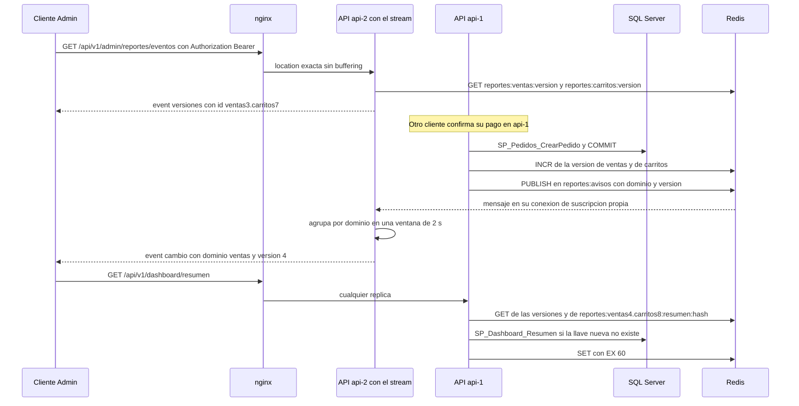

# Módulo reportes

## Qué hace
Calcula el dashboard del Administrador sobre una definición única de venta y lo sirve desde una caché versionada en Redis. También mantiene el stream en tiempo real que avisa cuando cambian las ventas o los carritos.

- **Endpoints, todos solo para el Administrador** ([reportes.routes.ts:113](../../../apps/api/src/modules/reportes/reportes.routes.ts#L113 "autorizar('Administrador')")):
  - `GET /api/v1/dashboard/resumen`, `/ventas?agrupacion=dia|semana|mes`, `/ventas-por-categoria`, `/top-productos` y `/carritos-abandonados` (paginado).
  - `GET /api/v1/admin/reportes/eventos`: SSE, E9-H02, A-25 ([reportes.routes.ts:120](../../../apps/api/src/modules/reportes/reportes.routes.ts#L120 "'/admin/reportes/eventos'")).
- **SPs:** `SP_Dashboard_Resumen`, `SP_Dashboard_VentasPorPeriodo`, `SP_Dashboard_VentasPorCategoria`, `SP_Dashboard_TopProductos` y `SP_Dashboard_CarritosAbandonados`. Todos agregan sobre `VW_Dashboard_HechosVenta` (M-07) y `VW_Carrito_Abandonados` (N-13). Son de solo lectura: no escriben ni abren transacción.

## Flujo crítico
El flujo crítico es el aviso entre réplicas. Un pedido que se paga en `api-1` tiene que llegar como evento a un Admin cuyo stream está abierto en `api-2`, y el reporte que pida después no puede salir viejo de la caché. Lo hacen posible la versión por dominio (A-11) y el canal pub/sub (A-25).

Pasos con su cita:

1. Al conectar se envían las versiones actuales, con ellas como `id` ([reportes.eventos.ts:171](../../../apps/api/src/modules/reportes/reportes.eventos.ts#L171 "cliente.escribir(")).
2. El pago confirmado invalida después del commit ([checkout.pago.ts:227](../../../apps/api/src/modules/checkout/checkout.pago.ts#L227 "await reportes.invalidar('ventas', 'carritos');")).
3. El `INCR` y la publicación solo ocurren si el `INCR` respondió ([reportes.cache.ts:54](../../../apps/api/src/modules/reportes/reportes.cache.ts#L54 "if (version !== null) await avisos.publicar({ dominio, version });")).
4. La otra réplica recibe el aviso, lo valida y lo difunde ([reportes.eventos.ts:100](../../../apps/api/src/modules/reportes/reportes.eventos.ts#L100 "version <= conocidas[dominio]")).
5. La prueba de integración usa dos apps con Redis real ([tiempo-real.api.test.ts:155](../../../apps/api/test/integracion/reportes/tiempo-real.api.test.ts#L155 "un pedido creado en una réplica llega como evento a un cliente conectado a la otra")).

## Reglas: dónde vive cada una
| Regla | Dónde vive | Archivo:línea | Decisión |
|---|---|---|---|
| Venta = pedido no cancelado, en su día de pago, con IVA y sin envío | Vista `VW_Dashboard_HechosVenta` | [R__VW_Dashboard_HechosVenta.sql:17](../../../database/programmability/R__VW_Dashboard_HechosVenta.sql#L17 "e.Codigo <> 'Cancelado'") | N-11, M-07 |
| El día de una venta es su `FechaPagoLocal` (Guatemala) | Vista | [R__VW_Dashboard_HechosVenta.sql:8](../../../database/programmability/R__VW_Dashboard_HechosVenta.sql#L8 "p.FechaPagoLocal AS Fecha") | A-12 |
| `FechaPagoLocal` se calcula una vez, al crear el pedido (UTC−6) | `SP_Pedidos_CrearPedido` + `FU_Sistema_FechaLocal` | [R__SP_Pedidos_CrearPedido.sql:99](../../../database/programmability/R__SP_Pedidos_CrearPedido.sql#L99 "dbo.FU_Sistema_FechaLocal(@Ahora)"), [R__FU_Sistema_FechaLocal.sql:7](../../../database/programmability/R__FU_Sistema_FechaLocal.sql#L7 "DATEADD(HOUR, -6, @FechaUtc)") | A-12, M-03 |
| Las devoluciones restan en su propia fecha (fila en negativo) | Vista (`UNION ALL`) | [R__VW_Dashboard_HechosVenta.sql:25](../../../database/programmability/R__VW_Dashboard_HechosVenta.sql#L25 "-dd.MontoReembolso") | N-11 |
| Sin rango: los últimos 30 días de Guatemala, hoy incluido | Cada `SP_Dashboard_*` | [R__SP_Dashboard_Resumen.sql:20](../../../database/programmability/R__SP_Dashboard_Resumen.sql#L20 "DATEADD(DAY, -29, @Hasta)") | A-12 |
| Desde ≤ hasta | Zod y el SP (50003) | [reportes.schemas.ts:8](../../../apps/api/src/modules/reportes/reportes.schemas.ts#L8 "const rangoValido"), [R__SP_Dashboard_Resumen.sql:22](../../../database/programmability/R__SP_Dashboard_Resumen.sql#L22 "THROW 50003") | A-06 |
| Agrupación de una lista blanca, sin SQL dinámico | Zod y `CASE` en el SP | [reportes.schemas.ts:18](../../../apps/api/src/modules/reportes/reportes.schemas.ts#L18 "z.enum(AGRUPACIONES).default('dia')"), [R__SP_Dashboard_VentasPorPeriodo.sql:23](../../../database/programmability/R__SP_Dashboard_VentasPorPeriodo.sql#L23 "NOT IN ('dia', 'semana', 'mes')") | CLAUDE.md |
| La semana empieza el lunes, sin depender de `@@DATEFIRST` | SP | [R__SP_Dashboard_VentasPorPeriodo.sql:26](../../../database/programmability/R__SP_Dashboard_VentasPorPeriodo.sql#L26 "1900-01-01 fue lunes") | RF-08 |
| Carrito abandonado: `Activo`, con líneas y sin cambios en `HorasCarritoAbandonado` | Vista `VW_Carrito_Abandonados` | [R__VW_Carrito_Abandonados.sql:18](../../../database/programmability/R__VW_Carrito_Abandonados.sql#L18 "ps.HorasCarritoAbandonado") | N-13 |
| El monto potencial perdido va a precio vigente | Vista | [R__VW_Carrito_Abandonados.sql:15](../../../database/programmability/R__VW_Carrito_Abandonados.sql#L15 "FU_Catalogo_PrecioVigente(l.IDVariante)") | N-13 |
| Top: 10 productos por unidades, con desempate determinista | SP | [R__SP_Dashboard_TopProductos.sql:31](../../../database/programmability/R__SP_Dashboard_TopProductos.sql#L31 "ORDER BY Unidades DESC, Ventas DESC, pr.IDProducto") | RF-08 |
| Solo el Administrador consulta | `autorizar` (403) y otra vez en cada SP (50005) | [reportes.routes.ts:113](../../../apps/api/src/modules/reportes/reportes.routes.ts#L113 "const soloAdmin"), [R__SP_Dashboard_Resumen.sql:16](../../../database/programmability/R__SP_Dashboard_Resumen.sql#L16 "THROW 50005") | RF-01, A-02 |
| Montos `Decimal` en la API y texto en JSON; ventas con signo | Repositorio, controlador y Zod | [reportes.repository.ts:70](../../../apps/api/src/modules/reportes/reportes.repository.ts#L70 "ventas: aMonto(fila.Ventas)"), [reportes.schemas.ts:30](../../../apps/api/src/modules/reportes/reportes.schemas.ts#L30 "const montoConSigno") | A-21 |
| Cada reporte depende solo de sus dominios | Servicio (mapa `DEPENDENCIAS`) | [reportes.cache.ts:25](../../../apps/api/src/modules/reportes/reportes.cache.ts#L25 "export const DEPENDENCIAS") | A-11 |
| Se invalida después del commit; una escritura que falla no invalida | `InvalidadorReportes.tras` | [reportes.cache.ts:62](../../../apps/api/src/modules/reportes/reportes.cache.ts#L62 "const resultado = await escritura;") | A-11 |
| TTL corto de 60 s | Constante del servicio | [reportes.cache.ts:36](../../../apps/api/src/modules/reportes/reportes.cache.ts#L36 "SEGUNDOS_CACHE_REPORTES = 60") | A-11 |
| El token del stream va en `Authorization`, nunca en la URL | Esquema de encabezados y servicio | [reportes.schemas.ts:82](../../../apps/api/src/modules/reportes/reportes.schemas.ts#L82 "authorization: z.string().optional()") | A-25 |
| Máximo 3 streams por usuario y réplica (429) | Difusor, en memoria de la réplica | [reportes.eventos.ts:15](../../../apps/api/src/modules/reportes/reportes.eventos.ts#L15 "MAX_CONEXIONES_POR_USUARIO = 3") | A-25 |
| Como mucho un evento por dominio cada 2 s, por réplica | Difusor | [reportes.eventos.ts:11](../../../apps/api/src/modules/reportes/reportes.eventos.ts#L11 "VENTANA_AGRUPACION_MS = 2_000") | A-25 |
| Latido cada 15 s; cierra el stream si venció el token o cambió la versión de sesión | Difusor | [reportes.eventos.ts:166](../../../apps/api/src/modules/reportes/reportes.eventos.ts#L166 "reloj.ahora() >= cliente.venceEn") | A-25, A-07 |

## Concurrencia y réplicas
- **Dos peticiones simultáneas:**
  - Los reportes son lecturas: no hay stock ni dinero en disputa. Dos fallos de caché a la vez consultan la base las dos veces y guardan el mismo valor en la misma llave. No hay protección contra estampida, y no hace falta: el resultado es idéntico.
  - **Escritura concurrente con una lectura:** el servicio lee las versiones **antes** de consultar la base ([reportes.service.ts:57](../../../apps/api/src/modules/reportes/reportes.service.ts#L57 "cache.contador(claveDeVersion(d))")). Si la versión sube mientras tanto, el resultado (quizá viejo) se guarda bajo la llave anterior, que ya nadie lee ([reportes.cache.ts:89](../../../apps/api/src/modules/reportes/reportes.cache.ts#L89 "reportes:${versiones.map")). Lo prueba [reportes.service.test.ts:186](../../../apps/api/test/unit/modules/reportes/reportes.service.test.ts#L186 "un resultado viejo que se guarda después de la invalidación no queda visible").
  - **Las dos réplicas comparten la versión:** viven en Redis, no en memoria. Lo prueban [reportes.service.test.ts:232](../../../apps/api/test/unit/modules/reportes/reportes.service.test.ts#L232 "dos réplicas con la misma caché comparten la versión") y, de punta a punta, [cache.api.test.ts:111](../../../apps/api/test/integracion/reportes/cache.api.test.ts#L111 "crear un pedido en una réplica se ve de inmediato en el reporte de la otra").
  - **Dos streams del mismo Admin a la vez en la réplica:** mientras uno lee las versiones (hay un `await`), su lugar queda reservado ([reportes.eventos.ts:84](../../../apps/api/src/modules/reportes/reportes.eventos.ts#L84 "const reservadas = new Map<number, number>();")). Así el cuarto no se cuela en ese hueco ([reportes.eventos.ts:201](../../../apps/api/src/modules/reportes/reportes.eventos.ts#L201 "abiertas + (reservadas.get(idUsuario)")). Lo prueba [tiempo-real.api.test.ts:186](../../../apps/api/test/integracion/reportes/tiempo-real.api.test.ts#L186 "streams del mismo Admin en la réplica responde 429").
- **Una réplica muere a mitad:**
  - **Entre el commit y el `INCR`:** la venta queda en SQL Server (es la fuente de verdad) y la caché sirve la versión anterior hasta que vence su TTL de 60 s ([reportes.cache.ts:36](../../../apps/api/src/modules/reportes/reportes.cache.ts#L36 "SEGUNDOS_CACHE_REPORTES = 60")). El aviso no sale: el dashboard se entera en el siguiente cambio o al reconectar.
  - **Con streams abiertos y SIGTERM:** la réplica cierra sus streams antes de `servidor.close` ([server.ts:157](../../../apps/api/src/server.ts#L157 "difusorEventos.cerrarTodas();"), [apagado.ts:62](../../../apps/api/src/apagado.ts#L62 "for (const accion of alIniciar) accion();")). Un cliente que reconecta pasa por nginx y cae en la otra réplica. Si su `Last-Event-ID` no coincide con las versiones actuales, el evento inicial dice `recargar: true` ([reportes.eventos.ts:223](../../../apps/api/src/modules/reportes/reportes.eventos.ts#L223 "recargar: ultimoEventoId !== undefined && ultimoEventoId !== id")). Lo prueban [apagado.test.ts:109](../../../apps/api/test/unit/apagado.test.ts#L109 "antes de cerrar el servidor cierra los streams abiertos") y, contra Docker, [tiempo-real.test.ts:120](../../../apps/api/test/entorno/tiempo-real.test.ts#L120 "al detener la réplica (SIGTERM) su stream se cierra enseguida").
  - **La otra réplica no se entera de nada:** cada una tiene su propia conexión de suscripción ([avisos-redis.ts:90](../../../apps/api/src/shared/adapters/avisos-redis.ts#L90 "suscriptor = cliente.duplicate();")), y el estado del difusor (los clientes, las versiones conocidas) es local y descartable.

## Modos de falla
- **Redis caído (caché):** el adaptador nunca lanza: `contador` responde `null` ([cache-redis.ts:20](../../../apps/api/src/shared/adapters/cache-redis.ts#L20 "return siFalla;")) y el servicio consulta la base directo ([reportes.service.ts:58](../../../apps/api/src/modules/reportes/reportes.service.ts#L58 "if (versiones.some((v) => v === null)) return consultar();")). Responde `200`, más lento. Lo prueba [cache.api.test.ts:211](../../../apps/api/test/integracion/reportes/cache.api.test.ts#L211 "con Redis caído el reporte responde igual, desde la base").
- **Redis caído (stream):**
  - El stream sigue abierto con sus latidos y no llegan avisos. `publicar` nunca lanza ([avisos-redis.ts:85](../../../apps/api/src/shared/adapters/avisos-redis.ts#L85 "registro.fallo(error);")).
  - Al volver la suscripción se envían las versiones con `recargar: true` ([avisos-redis.ts:56](../../../apps/api/src/shared/adapters/avisos-redis.ts#L56 "oyente.alReconectar();"), [reportes.eventos.ts:162](../../../apps/api/src/modules/reportes/reportes.eventos.ts#L162 "recargar: true")).
  - Lo prueba [tiempo-real.test.ts:85](../../../apps/api/test/entorno/tiempo-real.test.ts#L85 "con Redis detenido el stream sigue abierto (latidos)").
- **Un valor de la caché corrupto o con otra forma:** cuenta como ausente y se consulta la base ([reportes.service.ts:66](../../../apps/api/src/modules/reportes/reportes.service.ts#L66 "if (leido?.success) return leido.data;")). Lo prueba [reportes.service.test.ts:256](../../../apps/api/test/unit/modules/reportes/reportes.service.test.ts#L256 "un valor en la caché que no se puede leer se descarta").
- **Redis caído al arrancar la réplica:** la suscripción se hace en el primer `ready`, venga o no después de una caída; ioredis solo restablece lo que ya estaba suscrito ([avisos-redis.ts:47](../../../apps/api/src/shared/adapters/avisos-redis.ts#L47 "if (!suscrito) {"), [avisos-redis.test.ts:84](../../../apps/api/test/unit/shared/adapters/avisos-redis.test.ts#L84 "con Redis caído al arrancar, se suscribe")).
- **Redis perdió los contadores (reinicio sin volcado):** al volver el canal, las versiones leídas reemplazan a las conocidas aunque sean menores; si no, los avisos nuevos (1, 2, 3…) se descartarían ([reportes.eventos.ts:161](../../../apps/api/src/modules/reportes/reportes.eventos.ts#L161 "Object.assign(conocidas, versiones);"), [reportes.eventos.test.ts:253](../../../apps/api/test/unit/modules/reportes/reportes.eventos.test.ts#L253 "si Redis perdió los contadores")).
- **Un Admin conecta entre el `INCR` y su aviso:** la versión leída al conectar se difunde a los ya conectados, porque al llegar el aviso se descartaría ([reportes.eventos.test.ts:238](../../../apps/api/test/unit/modules/reportes/reportes.eventos.test.ts#L238 "si un Admin conecta con una versión que el aviso aún no trajo")). Un stream que todavía lee las versiones cuando llega SIGTERM se cierra en lugar de quedar abierto ([reportes.eventos.test.ts:270](../../../apps/api/test/unit/modules/reportes/reportes.eventos.test.ts#L270 "un stream que todavía lee las versiones cuando empieza el apagado")).
- **Un aviso del canal con otra forma:** se descarta con una advertencia ([avisos-redis.ts:72](../../../apps/api/src/shared/adapters/avisos-redis.ts#L72 "Aviso del dashboard con otra forma: se descarta")).
- **Base caída:** el SP falla y la API responde `500 ERROR_INTERNO` con el mensaje genérico ([catalogo.ts:27](../../../apps/api/src/shared/errors/catalogo.ts#L27 "ERROR_INTERNO")). Si el reporte ya estaba en la caché con la versión vigente, sale de ella.
- **Entrada inválida:** fecha mal formada, `desde > hasta` o agrupación desconocida responden `400 VALIDACION_FALLIDA` ([catalogo.ts:12](../../../apps/api/src/shared/errors/catalogo.ts#L12 "VALIDACION_FALLIDA")). Lo prueba [dashboard.api.test.ts:223](../../../apps/api/test/integracion/reportes/dashboard.api.test.ts#L223 "valida el rango y la agrupación (400) y es solo para el Admin (403)").
- **Sin token, token vencido o sesión revocada:** `401 NO_AUTENTICADO` ([catalogo.ts:21](../../../apps/api/src/shared/errors/catalogo.ts#L21 "NO_AUTENTICADO")). Un Operador o un Cliente reciben `403 SIN_PERMISO` ([catalogo.ts:22](../../../apps/api/src/shared/errors/catalogo.ts#L22 "SIN_PERMISO")). Lo prueba [tiempo-real.api.test.ts:171](../../../apps/api/test/integracion/reportes/tiempo-real.api.test.ts#L171 "sin token responde 401; un Operador o un Cliente, 403").
- **Un cuarto stream del mismo Admin en la réplica:** `429 CONEXIONES_MAXIMAS` ([catalogo.ts:257](../../../apps/api/src/shared/errors/catalogo.ts#L257 "CONEXIONES_MAXIMAS")). Los encabezados SSE solo salen con el primer evento, así que todavía se puede responder JSON ([reportes.controller.ts:84](../../../apps/api/src/modules/reportes/reportes.controller.ts#L84 "if (!res.headersSent) res.writeHead(200, ENCABEZADOS_SSE);")).
- **Se revoca la sesión con el stream abierto:** se cierra en el siguiente latido, como mucho 15 s después ([reportes.eventos.ts:166](../../../apps/api/src/modules/reportes/reportes.eventos.ts#L166 "!(await cliente.sesionVigente())")). Lo prueba [tiempo-real.api.test.ts:128](../../../apps/api/test/integracion/reportes/tiempo-real.api.test.ts#L128 "su stream se cierra en el siguiente latido").
- **Recurso ajeno:** no aplica. El dashboard agrega datos de todos los clientes y solo lo ve el Administrador.

## Alternativas descartadas
- **Cada SP con su propio cálculo de venta:** dos reportes podrían no coincidir. Por eso se usa una vista única (M-07).
- **`AT TIME ZONE` en cada consulta:** no aprovecha índices. En su lugar, `FechaPagoLocal DATE` está indexada en `IX_Pedido_Reportes` (A-12, [V008__pedidos.sql:95](../../../database/migrations/V008__pedidos.sql#L95 "CREATE INDEX IX_Pedido_Reportes")).
- **Borrar las llaves de la caché por patrón:** es costoso y deja una ventana entre el borrado y la lectura en otra réplica. Con llaves versionadas, una llave vieja queda huérfana hasta su TTL (A-11).
- **Sin caché:** cada vista del dashboard recalcularía todo (A-11).
- **Polling del dashboard:** carga constante aunque nada cambie (A-25).
- **WebSocket:** es bidireccional sin necesidad y no trae ni la reconexión ni el `Last-Event-ID` nativos (A-25).
- **Token en la URL (`?token=`) para usar `EventSource`:** se filtra en el log de nginx, en el historial y en el `Referer` (A-25).
- **Enviar el reporte dentro del evento:** cada réplica consultaría la base por cada aviso y por cada cliente. El evento solo avisa (A-25).
- **Outbox en SQL Server para los avisos:** sería durable, pero perder un aviso solo atrasa el dashboard. Redis guarda lo que se puede perder (A-25, RNF-2).

## Preguntas probables

### ¿Dónde está definido qué es una venta, y cómo sabes que todos los reportes usan lo mismo?
En una sola vista, `VW_Dashboard_HechosVenta`: pedidos no cancelados en su `FechaPagoLocal`, y devoluciones en negativo. Los cinco SPs agregan sobre ella; ninguno vuelve a calcular la venta.
**Muéstralo en:** [R__VW_Dashboard_HechosVenta.sql:5](../../../database/programmability/R__VW_Dashboard_HechosVenta.sql#L5 "CREATE OR ALTER VIEW dbo.VW_Dashboard_HechosVenta")

### ¿Por qué una venta pagada a las 23:30 de Guatemala no aparece al día siguiente?
Porque se agrupa por `FechaPagoLocal`, el día de Guatemala (UTC−6), que se calcula una vez al crear el pedido. Las 05:59 UTC son el día anterior y las 06:00, el mismo día.
**Muéstralo en:** [dashboard.api.test.ts:118](../../../apps/api/test/integracion/reportes/dashboard.api.test.ts#L118 "las devoluciones se restan en su propio día de Guatemala")

### Si devuelvo hoy algo vendido el mes pasado, ¿cambia el reporte del mes pasado?
No. La devolución entra como una fila en negativo en su propia `FechaLocal`, así un periodo ya reportado no cambia (N-11). Por eso las ventas netas de un día pueden ser negativas.
**Muéstralo en:** [R__VW_Dashboard_HechosVenta.sql:25](../../../database/programmability/R__VW_Dashboard_HechosVenta.sql#L25 "-dd.MontoReembolso")

### ¿La agrupación por día, semana o mes usa SQL dinámico?
No. `@Agrupacion` se valida contra una lista blanca y el periodo sale de un `CASE`, sin `sp_executesql` ni concatenación.
**Muéstralo en:** [R__SP_Dashboard_VentasPorPeriodo.sql:30](../../../database/programmability/R__SP_Dashboard_VentasPorPeriodo.sql#L30 "CASE @Agrupacion")

### El driver entrega los `DECIMAL` como `number`. ¿Dónde se pierde precisión?
En ninguna parte. `aMonto` convierte el `number` a `Decimal` de inmediato, y falla en lugar de redondear si el valor pasa de 1e13. La respuesta JSON lleva el monto como texto con dos decimales.
**Muéstralo en:** [reportes.repository.ts:70](../../../apps/api/src/modules/reportes/reportes.repository.ts#L70 "aMonto(fila.Ventas)")

### ¿Cómo se invalida la caché cuando entra una venta?
Cada escritura que cambia lo que leen los reportes pasa por `reportes.tras(escritura, dominio)`. Este espera la promesa (el commit) y después hace `INCR` de la versión del dominio. Si la escritura lanza, no invalida.
**Muéstralo en:** [reportes.cache.ts:63](../../../apps/api/src/modules/reportes/reportes.cache.ts#L63 "await invalidar(dominio, ...otros);")

### ¿Y si se invalida justo mientras otra petición está leyendo la base?
La versión se lee antes de consultar. El resultado viejo queda guardado bajo la versión anterior, y la siguiente lectura usa la llave nueva.
**Muéstralo en:** [reportes.service.test.ts:186](../../../apps/api/test/unit/modules/reportes/reportes.service.test.ts#L186 "un resultado viejo que se guarda después de la invalidación no queda visible")

### ¿Un cambio en un carrito invalida los reportes de ventas?
No. Hay dos versiones, `ventas` y `carritos`, y cada reporte declara de cuáles depende. Solo el resumen y los carritos abandonados leen `carritos`.
**Muéstralo en:** [reportes.service.test.ts:201](../../../apps/api/test/unit/modules/reportes/reportes.service.test.ts#L201 "un cambio en un carrito invalida carritos abandonados y el resumen, pero no los reportes de ventas")

### ¿Qué pasa con el dashboard si Redis se cae?
Los reportes salen de la base (más lentos, pero correctos), porque el adaptador degrada a «no está». El stream sigue abierto con sus latidos y, al volver Redis, envía las versiones con `recargar: true`.
**Muéstralo en:** [reportes.service.ts:58](../../../apps/api/src/modules/reportes/reportes.service.ts#L58 "return consultar();")

### ¿Por qué el stream no usa `EventSource` con el token en la URL?
Porque una URL queda en el log de nginx, en el historial y en el `Referer`. El token va en `Authorization` (A-25), así que el cliente debe usar `fetch` leyendo el cuerpo como stream: así lo hacen las pruebas, y `curl -N` en el README. El frontend todavía no existe (Fase 2). El servicio vuelve a leer el token para saber cuándo vence.
**Muéstralo en:** [reportes.tiempo-real.ts:34](../../../apps/api/src/modules/reportes/reportes.tiempo-real.ts#L34 "await tokens.verificar(token)")

### ¿Cómo se entera `api-2` de un pedido que se pagó en `api-1`?
Por Redis pub/sub en el canal `reportes:avisos`. Se publica `{ dominio, version }` después del `INCR`, y cada réplica tiene su propia conexión de suscripción (`duplicate()`), porque una conexión suscrita no ejecuta otros comandos.
**Muéstralo en:** [avisos-redis.ts:82](../../../apps/api/src/shared/adapters/avisos-redis.ts#L82 "cliente.publish(CANAL_AVISOS, JSON.stringify(aviso))")

### Una ráfaga de 100 compras en un segundo, ¿manda 100 eventos?
No. El primero de la ventana sale de inmediato, los demás esperan a que cierre la ventana de 2 s y sale solo la última versión. Es por dominio y por réplica.
**Muéstralo en:** [reportes.eventos.test.ts:141](../../../apps/api/test/unit/modules/reportes/reportes.eventos.test.ts#L141 "una ráfaga produce como máximo un evento por dominio en la ventana")

### Si desactivo al Admin o le cambio el rol, ¿su stream sigue recibiendo datos?
Se cierra en el siguiente latido, como mucho 15 s después. El latido revisa el vencimiento del token y la versión de sesión (A-07), igual que `autenticar`.
**Muéstralo en:** [reportes.eventos.ts:166](../../../apps/api/src/modules/reportes/reportes.eventos.ts#L166 "reloj.ahora() >= cliente.venceEn")

### ¿Por qué nginx necesita una `location` propia para el stream?
La `location /api/` tiene `proxy_read_timeout 30s` y buffering. Esta otra desactiva el buffering, para que cada evento salga en cuanto llega, y sube el timeout a 1 h. La API además envía `X-Accel-Buffering: no`.
**Muéstralo en:** [nginx.conf:47](../../../infra/nginx/nginx.conf#L47 "proxy_buffering off;")

### En un deploy, ¿por qué no se queda colgado el apagado con streams abiertos?
Porque un stream SSE nunca termina solo. Antes de `servidor.close`, el apagado ejecuta `cerrarTodas()`; si no lo hiciera, esperaría hasta forzar la salida. Un cliente que reconecta pasa por nginx y cae en la otra réplica.
**Muéstralo en:** [reportes.eventos.ts:235](../../../apps/api/src/modules/reportes/reportes.eventos.ts#L235 "for (const cliente of [...clientes]) quitar(cliente);")
