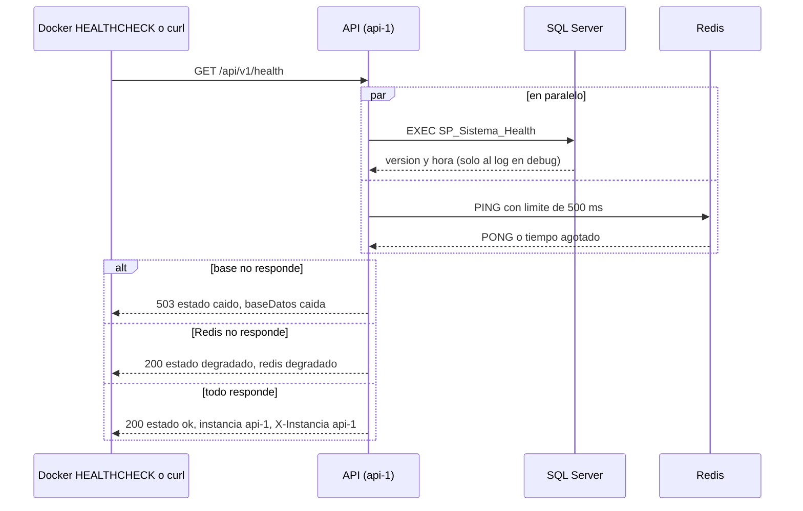

# Módulo sistema

## Qué hace

Infraestructura de la réplica. `GET /api/v1/health` (público, sin token) verifica SQL Server con `SP_Sistema_Health` y Redis con un `PING`, y responde `ok`, `degradado` (sin Redis: se sigue vendiendo) o `caido` (sin base: 503) ([sistema.routes.ts:31](../../../apps/api/src/modules/sistema/sistema.routes.ts#L31 "router.get('/health', controller.health)")). Lo usa el `HEALTHCHECK` de la imagen.
Además: el encabezado `X-Instancia` en cada respuesta para ver qué réplica atendió (RNF-2), el apagado ordenado con `SIGTERM` (`apagado.ts`), `SP_Sistema_EstablecerContexto` para el actor de los triggers (A-18, ver [bitacora.md](bitacora.md)) y la tarea horaria que purga las llaves de idempotencia de más de 24 h.
SPs: `SP_Sistema_Health`, `SP_Sistema_EstablecerContexto`, `SP_Sistema_PurgarSolicitudesIdempotentes` (y los de idempotencia que usa checkout).

## Flujo crítico

El health es el flujo crítico del módulo: es lo que decide si una réplica está sana para Docker y lo que demuestra en vivo RNF-2 (Redis caído no detiene la venta; base caída sí).

## Reglas: dónde vive cada una

| Regla | Dónde vive | Archivo:línea | Decisión |
| --- | --- | --- | --- |
| El health verifica la base con un SP, no con SQL en texto | Repositorio | [sistema.repository.ts:12](../../../apps/api/src/modules/sistema/sistema.repository.ts#L12 "ejecutarSP<FilaHealth>('SP_Sistema_Health')"), [R__SP_Sistema_Health.sql:12](../../../database/programmability/R__SP_Sistema_Health.sql#L12 "SERVERPROPERTY('ProductVersion')") | RNF-4 |
| Base y Redis se consultan en paralelo | Servicio | [sistema.service.ts:49](../../../apps/api/src/modules/sistema/sistema.service.ts#L49 "Promise.all([estadoBaseDatos(), redis.ping()])") | RNF-2 |
| Sin base: `caido` y 503 | Servicio + controlador | [sistema.service.ts:65](../../../apps/api/src/modules/sistema/sistema.service.ts#L65 "if (baseDatos === 'caida') return 'caido';"), [sistema.controller.ts:18](../../../apps/api/src/modules/sistema/sistema.controller.ts#L18 "salud.estado === 'caido'") | RNF-2 |
| Sin Redis: `degradado` con 200 (se sigue vendiendo) | Servicio | [sistema.service.ts:66](../../../apps/api/src/modules/sistema/sistema.service.ts#L66 "if (estadoRedis === 'degradado') return 'degradado';") | RNF-2 |
| El PING a Redis no cuelga el health | Adaptador con límite de 500 ms | [redis.ts:42](../../../apps/api/src/shared/adapters/redis.ts#L42 "Promise.race([cliente.ping(), tiempoAgotado])"), [redis.ts:6](../../../apps/api/src/shared/adapters/redis.ts#L6 "ESPERA_PING_MS = 500") | RNF-2 |
| Público pero sin datos internos (ni versión ni hora del servidor) | Esquema de respuesta; versión y hora solo al log en debug | [sistema.schemas.ts:3](../../../apps/api/src/modules/sistema/sistema.schemas.ts#L3 "Solo estados: el endpoint es público"), [sistema.service.ts:37](../../../apps/api/src/modules/sistema/sistema.service.ts#L37 "logger.debug(") | §10 |
| Solo la llamada a la base cuenta como caída | Servicio (un bug posterior es 500, no `caido`) | [sistema.service.ts:27](../../../apps/api/src/modules/sistema/sistema.service.ts#L27 "Solo la llamada a la base cuenta como") | A-06 |
| Cada respuesta dice qué réplica atendió | Middleware `X-Instancia` con `INSTANCIA_ID` | [instancia.ts:6](../../../apps/api/src/shared/http/instancia.ts#L6 "res.setHeader('X-Instancia', instancia);"), [docker-compose.yml:148](../../../docker-compose.yml#L148 "INSTANCIA_ID: api-1") | RNF-2, A-03 |
| Docker marca la réplica como no sana si el health falla | `HEALTHCHECK` de la imagen | [Dockerfile:34](../../../apps/api/Dockerfile#L34 "wget -q -O /dev/null http://127.0.0.1:3000/api/v1/health") | A-03 |
| nginx saca una réplica que no acepta conexiones | Detección pasiva: errores de conexión o timeout | [nginx.conf:29](../../../infra/nginx/nginx.conf#L29 "server api-1:3000 max_fails=3 fail_timeout=10s;"), [nginx.conf:71](../../../infra/nginx/nginx.conf#L71 "proxy_next_upstream       error timeout;") | A-03 |
| Apagado: deja de aceptar, termina lo en curso y cierra recursos | `registrarApagadoOrdenado` | [apagado.ts:84](../../../apps/api/src/apagado.ts#L84 "proceso.once('SIGTERM', alRecibirSenal);"), [apagado.ts:63](../../../apps/api/src/apagado.ts#L63 "servidor.close(() => {") | RNF-2 |
| Apagado con tiempo máximo de 10 s | Temporizador que fuerza la salida con 1 | [server.ts:36](../../../apps/api/src/server.ts#L36 "ESPERA_APAGADO_MS = 10_000"), [apagado.ts:58](../../../apps/api/src/apagado.ts#L58 "terminar(SALIDA_CON_ERROR);") | RNF-2 |
| Las tareas terminan antes de cerrar el pool | Orden de cierre en `server.ts` | [server.ts:145](../../../apps/api/src/server.ts#L145 ".then(() => pool.close())") | A-04 |
| Redis ausente al arrancar no impide arrancar | Conexión en segundo plano | [server.ts:168](../../../apps/api/src/server.ts#L168 "redis.connect().catch(() => undefined);") | RNF-2 |
| Purga horaria de llaves de idempotencia, una réplica a la vez | Tarea + `sp_getapplock` en el SP | [sistema.tareas.ts:6](../../../apps/api/src/modules/sistema/sistema.tareas.ts#L6 "HORAS_VIGENCIA_LLAVE = 24"), [sistema.repository.ts:25](../../../apps/api/src/modules/sistema/sistema.repository.ts#L25 "return fila.Ejecutada ? fila.SolicitudesPurgadas : null;") | A-04 |

## Concurrencia y réplicas

- **Dos peticiones simultáneas:** el health es de solo lectura y no comparte estado; cada réplica responde por sí misma. Lo único compartido es la purga de idempotencia, que corre en las dos réplicas pero el SP toma un `sp_getapplock`: la que no lo obtiene devuelve `Ejecutada = 0` y el repositorio lo traduce a `null` (tarea omitida).
- **Una réplica muere (o se detiene):** nginx no consulta `/health`; detecta la falla de forma pasiva. Contra una réplica detenida la conexión se cuelga hasta `proxy_connect_timeout 250ms` ([nginx.conf:69](../../../infra/nginx/nginx.conf#L69 "proxy_connect_timeout     250ms;")) y la petición se intenta en la otra (`proxy_next_upstream error timeout`); tras 3 fallas en 10 s la saca de la rotación. Un POST que ya llegó a una réplica no se reintenta en la otra (sin `non_idempotent`). Lo demuestra la prueba de entorno: con `api-1` detenida, todas las peticiones responden 200 desde `api-2`, y al volver nginx la reincorpora ([rnf2.test.ts:40](../../../apps/api/test/entorno/rnf2.test.ts#L40 "peticiones seguidas a través de nginx responden 200 desde api-2")).
- **Apagado ordenado durante una petición:** `SIGTERM` cierra primero los streams del dashboard que no terminan solos, después `servidor.close` deja de aceptar conexiones y espera las peticiones en curso; luego detiene el planificador, las exportaciones y el pool, y Redis ([apagado.test.ts:123](../../../apps/api/test/unit/apagado.test.ts#L123 "con SIGTERM termina las peticiones en curso"), [apagado.test.ts:137](../../../apps/api/test/unit/apagado.test.ts#L137 "durante el apagado ya no acepta conexiones nuevas")). Si algo no termina en 10 s, sale con 1 ([apagado.test.ts:162](../../../apps/api/test/unit/apagado.test.ts#L162 "si una petición no termina a tiempo fuerza la salida con 1")). Lo que queda a medias en la base lo revierte `XACT_ABORT`; lo que necesita retomarse (intentos de pago, exportaciones) usa arrendamientos que vencen y toma la otra réplica.
- **Error no capturado:** se registra como fatal y se apaga ordenadamente con código 1, en lugar de seguir en un estado desconocido ([apagado.test.ts:203](../../../apps/api/test/unit/apagado.test.ts#L203 "un error no capturado se registra como fatal y apaga ordenadamente con 1")).

## Modos de falla

- **Base caída:** health 503 con `estado: caido` y `baseDatos: caida` ([health.api.test.ts:95](../../../apps/api/test/unit/modules/sistema/health.api.test.ts#L95 "con la base y Redis caídos responde 503")); el resto de los endpoints responde 500 `ERROR_INTERNO`.
- **`SP_Sistema_Health` sin filas:** cuenta como base caída ([health.api.test.ts:108](../../../apps/api/test/unit/modules/sistema/health.api.test.ts#L108 "si SP_Sistema_Health no devuelve filas, la base cuenta como caída")).
- **Redis caído o colgado:** health 200 con `redis: degradado` ([health.api.test.ts:86](../../../apps/api/test/unit/modules/sistema/health.api.test.ts#L86 "con Redis detenido responde 200 con redis")). Los comandos fallan rápido: sin cola fuera de línea, un solo intento y 500 ms por comando ([redis.ts:23](../../../apps/api/src/shared/adapters/redis.ts#L23 "enableOfflineQueue: false"), [redis.ts:25](../../../apps/api/src/shared/adapters/redis.ts#L25 "commandTimeout: ESPERA_COMANDO_MS")). La caída se registra una vez al caer y otra al volver ([redis.ts:90](../../../apps/api/src/shared/adapters/redis.ts#L90 "export function registrarCambiosDeEstado")).
- **Error del pool de SQL Server fuera de una petición:** se registra y no tumba la réplica ([server.ts:53](../../../apps/api/src/server.ts#L53 "pool.on('error'")).
- **Una réplica detenida:** la otra atiende todo; `X-Instancia` lo muestra.
- **Ruta inexistente:** 404 `NO_ENCONTRADO` con el mensaje de ruta.

## Alternativas descartadas

- **`deploy.replicas` en Compose** → no habría un nombre por réplica ni `X-Instancia` con el que demostrar el balanceo; se usan `api-1` y `api-2` explícitas con IP fija (A-03).
- **Gateway separado delante de nginx** → un contenedor más sin beneficio (A-03).
- **Resolver las réplicas por el DNS de Docker en tiempo de ejecución** → con un contenedor detenido, el DNS reenvía el nombre al DNS del host, que puede devolver una IP pública; nginx las resuelve una sola vez desde `/etc/hosts` (A-03).
- **Un health que devuelva la versión y la hora de SQL Server** → es público; esos datos van solo al log ([sistema.routes.ts:13](../../../apps/api/src/modules/sistema/sistema.routes.ts#L13 "Pública: la usa el healthcheck de Docker")).
- **Reintentar en la otra réplica cualquier petición fallida** (`non_idempotent`) → un POST de pago podría ejecutarse dos veces; nginx solo reintenta errores de conexión ([nginx.conf:67](../../../infra/nginx/nginx.conf#L67 "un 503 de una réplica viva no se repite")).
- **Matar el proceso al recibir `SIGTERM`** → cortaría peticiones en curso y dejaría tareas a mitad; el apagado espera con un tope.

## Preguntas probables

### ¿Qué devuelve el health si Redis está caído?

200 con `estado: degradado` y `redis: degradado`: Redis solo guarda lo que se puede perder, así que la réplica sigue vendiendo (RNF-2).
**Muéstralo en:** [sistema.service.ts:66](../../../apps/api/src/modules/sistema/sistema.service.ts#L66 "if (estadoRedis === 'degradado') return 'degradado';")

### ¿Y si la base está caída?

503 con `estado: caido`: sin SQL Server la réplica no puede atender nada. Docker la marca como `unhealthy`.
**Muéstralo en:** [sistema.controller.ts:18](../../../apps/api/src/modules/sistema/sistema.controller.ts#L18 "salud.estado === 'caido'")

### ¿El health ejecuta SQL directo?

No: llama a `SP_Sistema_Health` con `ejecutarSP` como cualquier otro repositorio. El único `SELECT 1` es el healthcheck del contenedor de SQL Server en Compose, que es infraestructura.
**Muéstralo en:** [sistema.repository.ts:12](../../../apps/api/src/modules/sistema/sistema.repository.ts#L12 "ejecutarSP<FilaHealth>('SP_Sistema_Health')")

### ¿Por qué es público? ¿No expone información?

Lo consumen el healthcheck de Docker sin token. Solo devuelve estados y el nombre de la réplica; la versión y la hora de SQL Server van al log en debug.
**Muéstralo en:** [health.api.test.ts:56](../../../apps/api/test/unit/modules/sistema/health.api.test.ts#L56 "es pública: no expone la versión ni la hora de SQL Server")

### ¿Cómo demuestras que hay dos réplicas?

Cada respuesta lleva `X-Instancia` con el `INSTANCIA_ID` de la réplica; peticiones repetidas alternan `api-1` y `api-2` por el round-robin de nginx, y el log de nginx también registra la instancia.
**Muéstralo en:** [app.api.test.ts:19](../../../apps/api/test/unit/app.api.test.ts#L19 "X-Instancia identifica la réplica que respondió")

### ¿Qué pasa si detengo `api-1` en plena demo?

nginx no logra conectar en 250 ms, reintenta en `api-2` y, tras 3 fallas, saca a `api-1` por 10 s; todas las peticiones responden 200 desde `api-2`.
**Muéstralo en:** [rnf2.test.ts:40](../../../apps/api/test/entorno/rnf2.test.ts#L40 "peticiones seguidas a través de nginx responden 200 desde api-2")

### ¿nginx usa el `/health` para decidir a quién enviar tráfico?

No: nginx open source hace detección pasiva (errores de conexión y timeouts). El 503 del health lo usa el `HEALTHCHECK` de Docker; nginx no reintenta un 503 de una réplica viva.
**Muéstralo en:** [nginx.conf:71](../../../infra/nginx/nginx.conf#L71 "proxy_next_upstream       error timeout;")

### ¿Un POST de pago se puede duplicar por el reintento de nginx?

No: `proxy_next_upstream` no incluye `non_idempotent`, así que un POST que ya llegó a una réplica nunca se repite en la otra. Además el pago lleva `Idempotency-Key`.
**Muéstralo en:** [nginx.conf:67](../../../infra/nginx/nginx.conf#L67 "Sin non_idempotent")

### ¿Qué pasa con las peticiones en curso al hacer `docker compose stop api-1`?

`SIGTERM` activa el apagado ordenado: no acepta conexiones nuevas, espera las que están en curso, detiene tareas y cierra el pool y Redis; con un tope de 10 s.
**Muéstralo en:** [apagado.ts:66](../../../apps/api/src/apagado.ts#L66 "Promise.allSettled(recursos.map")

### ¿Si Redis no está al arrancar, la API arranca?

Sí: el cliente se conecta en segundo plano y reintenta con espera creciente hasta 2 s; mientras tanto el health dice `degradado`.
**Muéstralo en:** [server.ts:163](../../../apps/api/src/server.ts#L163 "si Redis no está al arrancar, la API arranca igual")

### ¿Un Redis colgado puede bloquear las peticiones?

No: el cliente no encola comandos sin conexión, hace un solo intento y corta cada comando a los 500 ms; el health además corre el `PING` contra un temporizador propio.
**Muéstralo en:** [redis.ts:24](../../../apps/api/src/shared/adapters/redis.ts#L24 "maxRetriesPerRequest: 1")

### ¿Cómo evitas que las dos réplicas ejecuten la misma tarea periódica a la vez?

Cada SP de tarea toma un `sp_getapplock`; la réplica que no lo obtiene no hace nada y lo registra como tarea omitida (A-04). La purga de idempotencia corre también al arrancar.
**Muéstralo en:** [sistema.repository.ts:17](../../../apps/api/src/modules/sistema/sistema.repository.ts#L17 "null si la otra réplica tenía el sp_getapplock")
