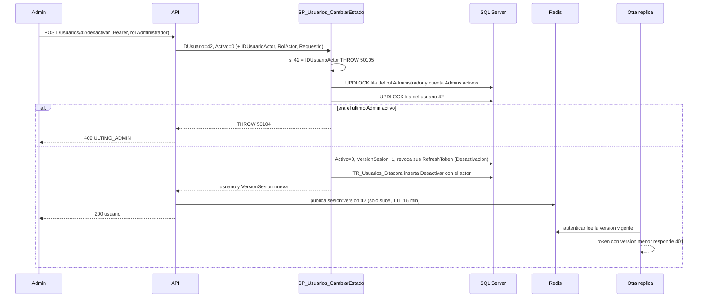

# Módulo usuarios

## Qué hace

Perfil propio y administración de usuarios bajo `/api/v1/usuarios`. Cualquier usuario autenticado: `GET /me`, `PATCH /me` (nombre y teléfono) y `POST /me/contrasena` (cambia la contraseña y renueva la sesión). Solo Administrador: `GET /` (listado paginado con filtro por rol y estado), `POST /` (crea Operadores o Admins), `PATCH /:id` (nombre o rol), `POST /:id/desactivar` y `POST /:id/activar` ([usuarios.routes.ts:131](../../../apps/api/src/modules/usuarios/usuarios.routes.ts#L131 "const cualquierUsuario"), [usuarios.routes.ts:132](../../../apps/api/src/modules/usuarios/usuarios.routes.ts#L132 "autorizar('Administrador')")).
Reglas críticas: un Admin no se desactiva ni cambia su propio rol, el sistema nunca queda sin Admins activos, y desactivar, cambiar el rol o cambiar la contraseña sube `VersionSesion` para cortar los access tokens de inmediato (A-07).
SPs: `SP_Usuarios_ObtenerPerfil`, `SP_Usuarios_ActualizarPerfil`, `SP_Usuarios_CambiarContrasena`, `SP_Usuarios_Listar`, `SP_Usuarios_CrearInterno`, `SP_Usuarios_Actualizar`, `SP_Usuarios_CambiarEstado`; la bitácora la escribe `TR_Usuarios_Bitacora`.

## Flujo crítico

Desactivar a un usuario es el flujo crítico: combina la regla del último Admin (que se rompe con dos peticiones simultáneas), la revocación de sesiones en SQL Server y el corte inmediato del access token en todas las réplicas vía Redis.

## Reglas: dónde vive cada una

| Regla | Dónde vive | Archivo:línea | Decisión |
| --- | --- | --- | --- |
| El perfil sale del token, nunca de un ID del cliente | SP filtra por `@IDUsuarioActor` | [R__SP_Usuarios_ObtenerPerfil.sql:14](../../../database/programmability/R__SP_Usuarios_ObtenerPerfil.sql#L14 "u.IDUsuario = @IDUsuarioActor"), [R__SP_Usuarios_ActualizarPerfil.sql:28](../../../database/programmability/R__SP_Usuarios_ActualizarPerfil.sql#L28 "IDUsuario = @IDUsuarioActor") | RF-01, A-18 |
| El perfil no acepta otros campos (ni `idUsuario` ni `rol`) | Zod `.strict()` | [shared/usuarios.ts:12](../../../packages/shared/src/usuarios.ts#L12 ".strict()") | RF-01 |
| PATCH: la mezcla con lo guardado la hace el SP en el mismo UPDATE | `SP_Usuarios_ActualizarPerfil` | [R__SP_Usuarios_ActualizarPerfil.sql:26](../../../database/programmability/R__SP_Usuarios_ActualizarPerfil.sql#L26 "CASE WHEN @QuitarTelefono = 1 THEN NULL") | A-02 |
| El hash nunca sale del servicio | Servicio arma la respuesta sin él | [usuarios.service.ts:45](../../../apps/api/src/modules/usuarios/usuarios.service.ts#L45 "return { idUsuario, correo, nombre, telefono, rol, activo, fechaCreacion };") | §10 |
| Cambiar la contraseña exige la actual | Servicio (argon2 vive en la API) | [usuarios.service.ts:59](../../../apps/api/src/modules/usuarios/usuarios.service.ts#L59 "verificarContrasena(perfil.hashContrasena, datos.contrasenaActual)") | N-15 |
| Cambio de contraseña: 5 intentos por minuto por usuario | Middleware con contador en Redis | [usuarios.routes.ts:140](../../../apps/api/src/modules/usuarios/usuarios.routes.ts#L140 "limitarIntentos(limitadorContrasena, porUsuario)"), [server.ts:41](../../../apps/api/src/server.ts#L41 "LIMITE_CAMBIO_CONTRASENA") | A-07 |
| Cambio de contraseña: revoca todos los refresh y sube la versión | `SP_Usuarios_CambiarContrasena`, una transacción | [R__SP_Usuarios_CambiarContrasena.sql:32](../../../database/programmability/R__SP_Usuarios_CambiarContrasena.sql#L32 "VersionSesion = VersionSesion + 1"), [R__SP_Usuarios_CambiarContrasena.sql:37](../../../database/programmability/R__SP_Usuarios_CambiarContrasena.sql#L37 "MotivoRevocacion = 'CambioContrasena'") | N-15, A-07 |
| Un inactivo con token vivo no cambia su contraseña | SP | [R__SP_Usuarios_CambiarContrasena.sql:28](../../../database/programmability/R__SP_Usuarios_CambiarContrasena.sql#L28 "THROW 50103") | N-15 |
| El Admin solo crea Operadores y Admins | Zod + SP | [usuarios.ts:48](../../../packages/shared/src/usuarios.ts#L48 "rol: z.enum(ROLES_INTERNOS)"), [R__SP_Usuarios_CrearInterno.sql:19](../../../database/programmability/R__SP_Usuarios_CrearInterno.sql#L19 "IF @Rol NOT IN ('Operador', 'Administrador')") | N-15 |
| Un Admin no se desactiva a sí mismo | SP | [R__SP_Usuarios_CambiarEstado.sql:17](../../../database/programmability/R__SP_Usuarios_CambiarEstado.sql#L17 "IF @Activo = 0 AND @IDUsuario = @IDUsuarioActor") | N-15 |
| Un Admin no cambia su propio rol | SP | [R__SP_Usuarios_Actualizar.sql:50](../../../database/programmability/R__SP_Usuarios_Actualizar.sql#L50 "IF @IDUsuario = @IDUsuarioActor") | N-15 |
| Nunca sin Admins activos (desactivar o quitar el rol) | SP bajo `UPDLOCK` de la fila del rol Administrador | [R__SP_Usuarios_CambiarEstado.sql:48](../../../database/programmability/R__SP_Usuarios_CambiarEstado.sql#L48 "@AdminsActivos <= 1"), [R__SP_Usuarios_Actualizar.sql:54](../../../database/programmability/R__SP_Usuarios_Actualizar.sql#L54 "THROW 50104") | N-15, A-02 |
| Desactivar sube la versión y revoca los refresh | SP, una transacción | [R__SP_Usuarios_CambiarEstado.sql:57](../../../database/programmability/R__SP_Usuarios_CambiarEstado.sql#L57 "CASE WHEN @Activo = 0 THEN 1 ELSE 0 END"), [R__SP_Usuarios_CambiarEstado.sql:63](../../../database/programmability/R__SP_Usuarios_CambiarEstado.sql#L63 "MotivoRevocacion = 'Desactivacion'") | N-15, A-07 |
| Cambiar el rol sube la versión (no revoca refresh: el siguiente refresh trae el rol nuevo) | SP | [R__SP_Usuarios_Actualizar.sql:61](../../../database/programmability/R__SP_Usuarios_Actualizar.sql#L61 "CASE WHEN @IDRolNuevo <> IDRol THEN 1") | A-07 |
| La versión se publica en Redis después del commit | Servicio | [usuarios.service.ts:97](../../../apps/api/src/modules/usuarios/usuarios.service.ts#L97 "if (cambios.rol !== undefined) await versiones.publicar"), [usuarios.service.ts:105](../../../apps/api/src/modules/usuarios/usuarios.service.ts#L105 "await versiones.publicar(idUsuario, versionSesion);") | A-07 |
| Reactivar no baja la versión | SP solo suma al desactivar; el servicio no publica | [usuarios.service.ts:112](../../../apps/api/src/modules/usuarios/usuarios.service.ts#L112 "repositorio.cambiarEstado(idUsuario, true)") | N-15 |
| Activo y fecha de desactivación coherentes | Constraint `CK_Usuario_Desactivacion` | [V002__seguridad.sql:30](../../../database/migrations/V002__seguridad.sql#L30 "CK_Usuario_Desactivacion") | N-15 |
| Bitácora de alta, rol y activación, nunca el hash | Trigger con columnas explícitas | [R__TR_Usuarios_Bitacora.sql:28](../../../database/programmability/R__TR_Usuarios_Bitacora.sql#L28 "SELECT d.Correo, d.Nombre, d.IDRol, d.Activo FOR JSON PATH") | RF-09, A-18 |

## Concurrencia y réplicas

- **Dos Admins que se desactivan entre sí a la vez:** sin bloqueo, cada uno contaría 2 Admins activos y ambos pasarían, dejando 0. `SP_Usuarios_CambiarEstado` y `SP_Usuarios_Actualizar` toman primero el `UPDLOCK` de la fila del rol Administrador ([R__SP_Usuarios_CambiarEstado.sql:31](../../../database/programmability/R__SP_Usuarios_CambiarEstado.sql#L31 "dbo.Rol AS r WITH (UPDLOCK, ROWLOCK)"), [R__SP_Usuarios_Actualizar.sql:31](../../../database/programmability/R__SP_Usuarios_Actualizar.sql#L31 "dbo.Rol AS r WITH (UPDLOCK, ROWLOCK)")) y después la fila objetivo ([R__SP_Usuarios_Actualizar.sql:41](../../../database/programmability/R__SP_Usuarios_Actualizar.sql#L41 "dbo.Usuario AS u WITH (UPDLOCK, ROWLOCK)")): se serializan, uno gana y el otro recibe `ULTIMO_ADMIN` ([ultimo-admin.test.ts:91](../../../apps/api/test/integracion/secuencial/ultimo-admin.test.ts#L91 "A desactiva a B mientras B hace")). Al tomar los bloqueos siempre en el mismo orden, los pares cruzados no se cruzan en un deadlock ([ultimo-admin.test.ts:112](../../../apps/api/test/integracion/secuencial/ultimo-admin.test.ts#L112 "pares cruzados a la vez terminan bien")).
- **Dos PATCH del perfil a la vez** (uno el nombre, otro el teléfono): la mezcla es un `COALESCE` dentro del mismo UPDATE, con la fila bloqueada; ninguno pisa al otro ([usuarios.api.test.ts:137](../../../apps/api/test/integracion/usuarios/usuarios.api.test.ts#L137 "dos PATCH simultáneos, uno del nombre y otro del teléfono")).
- **Entre réplicas:** el corte del token no depende de qué réplica atendió el cambio: la versión vive en Redis y `autenticar` la consulta en cada petición ([usuarios.api.test.ts:478](../../../apps/api/test/integracion/usuarios/usuarios.api.test.ts#L478 "dos réplicas ven la misma versión")). El script de Redis solo sube la versión, así que dos publicaciones desordenadas no la hacen retroceder ([versiones-sesion.test.ts:49](../../../apps/api/test/integracion/adaptadores/versiones-sesion.test.ts#L49 "una publicación con una versión menor no la hace retroceder")).
- **Una réplica muere a mitad:** si muere antes del COMMIT, no cambia nada. Si muere entre el COMMIT y la publicación en Redis, la base ya está bien (refresh revocados, `VersionSesion` subida) y solo queda el access token vivo hasta su vencimiento: como mucho 15 min, el mismo riesgo acotado que con Redis caído (N-15). Nadie lo "recupera": el siguiente login o refresh lee la versión de la base.

## Modos de falla

- **Sin token o token de versión anterior:** 401 `NO_AUTENTICADO`.
- **Cliente u Operador en una ruta de Admin:** 403 `SIN_PERMISO` ([usuarios.api.test.ts:260](../../../apps/api/test/integracion/usuarios/usuarios.api.test.ts#L260 "recibe 403 en cada ruta Admin que escribe")).
- **Usuario inexistente en `PATCH /:id` o desactivar:** 404 `NO_ENCONTRADO` (THROW 50001).
- **Desactivarse o cambiarse el rol a sí mismo:** 409 `ACCION_SOBRE_SI_MISMO` (50105) ([catalogo.ts:55](../../../apps/api/src/shared/errors/catalogo.ts#L55 "ACCION_SOBRE_SI_MISMO")).
- **Dejar el sistema sin Admins:** 409 `ULTIMO_ADMIN` (50104) ([catalogo.ts:60](../../../apps/api/src/shared/errors/catalogo.ts#L60 "ULTIMO_ADMIN")).
- **Contraseña actual incorrecta:** 400 `PARAMETRO_INVALIDO` y no cambia nada ([usuarios.service.ts:61](../../../apps/api/src/modules/usuarios/usuarios.service.ts#L61 "throw new AppError('PARAMETRO_INVALIDO'")).
- **Usuario inactivo con token todavía vivo que cambia su contraseña:** 401 `USUARIO_INACTIVO` (50103).
- **Correo repetido al crear un interno:** 409 `CORREO_EN_USO` (50101).
- **Asignar el rol `Sistema`:** 400 por Zod ([casos-borde.api.test.ts:81](../../../apps/api/test/integracion/usuarios/casos-borde.api.test.ts#L81 "no permite asignar el rol Sistema")).
- **Redis caído al publicar la versión:** no lanza; queda un `warn` con el usuario y su access token anterior sirve hasta que venza ([versiones-sesion-redis.ts:60](../../../apps/api/src/shared/adapters/versiones-sesion-redis.ts#L60 "su access token anterior vence en 15 min")).

## Alternativas descartadas

- **Lista negra de JWT por `jti`** → habría que guardar cada token emitido; la versión por usuario es un solo número y cubre desactivación, rol y contraseña (A-07).
- **Contar Admins solo en el servicio** → dos peticiones simultáneas pasan las dos la validación; la regla vive en el SP bajo bloqueo (A-02).
- **Bloquear solo la fila del usuario objetivo** → dos Admins que se desactivan entre sí bloquean filas distintas y ambos ven 2 Admins activos; por eso se bloquea la fila del rol Administrador primero (comentario en [R__SP_Usuarios_CambiarEstado.sql:23](../../../database/programmability/R__SP_Usuarios_CambiarEstado.sql#L23 "Toda operación que puede reducir los Admins activos")).
- **Borrar usuarios** → RF-01 pide desactivar sin borrar, y las filas ledger que los referencian nunca se borran (M-01).
- **Registrar en la bitácora cada cambio del usuario** → el trigger registra solo alta, rol y activación, para no exponer el hash ni llenar la bitácora con cambios de `VersionSesion` ([R__TR_Usuarios_Bitacora.sql:37](../../../database/programmability/R__TR_Usuarios_Bitacora.sql#L37 "EXCEPT SELECT d.IDRol, d.Activo")).

## Preguntas probables

### ¿Cómo garantizas que nunca se queda el sistema sin Administradores?

En el SP, bajo el `UPDLOCK` de la fila del rol Administrador: cuenta los Admins activos y si el objetivo es el último lanza 50104. La prueba lanza dos desactivaciones cruzadas a la vez.
**Muéstralo en:** [R__SP_Usuarios_CambiarEstado.sql:49](../../../database/programmability/R__SP_Usuarios_CambiarEstado.sql#L49 "THROW 50104")

### ¿Por qué no basta con validar eso en el servicio?

Porque dos peticiones en dos réplicas leen el mismo conteo antes de que la otra escriba. Solo un bloqueo dentro de la transacción lo serializa (A-02).
**Muéstralo en:** [ultimo-admin.test.ts:91](../../../apps/api/test/integracion/secuencial/ultimo-admin.test.ts#L91 "A desactiva a B mientras B hace")

### ¿Por qué el SP bloquea la fila de `Rol` y no la tabla `Usuario`?

Es un candado barato y común a toda operación que puede reducir los Admins activos, tomado siempre antes que la fila objetivo: serializa esas operaciones sin bloquear lecturas ni al resto de usuarios, y el orden fijo evita deadlocks.
**Muéstralo en:** [R__SP_Usuarios_Actualizar.sql:25](../../../database/programmability/R__SP_Usuarios_Actualizar.sql#L25 "Fila del rol Administrador bloqueada ANTES que la fila objetivo")

### ¿Un Admin puede desactivarse a sí mismo o quitarse el rol?

No: 409 `ACCION_SOBRE_SI_MISMO`. El SP compara con `@IDUsuarioActor`, que sale del token vía `ejecutarSP`, no del cuerpo.
**Muéstralo en:** [usuarios.api.test.ts:355](../../../apps/api/test/integracion/usuarios/usuarios.api.test.ts#L355 "un Admin no puede desactivarse a sí mismo")

### Si desactivo a un usuario, ¿cuándo pierde el acceso?

De inmediato: su refresh queda revocado en la misma transacción y su access token tiene una versión menor que la publicada en Redis.
**Muéstralo en:** [usuarios.api.test.ts:380](../../../apps/api/test/integracion/usuarios/usuarios.api.test.ts#L380 "desactivar revoca los refresh tokens y el access token deja de servir de inmediato")

### ¿Y si le quito el rol de Admin a alguien que tiene la sesión abierta?

Su versión sube y su token anterior deja de servir; no se revoca su refresh, así que el siguiente refresh le emite un token con el rol nuevo leído de la base.
**Muéstralo en:** [usuarios.api.test.ts:447](../../../apps/api/test/integracion/usuarios/usuarios.api.test.ts#L447 "un Admin al que le quitan el rol pierde los permisos de inmediato") y [usuarios.api.test.ts:461](../../../apps/api/test/integracion/usuarios/usuarios.api.test.ts#L461 "cambiar el rol rechaza al instante el access token anterior, pero no revoca el refresh")

### Si reactivo al usuario, ¿su token viejo vuelve a servir?

No. Reactivar no baja `VersionSesion`; el usuario debe iniciar sesión de nuevo.
**Muéstralo en:** [usuarios.api.test.ts:413](../../../apps/api/test/integracion/usuarios/usuarios.api.test.ts#L413 "activar devuelve el acceso con un login nuevo")

### ¿Qué pasa con las otras sesiones al cambiar la contraseña?

El SP revoca todos los refresh del usuario y sube la versión; la API publica la versión y abre una sesión nueva para este dispositivo con la versión nueva. Las demás quedan fuera.
**Muéstralo en:** [usuarios.service.ts:73](../../../apps/api/src/modules/usuarios/usuarios.service.ts#L73 "sesiones.abrir({ idUsuario, correo, nombre, rol, versionSesion }, cliente)")

### ¿Un cliente puede leer o editar el perfil de otro cambiando un ID?

No hay ID que cambiar: `/me` no recibe ninguno, el SP usa `@IDUsuarioActor` y el cuerpo es `.strict()`.
**Muéstralo en:** [usuarios.api.test.ts:97](../../../apps/api/test/integracion/usuarios/usuarios.api.test.ts#L97 "cada uno ve y edita solo su perfil")

### ¿Puede el Admin crear un Cliente o asignar el rol Sistema?

No: el alta interna solo acepta Operador o Administrador (Zod y SP) y `Sistema` no es un rol de usuario ni existe en `CK_Rol_Codigo`.
**Muéstralo en:** [usuarios.api.test.ts:339](../../../apps/api/test/integracion/usuarios/usuarios.api.test.ts#L339 "el Admin crea un Operador; no puede crear un Cliente")

### ¿Qué impide adivinar la contraseña actual con un token robado?

El cambio exige la contraseña actual y está limitado a 5 intentos por minuto por usuario (contador en Redis, compartido entre réplicas).
**Muéstralo en:** [usuarios.api.test.ts:535](../../../apps/api/test/integracion/usuarios/usuarios.api.test.ts#L535 "el sexto intento en un minuto responde 429")

### ¿La bitácora guarda el hash de la contraseña?

No. El trigger lista las columnas explícitamente (correo, nombre, rol, activo) y solo registra alta, rol y activación.
**Muéstralo en:** [usuarios.api.test.ts:399](../../../apps/api/test/integracion/usuarios/usuarios.api.test.ts#L399 "la bitácora registra la desactivación sin el hash")

### ¿El listado de usuarios pagina en memoria?

No: el SP pagina con `OFFSET ... FETCH` y devuelve el total del filtro en un segundo conjunto.
**Muéstralo en:** [R__SP_Usuarios_Listar.sql:45](../../../database/programmability/R__SP_Usuarios_Listar.sql#L45 "OFFSET (@Pagina - 1) * @Tamano ROWS")
